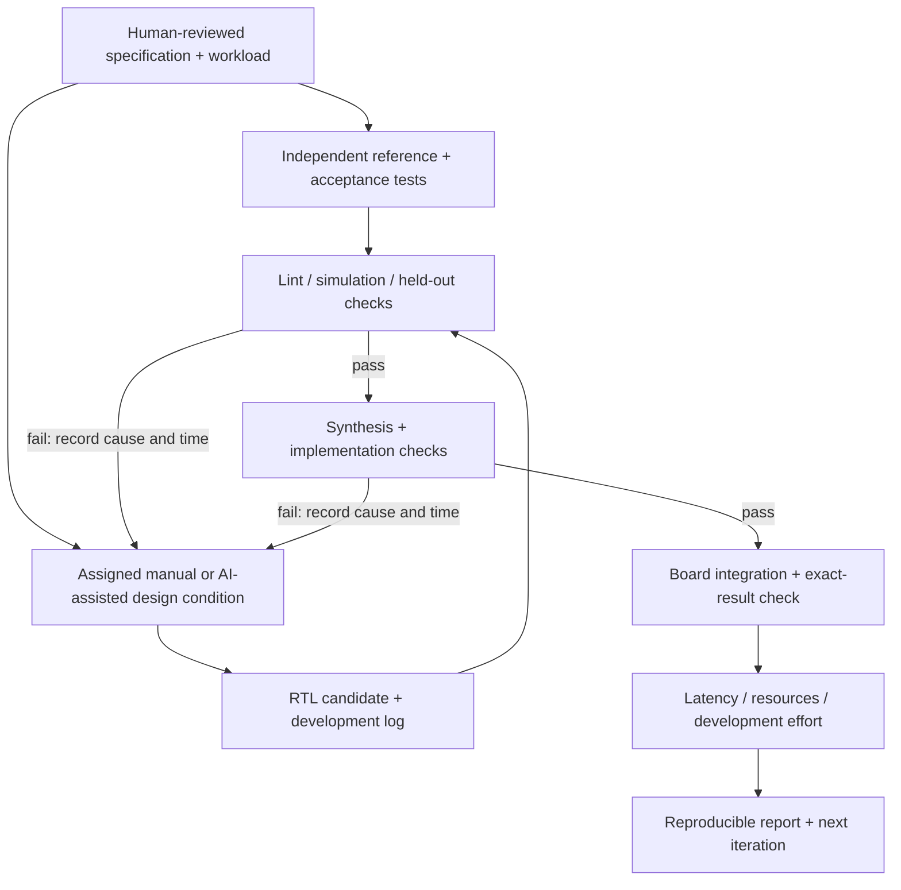

# Risks, verification, and measuring AI's impact

This document supports the [semester schedule](SEMESTER_SCHEDULE.md). The semester research question is: **under a fixed specification and acceptance process, how does AI assistance affect the effort and quality of accelerator development?**

The estimates and risk priorities below are engineering judgments for this team, not measured probabilities. No hardware tests were run while preparing these planning documents.

## The flow we are documenting

For short controlled trials, board integration can be a later shared stage: compare candidates through the same declared simulation/synthesis gate first, then separately record deployment effort. A trial may end at its time limit anywhere in this flow. The record must show that endpoint instead of treating an unfinished candidate as a successful design.

## 1. Roadblocks to address early

| Risk | First visible symptom | Why it happens | Early mitigation | Owner / decision point |
|---|---|---|---|---|
| Goal expands beyond weekly capacity | Lots of code, no working release | Full ResNet, AI research, and a new array become simultaneous projects | Protect one deployed kernel and one controlled comparison; use explicit stretch goals | G / week 1 |
| Unusable tool/board combination | Cannot generate or load a simple design | Image, board support, tool versions, metadata, or host resources mismatch | Inventory and reproduce one known-good example before custom CNN integration | D / weeks 1-2 |
| Incorrect baseline weights/preprocessing | Accuracy wrong even on CPU | Different checkpoint, normalization, channel order, or model variant | Hash model/input files and reproduce CPU evaluation first | A / weeks 1-3 |
| Ambiguous arithmetic | RTL and Python disagree at edge values | Signedness, overflow, negative rounding, or saturation unspecified | Write a mathematical integer contract and directed extrema tests | A/B/E / week 2 |
| Quantization reduces accuracy too far | Hardware matches integer model, but predictions degrade | Poor activation ranges, outliers, inconsistent residual scales | Calibrate separately from testing; inspect per-layer error; use more bits where justified | A / before extending hardware |
| DMA never completes | Notebook waits forever | Missing/incorrect TLAST, transfer length, clocks, reset, address, or backpressure | Loopback, byte counters, timeouts, and status capture before ML | C/D/E / week 4 |
| Buffer incoherence | Stale or intermittently incorrect results | CPU and DMA do not see the same latest memory contents | Use hardware-accessible buffers and verify synchronization behavior | D / first hardware result |
| Memory inference fails | Huge LUT/register usage or failed implementation | Resetting large arrays, unsupported access patterns, too many read ports | Synthesize buffers early and inspect inferred primitive types | B/C / week 4 |
| Slow despite many multipliers | DSPs idle while waiting for data | Insufficient memory bandwidth/ports or repeated weights/patch packing | Add stall/cycle counters; measure traffic; improve reuse before lane count | C/D / after correct hardware |
| FPGA timing failure | Synthesis passes but implementation has negative slack | Long combinational paths, fanout, congestion, or poor pipelining | Modest initial clock, early placement/routing, pipeline critical paths | B/G / every hardware build |
| Simulation is prohibitively slow | Full-network tests take days | Billions of cycle-level operations | Verify small units and representative tiles; use hardware for larger runs | E / before full-network tests |
| ResNet residual corruption | First block works; later output diverges | Shortcut overwritten or scales/shapes differ | Tensor liveness table and explicit residual-add contract | A/C/E / later ResNet phase |
| Wrong ResNet variant | Layer shapes look similar but outputs differ | Stride placement/checkpoint/preprocessing not frozen | Pin exact constructor/library revision/weights and exported graph | A / software ResNet inventory |
| Unavailable labeled evaluation data | Demo images exist but no accuracy result | Dataset access/storage assumed | Resolve access early; distinguish a sample demo from an accuracy study | A/G / week 2 |
| Invalid AI comparison | AI appears faster only on easier tasks | Different tasks, experience, hidden help, or unequal tool access | Matched tasks, counterbalancing, equal budgets, full logs | F / before trials |
| AI code and tests share a bug | Both agree on the same wrong result | Same assumption copied into implementation and oracle | Independently derive reference and held-out tests | E / every trial |
| Team integration bottleneck | Seven branches cannot be connected | Interfaces change without coordination | One contract owner, small reviews, weekly runnable release | G / every week |
| Unreproducible “works on my machine” result | Another teammate cannot run it | Manual GUI state, missing paths/versions, untracked files | Tcl builds, manifests, clean-checkout rehearsal | D/G / weeks 8 and 11 |

The standard PYNQ DMA driver specifically depends on correct receive packet termination; its [DMA guide](https://pynq.readthedocs.io/en/latest/pynq_libraries/dma.html) is a useful reference during transport debugging. It does not replace tests of our own stream endpoints.

## 2. Separate three kinds of correctness

### A. Model quality

Does the floating-point model classify the intended data well? Does the chosen quantized model preserve enough of that quality?

Record float accuracy, quantized accuracy, and their difference in percentage points. A proposed starting target is no more than 0.5 percentage-point MNIST loss and 1 percentage-point ResNet top-1 loss, but these are team acceptance proposals, not guarantees. Confirm the criterion with the instructor after initial calibration results.

Use calibration examples from training or a separately designated calibration split. Do not tune repeatedly on the held-out final evaluation set. Report dataset identity, number of examples, preprocessing, and exclusions.

### B. Implementation correctness

Does RTL produce the same integer outputs as the agreed software reference? The acceptance target for a deterministic integer kernel is exact equality, including saturation and rounding.

A network can classify the right digit despite numerous wrong intermediate values. Correct top-1 labels alone do not validate RTL arithmetic. Conversely, an exact RTL match to a poor quantized reference is a hardware success and a model-quality failure; fix the right problem.

### C. System correctness

Does the host load, configure, transfer, execute, and receive results reliably across multiple jobs? Does it fail with an actionable timeout rather than silently reuse old outputs? Do post-route timing and resource checks support the configured operating point?

These require integration and board tests. A passing C++ simulation from the abandoned HLS flow does not establish any of them for new RTL.

## 3. Verification ladder

| Level | Tests | Evidence to retain |
|---|---|---|
| Arithmetic primitive | Zero/extreme operands, negative values, accumulations near bounds, rounding ties, saturation limits | Inputs, expected outputs, first mismatch, seed |
| Matrix tile | Tiny hand-computable matrices; rectangular and partial tiles; random cases; segmented K | Exact full output arrays, not just checksums |
| Buffer/controller | Every legal dimension; invalid commands; reset/abort; back-to-back jobs; stalled input/output | Assertions, transaction counts, selected waveforms |
| Layer | Real checkpoint weights and representative input feature maps, including boundaries | Layer name, shape, numeric format, compared element count |
| Block | Residual identity/projection, shape changes, scale mismatch cases | Main/shortcut/add outputs and buffer-lifetime trace |
| Model | Multiple images, all supported operators, final scores and intermediate checkpoints | Float/quantized/hardware results with manifest |
| Board | Repeat transfers/jobs, reload/restart, long run, timing checks | Bitstream hash, versions, failures, measured timings |

Useful invariants include: no transfer count advances without a handshake; no output changes while valid is asserted and ready is deasserted; no read of an unwritten partial sum; no buffer overwrite while another unit owns it; and exactly one final packet boundary per expected output transaction.

When diagnosing a mismatch, find the first wrong tensor and then the first wrong coordinate. Trace that coordinate's products and address sequence. Looking only at the final class turns a local arithmetic bug into an apparently mysterious network failure.

### ResNet-specific checks for the later phase

- Confirm folded floating-point Conv/BN pairs agree with the original evaluation model before quantization.
- Do not apply ReLU after the last main-branch convolution before residual addition if the chosen graph does not do so.
- Preserve the shortcut until both branches are ready and reconcile their integer scales.
- Verify downsampling stride and padding at every stage transition.
- Implement global average pooling's division and rounding explicitly.
- Ensure final scores have a common interpretation before argmax. Raw integers with different per-class scales cannot be compared directly.
- Validate normalization, RGB order, crop/resize, and class-index mapping against the pinned pretrained weights.

## 4. A feasible experiment on AI assistance

### The question must be narrow enough to answer

Recommended primary question:

> For a bounded RTL kernel with the same specification and acceptance tests, does AI assistance reduce active human time to a verified implementation, and what happens to defect rate and implementation quality?

Secondary questions: Does it help more with first drafts or debugging? Which failure classes recur? How much human review is needed? Does faster authoring produce more integration work later?

Do not initially compare complete independently designed ResNet accelerators. Different architectures, scopes, and experience would overwhelm the effect being studied.

### Two proposed conditions

| Condition | Allowed | Excluded during the measured attempt |
|---|---|---|
| Manual baseline | Same specification, approved reference documentation, normal editor, simulator/synthesis tools, shared infrastructure | Generative-AI code/debug suggestions and copied solutions from another trial |
| AI-assisted | Everything in baseline plus the named AI tool and documented interactions | Undocumented outside solutions or a changed acceptance standard |

Heavy AI use can still be normal outside the short baseline trials. The manual condition exists to estimate a comparison, not to forbid AI across the project. If the instructor prefers comparing two AI workflows instead, label that question explicitly; two AI conditions do not estimate AI versus no-AI.

Pin or record model identifier, date, tool version, context/files supplied, system/task instructions where available, and relevant settings. Hosted services can change; preserved transcripts are important even when a model identifier is available.

### A small counterbalanced study

1. Prepare matched, similarly difficult task variants: for example signed dot-product engines with comparable dimensions/handshake complexity, and requantization variants with comparable corner cases.
2. Give all designers the same familiarity exercise first; exclude it from results.
3. Designer 1 does variant A manually then variant B with AI. Designer 2 does A with AI then B manually, or use balanced equivalent variants with assignments chosen before starting.
4. Use fresh variants in a second campaign and swap conditions/order where possible.
5. Keep final acceptance tests held out. Supply development examples equally to both conditions.
6. Apply equal active-time limits, proposed initially as three hours per attempt. Track tool-wait time separately.
7. Keep incomplete attempts as incomplete. Record time-to-timeout and passed gates; do not pretend their completion time equals the cap or delete them from averages.

The goal is roughly four recorded attempts in the first campaign and four in the second if capacity permits. That is a small pilot study, not enough to make sweeping claims about all developers or all AI tools. Different tasks, learning, unequal experience, and prior exposure remain limitations even after counterbalancing.

Do not let participants view the other condition's finished solution before completing their assigned attempt. After trial measurement ends, solutions can be reviewed and repaired openly for the deployed artifact; log that repair/integration time separately.

### What to measure

| Metric | Why it matters |
|---|---|
| Active human minutes to first accepted result | Measures assistance with actual work, including reading, prompting, debugging, and review |
| Elapsed wall time and tool-wait time | Captures practical turnaround without confusing machine waits with labor |
| Acceptance gates passed | Distinguishes syntax-only success from verified hardware |
| First-pass and final correctness | Shows whether repairs were needed |
| Failure categories and repair minutes | Makes failure modes and hidden costs visible |
| Simulation/synthesis/implementation iterations | Indicates trial-and-error burden |
| LUT/FF/BRAM/URAM/DSP usage | Checks whether quick code creates expensive hardware |
| Achieved timing and latency/cycles | Checks functional designs against physical constraints |
| Reproducibility success by another teammate | Tests whether the design flow can be transferred |
| Tokens/cost if available | Optional resource use, not a substitute for correctness |

Use identical devices, tool settings, constraints, and acceptance criteria for hardware comparisons. Report post-route results when available and label synthesis estimates explicitly. Compile time on different machines is not a clean AI comparison.

The companion [AI_EXPERIMENT_LOG_TEMPLATE.csv](AI_EXPERIMENT_LOG_TEMPLATE.csv) supplies a header-only recording format. Keep one row per attempt, with detailed logs referenced by path. Use a participant code rather than conflating the person's identity with the assistance condition.

### Interpreting the results honestly

Report individual paired outcomes before aggregates. A result such as “AI shortened drafting but required additional review for signed arithmetic” is useful. So is “AI did not help on this task.” Avoid lines-of-code and number-of-prompts as success metrics.

Do not claim a general percentage improvement from a few nonrandom, confounded tasks. Use wording such as “in these eight attempts under these conditions.” Distinguish verified completions from incomplete trials when describing time differences.

## 5. How to use AI productively in day-to-day development

Give AI a small contract: ports, widths, clock/reset behavior, arithmetic semantics, legal dimensions, timing/handshake rules, and acceptance examples. Ask it to explain state and data ownership before producing RTL. Inspect the result and run independent tests.

Good uses include generating repetitive test fixtures, explaining a waveform, reviewing a narrow arithmetic path, suggesting assertions, drafting build scripts, and identifying likely causes from a synthesis report. Ask for one bounded change at a time so failures remain attributable.

Risky uses include accepting an entire unreviewed accelerator, asking the same interaction to invent both the implementation and its only oracle, assuming compiling RTL is synthesizable, or trusting claimed resource/FPS estimates without tool reports.

AI cannot decide whether two tensors use compatible scales by intuition. It needs the exact export metadata. It cannot know a board clock is stable or a DMA transfer finished without actual evidence. Keep human ownership of the specification, acceptance criteria, and final claims.

## 6. Performance measurement without misleading ourselves

Record these separately:

1. Model/checkpoint load time, usually excluded from steady-state inference but reported for cold start.
2. Image preprocessing and tile packing on the CPU.
3. Transfer and command overhead.
4. Hardware compute cycles and stall cycles.
5. Output conversion and prediction selection.
6. End-to-end latency and throughput over the declared batch/workload.

Use a board ARM CPU baseline for a platform-local speedup claim. A desktop CPU or GPU baseline is a separate comparison with its hardware and software stated. Warm up both paths, use the same model/precision assumptions where possible, and explain unavoidable differences.

For a first design, measure batch size 1 and a distribution of request latencies, not just one lucky run. Report the number of samples and repetitions. If transfers overlap compute, avoid double-counting overlap when reconciling component times with total time.

Board power, accelerator dynamic power, and Vivado power estimates are different quantities. Only report power numbers with the measurement method and boundary identified; otherwise leave energy efficiency out of the claim.

## 7. Release checklist

- [ ] Explicit statement of what runs on CPU versus custom RTL.
- [ ] Checkpoint/export/input hashes and data preprocessing recipe.
- [ ] Numeric and interface specification versions.
- [ ] Independent test results, including corner cases and unsuccessful attempts.
- [ ] Tool versions, target part/board configuration, clock constraints, implementation reports.
- [ ] Matching bitstream/metadata and source commit.
- [ ] Host script with bounded waits and actionable errors.
- [ ] Raw measurement records and AI trial logs.
- [ ] Runbook successfully followed by a second teammate.
- [ ] Clear labels for implemented, simulated, estimated, and future work.

The checklist is the evidence package for the flow study. It is not a requirement to perfect a production accelerator before demonstrating a useful student design.
