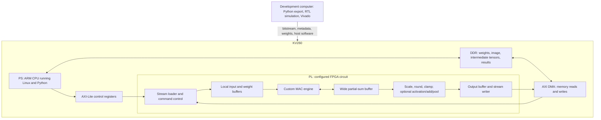

# Proposed RTL architecture and data movement

This is a design proposal, not implemented hardware. The semester goal is a reproducible AI-assisted design flow with a bounded deployed accelerator; full MNIST, ResNet-50, and a TPU-like array are successive extensions. Read the [beginner guide](ML_AND_KV260_EXPLAINED.md) first.

## 1. Where the computation happens

The CPU runs the host program. The programmable logic runs the arithmetic circuit. Both use the board's DDR through the processing system's memory infrastructure. We do not need PCIe or a second computer to transfer each image between the CPU and FPGA.



The DMA and control infrastructure are also implemented partly in PL; the diagram separates their responsibilities from the custom computation rather than representing exact chip boundaries. Vivado connects these blocks to suitable PS AXI ports, clocks, and resets.

For the first experiment, replace the MAC engine with a loopback or simple arithmetic block. That tests the transport independently of ML.

## 2. The actual FPGA resource mapping

| RTL behavior | Expected physical resources | What can go wrong |
|---|---|---|
| Signed multiply/accumulate | DSP slices and pipeline registers; mapping depends on coding and widths | Accidental LUT multipliers, long feedback path, incorrect sign extension |
| Large buffers | BRAM or UltraRAM | Incorrect coding prevents memory inference; port demand exceeds available ports |
| Small FIFO/control state | Registers, LUTs, possibly BRAM | Unbounded queues, off-by-one counters, incorrect full/empty logic |
| Address generation | Adders, counters, comparators | Wrong stride, tensor order, or edge-tile address |
| ReLU/max pool | Comparators and selection logic | Signed comparisons or padding semantics wrong |
| Integer scaling | Multipliers/shifters plus rounding/saturation | Intermediate width truncation |
| AXI/DMA | Vendor infrastructure IP plus our stream endpoints | Protocol stall or invalid memory range |

AMD's K26 reference resource table lists 117,120 LUTs and 1,248 DSP slices. That is the device capacity, not a budget entirely available to our engine. Leave space for the platform, memories, debug probes, and routing. [AMD K26 resource table](https://xilinx.github.io/kria-apps-docs/kv260/2022.1/build/html/docs/aibox-reid/docs/hw_arch_accel_aib.html)

Do not equate “1,248 DSPs” to a guaranteed number of INT8 MACs per cycle. Mapping, packing, accumulator design, clock rate, and data supply must be measured in synthesis and implementation.

## 3. Three interfaces, three jobs

**AXI-Lite** carries small control operations: mode, dimensions, start, status, errors, and counters. It is appropriate for a few register writes, not hundreds of thousands of weights.

**AXI memory-mapped transactions** access DDR addresses. Let standard DMA IP perform them initially; writing a custom burst master adds another verification project.

**AXI-Stream** carries a sequence of data beats between DMA and our block. It has no memory address on each beat; the endpoint interprets the sequence according to the agreed command and layout.

In our protocol specification, a beat transfers only when `TVALID && TREADY`. If the receiver pauses, the sender must preserve the pending data and sidebands. Our counters advance on accepted transfers, not elapsed clock cycles. A 64-bit data beat can pack eight 8-bit values; low byte first is a proposed convention to document and test. `TKEEP` identifies valid bytes and `TLAST` identifies the final beat of a transfer.

PYNQ's standard DMA class supports simple mode, and receive completion depends on correct output `TLAST`. Transfer-length limits must match the DMA configuration. [PYNQ DMA documentation](https://pynq.readthedocs.io/en/latest/pynq_libraries/dma.html) AMD separately documents the [simple DMA mode](https://docs.amd.com/r/en-US/pg021_axi_dma/Direct-Register-Mode-Simple-DMA).

## 4. What PYNQ provides, and what remains ours

PYNQ can load an overlay using a bitstream and matching hardware metadata, discover IP, and expose software drivers. The `.hwh` describes hardware; it contains neither model weights nor the RTL implementation. Board/image-specific configuration must still be compatible. [PYNQ overlay design](https://pynq.readthedocs.io/en/latest/overlay_design_methodology/overlay_design.html)

`pynq.allocate` provides buffers accessible by the hardware and exposes device addresses. Ordinary NumPy virtual addresses are not a substitute. For noncoherent buffers, software must ensure CPU writes become visible to hardware and hardware writes become visible to CPU; use the installed driver's supported synchronization behavior. [PYNQ buffer documentation](https://pynq.readthedocs.io/en/latest/pynq_libraries/allocate.html)

We still build and verify the register map, stream endpoints, numeric formats, load/execute/read sequence, and errors/timeouts. PYNQ does not determine our tensor layout or automatically invoke a convolution just because the checkpoint is on the SD card.

## 5. First reusable architecture: a tiled dot-product engine

Start with a small engine that computes a tile of matrix multiplication:

```text
C[M, N] = A[M, K] * B[K, N]
C[m, n] = sum over k of A[m, k] * B[k, n]
```

Here a tile means a piece small enough for local buffers. For a convolution, M can represent output pixel positions, N output channels, and K all input-channel/filter-position combinations.

Example proposed tile: `M=16, N=16, K=64`, signed 8-bit operands, 32-bit partial sums.

| Local data | Size |
|---|---:|
| A input tile | 16 x 64 = 1,024 bytes |
| B weight tile | 64 x 16 = 1,024 bytes |
| C partial sums | 16 x 16 x 4 = 1,024 bytes |
| Second A/B banks, if added later | 2,048 more bytes |

These small totals illustrate capacity, not a finished BRAM estimate. Delivering many values per cycle requires banked memories and suitable widths; a small memory with two ports cannot magically feed 64 independent reads per cycle.

Begin with one or a few MAC lanes and a reference schedule. Parameterize dimensions and lane count, but implement only the configurations we test. A fully generic accelerator compiler is outside the semester scope.

## 6. A complete job, from Python to a result

One workable first command protocol is deliberately sequential:

1. Python checks hardware ID/version and idle status, then writes dimensions and numeric-mode registers.
2. `LOAD_W`: DMA sends a weight tile. The loader stores it and validates the expected byte count.
3. `LOAD_X`: DMA sends an activation tile. The loader stores it similarly.
4. `EXEC`: the engine computes into local partial sums. Flags distinguish initializing a new sum from continuing an existing sum.
5. If K is larger than the supported local tile, repeat the loads and execution for another K segment. Preserve partial sums between segments.
6. Only after the FINAL segment, add the bias at the specified point, scale/round/clamp, and optionally apply activation. Bias must be added exactly once.
7. Arm the DMA receive channel, then issue `READ_Y`. Our writer streams the output with the specified length and final `TLAST`.
8. Wait with a timeout, synchronize buffers as appropriate, and compare with the software reference.

Use explicit command states and completion rules. A “weight load complete” event is not an “inference complete” event. Reset must abort/clear a job in a defined way.

This design is slower than a deeply overlapped engine, but each failure can be isolated. Reusing a weight tile across many input tiles is an early improvement. Later, double buffering overlaps transfer with computation; it requires bank-ownership rules and only works if compute and transfer resources can run concurrently.

### Proposed control fields, not assigned physical addresses

| Register/field | Purpose |
|---|---|
| ID and version | Verify that software matches the loaded design |
| Command | LOAD_W, LOAD_X, EXEC, READ_Y, RESET |
| Status/error | Idle, busy, done, malformed command/length/shape |
| M/N/K and valid extents | Describe actual tile dimensions, including edges |
| Flags | Initialize/accumulate/final; bias/ReLU enable |
| Expected byte counts | Validate packets; all lengths explicitly in bytes |
| Numeric format identifier | Prevent incompatible weight/export versions |
| Cycle/stall counters | Measure compute and time waiting for data |

Define register offsets, write semantics, reset values, and behavior of writes while busy in a versioned specification before implementing them. Freeze the initial map before independent work begins.

## 7. Turning image convolution into that computation

For each output position, collect the input values under the filter into a vector. A dot product of that vector with a filter gives one output value. Collecting many positions makes matrix A; arranging filters makes B.

Two implementation stages are useful:

- **Semester baseline:** CPU packs small input tiles in the correct order. FPGA performs the dot products. This is a valid custom arithmetic accelerator, but packing time and its memory traffic count in total latency.
- **Later extension:** RTL address/window generation produces tiles from feature maps, avoiding expensive CPU packing and unnecessary duplication. This helps the TPU-like architecture become a system rather than an isolated multiplier array.

Do not create one giant expanded image matrix by default. For a 56 x 56 feature map with 64 channels and a 3 x 3 stride-1 convolution, materializing every patch contains `56 * 56 * 64 * 9 = 1,806,336` values versus `200,704` in the original feature tensor. Tiling limits temporary storage, although overlap may still cause repeated reads.

Partial acceleration does not require replacing the whole model. Execute the preceding layers in software, transfer a precisely defined tensor to our kernel, return its result, and continue. Document the numerical format at each boundary and include conversions in timing.

## 8. A specific MNIST convolution example

The second convolution reads `32 x 14 x 14` activations and produces `64 x 14 x 14` activations. Each output value sums 288 products: 32 channels x 3 x 3 positions.

For one output tile:

1. Select a group of output spatial positions and output channels.
2. Pack the corresponding input patches, inserting correctly represented zero at padded edges.
3. Load that group's weight values.
4. Iterate over all 288 contributions, possibly in multiple K segments.
5. Keep wide partial sums until all contributions are included.
6. Add each output channel's bias, apply the agreed scaling/rounding and ReLU, and write results.
7. Repeat until the layer's tensor is complete.

The hardware does not need 3.6 million physical multipliers for this layer. It reuses a smaller set for 3.6 million operations over time. Correct scheduling and data reuse determine how efficiently those units operate.

## 9. Where ResNet's data lives

| Data | Proposed default location | Reason |
|---|---|---|
| Full model weights | DDR | Roughly 25 MB at one byte per weight is larger than local memory |
| Current weight/input tiles | BRAM/UltraRAM | Reuse them at computation speed |
| Partial sums | Local wide buffers where possible | Avoid rounding early and repeated DDR read-modify-write |
| Completed intermediate tensors | DDR initially | Simple lifetime management and easy debugging |
| Shortcut tensor | Reserved DDR allocation until residual add finishes | Main branch must not overwrite it |
| Biases/scales/descriptors | DDR, staged locally as needed | Much smaller metadata, but still required for correctness |

For `Y = ReLU(F(X) + X)`, hold X while producing F(X), then read both branches into an add/requantization path. For a projection shortcut, compute `P(X)` into a separate live allocation. Only release a buffer when every consumer has finished reading it. Use an explicit liveness table; two alternating buffers are not sufficient for every residual schedule.

For the first stage, even one `256 x 56 x 56` INT8 shortcut is 784 KiB. Its INT32 counterpart would be 3,136 KiB, already larger than the theoretical combined BRAM/URAM capacity in the beginner guide. This motivates tiles and carefully chosen representations.

Pool padding also requires attention. Convolution zero padding means real zero. Max-pool padding usually behaves like negative infinity, not zero for arbitrary signed tensors. Match the reference operator rather than reusing one padding rule blindly.

## 10. What speed can we reasonably expect?

The following is a dimensional estimate, not a benchmark. Suppose a design sustains P MACs per cycle at 150 MHz. Ignoring all stalls and non-MAC operations:

```text
ideal_compute_seconds = MAC_count / (P * clock_frequency)
```

For the 4.089-billion-MAC ResNet-50 count in the beginner guide:

| P | Ideal compute time per image |
|---:|---:|
| 16 | 1.704 seconds |
| 64 | 426 milliseconds |
| 128 | 213 milliseconds |
| 256 | 106 milliseconds |

Real time also includes transfer, loading, pooling, residuals, padding work, pipeline startup, imperfect lane occupancy, CPU packing, and software launch overhead. Even the assumed clock must pass implementation timing.

As another estimate, streaming 25.5 MB of weights once at a measured effective 1 GB/s would take about 25.5 ms. That bandwidth is an example, not a KV260 guarantee. Reloading a weight tile for every pixel can multiply that traffic dramatically.

For a sequential design, compute and transfer times mostly add. With proven overlap, a lower-bound model approaches the larger of compute time and transfer time, plus overhead. Measure effective bandwidth and hardware utilization before increasing the multiplier count.

## 11. How this becomes a TPU-like architecture later

A TPU-like student design can mean a small systolic matrix-multiply array, software-managed buffers, integer arithmetic, and commands for loading tiles and executing them. Google's TPU paper is a useful architectural reference; its ASIC scale and performance are not targets that transfer directly to this FPGA. [Original TPU architecture paper](https://arxiv.org/abs/1704.04760)

In a systolic array, each processing element repeatedly multiplies incoming operands, accumulates a result, and passes operands to neighbors. Regular movement allows values to be reused instead of fetched separately for every multiply.

A later prototype might begin with a 4 x 4 or 8 x 8 array. These are illustrative choices, not resource commitments. The controller must account for wavefront arrival, pipeline fill/drain, incomplete edge tiles, and the lifetime of partial sums. Peak array size does not guarantee useful throughput on a mismatched tile.

The semester's arithmetic contract, reference model, DMA shell, experiment logs, and tests should survive this change. Replace the simple compute engine behind the same external contract and compare area, cycles, bandwidth, and development effort. This is why a small carefully specified accelerator is a useful step toward the later architecture.

## 12. Artifacts to produce in implementation, in dependency order

1. Tensor/numeric specification and reference vectors.
2. Register/packet specification and loopback design.
3. Verified scalar MAC/tile engine and controller.
4. Working board shell and Python driver with timeouts.
5. Integrated kernel demonstration and measured results.
6. Layer packing/scheduling and, if time permits, full MNIST.
7. Residual/operator extensions and larger-memory tests.
8. A later systolic engine and full ResNet mapping.

Keep Vivado project-generation Tcl, source constraints, RTL, driver, and export scripts under version control. Archive build versions and hashes beside the bitstream. The resulting flow should be executable by another teammate from a clean checkout, not dependent on one person's GUI state.
