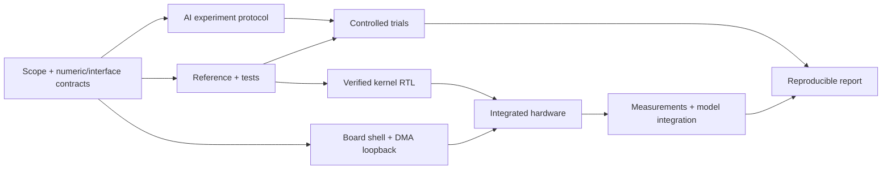

# Semester schedule: seven people, limited weekly time

Updated for the team's clarification on September 24, 2026: this semester is about documenting and evaluating an AI-assisted accelerator-design flow. A later phase aims to build a TPU-like architecture. Full custom ResNet-50 remains an extension, not the minimum semester commitment.

## 1. Assumptions and a realistic commitment

Known: seven people, year-long class, limited time, custom RTL rather than HLS, KV260 target, and interest in AI's effect on accelerator development.

Unknown: exact weekly availability, final presentation date, individual RTL/Linux experience, access to labeled ImageNet data, board image, installed Vivado version, and final grading requirements.

The dated example uses **September 28-December 20, 2026**, with a **placeholder December 18 demonstration**. These are planning dates, not a verified university calendar. If the real deadline is earlier, shorten scope instead of silently moving all integration work into the last week.

| Available effort | 12-week team capacity | Recommended commitment |
|---|---:|---|
| Seven people x 3 hours/week | 252 person-hours | One tightly scoped RTL kernel, board proof if platform is available, and a small documented AI comparison |
| Seven people x 5 hours/week | 420 person-hours | Reproducible flow, deployed kernel, controlled AI trials, and MNIST application integration; full-MNIST RTL is stretch |
| Seven people x 7 hours/week | 588 person-hours | Same research deliverables plus stronger MNIST coverage or one ResNet block; full ResNet still has major integration risk |

Do not count seven people as seven interchangeable engineers. A board problem can block multiple people; a memory-interface decision may require one person to finish before others continue. Pairing helps learning and reviews but two people in a one-hour session consume two person-hours.

### The minimum successful semester package

1. One versioned specification with explicit numeric and interface behavior.
2. A software reference and independent automated tests.
3. Custom RTL that passes simulation and implementation checks.
4. A KV260 hardware demonstration of a useful kernel, with honest CPU/FPGA boundaries.
5. A reproducible build/run procedure tested by someone other than its author.
6. A small controlled comparison of AI assistance, including failures and human repair time.
7. A report explaining measured results, limitations, and the path to the later architecture.

That package directly answers the class goal. A larger network that only works on one laptop with unrecorded AI interactions does not.

## 2. Seven roles with concrete ownership

Use roles, not seven unrelated mini-projects. Assign actual names in the first meeting. Everyone should understand the end-to-end path and rotate at least one review responsibility.

| Role | Primary responsibility | Deliverables | Review/backup partner |
|---|---|---|---|
| A: Model and numeric reference | Understand MNIST, export weights, define quantization, collect ResNet operator requirements | Reference scripts, vectors, numeric manifest, accuracy results | E |
| B: Arithmetic RTL | MAC/dot-product engine, scaling/rounding, pipelining | RTL with cycle/width specification and unit results | C |
| C: Memory and sequencing | Tile buffers, counters, layout, load/compute/output control | Buffer contract, controller RTL, address tests | B |
| D: Board and host integration | KV260 image/tool inventory, Vivado shell, DMA, Python driver | Rebuildable board design, loopback, working host script | G |
| E: Verification | Independent oracle checks, held-out tests, stalls/reset tests, regressions | Test suite, failure reports, acceptance-gate evidence | A |
| F: AI experiment | Experimental protocol, prompts/logs, timing, comparative analysis | Trial records, paired results, limitations | G |
| G: Integration and reproducibility | Interface ownership, weekly release, clean rebuild, report integration | Runnable release, issue dependencies, build manifests | D |

G is a technical integration role, not just “write slides.” F designs and executes a research experiment, not just “ask ChatGPT.” A and E must coordinate while keeping final verification independent of the generated RTL implementation.

### A five-hour personal week

- 30 minutes: shared meeting, only interfaces/blockers/gate status. Across seven people this costs 3.5 team-hours.
- 2 hours: one uninterrupted build/design/analysis session.
- 1 hour: testing or reviewing another person's artifact.
- 30 minutes: evidence, commit, next-step handoff.
- 1 hour: contingency or integration help.

The baseline planned week is four hours per person, including the meeting, with one hour uncommitted. This is why scope must be small. A full-time professional estimate cannot be applied to a team with mostly one-hour work windows.

## 3. Capacity allocation and dependencies

The plan has **310 scheduled person-hours and 110 hours of reserve**, totaling 420. Reserve absorbs build failures, unfamiliar tools, exams, and underestimated tasks; it is not preallocated to a second accelerator.

| Week | Dates | Planned hours | Reserve within 35-hour capacity | Required result |
|---|---|---:|---:|---|
| 1 | Sep 28-Oct 4 | 28 | 7 | Scope, baseline, role assignments, tool inventory |
| 2 | Oct 5-11 | 28 | 7 | Frozen tiny-kernel contract and board access proof |
| 3 | Oct 12-18 | 28 | 7 | Golden arithmetic tests and baseline kernel simulation |
| 4 | Oct 19-25 | 28 | 7 | DMA loopback and first synthesis-backed kernel |
| 5 | Oct 26-Nov 1 | 28 | 7 | First controlled AI/manual trial campaign |
| 6 | Nov 2-8 | 28 | 7 | Real arithmetic kernel running on KV260 |
| 7 | Nov 9-15 | 28 | 7 | Model-level use of the kernel, correctness evidence |
| 8 | Nov 16-22 | 28 | 7 | Repeat trials and a reproducible design-flow release |
| 9 | Nov 23-29 | 16 | 19 | Report draft, evidence audit, no new critical features |
| 10 | Nov 30-Dec 6 | 28 | 7 | Optional bounded ResNet extension OR close remaining defects |
| 11 | Dec 7-13 | 24 | 11 | Clean rebuild, measured results, design freeze |
| 12 | Dec 14-20 | 18 | 17 | Rehearsed demonstration and final reproducibility package |
| Total | | 310 | 110 | |

The lower planned load in weeks 9 and 12 anticipates possible holidays/exams and must be checked against your actual calendar. Reserve in an earlier week cannot literally compensate for a person unavailable in a later week; manage capacity weekly.

The memory/control contract is deliberately early: independent RTL work is only parallel once interfaces are agreed. The experiment protocol is also early: you cannot reconstruct unbiased time logs after the final design works.

## 4. Detailed weekly work

For weeks 1-8 and 10, each role has a four-hour planned budget including its share of coordination/review. Tasks below are a weekly target, not an instruction to exceed that budget silently. If a task does not fit, consume explicitly recorded reserve or reduce scope.

### Week 1: agree on the question before building hardware

- **A:** Reproduce the existing CPU MNIST inference if the environment supports it; record checkpoint hash, preprocessing, shapes, and prior versus newly measured accuracy. If setup consumes the budget, export a tiny deterministic dot-product reference first.
- **B:** Work through signed multiplication/accumulation and inspect available RTL/simulation tools. Sketch a single-lane MAC datapath; no large array yet.
- **C:** Draw one tile's complete life from load to result. Calculate required widths and buffer capacity for a tiny case.
- **D:** Inventory board boot image, network/serial access, PYNQ version, host tools, licenses/device support, and one proven board example. Preserve a known-working boot setup.
- **E:** Define acceptance categories: arithmetic equality, protocol behavior, synthesis, timing, hardware result, reproducibility.
- **F:** Write the research question and a first trial-record template. Identify the exact AI products/models available; do not assume a particular paid tool is accessible.
- **G:** Assign names and backups, confirm the real deadline and weekly hours, set repository/issue conventions, and identify the minimum demo with the instructor.

**Gate:** a one-page signed-off scope, a clear minimum deliverable, a tool/board inventory, and a tiny reference input/output pair. Do not require a trained ResNet to pass this gate.

**Why this week exists:** a large fraction of schedule risk comes from missing tools and an ambiguous definition of “AI improves design,” not multiplier code.

### Week 2: freeze a small contract

- **A:** Define signed operand width, accumulator bound, rounding, saturation, tensor order, and weight-file layout. Begin MNIST calibration in software, but keep the first kernel's inputs deterministic.
- **B:** Specify scalar dot-product latency/handshake behavior. Create a small implementation or familiarization exercise excluded from the controlled trials.
- **C:** Specify legal M/N/K sizes, segment accumulation, packet lengths, reset behavior, and edge tiles.
- **D:** Load a known board-compatible design and demonstrate a register read/write or simple loopback. Begin a reproducible Vivado Tcl flow.
- **E:** Write tests directly from the contract: zeros, ones, alternating signs, extrema, smallest/largest supported dimensions.
- **F:** Freeze AI/manual conditions, time limits, task variants, and logging fields. Pick tasks that fit a three-hour attempt.
- **G:** Review all interfaces together; publish specification version 0.1 and require changes to update both model and tests.

**Gate:** another person can determine expected output bytes without asking the RTL author. Board access is demonstrated. If board access is blocked, instructor/lab support is contacted early while simulation proceeds.

**Why:** quantization and data order are contracts between teammates. Debugging incompatible assumptions after integration costs much more than agreeing now.

### Week 3: establish trustworthy arithmetic

- **A:** Build the integer software reference for the selected kernel. Compare a simple float MNIST layer with exported values; record quantization error separately from RTL error.
- **B:** Implement the baseline small kernel and run directed arithmetic tests. Check signedness and accumulator feedback timing.
- **C:** Implement a minimal buffer/controller or a standalone simulated tile loader. Avoid advanced overlap.
- **D:** Complete DMA configuration in the block design and simulate or build loopback. Resolve address widths, clocks, and resets.
- **E:** Add randomized inputs, held-out seeds, and first-mismatch reporting. Keep Python arithmetic wider than RTL until explicitly applying the specified limits.
- **F:** Pilot the logging process on an unrelated toy task; exclude pilot results from the comparison. Verify that repair time and failed attempts are recorded.
- **G:** Run the simulation flow from a second machine/environment where practical; publish dependency versions and known failures.

**Gate:** the arithmetic kernel matches the independent reference over the agreed test set; tests demonstrate that injected sign/rounding bugs are caught.

**Why:** a passing test that uses the same erroneous indexing as the RTL proves little. Establish the oracle before the experiment.

### Week 4: prove transport and synthesis before increasing scale

- **A:** Finalize the kernel export and a small real-model tensor fixture. Finish the initial MNIST quantization feasibility measurement if time permits.
- **B:** Synthesize the small compute design. Inspect inferred multipliers, memory use, warnings, and critical paths.
- **C:** Add backpressure and partial-tile tests to the control logic; repair transfer-count issues.
- **D:** Run repeated DMA loopback on KV260, including several lengths and reload/reset behavior. Save the successful bitstream and metadata together.
- **E:** Verify no lost/duplicated bytes under randomized stalls. Add timeouts to regression and host checks.
- **F:** Finalize matched tasks and the predeclared scoring table after pilot feedback. Hold final tests separately from participants' development tests.
- **G:** Merge the kernel/shell interfaces and publish the week-four gate report, even if it says a gate failed.

**Gate:** reliable board loopback plus synthesis evidence for the selected kernel. A small debug fixture fits and has a plausible timing path.

**If missed:** use weeks 5-6 reserve to fix transport or narrow the kernel. Drop full-MNIST hardware as a commitment. Controlled simulation/synthesis experiments can still proceed.

**Why:** this is the earliest practical point to know whether “our RTL works” also means “our hardware can be built and connected.”

### Week 5: first controlled experiment

This week temporarily reallocates work: four designers can use three hours each for four attempts, E/F together use about eight hours to verify and curate results, and the remaining eight planned hours cover board integration, review, and coordination. Actual person availability limits pairing; do not assign two full jobs to one role.

- **A/B/C/D as available:** run assigned matched tasks under the frozen AI/manual conditions, or serve as designers in a counterbalanced two-person crossover if fewer qualified designers are ready.
- **E:** apply held-out tests and independently inspect failures; do not change the acceptance threshold to favor an approach.
- **F:** collect wall time, active human minutes, AI interactions, tool runs, failed cases, and human repairs. Preserve the initial and repaired versions.
- **G:** ensure the trial branches do not disrupt the working integration branch; select a verified implementation for the demo based on evidence.

Suggested tasks are small: a signed dot product with clear ready/valid semantics, and a bounded requantization unit. Large convolution engines are too open-ended for a first controlled trial.

**Gate:** four fully recorded attempts or an explicitly documented smaller sample, including timeouts/failures. Each result has the same acceptance evidence.

**Why:** the class goal is a flow study. Protect time for the experiment instead of spending the entire semester on the demo datapath.

### Week 6: a real hardware arithmetic result

- **A:** Prepare a few small model-derived inputs and expected integer outputs with a manifest.
- **B:** Integrate the verified arithmetic path; resolve pipeline or synthesis-specific behavior.
- **C:** Connect load/execute/read states and verify accumulator reset between jobs.
- **D:** Run the arithmetic kernel on KV260, initially with tiny vectors. Save timeouts/error status rather than hanging indefinitely.
- **E:** Compare hardware outputs exactly with the integer reference; test repeated jobs with different data.
- **F:** Analyze first campaign failure categories without overclaiming statistical significance.
- **G:** Package a tagged, repeatable “first hardware result” release with instructions and recorded evidence.

**Gate:** custom arithmetic on the board, exact output equality, repeatability, and a recoverable failure path.

**If missed:** all expansion stops. The minimum deliverable becomes this kernel and its design-flow evidence. Do not start ResNet operators while the first hardware output is untrusted.

**Why:** one correct integrated result retires more system risk than several unintegrated RTL modules.

### Week 7: connect the kernel to an ML application

- **A:** Choose one MNIST layer boundary and implement packing/dequantization as required by the mixed CPU/FPGA path. Validate all-CPU quantized behavior first.
- **B:** Extend only the dimensions/features required by that layer. A tiled dense layer may be simpler initially than a convolution window generator.
- **C:** Handle K segmentation and edge tiles; preserve wide partial sums until the final segment.
- **D:** Add a host loop over tiles and record packing, DMA, compute, and total time separately.
- **E:** Compare layer tensors before looking at final digit accuracy. Exercise more than one image and class.
- **F:** Document how much new work was needed after the initial AI-generated module; integration cost belongs in the flow analysis.
- **G:** Produce the application demo and label exactly which arithmetic is on FPGA. Decide whether full MNIST is achievable using remaining reserve.

**Gate:** a useful model-derived layer/kernel produces correct hardware results, and the application can consume them. A fallback is replayed real-model tensors if full live integration exceeds the budget; disclose it as a kernel demonstration.

**Why:** a stand-alone dot product is useful, but this step tests whether the interface is actually suitable for neural-network data.

### Week 8: replicate the experiment and make the flow transferable

- **A:** Export software ResNet layer shapes and representative tile fixtures; no full-network hardware dependency.
- **B/C:** Run new matched trial variants with swapped assistance conditions, preserving the deployed design branch.
- **D:** Measure transfer overhead and repeated hardware execution; improve stability, not speculative peak throughput.
- **E:** Run the same acceptance procedure on all campaign-two outputs and check coverage gaps.
- **F:** Combine both campaigns, report individual paired outcomes and confounders, and include failed attempts in the denominator.
- **G:** Ask a teammate who did not build the shell to follow the complete runbook. Record every missing step as a defect.

Use reserve or borrow from optional application extensions if the repeated trial campaign needs more than the nominal role budgets. Do not add a third AI platform unless the first two conditions already have usable evidence.

**Gate:** repeat trial records and a demonstrated handoff. Minimum semester deliverables should now exist in draft form.

**Why:** one successful AI prompt is an anecdote. Replication and another person's clean run make the result much stronger.

### Week 9: evidence and report consolidation

Planned hours by role: A2, B2, C2, D2, E3, F3, G2 = 16.

- A-D document numerical assumptions, RTL architecture, memory flow, and board procedure from the artifacts already built.
- E audits acceptance claims against saved logs and identifies unsupported assertions.
- F writes the AI-impact results and threats to validity, including learning/order effects.
- G assembles the report, verifies links, and schedules the final demo/review requirements.

**Gate:** a complete rough report with real tables, figures, and explicit missing measurements.

**Why:** writing exposes missing evidence while time remains to collect it. Lower workload also protects against calendar conflicts.

### Week 10: choose one extension, only if the core gates passed

Options, in preferred order according to the actual evidence:

1. Fix reproducibility/correctness gaps.
2. Complete the existing MNIST hardware path if close.
3. Run a representative ResNet 1 x 1 tile through the same arithmetic engine and compare with the reference.
4. Simulate a tiny 2 x 2 or 4 x 4 systolic array as a feasibility study for the next phase.

- **A:** provide the chosen extension's reference tensors and data-volume estimate.
- **B/C:** implement only the selected bounded feature.
- **D:** reuse the existing shell; avoid a simultaneous platform migration.
- **E:** verify the extension without weakening the baseline regression.
- **F:** connect the additional effort/defects to lessons from the experiment, but do not mix unplanned exploratory work into controlled-trial statistics.
- **G:** cap extension effort at this week and protect the release branch.

**Gate:** a clearly labeled extension result or a decision to keep the proven design. Full ResNet inference is not required here.

**Why:** a small ResNet-shaped test can reveal future bandwidth/layout issues without risking the semester deliverable.

### Week 11: freeze and reproduce

Planned hours by role: A3, B3, C3, D3, E4, F4, G4 = 24.

- A verifies weight/input manifests and numerical comparisons.
- B/C close correctness issues and inspect implementation timing/resource reports.
- D rebuilds/reloads from the documented toolchain and runs repeated hardware jobs.
- E performs the release regression, including reset, stalls, edge dimensions, and long repeatability checks appropriate to the design.
- F finalizes development-effort, correctness, and hardware-quality comparisons with raw records attached.
- G freezes RTL/interfaces, records commit/tool/bitstream hashes, and rehearses a clean demonstration.

**Gate:** no unexplained correctness mismatch, no unacknowledged timing failure, and a reproducible report tied to a specific build. If hardware remains blocked, disclose that and show simulation/synthesis evidence rather than claiming deployment.

**Why:** a week of predictable verification is more valuable than a last-minute architecture upgrade.

### Week 12: demonstrate and hand off

Planned hours by role: A2, B2, C2, D3, E3, F3, G3 = 18.

- A-C prepare concise explanations of one numerical example, one RTL transaction, and one memory-flow example.
- D prepares the known-working board setup and a recorded backup demonstration.
- E checks the exact release used for the presentation.
- F explains what the data does and does not say about AI.
- G runs the final rehearsal, archives artifacts, and writes the next-phase entry checklist.

**Gate:** another teammate can explain and run the design; the report distinguishes implemented, simulated, estimated, and future work.

**Why:** understanding and a reusable flow are the semester's product. The live demo is evidence, not the whole project.

## 5. When to stop adding scope

| Checkpoint | Evidence required | If it is absent |
|---|---|---|
| End week 2 | Clear arithmetic/interface contract | Stop independent RTL expansion; resolve contract |
| End week 4 | Loopback and synthesis-backed kernel | Drop full-MNIST promise; fix shell and small kernel |
| End week 6 | Exact custom arithmetic on hardware | Freeze new operators and focus on hardware correctness |
| End week 8 | Repeat experiment and reproducible flow | Spend remaining time on evidence/report; no ResNet extension |
| End week 10 | Stable core release | No architectural changes; fix defects only |

If the FPGA design is correct but slower than the CPU, that is still an interpretable research result. Diagnose packing, transfer, and utilization rather than changing benchmark definitions to manufacture a speedup.

## 6. Next phase: a TPU-like architecture

Exact dates are intentionally unspecified: the team described a later TPU phase, but its calendar has not been confirmed. The following is a 16-week planning template, assuming the semester shell/reference/tests survive and the same approximate 35-hour team capacity. It offers about 560 hours before absences; full ResNet remains contingent on measured progress.

| Relative weeks | Objective | Why this order |
|---|---|---|
| 1-2 | Audit the previous release; choose workloads, tile sizes, numerical formats, and resource budget | A systolic array must serve an explicit workload |
| 3-4 | Verify one processing element and a small systolic array | Prove operand timing, fill/drain, and accumulation before scaling |
| 5-6 | Add banked scratchpads and tile sequencing; verify GEMM on hardware | Data supply determines whether the array is useful |
| 7-8 | Map dense and 1 x 1 layers, then 3 x 3 windows | Separate matrix arithmetic from convolution address generation |
| 9-10 | Support stem, pooling, scale conversions, and residual/projection paths | Complete the operator set before attempting the whole graph |
| 11-12 | Run full MNIST and at least one real ResNet bottleneck/projection block | Establish correctness on both simple and branching graphs |
| 13-14 | Attempt complete fixed ResNet-50; verify intermediate tensors and memory lifetimes | Integration follows verified operators |
| 15-16 | Measure, fix, and document; retain block-level fallback if needed | Protect final delivery and a defensible evaluation |

This is an aggressive extension, not a commitment to full ResNet at 30 FPS. If the earlier phase only reaches simulation, carry the missing integration work into this budget and remove later scope. Do not borrow time from unconfirmed future availability.

## 7. Weekly questions that keep the team honest

1. What artifact can someone else execute today?
2. Which acceptance test failed, and who owns the next experiment?
3. Did we consume reserve? If so, which optional feature was displaced?
4. Are our AI logs and build versions complete enough to reproduce the claim?
5. Does the next task advance the semester research question or only make the demo larger?
