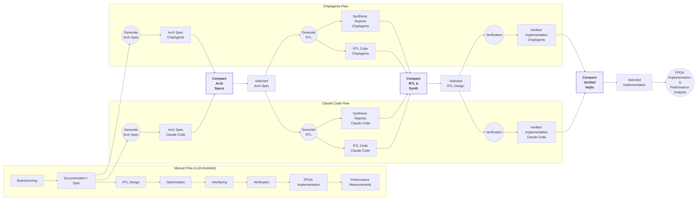

# AI in Hardware Design — Design Flow Comparison

## Purpose

This project evaluates how effective AI is in hardware design by comparing three design flows on the same target:

1. **Manual (LLM-assisted)**: the engineer drives each stage, using an LLM as an assistant.
2. **Claude Code**
3. **ChipAgents**

The Claude Code and ChipAgents flows both take the manual flow's documentation/spec as their input, and the two flows run side by side so they can be compared stage by stage.

## Design Flow Diagram

**Legend (Claude Code and ChipAgents flows)**

| Shape | Meaning |
|---|---|
| Circle | Process |
| Rectangle | Input / output artifact |
| Square | Comparison |

## Flow Descriptions

### Manual Flow (LLM-Assisted)

The manual flow is the baseline. Its goal is to show that the hardware accelerator design can be implemented on the FPGA with reasonable functional accuracy, performance, and resource utilization.

Engineers drive every stage of this flow, using AI in the form of LLMs plus partial use of various coding agents. The design is refined through hands-on learning and repeated iteration, so this flow is expected to take the longest of the three.

Setting a baseline for functional expectations here makes the Claude Code and ChipAgents evaluations easier to run and more informative to interpret.

### Claude Code Flow

This flow uses the Claude Code coding agent to generate three main artifacts:

1. An architectural spec
2. RTL design code
3. Verification outputs

It builds on the manual flow in two ways. The coding agent has complete context of the project files, and it runs on more sophisticated models than the ones used in the manual flow.

A custom skill suite for hardware accelerator design also supplements this flow. The skills give the agent design-specific guidance it would not otherwise have, so it is better equipped for accelerator work.

### ChipAgents Flow

This flow uses the agentic tool for custom hardware design from ChipAgents.ai. The tool includes functionality built specifically for hardware design and verification.

Each of these features will be evaluated for how effective it is, and the results will be compared against the manual and Claude Code flows. The goal is to measure how much benefit a dedicated hardware design tool like this adds to the hardware design process.
