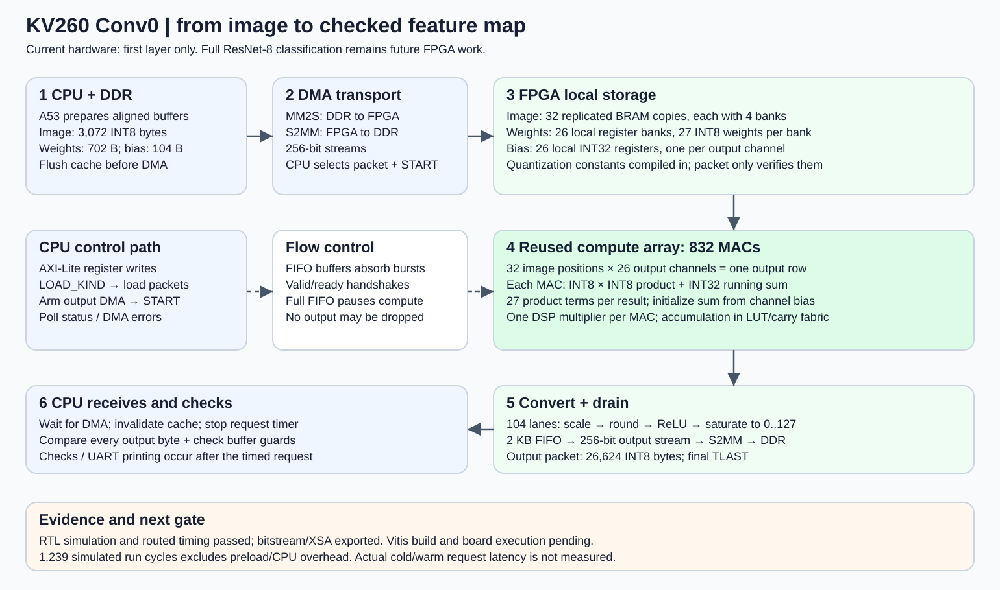
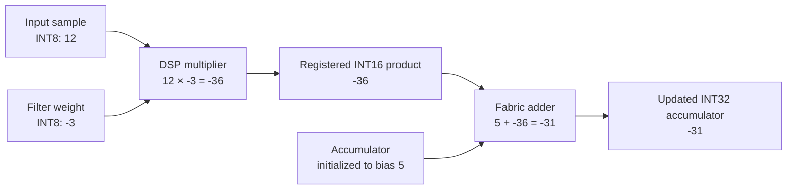
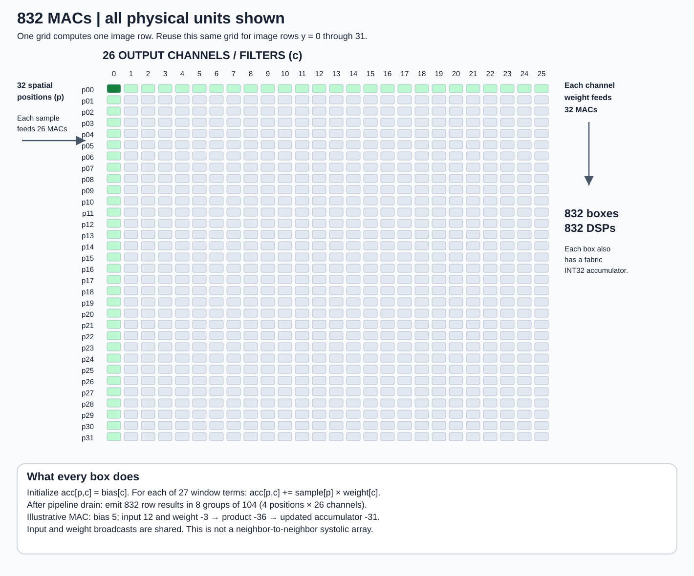
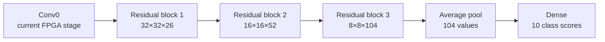

# ResNet-8 architecture: from image to FPGA result

**We have implemented the first layer of ResNet-8: an INT8 Conv0 accelerator with 832 MAC units.** It takes a 32×32 RGB image and returns 26 feature channels. The full network runs in software; later layers are future FPGA work. Simulation and routed timing passed; board correctness and end-to-end latency still need measurement.

## The complete system at a glance



[Open the system diagram at full size](diagrams/conv0_system.svg). The SVG is a standalone vector image suitable for slides or browser viewing. Solid arrows carry data; dashed arrows summarize control/flow-control relationships rather than individual signal wiring.

The CPU prepares the request in DDR memory. DMA transports data to local FPGA storage. The FPGA computes Conv0, converts its results to INT8, and streams them back. The CPU checks the returned feature map against the saved reference. No weights are trained or updated during this computation.

## How a 3-channel image becomes 26 feature channels

We use **26 learned filters**, each spanning **3 rows × 3 columns × all 3 input channels**. A filter contains 27 weights and produces one output channel. It is reused at every image position.

```text
At one output position, for ONE filter:

  3×3 red neighborhood   × 9 red weights   ┐
  3×3 green neighborhood × 9 green weights ├─ sum all 27 products + bias
  3×3 blue neighborhood  × 9 blue weights  ┘
                                           ↓
                              one output-channel value

Repeat for 26 different filters → 26 values at that position.
Repeat over 32×32 positions    → 32×32×26 feature map.
```

The multiplication is element-by-element followed by summation. It is 27 products per filter/output position, not nine products total for RGB. At image edges, zero padding supplies missing inputs so output resolution remains 32×32.

| Quantity | Calculation | Result |
|---|---|---:|
| Input values | 32×32×3 | 3,072 INT8 bytes |
| Learned weights | 26×3×3×3 | 702 INT8 bytes |
| Bias values | 26×4 bytes | 104 bytes |
| Output values | 32×32×26 | 26,624 INT8 bytes |
| MAC terms, including padding | 32×32×26×27 | 718,848 |

BatchNorm is folded into the exported weights and biases. The hardware then performs output scaling, rounding, ReLU and saturation. It is computing the complete Conv0 inference stage, not only its raw products.

## Inside one MAC

**MAC = multiply-accumulate.** Each physical MAC accepts an INT8 activation and INT8 weight, produces a signed 16-bit product, and adds that product into a signed 32-bit running sum. The sum starts at that channel's bias.



This is an illustrative arithmetic example, not a value measured from the pretrained fixture. The multiply and accumulation are pipelined; the diagram does not claim they complete in one clock from input arrival. The controller aligns enables with the registered product. Repeat for 27 terms, then the final accumulator is ready for output conversion.

As a separate illustrative conversion, an accumulator of 40, multiplier 1 and right shift 1 represent scaling by one half: output 20 after rounding/ReLU. A negative final result becomes zero; a scaled positive result above 127 saturates to 127. Real constants vary by channel and are fixed in `conv0_quant_pkg.sv`. Scaling uses a signed INT64 product and nearest rounding with ties away from zero. INT32 accumulator overflow wraps; exported trained parameters have separately checked safe bounds.

## All 832 MAC units and their shared operands



[Open the complete MAC array at full size](diagrams/mac_array_832.svg). Every small box is one physical MAC; all 832 are shown. This diagram is a logical organization, not a placed-chip floorplan.

- **Across a row:** one spatial position's input sample is broadcast to 26 channel MACs. Each uses a different channel weight.
- **Down a column:** one channel's weight is broadcast to all 32 spatial positions. Each position has its own input sample and accumulator.
- **Across time:** the controller selects the next term in the 3×3×3 window. After 27 terms, the array contains 832 results for one image row.

The same array is reused for all 32 image rows. It is not 832 MACs per row instantiated 32 times. It is also not a neighbor-to-neighbor systolic array: operands are broadcast from local memories.

Each row uses accumulator initialization, 27 issue cycles, two drain cycles, and eight accepted groups of 104 results. Each group contains four complete positions × 26 channels. Stalls extend the schedule. The output-scaling pipeline has 104 lanes; the external 256-bit stream carries at most 32 INT8 bytes per accepted beat. The FIFO absorbs bursts between these rates, and backpressure prevents overflow.

## Where data and weights live

| Data | Before transfer | Inside FPGA | How it is used |
|---|---|---|---|
| Image | Compiled benchmark fixture and CPU DDR transmit buffer | 32 replicated BRAM copies, each four 192×32-bit banks | One addressed sample per spatial lane; broadcast across its 26 MACs |
| Weights | CPU fixture/DDR, 702-byte packet | 26 register banks, each 27 INT8 weights | One selected weight per channel/issue clock, broadcast to 32 MACs |
| Bias | CPU fixture/DDR, 104-byte packet | 26 INT32 registers | Initializes all spatial accumulators for its channel |
| Quantization | 208-byte packet from CPU; compiled constants in FPGA build | Fixed per-channel multiplier/shift logic | Packet verifies constants; it does not reprogram them |
| Output | Receive buffer reserved in DDR | INT32 accumulators → 104 scaling lanes → 2 KB FIFO | Stream one 26,624-byte INT8 packet to DDR |

Input replication trades memory for simultaneous reads. Its logical image storage is 32×3,072 = 98,304 bytes before physical BRAM packing. Weights are shared, not copied into 832 private filter banks. Parameters are runtime-loadable except for the quantization specialization.

## CPU/FPGA interaction for one request

```mermaid
sequenceDiagram
    participant CPU as A53 CPU
    participant DMA as AXI DMA / DDR
    participant FPGA as Conv0 accelerator
    CPU->>CPU: Start request timer; reset or PREPARE
    CPU->>DMA: Copy image and flush cache
    CPU->>FPGA: Select LOAD_KIND
    CPU->>DMA: Submit memory-to-stream packet
    DMA->>FPGA: Image; cold requests also load parameters
    CPU->>FPGA: Wait for each packet to finish loading
    CPU->>DMA: Prepare/flush receive buffer; arm S2MM
    CPU->>FPGA: START
    FPGA->>DMA: INT8 output stream, final TLAST
    CPU->>DMA: Wait for receive completion; check status
    CPU->>CPU: Invalidate cache; stop request timer
    CPU->>CPU: Compare output and guards; print UART record
```

Cold requests invalidate everything and send image, weights, bias and quantization as four packets. Warm requests retain parameters with PREPARE and send only the image. Finish each packet before changing LOAD_KIND. Receive DMA is armed before START so results have a destination immediately.

AXI-Lite carries control/register accesses; AXI-Stream carries tensor packets. Accelerator/DMA/streams are nominally 100 MHz and 256 bits wide. The PS HP0 interface is 128 bits at nominal 200 MHz; SmartConnect converts widths and clocks. Nominal bus capacity is not a guarantee of sustained DDR throughput.

## Checking correctness and measuring performance

| Check | What it establishes | Current evidence |
|---|---|---|
| Golden arithmetic comparison | Results match the independent integer reference | 30 direct-top simulated frames: 798,720 INT32 and 798,720 INT8 comparisons; separate two-frame wrapper baseline |
| AXI/protocol tests | Stalls and packet errors are handled under tested scenarios | Held responses, backpressure, malformed packets, incorrect quantization and reset recovery exercised |
| Synthesis and routing | Actual resources and physical timing | 832 DSPs, 95,688 LUTs, 56,684 FFs; setup/hold slack +0.365/+0.010 ns |
| Clock crossing/design rules | Tool checks of crossings and implementation rules | 733 safe crossing endpoints; 2,548 DRC warnings retained for review, no errors/critical warnings in summary |
| Board golden and guard checks | Deployed CPU/cache/DMA/FPGA path works together | Harness written; board execution pending |
| End-to-end benchmark | Actual request latency including overhead | Harness targets 20 cold + 200 warm frames; measurements pending |

The CPU harness checks hardware identity, DMA/accelerator error status, timeouts, output-byte count, every output byte and both receive-buffer guards. Guards detect writes beyond the intended receive region. These checks are implemented, but not yet demonstrated on the board.

**Headline timing includes** copies, cache maintenance, control/DMA setup, polling, compute and transfers. Golden comparison and UART printing happen afterward. Report cold/warm median and p95 alongside hardware run/stall counters, rather than only the MAC computation time.

No-stall RTL simulation reports **1,239 cycles ≈ 12.39 us** at nominal 100 MHz from START to final accepted output, excluding preload and CPU overhead. **19.47 us is a Python-model estimate**, not a board measurement. The actual generated clock is approximately 99.999001 MHz; final measurement conversion should use the actual platform clock.

## What comes after Conv0



First build the Vitis application, execute it on KV260 and measure a correct baseline. Then extend a reusable engine with channel tiling, later-layer padding/strides, residual storage and scale-aware addition, layer-dependent quantization, pooling and dense output. Conv0 is only 2.21% of full-network convolution/dense MAC terms.

The current design occupies 97.72% of CLBs despite 81.70% LUT use, so expansion needs a new resource/memory plan. There is no proven reserved budget for all remaining operations. Reusing or narrowing the engine may be preferable to adding MACs.

For more ML explanation, see Understanding our ResNet-8 accelerator. See [current status](CURRENT_STATUS.md) and [deployment guide](KV260_BUILD_AND_BENCHMARK.md) for evidence and next actions.

## Exact frozen network specification

The diagrams above explain the implementation; they do not change the model. The original detailed graph, source/checkpoint hashes and freeze policy are retained below.

<details>
<summary>Expand the authoritative network graph, provenance and freeze policy</summary>

### Phase 0: ResNet-8 architecture freeze, revision 1

The authoritative function is `resnet_v1_eembc(conv_filters=26)` in
`upstream/keras_model.py`, from MLCommons Tiny revision
`4addd0fa08d216e20637637874e084895f289da4`.

Source SHA-256: `52a7564de25828abba7aa4aa785f1355513ad86079bad1ef9f26167073791f45`.

Selected checkpoint: `upstream/pretrainedResnet26.h5`, originally named
`pretrainedResnet.h5` at revision `eb78d0ebaf2c812ce13668f017a22171a38cd051`.

Checkpoint SHA-256: `7e469415849ea0be2d5a6cb988a0840e2ffc4184ee1bdff3442a2f1ae4774fdf`.

## Exact graph

Batch dimension is omitted below. Every convolution includes a bias, uses
TensorFlow `SAME` padding, and cross-correlation (no kernel reversal). All tensors
use channels-last layout. There is **no max pooling**.

| Operation | Kernel / stride | Cin → Cout | Output H×W×C | Following operations |
|---|---|---|---|---|
| Input | — | — | 32×32×3 | RGB float32, unnormalized pixels [0,255] |
| Conv0 | 3×3 / 1 | 3 → 26 | 32×32×26 | BN, ReLU |
| Block1 Conv1 | 3×3 / 1 | 26 → 26 | 32×32×26 | BN, ReLU |
| Block1 Conv2 | 3×3 / 1 | 26 → 26 | 32×32×26 | BN |
| Block1 Add | — | 26 | 32×32×26 | Add Conv0 identity, ReLU |
| Block2 Conv1 | 3×3 / 2 | 26 → 52 | 16×16×52 | BN, ReLU |
| Block2 Conv2 | 3×3 / 1 | 52 → 52 | 16×16×52 | BN |
| Block2 Shortcut | 1×1 / 2 | 26 → 52 | 16×16×52 | No BN, no activation |
| Block2 Add | — | 52 | 16×16×52 | Add main and shortcut, ReLU |
| Block3 Conv1 | 3×3 / 2 | 52 → 104 | 8×8×104 | BN, ReLU |
| Block3 Conv2 | 3×3 / 1 | 104 → 104 | 8×8×104 | BN |
| Block3 Shortcut | 1×1 / 2 | 52 → 104 | 8×8×104 | No BN, no activation |
| Block3 Add | — | 104 | 8×8×104 | Add main and shortcut, ReLU |
| Average pool | 8×8 / 8, VALID | 104 | 1×1×104 | Flatten to 104 |
| Dense | — | 104 → 10 | 10 | Bias, then softmax |

Each downsampling shortcut takes the preceding block's **post-add ReLU** output,
the same input as its main path. Seven BatchNorm layers use epsilon 0.001 and
their saved moving mean/variance. Inference always uses `training=False`.
There are nine physical convolution operations (seven on the main path, two
projections), three residual adds, and one Dense layer. The name “ResNet-8” does
not mean eight physical convolution operations.

Total Keras parameters including BatchNorm moving statistics: **205,306**.
Class order: airplane, automobile, bird, cat, deer, dog, frog, horse, ship, truck.

## Freeze policy

Do not change channels, kernel sizes, strides, graph connections, nonlinearities,
preprocessing, class order, or checkpoint during RTL development. The source and
checkpoint hashes are runtime guards. BatchNorm folding is a validated inference
transformation, not a topology change. Quantization introduces a separately
versioned numerical approximation; its scales, rounding and layout are frozen
with an export manifest before RTL work begins.

Any necessary change requires updating this specification and the relevant hash
guards, regenerating all golden vectors and exports, and rerunning software and
any existing RTL regressions. Do not silently switch to the incompatible
16-channel checkpoint currently shipped at the upstream master revision.

</details>
