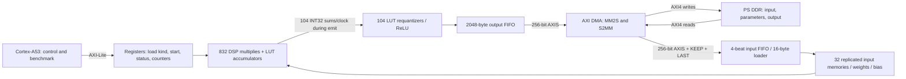

# KV260 Conv0 accelerator: 832 MACs and AXI DMA

This is the RTL implementation candidate selected from the [INT8 latency study](docs/AXI_INT8_STUDY.md). It computes **one complete Conv0**, including folded bias, requantization, and ReLU. It does not yet execute the remaining ResNet layers or classify an image.

**Status, October 19:** the new RTL passed the baseline plus 14 additional XSim cases, each cold/warm. Integrated synthesis and routing completed with 832 DSPs, 95,688 routed LUTs and 56,684 FFs. Routed setup/hold slack is +0.365/+0.010 ns at nominal 100/200 MHz. Vitis compilation and board execution remain pending; 19.47 us is still a model estimate. See [current status and schedule](CURRENT_STATUS.md) for exact evidence and export progress.

Start with [KV260_BUILD_AND_BENCHMARK.md](KV260_BUILD_AND_BENCHMARK.md) for the exact build, programming, CPU setup, and benchmarking workflow.

October 19: see [source review and validation gates](REVIEW_AND_VALIDATION.md)
and the [Ericsson briefing](reports/meeting_2026_10_20/ERICSSON_BRIEF.md).
The expanded testbench now checks raw INT32 as well as final INT8, forces FIFO
backpressure, and exercises malformed packets/reset recovery. The full suite passed.
`scripts/synth_components.tcl` prepares isolated component synthesis experiments;
all four components have now been synthesized. `tools/meeting_analysis.py` generates explicit latency
budgets and full-network workload tables from the existing export manifest.
`tools/prepare_validation_vectors.py` prepares ten archived-image and four
synthetic stress cases; see the review for optional per-case simulation commands.

## Architecture



The 832 MACs are **32 spatial positions × 26 output channels**. One tile is one image row. Each MAC consumes one signed INT8 input and weight per issue clock, accumulating 27 terms for a 3×3×3 window. Weights are broadcast across spatial positions; each image sample is broadcast across output channels. After completing a row, the controller emits eight groups of 104 sums, corresponding to four complete output pixels per group. It then reuses the same MACs for the next row.

Each row needs one accumulator initialization cycle, 27 memory issue cycles, two pipeline drain cycles, and eight accepted output cycles: **38 cycles/row**, or **1,216 cycles for 32 rows**, plus start/control boundary cycles. Backpressure adds cycles. The Python model's core count is 1,217 under its start convention. The AXI register counter has its own documented boundary below; compare traces before treating a one-cycle difference as a failure.

There are 26,624 output values and **718,848 MAC terms per Conv0** (including zero-padded terms). MAC hardware count and total mathematical operations are different quantities.

## Resource intent and limits

| Component | Implementation intent |
|---|---|
| 832 signed 8×8 multipliers | One DSP each, explicit `use_dsp=yes` |
| 832 signed INT32 accumulators | LUT/carry fabric, separate inference boundary |
| 104 requantization lanes | Constant multiply, round/shift, ReLU, saturate in fabric |
| Image storage | 32 replicas × 4 banks, each 192×32 bits, block-RAM inference |
| Weights | 26 independent small register banks, 27 bytes/channel |
| Result FIFO | 16 distributed-RAM banks × 16 words × 64 bits = 2048 bytes |
| Input FIFO | Four 256-bit beats plus metadata |
| AXI infrastructure | AMD DMA, two SmartConnects, PS, reset controller |

This combines DSP multiplication with fabric accumulation and quantization. It does not add a second, separate pool of LUT-only MACs: the study did not justify that as the latency winner under its resource assumptions.

The K26 limits used in the study are 1,248 DSPs, 117,120 LUTs, 234,240 FFs, and 144 BRAM36 tiles. The old measured 416-MAC RTL used 832 DSPs. Separating multiply and accumulation here is intended to prevent that two-DSP-per-MAC mapping, but inference attributes are not a guarantee. Check `utilization_synth.rpt` by hierarchy. If it still uses 1,664 DSPs, the implementation cannot fit; fix mapping before proceeding.

The study estimated 896 DSPs, 107,531 LUTs, 94,467 FFs, and 140 BRAM36 tiles including modeled reserves. **Those are not resource reports for these files.** Fixed quantization, actual BRAM packing, DMA, FIFO routing, and clock conversion all change the totals. The LUT estimate was already close to capacity. The build must establish fit and timing, and may motivate the narrower-output fallback described in the study.

## Arithmetic and specialization

`acc = bias[channel] + sum(input_int8 * weight_int8)` in signed INT32, with two's-complement wrap on overflow. Then use the existing positive per-channel multiplier and shift:

```text
product = signed_int64(acc) * multiplier[channel]
rounded_magnitude = (abs(product) + 2**(shift[channel]-1)) >> shift[channel]
signed_result = -rounded_magnitude if product < 0 else rounded_magnitude
output = clip(signed_result, 0, 127)   # ReLU and signed INT8 saturation
```

BatchNorm is already folded into the exported weights and bias. Padding is INT8 zero, consistent with the symmetric zero-point-zero model. The three-stage quantization pipeline freezes as a unit when its output cannot enter the FIFO.

`conv0_quant_pkg.sv` contains the **fixed pretrained Conv0** quantization constants. This enables constant arithmetic optimization in LUTs. The 208-byte quantization packet is still loaded, but hardware validates it against those constants; it does not change them. New quantization constants require regenerating the package and rebuilding the bitstream. Image, weights, and bias remain loadable at runtime. This is an explicit specialization beyond the generic Python model.

## Host protocol and layouts

AXI-Lite chooses `LOAD_KIND`, because simple AXI DMA does not provide the Python model's per-packet TDEST selector. Finish one packet and wait for its loaded status before changing kinds. AXIS data is little-endian: byte zero is `TDATA[7:0]`. Each input packet starts at local byte offset zero.

| Kind | Payload | Bytes | Layout |
|---|---|---:|---|
| 0 | Signed INT8 image | 3072 | HWC: `((y*32+x)*3+channel)` |
| 1 | Signed INT8 weights | 702 | OHWI: `out_channel*27 + ky*9 + kx*3 + in_channel` |
| 2 | Signed INT32 folded bias | 104 | 26 little-endian words |
| 3 | Quantization check packet | 208 | 26 pairs: signed INT32 multiplier, INT32 shift |
| Output | ReLU INT8 feature map | 26624 | HWC: `((y*32+x)*26+channel)` |

Each packet requires TLAST on its final beat. TKEEP must be contiguous from the least significant byte; all nonfinal beats must have all 32 bytes valid. Output always has 832 full beats, with TLAST on beat 831. VALID/data remain stable until READY accepts them. Invalid lengths, masks, or quantization set sticky errors and prevent START.

The loader writes 16 bytes per cycle; each image replica has four 32-bit banks to accept that rate. Computation starts only after all four payloads are complete. There is no image-loading/compute overlap or double buffering in this version.

## Register map

Accelerator base is `0xA0000000`; DMA base is `0xA0010000`. All accesses are aligned 32-bit AXI-Lite. One write and one read may be outstanding independently. Write address and data may arrive in either order. Unsupported addresses/commands return SLVERR.

| Offset | Register | Meaning |
|---|---|---|
| 0x00 | CONTROL, write | Exactly 1=START; 2=PREPARE; 4=SOFT_RESET |
| 0x04 | STATUS | bit0 running; bit1 output done; bit2 raw done; bit3 error; bit4 loader active; bits11:8 loaded kinds3:0 |
| 0x08 | OUTPUT_BYTES | Accepted output bytes |
| 0x0C | LOAD_KIND, R/W | 0..3; writable only when idle and loader empty |
| 0x10 | ERRORS | bit0 invalid KEEP; bit1 quant mismatch; bit2 length mismatch/overflow |
| 0x14 | RUN_CYCLES | Clock count while running, from accepted START command until final output handshake |
| 0x18 | RAW_CYCLES | Snapshot of RUN_CYCLES when core done pulse is observed |
| 0x1C | INPUT_STALLS | Clocks with input VALID and !READY |
| 0x20 | OUTPUT_STALLS | Clocks with output VALID and !READY |
| 0x24 | FIRST_OUTPUT_CYCLE | RUN_CYCLES at first output handshake |
| 0x28 | LOAD_CYCLES | Accepted 16-byte loader chunks, including partial final chunks |
| 0x2C | VERSION | 0x00010000 |
| 0x30 | MACS | 832 |
| 0x34 | OUTPUT_LANES | 104 |

PREPARE is accepted only while idle with an empty loader. It clears counters and done/error state, invalidates the image, and retains weights/bias/quant readiness for a warm run. SOFT_RESET can abort a frame or malformed packet and invalidates all readiness flags; it does not clear physical RAM contents. To recover an active DMA failure, stop/reset the DMA as well, then reset/reload the accelerator. START requires all loaded flags, no error, and PREPARE/RESET since the previous frame. No interrupts are used in this first benchmark.

## Files and evidence

- `src/`: MAC, core, requantization, FIFOs/AXI top, generated constants.
- `scripts/`: create Vivado PS/DMA project, implement/export, optional XSim run.
- `sim/tb_conv0_axi.sv`: self-checking accelerator testbench; no vendor DMA model.
- `cpu/benchmark.c`: standalone A53 DMA harness; `fixture_data.h` and manifest are generated.
- `tools/export_fixture.py`: validates source fixture hashes and regenerates constants/payloads.
- `tools/check_layout.py`: Python bank/address equations, golden arithmetic and FIFO wrap checks.
- `tools/summarize_uart.py`: board latency statistics from saved UART output.

Python checks completed: all 26,624 INT32 sums and INT8 outputs matched; FIFO equations passed 100,000 randomized steps with 24,570 pushes and 79,792 pops; generated CPU payload hashes matched. Separately, the XSim suite passed 798,720 raw and 798,720 final-byte comparisons across 30 frames (baseline plus 14 cases, cold/warm). A subsequent baseline run through the new plain-Verilog block-design wrapper also passed. Unstalled hardware counters were raw=1,217, first output=35, last output=1,239; cold/warm loader counts were 256/192. These are simulation results, not CPU/DDR/board latency measurements.
