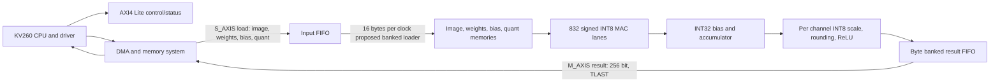

# Latency first Conv0 with INT8 outputs and AXI style transfers

The selected candidate now has a [source RTL/AXI DMA project](../README.md)
and [KV260 deployment/benchmark guide](../KV260_BUILD_AND_BENCHMARK.md).
It has now passed HDL simulation, integrated synthesis and routed timing; see
[current hardware evidence](../CURRENT_STATUS.md). Board latency is not measured. Its fixed quantization
and concrete DMA/control implementation differ from this model; the guide explains
the comparison limits.

## Recommendation

For the **modeled 100 MHz, 2,000 MB/s, 256 bit-stream case**, the fastest
candidate that passes the conservative *estimated* resource screen is **832
INT8 MAC lanes**, **104 INT8 outputs per core beat**, a **16 byte per clock
input loader**, one DSP multiplier per MAC followed by LUT accumulation, and a
LUT based requantizer. The complete modeled cold-frame transaction takes
**19.47 us** (1,947 clocks). It calculates 26,624 raw INT32 sums, converts
them to INT8 with the exported per-channel parameters, and sends the 26,624
output bytes through AXI style stream handshakes. All INT32 and INT8 values
match the saved software fixtures. The core schedule is 1,217 clocks before
backpressure; the full model records 1,266 clocks, including 49 stalls while
the result buffer waits for the output stream.

This is a latency first *candidate for RTL*, not an implemented or measured
FPGA result. The search assumes the processor can sustain a 2,000 MB/s stream,
that 100 MHz closes after placement and routing, and that the proposed local
memory banking and DSP/LUT mapping can be built within the resource estimates.
Those conditions still need hardware measurements. If they fail, the 416-MAC
candidate at 1,000 MB/s takes 34.07 us and uses less estimated area; at 500 MB/s,
208 MACs with 52 outputs takes 64.69 us.

## INT8 changes the workload

The multiplier still consumes signed INT8 activations and signed INT8 weights.
Products accumulate with the trained INT32 bias, as before. Previously the
simulator returned the full 26,624-value INT32 accumulator tensor for inspection.
The trained model also includes per-channel quantization constants. The output
now applies the original integer rule:

```text
INT32 accumulator x per-channel multiplier
    -> signed rounding and right shift
    -> ReLU
    -> saturate to INT8 [0, 127]
```

The Python pipeline models one 32 by 32 multiply per output lane, rounding,
then saturation/ReLU. It accepts a new vector each clock while unstalled and
has a three-clock pipeline latency. The multiplier and shift come from the
same exported `conv0_quant.mem` used by the integer software model. Input,
weights, raw accumulator, and quantized output vectors have SHA checked fixture
files; [manifest.json](../../fixtures/manifest.json) binds them to the original
export. The AXIS output tensor is NHWC: pixel position first, then 26 channels.

This matches the supplied INT8 Conv0 software reference. It does not make a
full FPGA ResNet yet: subsequent layers, residual scale alignment, average pool,
dense, and on chip activation reuse remain future work.

## Latency sweep

`simulate_axi_conv0.py sweep` ran **540 cold full frame combinations** across
four spatial parallelism choices (208, 416, 832, 1,664 MACs), five output
widths (8, 13, 26, 52, 104 INT8 values per core beat), three AXIS widths
(64/128/256 bits), three local loader rates (1/4/16 bytes per clock), and
three matching host rates (500/1,000/2,000 MB/s). Another 24 runs varied the
clock (75/100/150 MHz) and cold versus already resident weights.

Each frame checked **26,624 INT32 accumulators and 26,624 quantized INT8
outputs** against the golden files. Across 564 frames that is 15,015,936
checks of each type, all passing. The simulator ran in about 83 seconds on
this development machine; this is the time to calculate the model results,
not accelerator latency.

| Assumed matching H2D/D2H link | MACs | Output lanes | AXIS width | Loader bytes/clock | Core clocks incl. stalls | End to end |
|---:|---:|---:|---:|---:|---:|---:|
| 500 MB/s | 208 | 52 | 256 bits | 16 | 4,913 | 64.69 us |
| 1,000 MB/s | 416 | 52 | 256 bits | 16 | 2,475 | 34.07 us |
| 2,000 MB/s | 832 | 104 | 256 bits | 16 | 1,266 | 19.47 us |

At the top-speed row, the resource screen found only one mapping that met its
high-cost estimates: one DSP for each INT8 product, LUT accumulation, and LUT
requantization. The next slightly slower tested configuration, 832 MACs and 52
outputs at 20.63 us, has a more comfortable estimated LUT total if its
requantizer uses DSPs. That is a useful fallback if synthesis rejects the
104-output LUT requantizer or FIFO.

| 832 MAC design | Requantizer | Modeled latency | Estimated DSP / LUT / FF / BRAM36 totals, with reserves |
|---|---|---:|---|
| 104 outputs per clock | LUT | 19.47 us | 896 / 107,531 / 94,467 / 140 |
| 52 outputs per clock | DSP | 20.63 us | 1,104 / 91,019 / 86,147 / 140 |

The narrower candidate is only 1.16 us slower in this configuration and moves
16,512 LUTs to 208 more DSPs. Both require a new 832 lane core and banked loader.

All three use the same assumed 100 MHz clock, 2 us DMA startup, 2 clock gaps
between 16 beat bursts, four beat input FIFO, 2,048 byte output FIFO, and
1 us completion wait. The controller write uses separate AXI Lite AW and W
handshakes; in the selected scenario they arrive two clocks apart. Results
include the transfer and controller time. Only the MAC/core clocks are counted
in the “core clocks” column. Timings are estimates from this stated model.

Increasing parallelism stops helping when output bandwidth limits the run.
At 1,000 MB/s, 416 MACs/52 outputs and 832 MACs/52 outputs both take 34.07 us;
the larger design has no end to end advantage. At 2,000 MB/s, the 832/104
candidate drops to 19.47 us because the additional output lanes reduce core
time and the INT8 stream drains at 20 bytes per 100 MHz clock. A 256 bit bus
could carry 32 bytes per clock, so the modeled link, not AXIS width, is the
output transfer limit at that rate.

The input contains 3,072 bytes. A cold transfer adds 702 weight bytes, 104
INT32 bias bytes and 208 bytes of INT32 multiplier/shift pairs, for **4,086
input payload bytes**. A 16 byte per clock local loader accepts those bytes in
256 accepted loader chunks including packet partials (192+44+7+13; corrected
from the earlier 257 arithmetic claim and confirmed in RTL simulation). The 16 byte write rate also needs a
memory banked to accept four 32 bit words at once. The 4,086 bytes are delivered
as four TDEST packets: image 0, weights 1, bias 2, quantization constants 3.

## Proposed AXI style interface

The Python model implements a single clock domain with a DMA facing AXI4 Stream
load port, a DMA facing AXI4 Stream result port, and an AXI4 Lite control/status
slave. The `TVALID && TREADY` edge transfers a beat; while stalled, the sender
must hold `TVALID`, `TDATA`, `TKEEP`, `TLAST`, and `TDEST` stable. This follows
the AXI Stream handshake rule in the [Arm AXI4 Stream specification](https://documentation-service.arm.com/static/64819f1516f0f201aa6b963c).
AXI Lite has separate address and data write handshakes, followed by a response;
the model accepts AW and W in either order. [AMD AXI Lite signal reference](https://docs.amd.com/r/en-US/pg439-axi-i3c/AXI4-Lite-Interface-Signals)



AXI Lite register proposal:

| Offset | Access | Meaning |
|---:|---|---|
| 0x00 | Write | Control; bit 0 requests start after all four load packets arrive |
| 0x04 | Read | Status; bit 0 busy, bit 1 complete INT8 stream delivered, bit 2 raw core finished |
| 0x08 | Read | Number of INT8 result bytes accepted by the DMA |

The driver sends each input packet with one `TDEST` value and `TLAST` on its
last beat. `TKEEP` identifies valid bytes in a partial final beat. The output
is a single packet with `TDEST=0`; the final output beat asserts `TLAST`.
The stream bus width, local loader width, and compute output width are separate:
the selected model accepts up to 16 input bytes per clock, computes 104 INT8
values per clock, and serializes 104 bytes through a 32 byte AXIS interface
and output buffer. Output-buffer write ports are therefore a real design
requirement, not implied by the AXI bus width.

The Python trace CSV records every modeled clock: VALID/READY/data/keep/last/dest
for both streams; AW/W/B/AR/R and response signals; controller/core states;
tile and tap indexes; image read addresses; sample pipeline/accumulator probes;
local memory writes; FIFO occupancy; and the requantizer's stall/advance signal.
Stalled beats remain stable. Run the selected configuration and inspect the
per-cycle trace in VS Code with:

```powershell
# Run from resnet8_project/
..\.venv-resnet\Scripts\python.exe simulate_axi_conv0.py run --config cycle_sim/configs/conv0_int8_latency.json --trace resnet8/artifacts/axi_conv0/selected_trace.csv
```

This is a Python level AXI style data/control model. It does not issue actual
DDR address bursts or model AXI4 memory mapped AR/R/AW/W/B traffic, DMA IP,
driver calls, caches, CPU memory allocation, clock crossing, or KV260 PS/PL
bandwidth. The selected burst gaps and link rates are configurable estimates.
This trace lets the team reason about valid/ready backpressure and stage timing;
it is not Vivado transaction simulation or proof of an integrated bus.

## DSP and LUT screening

The previous 416 lane implementation has an actual synthesized report:
832 DSPs, 16 BRAM36, 12,121 LUTs, 14,337 registers. That datapath returns raw
INT32 sums; it has no INT8 output requantizer. Its measured ratio of two DSPs
per MAC cannot simply be carried into a different multiplier/adder partition.

For this sweep the latency candidate uses 832 lanes arranged as 32 spatial
positions times 26 output channels. The proposed mapping uses one DSP for each
signed INT8 multiplication and fabric LUTs for the 32 bit accumulation. That
would use 832 DSPs for the multipliers. Mapping the 104 requantizer multipliers
to LUTs saves 416 DSPs compared with the model's four DSPs per requantizer lane.

| Resource | High cost scenario estimate | K26 capacity | Fraction |
|---|---:|---:|---:|
| DSP | 896 including 64 DSP reserve | 1,248 | 71.8% |
| LUT | 107,531 including 8,192 LUT reserve | 117,120 | 91.8% |
| FF | 94,467 including 8,192 FF reserve | 234,240 | 40.3% |
| BRAM36 | 140 including 8 BRAM reserve | 144 | 97.2% |

For BRAM, the proposed loader uses four 32 bit banks per spatial replica to
accept 16 bytes per clock; 32 replicas therefore account for 128 BRAM36 sites
in the estimate. Four more cover the narrow input FIFO. The output FIFO is
modeled as 128 byte wide banks in LUTRAM so that it can accept 104 requantized
bytes and send 32 AXIS bytes in the same clock. That adds an assumed 3,072 LUTs.
This organization needs custom RTL and synthesis to validate its read/write
ports, memory inference, and placed routing. Only four BRAM36 sites remain
after the explicit eight site reserve in this estimate.

The requantizer comparison is significant. Keeping its 104 multipliers in DSPs
would require 416 more DSPs and fail the selected design's device screen.
The model therefore puts the requantizer in LUTs, adding an assumed range of
6,656 to 19,968 LUTs before buffering and reserve. The selected high cost
estimate is near the LUT and BRAM limits. The LUT costs for fabric MACs,
32 bit accumulators, wide requantizers, byte FIFOs, and control are assumptions,
not vendor resource measurements. They can be wrong in either direction.
The 100 MHz clock for LUT based multiplication and accumulation also needs
implementation timing. See `axi_resources.py` and the
full mapping sensitivity CSV for
the model's cost ranges and alternatives.

AMD synthesis can select LUT or DSP multiplier implementation through
[Vivado multiplier synthesis controls](https://docs.amd.com/r/en-US/ug901-vivado-synthesis/Multipliers-Implementation).
Using a directive only influences inference; synthesis and timing reports must
confirm the result. This sweep changes estimated resource allocations only.
It does not assign different delay per DSP/LUT MAC, so it cannot predict that
a fabric heavy mapping clocks at 100 MHz.

## Reproduce

From `resnet8_project/`, the simulator and its sweep need the existing Python
environment plus NumPy. They do not require TensorFlow, Vivado, or an HDL
simulator.

```powershell
# Latency first chosen run and cycle by cycle AXIS/AXI Lite trace
..\.venv-resnet\Scripts\python.exe simulate_axi_conv0.py run --config cycle_sim/configs/conv0_int8_latency.json --trace resnet8/artifacts/axi_conv0/selected_trace.csv

# 540 architecture/link/bus/loader runs plus 24 clock/residency comparisons
# simulate_axi_conv0.py and cycle_sim/ were removed during cleanup;
# recover them from origin/resnet8-conv0 to reproduce this study.

# Full software/reference and protocol checks
..\.venv-resnet\Scripts\python.exe -m unittest discover -s tests -v
```

Full JSON and CSV sweep outputs are saved under ignored
`resnet8/artifacts/axi_conv0/`. The output folder includes `sweep.json`,
`sweep.csv`, `run.json`, and the saved trace. Results also check one input
image (CIFAR 10 test index 3); the sweep repeats it across architectures rather
than using independent test images. Protocol corner tests and quantizer boundary
tests are separate.

Next, synthesize the 832 lane candidate in pieces: first one DSP multiplier
plus fabric accumulation, then the LUT requantizer and byte banked FIFO. Add
that RTL's exact ports to a Vivado testbench and check the archived raw INT32
and INT8 vectors. Use actual H2D/D2H bandwidth and post route clock to revise
this Python configuration before estimating full ResNet latency.
