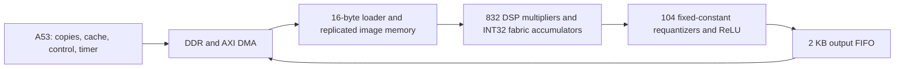

> **Publication status, October 21:** simulation, integrated routing/timing, and bitstream/XSA export have completed. Vitis compilation and board execution remain pending. Historical unrun statements below are superseded by [current status](../../CURRENT_STATUS.md).

# Ericsson technical briefing — October 20, 2026

**Goal:** minimize image-to-result latency for the frozen INT8 ResNet-8 on KV260, including CPU/FPGA transfers. **Current milestone:** one correct, implementable Conv0 with an integrated DMA/CPU path. Full-network inference is still software-only.

## Suggested five-minute presentation

### 1. What we built

We established the original FP32 reference, an exact integer reference, exported parameters, and golden tensors. The frozen network uses 26/52/104 channels and ten CIFAR-10 classes. FP32 checks fidelity to the pretrained network; integer results define the FPGA arithmetic. The existing team report records 89.2% FP32 and 87.9% INT8 accuracy on its declared 1,000-image subset. These are prior software results, not a newly measured board accuracy result.

We explored spatial parallelism, then moved to hardware reuse. The original design was much too large. A 416-MAC version passed synthetic RTL tests and synthesized, but consumed two DSPs per MAC. Our new candidate explicitly separates DSP multiplication from fabric accumulation and includes INT8 requantization, AXI streams, DMA integration, and a standalone A53 benchmark.

### 2. Why this architecture

The candidate computes one row at a time: **32 positions x 26 channels = 832 MACs**. Each MAC reuses its multiplier for 27 input/weight terms. The resulting 832 sums leave in eight groups of 104, are requantized to INT8, buffered, then transferred through a 256-bit stream.

Compute and output drain overlap. More MACs help only while computation is limiting. The existing model selected 208 MACs at 500 MB/s, 416 at 1 GB/s, and 832 at 2 GB/s. Actual bandwidth has not been measured.

### 3. What is evidence, and what is a hypothesis

| Statement | Evidence level |
|---|---|
| Software reference/export/golden workflow exists | Existing source, fixtures, recorded software results |
| Old 416-MAC RTL passed 133,120 synthetic comparisons | Prior user-run HDL result; pretrained fixture was skipped |
| Old 416-MAC design used 832 DSPs, 12,121 LUTs, 14,337 FFs, 16 BRAM36 | Archived synthesis report; different design from the new candidate |
| New row schedule is intended to be 1,217 ideal core cycles | Architecture/model counting convention; no new HDL timing trace |
| 19.47 us cold-frame latency | Prior Python model under stated 100 MHz/2 GB/s assumptions, not hardware measurement |
| New RTL, DMA block-design Tcl, CPU harness exist | Written source; HDL/Vitis compilation and integration are unverified |
| 896 DSP / 107,531 LUT / 94,467 FF / 140 BRAM36 | Prior conservative model estimates including reserves; not new synthesis |
| New testbench checks raw sums and final bytes | Expanded source only; no HDL PASS yet |
| 32 Python tests and fixture/bank checks pass | Re-run October 19; verifies Python and saved data, not synthesized hardware |
| Ten independent saved images plus four synthetic stress fixtures ready | Python oracle/hash checks passed; no HDL execution of these cases |

The 564 architecture-study runs reused one golden image. They explored schedules and interfaces; they are not 564 independent image accuracy tests.

### 4. What the latest analysis changes

The concrete cold path submits four input packets and one output transfer; warm submits only image and output. A single nominal bandwidth number therefore misses DMA setup, cache work, polling, and completion cost. At 2 GB/s, just serializing the 26,624-byte output takes **13.312 us**, overlapping computation.

The new analytic sensitivity budget illustrates that **2 us per DMA submission plus 5 us of other CPU/completion work** gives approximately **31.21 us cold / 24.57 us warm** at 2 GB/s. These numbers are hypothetical budgets with optimistic hardware timing, not replacements for the detailed cycle model and not measurements. We need board timestamps to choose the right assumptions.

The export-derived full network has **32,562,192 convolution/dense MAC terms**; Conv0 contributes only **2.21%**. Successful Conv0 is a valuable integration milestone, but it does not establish full-network speedup. Returning every operation to DDR would move approximately **442,586 activation bytes/inference**, excluding weights. A hypothetical design retaining all intermediate activations would move only **3,082 external activation bytes** (image + ten INT8 logits). That makes activation reuse a major next architecture question.

### 5. Next gates and decisions

1. Obtain new testbench PASS on raw INT32 and final INT8 outputs, including stalls and malformed-packet recovery.
2. Synthesize isolated components: prove one DSP per MAC and measure requantizer/memory costs.
3. Synthesize and route the complete PS/DMA system; inspect fit, clocks, unconstrained paths, CDC and DRC.
4. Build the Vitis application, verify every returned byte and guard region on KV260, then report cold/warm median and p95.
5. Calibrate the model with measured bandwidth/overhead. Decide whether 104 output lanes, the 52-lane fallback, or a smaller engine wins.
6. Run the prepared ten-image and four-stress-case fixtures in HDL, then extend the proven integration to a reusable multilayer engine with residual storage.

## Questions to take to Ericsson

- Is the target application optimizing a single request, steady-state throughput, or a percentile latency requirement?
- What CPU/runtime and preprocessing/postprocessing must be included in the eventual end-to-end metric?
- Which platform constraints matter most after correctness: latency, power, FPGA area, or deployment complexity?
- Can the team review the first routed resource/timing reports and the CPU/DMA measurement method before we generalize the datapath?

## Likely questions and concise answers

**Does the FPGA classify images today?** No. Full-network classification works in software. The new FPGA source computes Conv0; remaining layers and board validation are pending.

**Why not use all 1,248 DSPs?** More arithmetic is not automatically faster when output transfer or CPU work dominates. LUTs, memory ports, routing and clock closure also constrain the design.

**Did the one-DSP-per-MAC fix work?** It is an inference strategy in the new source. Only synthesis can confirm the mapping.

**Why fixed quantization constants?** Constant arithmetic may reduce requantizer cost. Hardware verifies the incoming quantization packet against those constants. New constants require rebuilding hardware; input, weights and bias remain runtime-loadable.

**What speedup can we claim?** None for end-to-end KV260 inference yet. The existing i7 NumPy reference is correctness-oriented and is not an optimized A53 baseline. A fair speedup needs equivalent work and timing boundaries on a declared CPU implementation.

**What if the candidate does not fit?** First use hierarchical reports to identify the cause. The prior 52-output-lane candidate estimated lower LUT use at 20.63 us modeled latency versus 19.47 us. It is a documented alternative, not implemented fallback RTL.

**What is the biggest full-network issue?** Reusing weights/activations efficiently across higher-channel convolutions and retaining residual inputs. Capacity alone is insufficient: banking must supply the required read/write bandwidth.

## Supporting material

- [Reproducible latency and network workload analysis](ANALYSIS.md)
- [Static review, coverage and synthesis experiments](../../REVIEW_AND_VALIDATION.md)
- [Integrated architecture and register map](../../README.md)
- [Build and board benchmark procedure](../../KV260_BUILD_AND_BENCHMARK.md)
- [Prior model and architecture tradeoffs](../../docs/AXI_INT8_STUDY.md)

Prepared from the local repository on October 19. No new HDL/Vivado/Vitis run or board measurement was performed.
