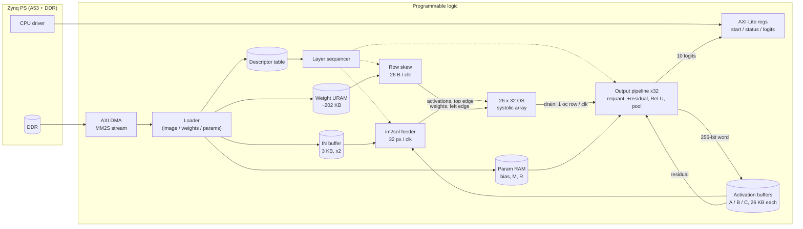
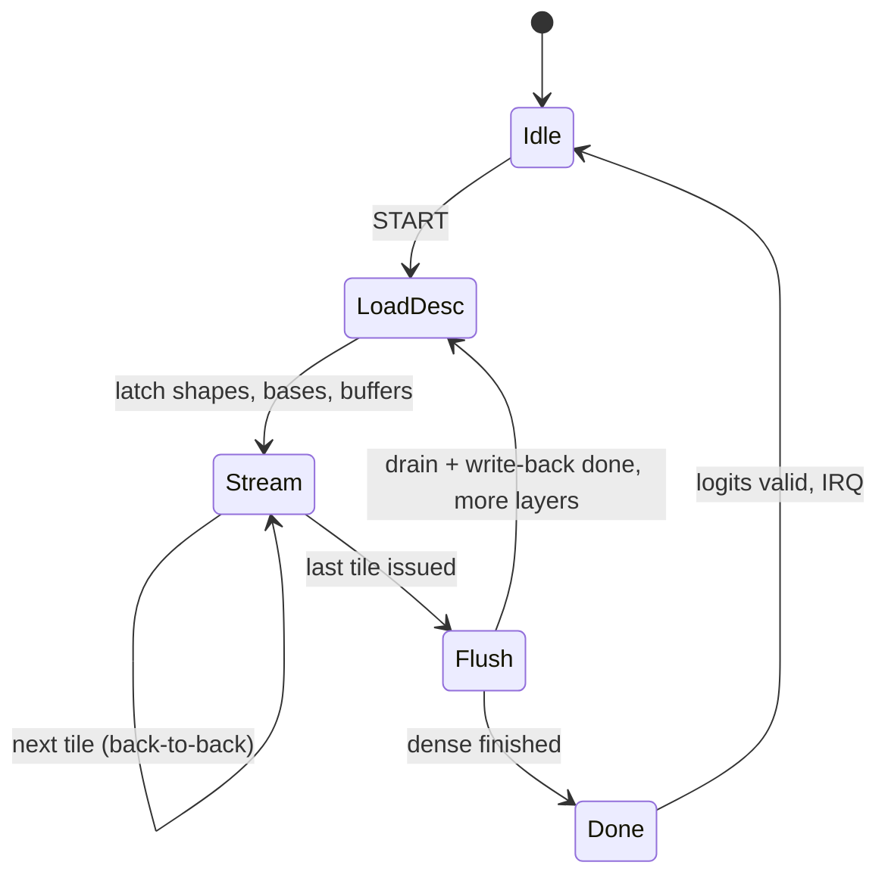

# Architecture 2 – Output-stationary systolic conv engine (26 × 32)

**Status: proposed, not implemented.** All numbers are derived from layer shapes
and device datasheet capacities; nothing here is synthesized or measured.
Background and trade-off discussion: [uarch_study](../uarch_study/README.md)
(steps 02–04 and [03b comparison](../uarch_study/03b_performance_comparison.md)).

## 1. Summary

| Parameter | Value |
|---|---|
| Scope | Every ResNet-8 conv layer (3×3 s1/s2, 1×1 s2), fused residual add, avgpool, dense |
| Array | 26 rows (output channels) × 32 columns (output pixels) = 832 PEs |
| Dataflow | Output-stationary: each PE owns one output `(oc, p)`; reduction `K` runs in time |
| PE | 1 DSP48E2 (INT8 × INT8 → 25-bit accumulate) + 1 drain register (2nd accumulator) |
| Clock target | 200 MHz |
| On-chip storage | All weights (URAM), all activations (BRAM buffers A/B/C), per-channel params |
| Off-chip traffic per inference | 3,072 B image in, 10 B logits out |
| Ideal full-inference latency | 39,136 compute cycles ≈ 40,200 with overheads ≈ **201 µs @ 200 MHz** |
| Conv0 inside the network | ~950 cycles ≈ **4.8 µs** |

## 2. Top-level block diagram



## 3. Dataflow: a convolution as a matrix multiply

Every conv layer is `Y[oc][p] = Σ_k W[oc][k] · X̂[k][p]`, with
`p = (oy, ox)` flattened and `k = (ky, ic, kx)` flattened
(see [loop nest](../uarch_study/02_conv_loop_nest.md)).

- Rows of the array = 26 output channels (one oc tile).
- Columns = 32 consecutive output pixels (one pixel tile).
- Each cycle one `k` is processed: weight `W[oc][k]` enters row `oc` from the
  left, activation `X̂[k][p]` enters column `p` from the top.
- Both move one PE per cycle (right / down). Inputs are skewed so that
  `W[oc][k]` and `X̂[k][p]` meet in PE(oc, p) at cycle `k + oc + p`.

```text
                 col 0        col 1        col 2   ...   col 31
                 X̂[k][p0]    X̂[k-1][p1]  X̂[k-2][p2]      X̂[k-31][p31]   (column skew)
                    ↓            ↓            ↓                  ↓
row 0  W[0][k]  → [PE] ──────→ [PE] ──────→ [PE] ── ... ──→ [PE]
                    ↓            ↓            ↓                  ↓
row 1  W[1][k-1]→ [PE] ──────→ [PE] ──────→ [PE] ── ... ──→ [PE]
  ...                                                              (row skew)
row 25 W[25][k-25]→[PE] ─────→ [PE] ──────→ [PE] ── ... ──→ [PE]
                    ↓ drain      ↓            ↓                  ↓
                 lane 0       lane 1       lane 2   ...    lane 31   → output pipeline
```

Why output-stationary fits ResNet-8: `K` ranges from 27 to 936, and here `K`
is just "how many cycles a tile runs". No lanes go idle when `K` changes, and no
partial-sum memory is needed. Every `OC` is a multiple of 26 and every `P` a
multiple of 64, so all 832 PEs are busy on every conv layer.

### 3.1 Tile mapping per layer

| Layer | OC tiles | Pixel tile (32 px) covers | Pixel tiles | K | Tiles | Cycles (tiles × K) |
|---|---:|---|---:|---:|---:|---:|
| conv0 | 1 | 1 output row (W=32) | 32 | 27 | 32 | 864 |
| block1_conv1 | 1 | 1 row | 32 | 234 | 32 | 7,488 |
| block1_conv2 | 1 | 1 row | 32 | 234 | 32 | 7,488 |
| block2_conv1 (s2) | 2 | 2 rows (W=16) | 8 | 234 | 16 | 3,744 |
| block2_conv2 | 2 | 2 rows | 8 | 468 | 16 | 7,488 |
| block2_shortcut (1×1 s2) | 2 | 2 rows | 8 | 26 | 16 | 416 |
| block3_conv1 (s2) | 4 | 4 rows (W=8) | 2 | 468 | 8 | 3,744 |
| block3_conv2 | 4 | 4 rows | 2 | 936 | 8 | 7,488 |
| block3_shortcut (1×1 s2) | 4 | 4 rows | 2 | 52 | 8 | 416 |
| **Total** | | | | | **168** | **39,136** |

## 4. Processing element

```text
          act_in (8b, from PE above)
              │
              ├──────────────► act_out (to PE below, registered)
              ▼
 w_in ──►[reg]──► w_out (to PE right)
  (8b)    │
          ▼
      ┌────────────── DSP48E2 ──────────────┐
      │  A = w, B = act                      │
      │  P = first ? A·B : P + A·B           │   25-bit signed accumulator
      └──────────────────┬───────────────────┘
                         │ last (end of tile for this PE)
                         ▼
 drain_in ──►  [drain reg, 25b]  ──► drain_out (to PE below)
 (from PE above)   load on `last`, shift on `drain_shift`
```

- **Accumulator 1** = DSP `P` register. On the first `k` of a tile the DSP
  OPMODE loads `A·B` instead of adding, so no reset cycle is needed.
- **Accumulator 2** = drain register. On the last `k` the finished sum is
  captured; the DSP immediately starts the next tile. This is the
  "two accumulators per PE" decision (D-004).
- **Control travels with data.** `first`/`last` are 1-bit flags that move down
  the array alongside the activation, so every PE sees them exactly at its own
  skewed time. There is no global broadcast enable.
- **Width.** Worst case `|Σ| ≤ 936 · 128 · 128 ≈ 15.3 M < 2^24`, so 25 signed
  bits suffice. Bias is added later in the output pipeline.

### 4.1 Draining without stalling

Column `c` shifts its 26 drain registers down into output lane `c`, bottom row
first (oc 25, 24, …, 0). Shifting starts once row 25 has captured. A drain
register is reused one tile later, so draining must finish within `K` cycles:

```text
requirement: 26 shift cycles ≤ K       min K in ResNet-8 = 26 (block2_shortcut)  ✓
```

Columns finish one cycle apart (column skew), so a small de-skew triangle at the
bottom aligns the 32 lanes into one 256-bit word per output channel.

## 5. Feeding the array

### 5.1 Weights (left edge)

- Stored in URAM as 26-byte words, one per `k`: `W[oc_tile·26 .. +25][k]`, in
  the same `(ky, ic, kx)` order the feeder uses.
- One word is read per cycle; row `r` gets byte `r` delayed by `r` cycles (skew
  triangle: 26·25/2 = 325 byte registers).
- Words needed: Σ OC/26 · K = 7,775 words × 26 B = 202,150 B → 6 URAM
  (3 wide × 2 deep = 8,192 × 216 bits).

### 5.2 Activations (top edge): the im2col feeder

Activation layout in A/B/C: **channel-planar 32-pixel words** (256 bits):

```text
word(c, j) = X[c][p = 32j .. 32j+31]           address = base + c·(P/32) + j
W = 32: one word = 1 image row   W = 16: 2 rows   W = 8: 4 rows
```

For each `(ky, ic)` the feeder loads the input-row words that the pixel tile
needs into a small window register. It then serves the three `kx` taps from
that register by selecting, per column, the pixel at
`x = s·ox + kx − pad_left` (zero if outside the image). Per-column select
candidates are few (≤ ~16), so the crossbar is small.

| Layer type | Words per `(ky, ic)` | Cycles served | Reads / cycle | Ports |
|---|---:|---:|---:|---|
| 3×3 s1, W=32 (conv0, block1) | 1 | 3 | 0.33 | 1 |
| 3×3 s1, W=16 / W=8 | ≤ 2 | 3 | ≤ 0.67 | 1 |
| 3×3 s2, 32 → 16 | 2 | 3 | 0.67 | 1 |
| 3×3 s2, 16 → 8 | ≤ 4 | 3 | ≤ 1.33 | 2 |
| 1×1 s2, 32 → 16 | 2 | 1 | 2 | 2 |
| 1×1 s2, 16 → 8 | 4 | 1 | 4 | run at half rate (+416 cycles, ~1%) |

No layer reads and writes the same buffer, so both BRAM ports are available for
feeder reads (see §7).

Padding follows the hardware contract: 3×3 s1 pads 1 on every side; 3×3 s2 pads
top/left 0 and bottom/right 1; 1×1 s2 has no padding.

## 6. Output pipeline (32 lanes)

Each lane receives one 25-bit sum per cycle during drain (oc order 25 → 0) and
fetches that channel's `{bias, M, R}` from the param RAM.

```text
acc ─► + bias ─► × M ─► round-shift R ─► [ReLU] ─► sat INT8 ─┬────────────────► conv output
                                                             │  (if fused add)
                                    residual INT8 ─► ×M_b ─► round R_b ─┐
                                    conv INT8 ─────► ×M_a ─► round R_a ─┴► + ─► ReLU ─► sat INT8
```

- Rounding follows the contract exactly: `magnitude = (|p| + 2^(R−1)) >> R`,
  sign restored afterwards. Not an arithmetic shift of a negative value.
- **Fused residual add.** Block conv2 outputs are requantized to INT8, then
  both branches are requantized to the add scale, summed in INT32, ReLU'd and
  saturated. These are the same bits as a separate add pass.
- **Write-back.** 32 lanes × 8 bits = one 256-bit word `(oc, pixel tile)`, one
  per cycle, into the destination buffer.
- **Avgpool** (after block3): each lane accumulates its channel's 64 outputs
  in a per-channel INT32 register, then divides by 64 with the same rounding
  rule.
- **Dense** (104 → 10) runs on the array as a degenerate layer: OC = 10 padded
  to 26 rows with zero weights, P = 1 (column 0), K = 104, ReLU off (~130
  cycles). Logits go to AXI-Lite registers.

DSP cost ballpark: ~4–6 per lane (32×32-bit requant multiply plus two
8×32-bit add multiplies) → ~130–190 DSPs.

## 7. On-chip memory map

| Store | Size | Organization | Physical (ballpark) |
|---|---:|---|---|
| IN (double-buffered) | 2 × 3,072 B | 96 × 256 b each | 4–8 BRAM36 |
| A, B, C | 3 × 26,624 B | 832 × 256 b each (4 wide × 2 deep) | 24 BRAM36 |
| Weights | 202,150 B | 8,192 × 216 b | 6 URAM |
| Per-channel params `{bias, M, R}` | 556 × 12 B | 1 record / drain cycle | 2 BRAM36 |
| Add / pool params, descriptors | ~1.9 KB | registers / 1 BRAM | 1 BRAM36 |
| **Total** | | | **~32–40 BRAM36 (of 144), 6 URAM (of 64)** |

Buffer rotation (no layer reads and writes the same buffer, residuals survive):

| Step | Layer | Feeder reads | Residual reads | Writes |
|---:|---|---|---|---|
| 1 | conv0 | IN | – | A |
| 2 | block1_conv1 | A | – | B |
| 3 | block1_conv2 + add | B | A | C |
| 4 | block2_conv1 | C | – | A |
| 5 | block2_shortcut | C | – | B |
| 6 | block2_conv2 + add | A | B | C |
| 7 | block3_conv1 | C | – | A |
| 8 | block3_shortcut | C | – | B |
| 9 | block3_conv2 + add + pool | A | B | C + pool regs |
| 10 | dense | pool regs | – | logits |

## 8. Control: layer sequencer

One 128-byte descriptor per layer (the existing `layer_config.bin` format plus
buffer IDs and URAM/param base addresses). The sequencer is a small FSM driving
nested counters:



```text
for oc_t in OC/26:                   # oc tile
  for p_t in P/32:                   # pixel tile, issued back-to-back
    for ky, for ic, for kx:          # K cycles; one weight word + one activation vector per cycle
      issue(k)                       # 'first' on k=0, 'last' on k=K-1 travel with data
```

Layer boundaries wait for the previous layer's last write-back (the next layer
reads it). Cost ≈ fill + drain ≈ 100 cycles per layer, ~900 total.

## 9. Worked examples

### 9.1 One PE in conv0

PE(row 5, column 7) during pixel tile `oy = 0` computes output channel 5 at
pixel (0, 7):

```text
acc = Σ_{ky=0..2} Σ_{ic=0..2} Σ_{kx=0..2}  W[5][ky][kx][ic] · X[ky−1][7+kx−1][ic]
      (27 terms; ky = 0 reads row −1, i.e. zero padding)
cycle at which term k arrives = t_tile + k + 5 + 7
'last' arrives at t_tile + 26 + 12 → sum captured into the drain register
next tile (oy = 1) starts accumulating in the DSP on the following cycle
```

### 9.2 Conv0 timeline

```text
tile (oy)    0        1        2              31
issue      [0..26][27..53][54..80] ... [837..863]
array fill    +56 cycles (25 row skew + 31 column skew) to reach PE(25,31)
final drain   +26 cycles, + ~8 cycles RAM/requant latency
total ≈ 864 + 56 + 26 + 8 ≈ 954 cycles ≈ 4.8 µs @ 200 MHz
```

### 9.3 block3_conv2 (the deepest layer)

- OC = 104 → 4 oc tiles. P = 64 → 2 pixel tiles (4 output rows of 8 each).
  K = 936.
- 8 tiles × 936 = 7,488 cycles = 37.4 µs; each weight word is reused by 32
  pixels; each activation is reused by 26 channels.
- Per tile, the drain (26 cycles) is fully hidden under 936 compute cycles.

### 9.4 block2_shortcut (worst case for drain and feeder)

- K = 26 is exactly the drain limit, so it still runs back-to-back.
- 1×1 s2 needs 2 feeder words per cycle; both BRAM ports of buffer C are free
  because C is only read in this layer.

## 10. Performance and resources (ballpark)

| Metric | Value |
|---|---|
| Compute cycles (ideal) | 39,136 (100% PE utilization on conv layers) |
| With fill/drain/layer switch, pool, dense | ~40,200 cycles |
| Latency @ 200 MHz / @ 100 MHz fallback | ~201 µs / ~402 µs |
| Throughput (one image at a time) | ~5,000 images/s (hardware only) |
| Host overhead (not included) | ~1 µs image DMA; driver ~1–5 µs bare-metal, ~20–100 µs Linux [assumed] |
| DSP | 832 PEs + ~130–190 output = ~960–1,020 (77–82%) |
| LUT | ~35–50k (30–43%): feeder crossbar, de-skew, sequencer, DMA/interconnect |
| FF | ~50–65k: 832 × 25-bit drain regs ≈ 21k + skew/pipeline regs |
| BRAM36 / URAM | ~32–40 / 6 |

## 11. Verification plan

1. **PE unit test:** random INT8 streams, `first`/`last` at random K; compare
   against a Python dot product. Include K = 26 back-to-back to check drain.
2. **Feeder address generator:** compare emitted `(column, k) → value` streams
   against a Python im2col for all 9 layer shapes, including padding corners.
3. **Single layer:** each layer against `resnet8/artifacts/layer_vectors/<layer>/`
   (input, raw accumulator, INT8 output), bit-exact.
4. **Full network:** every intermediate tensor and the 10 logits against
   `resnet8/integer.py` for the golden images.

## 12. Risks and open questions

| Risk / question | Mitigation |
|---|---|
| 200 MHz closure with 832 DSPs + drain chains | Register every PE boundary; use DSP A/B/M/P registers; 100 MHz fallback still beats every alternative |
| DSP budget 77–82% | Share requant lanes (drain is ≤ 1 row/clk), or move part of requant to LUTs |
| Feeder crossbar size for 3 tile shapes | Python model first; per-column candidate sets are static per layer |
| Dense on array vs dedicated MAC vs CPU | Decide after feeder is designed |
| 26 × 16 instead of 26 × 32 | Same RTL with `COLS` parameter: 416 PEs, ~398 µs @ 200 MHz |
