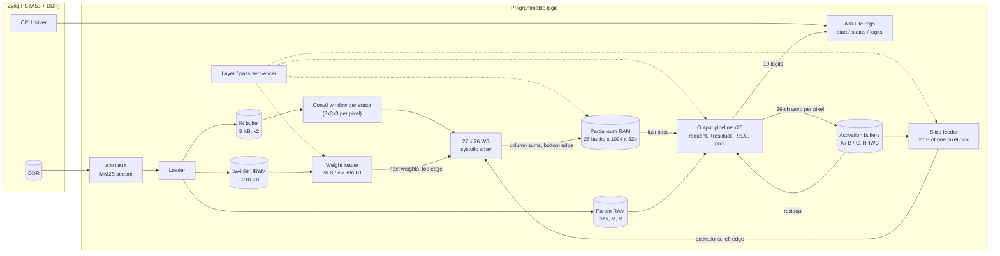
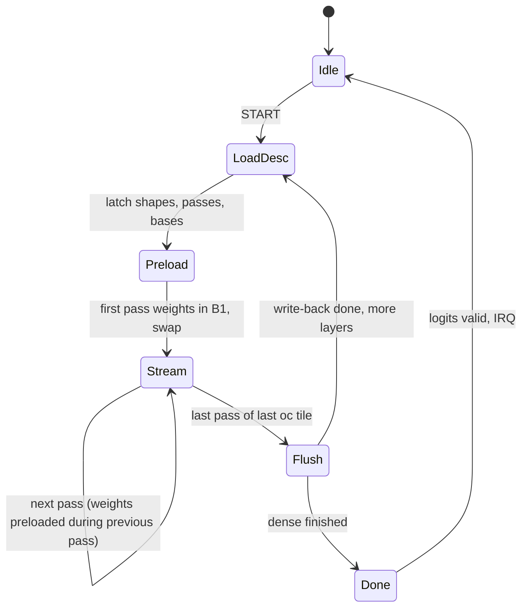

# Architecture 3 – Weight-stationary ("TPU-style") systolic conv engine (27 × 26)

**Status: alternative proposal, not implemented.** All numbers are derived from
layer shapes and device datasheet capacities; nothing here is synthesized or
measured. Background: [uarch_study step 03 §1.1–1.3](../uarch_study/03_systolic_array_mapping.md)
and the [three-way comparison](../uarch_study/03b_performance_comparison.md).

## 1. Summary

| Parameter | Value |
|---|---|
| Scope | Every ResNet-8 conv layer, fused residual add, avgpool, dense |
| Array | 27 rows (reduction slice `k`) × 26 columns (output channels) = 702 PEs |
| Dataflow | Weight-stationary: each PE holds one weight; pixels stream left→right, partial sums flow top→bottom |
| PE | 1 DSP48E2: weight in B2 (active) + B1 (next), partial sum through the PCIN/PCOUT cascade |
| Clock target | 200 MHz |
| On-chip storage | All weights (URAM), activations A/B/C (BRAM), partial-sum RAM (BRAM), params |
| Off-chip traffic per inference | 3,072 B image in, 10 B logits out |
| Ideal full-inference latency | 48,128 stream cycles ≈ 49,100 with overheads ≈ **246 µs @ 200 MHz** |
| Conv0 inside the network | ~1,090 cycles ≈ **5.5 µs** (exact fit: K = 27, OC = 26) |

## 2. Top-level block diagram



## 3. Dataflow

Same matrix view as every conv engine, `Y[oc][p] = Σ_k W[oc][k] · X̂[k][p]`
([loop nest](../uarch_study/02_conv_loop_nest.md)), but the roles are swapped
compared with architecture 2:

- Rows = a slice of up to 27 reduction indices `k`. Columns = 26 output channels.
- PE(r, c) holds weight `W[oc_tile·26 + c][k_slice + r]` for a whole **pass**.
- Pixels stream in: each cycle a new pixel `p` enters; row `r` receives
  `X̂[k_slice + r][p]` (skewed by `r`) and passes it right.
- Each PE adds `W·X` to the partial sum coming from above and passes it down.
  The bottom of column `c` emits `Σ_r W[c][r] · X̂[r][p]` for one pixel per cycle.

```text
                    col 0        col 1             col 25        weights fixed per pass
X̂[k0][p]      →  [W00] ─────→ [W01] ── ... ──→ [W0,25]         activations → (registered)
                    ↓ psum       ↓                  ↓            partial sums ↓ (PCIN cascade)
X̂[k1][p−1]    →  [W10] ─────→ [W11] ── ... ──→ [W1,25]
   ...                                                           (row skew on the left edge)
X̂[k26][p−26]  →  [W26,0] ────→ [W26,1] ─ ... ─→ [W26,25]
                    ↓            ↓                  ↓
             psum[p][oc0]  psum[p][oc1]  ...  psum[p][oc25]     → partial-sum RAM / output
```

### 3.1 Tiling: passes

A layer's weight matrix is `K × OC`. One **pass** loads one ≤ 27 × 26 block into
the PEs and streams **all P pixels** through it. Loop order:

```text
for oc_t in OC/26:                          # column tiling (output channels)
  for pass in passes(K):                    # row tiling (reduction)
    weights for (oc_t, pass) already in B1 → swap to B2
    start loading (oc_t, pass+1) into B1    # hidden: needs P ≥ 27
    for p in 0..P-1:                        # stream every pixel
      psum[p][0..25] = (pass == 0 ? bias : psum[p]) + column outputs
    if last pass: send psum[p] to the output pipeline instead of the RAM
```

**Tap-aligned passes.** A pass never crosses a 3×3 tap boundary: it covers one
`(ky, kx)` tap and up to 27 consecutive input channels. Each pass then reads a
contiguous channel slice of a **single** input pixel, which keeps the feeder
simple (§5.2). Conv0 (IC = 3) is the exception: all 27 `k` values fit in one
pass, fed by a window generator.

| Layer | IC | Passes per tap (rows used) | Passes (× 9 taps) | OC tiles | P | Stream cycles |
|---|---:|---|---:|---:|---:|---:|
| conv0 | 3 | all 27 k in 1 pass | 1 | 1 | 1,024 | 1,024 |
| block1_conv1 | 26 | 1 (26) | 9 | 1 | 1,024 | 9,216 |
| block1_conv2 | 26 | 1 (26) | 9 | 1 | 1,024 | 9,216 |
| block2_conv1 (s2) | 26 | 1 (26) | 9 | 2 | 256 | 4,608 |
| block2_conv2 | 52 | 2 (27 + 25) | 18 | 2 | 256 | 9,216 |
| block2_shortcut (1×1) | 26 | 1 (26) | 1 | 2 | 256 | 512 |
| block3_conv1 (s2) | 52 | 2 (27 + 25) | 18 | 4 | 64 | 4,608 |
| block3_conv2 | 104 | 4 (27 + 27 + 27 + 23) | 36 | 4 | 64 | 9,216 |
| block3_shortcut (1×1) | 52 | 2 (27 + 25) | 2 | 4 | 64 | 512 |
| **Total** | | | | | | **48,128** |

Row utilization is 96.3% on every layer except conv0 (100%), giving 96.4%
overall. A non-aligned split (`ceil(K/27)` passes) would save 256 cycles on
block3_conv2 but needs a feeder that straddles two pixels.

## 4. Processing element

```text
            next weight (from PE above, BCIN cascade, during load)
                 │
                 ▼
           ┌─────────── DSP48E2 ───────────┐
 act_in ──►│ A = activation (8b)            ├──► act_out (to PE right, registered)
 (8b)      │ B1 = next weight  (load)       │
           │ B2 = active weight (swap)      │
 psum_in ─►│ P = PCIN + A · B2              ├──► psum_out (PCOUT, to PE below)
 (PCIN)    └────────────────────────────────┘
```

- **Double-buffered weights inside the DSP.** B1 (CEB1) shifts the next pass's
  weights down the column through the BCIN/BCOUT cascade. B2 (CEB2) holds the
  active weight. A `swap` flag travels with the activations, so each PE
  switches to the new weight exactly when the first pixel of the new pass
  reaches it.
- **Partial sums ride the dedicated PCOUT→PCIN cascade**: no fabric routing
  for the 48-bit psums. An array column maps onto one physical DSP column
  (27 DSPs).
- **Load timing.** The weight load for column `c` starts `c` cycles later
  (column-skewed), as a wave behind the swaps. A load takes 27 cycles, so it
  is hidden whenever `P ≥ 27`. Every conv layer has `P ≥ 64`.
- Rows that a pass does not use (e.g. row 26 when IC = 26) get weight 0.

## 5. Feeding the array

### 5.1 Weights (top edge, during load)

URAM word = 26 bytes = one array row's weights for the 26 columns:
`W[oc_tile·26 + c][pass slice row r]`, stored bottom row first so the shift
chain lands each byte in its row. Words per pass = 27.

```text
words = Σ (OC/26) · passes · 27
      = 27 + 243 + 243 + 486 + 972 + 54 + 1,944 + 3,888 + 216 = 8,073 words × 26 B ≈ 210 KB
      → 6 URAM (8,192 × 216 b), 98.5% full
```

### 5.2 Activations (left edge): the slice feeder

Activation layout in A/B/C: **NHWC with 26-channel words** (32-byte word, 26
used). This matches the exported contract layout, and the output pipeline
writes exactly one word per pixel per oc tile.

```text
word(pixel, j) = X[y][x][26j .. 26j+25]     address = base + (y·W + x)·(C/26) + j
```

For a pass `(ky, kx, ic0 .. ic0+n−1)` and output pixel `p = (oy, ox)`, the
feeder reads input pixel `(s·oy + ky − pad_top, s·ox + kx − pad_left)` (zero if
outside), takes channels `ic0 .. ic0+n−1`, and rotates them onto rows 0..n−1.

| IC | Pass slices | Words per cycle |
|---:|---|---:|
| 26 | [0–25] | 1 |
| 52 | [0–26], [27–51] | ≤ 2 |
| 104 | [0–26], [27–53], [54–80], [81–103] | ≤ 2 |

Both BRAM ports are available because no layer reads and writes the same
buffer. Rotation is a 27-byte barrel shifter (offset fixed per pass).

**Conv0 window generator.** IC = 3 and all 27 taps go in one pass, so each
cycle needs the full 3×3×3 window of one pixel. A classic line-buffer window
does this: two 32-pixel line buffers plus a 3×3 register window of 3-byte
pixels, advancing one pixel per cycle in raster order. Alternative: the CPU
pre-expands the image to 1,024 × 27 B (27.6 KB DMA instead of 3 KB).

## 6. Partial sums and output pipeline

**Partial-sum RAM.** 26 banks (one per column), each 1,024 × 32 bit = one
BRAM36 in 1K×36 mode. Each bank has its own address counter, delayed by the
column skew, so no de-skew is needed before the RAM. Read-modify-write per
cycle: port A reads `psum[p]`, port B writes `psum[p] + column_sum`. The same
address recurs only after `P ≥ 64` cycles, far beyond the 2–3 cycle RAM
latency. Pass 0 initializes with the channel's **bias** instead of zero.

**Output pipeline (26 lanes).** On the last pass the column sums go to the
requant lanes instead of the RAM. Within an oc tile, lane `c` always handles
the same channel, so `{M, R}` are loaded once per oc tile, not per cycle.

```text
psum+bias ─► × M ─► round-shift R ─► [ReLU] ─► sat INT8 ─┬──────────────────────► conv output
                                                         │  (fused residual add)
                       residual INT8 (same pixel, 26 ch) ─► requant(M_b,R_b) ─┐
                       conv INT8 ──────────────────────► requant(M_a,R_a) ──┴► + ─► ReLU ─► sat INT8
```

- Output word = 26 INT8 channels of one pixel, after a small byte de-skew
  triangle. One word is written per cycle to the destination buffer.
- Rounding follows the contract: `magnitude = (|p| + 2^(R−1)) >> R`, sign
  restored.
- **Avgpool:** during block3_conv2 + add, lane `c` accumulates channel
  `26·oc_t + c` over the 64 pixels in INT32, then rounds `/64`.
- **Dense** (104 → 10): on the array as K = 104 (4 tap-free passes), OC = 10 in
  columns 0–9, P = 1. Weight loads are not hidden at P = 1, so
  ~4 × (27 + 51 + 10) ≈ 350 cycles. It could also run on the CPU.

## 7. On-chip memory map

| Store | Size | Organization | Physical (ballpark) |
|---|---:|---|---|
| IN (double-buffered) | 2 × 3,072 B | raster pixels, 3 B each | 4–8 BRAM36 |
| A, B, C | 3 × 32,768 B (26-ch words padded to 32 B) | 1,024 × 256 b each | 24 BRAM36 |
| Partial sums | 106,496 B | 26 banks × 1,024 × 32 b | 26 BRAM36 |
| Weights | ~210 KB | 8,192 × 216 b | 6 URAM |
| Params, descriptors | ~8.6 KB | per-oc records, 14 descriptors | 3 BRAM36 |
| **Total** | | | **~57–61 BRAM36 (of 144), 6 URAM (of 64)** |

Buffer rotation is identical to architecture 2 (IN → A → B → C, then
`C → A`, `C → B`, `A + B → C` per block). No layer reads and writes the same
buffer, and residual inputs survive until consumed.

## 8. Control: pass sequencer



Per-layer overhead: array skew (27 + 26 − 2 = 51) + RAM/requant latency
(~10) + layer dependency ≈ 70–90 cycles. The first pass of a layer can preload
during the previous layer's last pass. Total ~700 cycles.

## 9. Worked examples

### 9.1 One PE in block1_conv1

Pass = tap `(ky = 1, kx = 2)`, oc tile 0. PE(row 5, column 3) holds
`W[oc = 3][ky = 1][kx = 2][ic = 5]` for the whole pass. For each streamed output
pixel `(oy, ox)` it receives `X[oy][ox + 1][5]` (zero if `ox + 1 = 32`). It adds
`W · X` to the psum from PE(4, 3) and passes the result to PE(6, 3). Row 26 has
weight 0 (IC = 26). After all 9 tap passes, `psum[p][3]` holds the full
234-term sum.

### 9.2 Conv0 (exact fit)

```text
weights: one 27 × 26 block, loaded once (27 cycles, prefetchable)
stream:  1,024 pixels in raster order through the window generator
array:   column c emits the complete 27-term sum for (p, oc=c) every cycle; no psum RAM traffic
total ≈ 1,024 + 51 skew + ~10 latency (+27 if not prefetched) ≈ 1,085–1,112 cycles ≈ 5.4–5.6 µs
```

### 9.3 block3_conv2 (where weight-stationary is weakest)

- IC = 104 → 4 passes per tap × 9 taps = 36 passes. OC = 104 → 4 oc tiles.
  So 144 passes × 64 pixels = 9,216 cycles.
- Each weight is loaded for only 64 uses. Its 27-cycle load is hidden only
  because 64 ≥ 27. With pixel tiling or a smaller image this would stall.
- The psum RAM is read and written 144 × 64 times per bank.

### 9.4 block2_shortcut (1×1 s2)

- One pass per oc tile (IC = 26, single tap), P = 256. The feeder reads input
  pixel `(2·oy, 2·ox)`: one word per cycle.
- K = 26 ≤ 27, so results complete in one pass and skip the psum RAM, like
  conv0.

## 10. Performance and resources (ballpark)

| Metric | Value |
|---|---|
| Stream cycles (ideal) | 48,128 (96.4% PE utilization) |
| With skew/latency/layer switch, pool, dense | ~49,100 cycles |
| Latency @ 200 MHz / @ 100 MHz fallback | ~246 µs / ~491 µs |
| Throughput (one image at a time) | ~4,100 images/s (hardware only) |
| DSP | 702 PEs + ~100–160 output = ~800–860 (64–69%) |
| LUT | ~30–45k: slice feeder + rotator, window generator, sequencer, DMA |
| FF | ~20–35k: activation pipeline (702 × 8 b), skew triangles; weights and psums live in DSP registers |
| BRAM36 / URAM | ~57–61 / 6 |

## 11. How this differs from architecture 2

| | Arch 2: OS 26 × 32 | Arch 3: WS 27 × 26 |
|---|---|---|
| Stays in PE | Partial sum | Weight |
| Variable K | Free (K = cycles per tile) | Passes + psum RAM |
| Extra memory | none | 26 BRAM36 psum RAM |
| Weight read rate | 26 B every cycle | 26 B/cycle only while loading (27 of every ≥ 64 cycles) |
| Activation layout | Channel-planar 32-px words | NHWC 26-ch words (matches export) |
| Requant params | change every drain cycle | constant per lane per oc tile |
| DSP cascade use | Accumulate in P; drain in fabric | B1/B2 weight chain + PCIN psum chain (very natural) |
| Full inference | ~201 µs (832 PEs) | ~246 µs (702 PEs) |

## 12. Verification plan

1. **PE/column test:** load random weights, stream random activations, check
   column sums, the B1/B2 swap at pass boundaries, and back-to-back passes at
   P = 27 (the minimum hidden-load case).
2. **Slice feeder and window generator:** compare streams against a Python
   im2col for all layer shapes, including stride-2 asymmetric padding.
3. **Psum RAM:** RMW correctness across passes, and bias initialization on
   pass 0.
4. **Layers and network:** bit-exact against `resnet8/artifacts/layer_vectors/`
   and `resnet8/integer.py`.

## 13. Risks and open questions

| Risk / question | Mitigation |
|---|---|
| Weight URAM 98.5% full with tap-aligned padding | Store unused rows implicitly (zero-fill in loader), or use a 7th URAM |
| P ≥ 27 needed to hide loads | Holds for every conv layer; dense pays ~350 cycles or runs on CPU |
| 27 rows misaligned with IC = 26/52/104 | Tap-aligned passes (chosen) keep the feeder to ≤ 2 words / cycle |
| 26 psum banks + skewed addressing | Address counters are simple delayed copies of one counter |
| Physical DSP column height for 27-deep cascade | Check device DSP column layout before committing |
