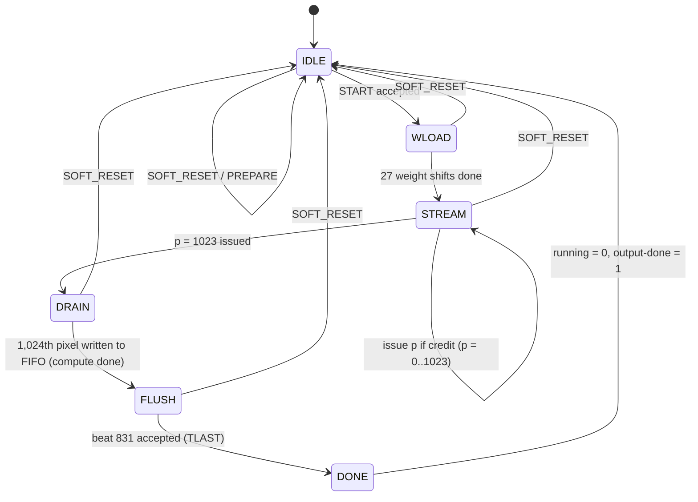

# Conv0 Weight-Stationary (TPU-style) Accelerator — Architecture Specification

| Field | Value |
|---|---|
| Document | `Conv0Spec_ChipAgents.md` |
| Revision | 0.1 (initial, for AI-assisted RTL generation and verification) |
| Target | AMD Kria KV260, K26 SOM, part `xck26-sfvc784-2LV-c` (Zynq UltraScale+ MPSoC) |
| Scope | ResNet-8 layer **Conv0 only**: 32×32×3 INT8 → 32×32×26 INT8, 3×3, stride 1, SAME, folded BN, ReLU |
| Architecture | Weight-stationary systolic array, 27 rows (reduction taps) × 26 columns (output channels) = 702 PEs |
| Source proposal | [arch3_ws_tpu_27x26/ARCHITECTURE.md](../brainstorming/conv0/arch3_ws_tpu_27x26/ARCHITECTURE.md) |
| Baseline RTL | [design/rtl/conv0/](../design/rtl/conv0/) (`ws_pkg`, `ws_pe`, `ws_column`, `ws_array`, `ws_skew`, `ws_mxu`) |
| Arithmetic contract | [HARDWARE_CONTRACT.md](../../junk/resnet8/HARDWARE_CONTRACT.md), reference [integer.py](../../junk/resnet8/integer.py) |
| Golden vectors | [junk/layer_vectors/conv0/](../../junk/layer_vectors/conv0/), [junk/export/](../../junk/export/) |

Keywords: **shall** = mandatory requirement (has an ID, must be verified); **should** = recommended;
**may** = permitted option. Requirement IDs (`REQ-xxx-nn`) are referenced from the verification plan (§13).

---

## Table of contents

1. [Purpose and how to use this spec with an AI agent](#1-purpose-and-how-to-use-this-spec-with-an-ai-agent)
2. [Assumptions and design decisions](#2-assumptions-and-design-decisions)
3. [Functional definition (golden arithmetic)](#3-functional-definition-golden-arithmetic)
4. [System architecture on the KV260](#4-system-architecture-on-the-kv260)
5. [Accelerator microarchitecture](#5-accelerator-microarchitecture)
6. [Systolic matrix unit (array, PE, skew)](#6-systolic-matrix-unit-array-pe-skew)
7. [Image store and window generator](#7-image-store-and-window-generator)
8. [Weight store and weight preload](#8-weight-store-and-weight-preload)
9. [Output path: bias, requantization, de-skew, FIFO, packer](#9-output-path-bias-requantization-de-skew-fifo-packer)
10. [Host interface: AXI-Stream loader, AXI-Lite registers, protocol](#10-host-interface-axi-stream-loader-axi-lite-registers-protocol)
11. [Control, timing and performance](#11-control-timing-and-performance)
12. [Implementation constraints (KV260 resources, clocks, coding rules)](#12-implementation-constraints-kv260-resources-clocks-coding-rules)
13. [Verification plan](#13-verification-plan)
14. [Module cards for RTL generation](#14-module-cards-for-rtl-generation)
15. [Milestones and acceptance gates](#15-milestones-and-acceptance-gates)
16. [Risks and open questions](#16-risks-and-open-questions)

---

## 1. Purpose and how to use this spec with an AI agent

This spec is the single source of truth for generating and verifying RTL for the
Conv0 weight-stationary accelerator. It is written so that each module can be
generated, linted and unit-tested **in isolation** from a module card (§14), and
then integrated bottom-up following §15.

Rules for any agent (human or AI) generating code from this spec:

1. **Reuse** the existing baseline RTL in [design/rtl/conv0/](../design/rtl/conv0/). Do not rewrite
   `ws_pe`, `ws_column`, `ws_array`, `ws_skew`, `ws_mxu` unless a requirement here demands a change;
   if so, change the minimum and record why.
2. Every new module shall have a self-checking unit testbench (§13) before it is integrated.
3. Bit-exactness is defined **only** by §3. Golden files in §3.5 are the arbiter, not the agent's own model.
4. Every numeric latency stated as *nominal* shall be measured by its unit test and back-annotated here
   (update the table in §11.2). Relative alignment rules (§6.4) are normative; absolute numbers are not.
5. Lint (slang/Verilator) and elaborate every module with zero errors and no unexplained warnings.
6. Never claim a gate in §15 is passed without the log of the simulator run that proves it.

---

## 2. Assumptions and design decisions

| ID | Assumption / decision | Rationale |
|---|---|---|
| A1 | Accelerator computes Conv0 only; one frame per START. No other ResNet layers. | Matches the scope of the implemented arch1 baseline; enables a fair comparison. |
| A2 | Single PL clock domain `aclk` for the accelerator, AXI-Lite and AXI-Stream. Target **200 MHz**; 150 MHz and 100 MHz are fallback build options with no RTL change. | WS array maps to DSP cascades; 200 MHz is the arch3 target. RTL is clock-agnostic. |
| A3 | Host data movement uses AMD AXI DMA (simple mode) with 256-bit AXI-Stream, identical to arch1. | Reuse of the existing block design, `cpu/benchmark.c` and the payload formats. |
| A4 | Register map and LOAD_KIND protocol are **backward compatible** with arch1 (same offsets/semantics) except: VERSION, MACS, OUTPUT_LANES values; quantization packet is **loaded** (runtime) instead of compared. | Minimal host software changes; runtime M/R is required for future reuse in later layers. |
| A5 | Reduction index order in the array rows is the OHWI order `k = ky·9 + kx·3 + ic` (0..26). | Weight packet is OHWI, so row `r` of the array takes weight byte `oc·27 + r` with no reordering. |
| A6 | Bias is added **after** the array (top-of-column partial sum = 0, as in the baseline `ws_array`). | Keeps `ws_array` unchanged; one 32-bit add per lane. |
| A7 | Partial sums are INT32 two's-complement and **wrap** modulo 2³². DSP P is 48-bit; only the low 32 bits are architecturally visible. | Contract: hardware accumulator wraps; low 32 bits of a 48-bit sum equal the mod-2³² sum. |
| A8 | Image is held on chip in a 9-bank window store (§7), not a streaming line buffer. | Exactly one 27-byte window per clock with no row-boundary bubbles and trivial padding. |
| A9 | No global stall net into the array. Back-pressure is handled by **credit-based issue** at the feeder (§9.6). | A systolic array without clock enables keeps PE/DSP mapping clean. |
| A10 | Single-buffered image store in v1; image load and compute do not overlap. A ping-pong image store is a v2 option (`IMG_BUFS = 2`). | Simplicity; the benchmark is single-frame latency. |
| A11 | Weights are re-shifted into the array on every START (27 cycles). | Negligible cost; avoids warm/cold state in the array. |
| A12 | No interrupt in v1; host polls STATUS (as arch1). | Reuse of the arch1 harness. |

---

## 3. Functional definition (golden arithmetic)

### 3.1 Tensors and layouts

| Tensor | Type | Shape | Linear byte/element address | Size |
|---|---|---|---|---:|
| Input `X` | INT8 signed | H=32, W=32, C=3 | `(y·32 + x)·3 + ic` (HWC) | 3,072 B |
| Weights `W` | INT8 signed | OC=26, KH=3, KW=3, IC=3 | `oc·27 + ky·9 + kx·3 + ic` (OHWI) | 702 B |
| Bias `b` | INT32 signed, LE | 26 | `4·oc` | 104 B |
| Quant `(M,R)` | INT32 signed, LE, pairs | 26 × 2 | `M`: `8·oc`, `R`: `8·oc + 4` | 208 B |
| Accumulator `acc` (debug/golden only) | INT32 | 32×32×26 | `(y·32 + x)·26 + oc` | 26,624 × 4 B |
| Output `Y` | INT8 signed (values 0..127) | 32×32×26 | `(y·32 + x)·26 + oc` (HWC) | 26,624 B |

### 3.2 Convolution (SAME, stride 1, zero padding 1 on every side)

```text
for oy in 0..31, ox in 0..31, oc in 0..25:
    acc = b[oc]                                                 (INT32)
    for ky in 0..2, kx in 0..2, ic in 0..2:
        iy = oy + ky - 1 ; ix = ox + kx - 1
        xv = (0 <= iy < 32 and 0 <= ix < 32) ? X[iy][ix][ic] : 0
        acc = (acc + xv * W[oc][ky][kx][ic]) mod 2^32           (two's-complement wrap)
```

Kernel is **not** flipped (cross-correlation). Padding samples are integer zero.

### 3.3 Requantization (per output channel, exactly one rounding)

```text
p        = INT64(acc) * INT64(M[oc])                 # signed 64-bit product, M > 0
mag      = (|p| + 2^(R[oc]-1)) >> R[oc]              # round half away from zero
wide     = (p < 0) ? -mag : mag
Y        = clip(wide, RELU ? 0 : -128, 127)          # Conv0: RELU = 1 → range 0..127
```

Constraints: `1 ≤ R ≤ 62`, `M > 0` (Q31 significand, `M < 2³¹`). An arithmetic right shift of a negative
`p` plus offset is **not** equivalent and shall not be used (REQ-ARI-03).

### 3.4 Arithmetic requirements

| ID | Requirement |
|---|---|
| REQ-ARI-01 | The accelerator output `Y` shall be bit-identical to §3.2–3.3 for every input, weight, bias and valid (M,R). |
| REQ-ARI-02 | Partial sums and `acc` shall wrap modulo 2³²; they shall not saturate. |
| REQ-ARI-03 | Rounding shall be magnitude-based half-away-from-zero exactly as in §3.3. |
| REQ-ARI-04 | Requant shall support any `R` in 1..62 and any `M` in 1..2³¹−1 at runtime. |
| REQ-ARI-05 | Padding samples shall contribute exactly zero (padding is never read from memory). |

### 3.5 Golden data (fixture: CIFAR-10 test index 3)

| File | Elements × bits | Content | Order |
|---|---|---|---|
| `junk/layer_vectors/conv0/input.mem` | 3,072 × 8 | Input image | HWC |
| `junk/export/conv0_weights.mem` | 702 × 8 | Weights | OHWI |
| `junk/export/conv0_bias.mem` | 26 × 32 | Folded bias | oc |
| `junk/export/conv0_quant.mem` | 52 × 32 | `M0, R0, M1, R1, …` | oc pairs |
| `junk/layer_vectors/conv0/expected_acc.mem` | 26,624 × 32 | `acc` incl. bias, pre-requant | HWC |
| `junk/layer_vectors/conv0/expected_output.mem` | 26,624 × 8 | Final `Y` | HWC |

One hex two's-complement word per line (`$readmemh`). SHA-256 hashes are in
[fixture_manifest.json](../brainstorming/conv0/arch1_broadcast_832/cpu/fixture_manifest.json). The
fixture's per-channel `R` values lie in 38..42; the fixture alone does **not** exercise small `R`
or negative outputs before ReLU clipping corner cases — see §13 for synthetic vectors.

---

## 4. System architecture on the KV260

### 4.1 Block design

```text
 ┌──────────────────────── Zynq UltraScale+ PS ────────────────────────┐
 │  Cortex-A53 (bare-metal benchmark / driver)        DDR4 (4 GB)      │
 │     │ M_AXI_HPM0_FPD (AXI4, 32b regs)                  ▲            │
 │     │                                   S_AXI_HP0_FPD (128 b)       │
 └─────┼──────────────────────────────────────────────────┼────────────┘
       │                                                  │
       ▼                                                  │
 ┌──────────────┐   AXI-Lite   ┌───────────────┐   AXI4 MM│ (SmartConnect, width/clock conv.)
 │ SmartConnect │─────────────►│ AXI DMA       │◄─────────┘
 │ (control)    │──────┐       │ simple mode   │
 └──────────────┘      │       │ MM2S   S2MM   │
                       │       └──┬──────▲─────┘
              AXI-Lite │ 0xA000_0000  │      │ 256-bit AXIS (TDATA/TKEEP/TLAST)
                       ▼          ▼      │
               ┌───────────────────────────────────────────┐
               │            conv0_ws_top (this spec)        │
               │ S_AXI (regs)  S_AXIS (in)   M_AXIS (out)   │
               └───────────────────────────────────────────┘
   Clocks: pl_clk0 = aclk (accelerator, DMA stream side, AXI-Lite) = 200 MHz target
           saxihp0_fpd_aclk may share aclk or use a second PL clock; SmartConnect converts.
   Reset : proc_sys_reset → aresetn (active-low, synchronous to aclk)
```

| ID | Requirement |
|---|---|
| REQ-SYS-01 | `conv0_ws_top` shall expose exactly one AXI4-Lite slave (32-bit data, 7-bit address), one AXI4-Stream slave and one AXI4-Stream master (256-bit TDATA, TKEEP, TLAST, TVALID/TREADY), clock `aclk`, reset `aresetn`. |
| REQ-SYS-02 | Accelerator base address `0xA000_0000`, DMA base `0xA001_0000` (same as arch1). |
| REQ-SYS-03 | A plain-Verilog wrapper `conv0_ws_bd.v` shall be provided for IP-integrator module reference (SystemVerilog unpacked arrays are not allowed on the top-level ports). |
| REQ-SYS-04 | The design shall build with Vivado for `xck26-sfvc784-2LV-c` using the KV260 board part when installed. |

### 4.2 End-to-end data flow for one frame

```text
 DDR image/W/b/quant ──MM2S──► S_AXIS ──► loader ──┬─► image store (9 banks)
                                                   ├─► weight store (27 × 26 B)
                                                   └─► param regs (bias, M, R)
 START ──► controller: weight preload (27 clk) ──► stream 1,024 pixels
     image store ─► window gen (27 B/clk) ─► row skew ─► 27×26 WS array ─► 26 column sums (col-skewed)
     ─► +bias ─► requant ×26 ─► de-skew ─► output FIFO (26 B/pixel) ─► packer (32 B/beat) ─► M_AXIS
 M_AXIS ──S2MM──► DDR output (26,624 B, HWC, 832 beats, TLAST on last)
```

---

## 5. Accelerator microarchitecture

### 5.1 Top-level block diagram (`conv0_ws_top`)

```text
                 ┌──────────────────────────────────────────────────────────────────────────────┐
 S_AXI ─────────►│ c0_axil_regs  ── CONTROL/STATUS/LOAD_KIND/counters ──┐                       │
                 │                                                       ▼                       │
 S_AXIS ────────►│ c0_loader ──img rows──► c0_image_store ◄──rd(9 addr)── c0_window_gen ◄─┐     │
 (256b)          │     │                    (9 × 128×24b LUTRAM)            │ 27 B         │     │
                 │     ├──weights──► c0_weight_store (27×208b) ──row/shift──┐│              │     │
                 │     └──b,M,R────► c0_param_regs                          ││   c0_ctrl ───┤     │
                 │                       │ bias[26], M[26], R[26]          ▼▼  (FSM, p ctr, │     │
                 │                       │                         ┌───────────┐ credits)  │     │
                 │                       │                         │  ws_mxu   │◄──────────┘     │
                 │                       │                         │ skew+27×26│                 │
                 │                       │                         └─────┬─────┘                 │
                 │                       │               26 × INT32, column-skewed (col c +c clk)│
                 │                       └──────────────► c0_requant (26 lanes: +b, ×M, rnd, sat)│
                 │                                                  │ 26 × INT8 (still skewed)    │
                 │                                       c0_deskew (lane c delayed 25−c)          │
                 │                                                  │ 208 b / pixel               │
                 │                                       c0_out_fifo (depth OUT_FIFO_DEPTH)       │
                 │                                                  │                             │
 M_AXIS ◄────────│                                       c0_packer (26 B → 32 B beats, TLAST)     │
                 └──────────────────────────────────────────────────────────────────────────────┘
```

### 5.2 Global parameters (extend `ws_pkg`)

| Name | Value | Meaning |
|---|---:|---|
| `ACT_W` | 8 | Activation width (existing) |
| `W_W` | 8 | Weight width (existing) |
| `PSUM_W` | 32 | Partial-sum width (existing) |
| `ROWS` | 27 | Array rows = reduction taps (existing) |
| `COLS` | 26 | Array columns = output channels (existing) |
| `IMG_H`, `IMG_W`, `IMG_C` | 32, 32, 3 | Input shape |
| `NPIX` | 1024 | Output pixels per frame |
| `AXIS_W` | 256 | Stream data width (bits) |
| `OUT_FIFO_DEPTH` | 128 | Output FIFO depth in pixels (≥ `PIPE_DEPTH` + 8) |
| `L_WG` | 2 | Window-generator latency (nominal) |
| `L_Q` | 7 | Requant latency including bias add (nominal) |
| `RELU` | 1 | Conv0 applies ReLU |

| ID | Requirement |
|---|---|
| REQ-PKG-01 | All widths and dimensions shall come from `ws_pkg`; no magic numbers in module bodies except loop bounds derived from them. |

---

## 6. Systolic matrix unit (array, PE, skew)

### 6.1 Mapping

```text
  PE(r, c) holds W[oc = c][k = r],  k = ky·9 + kx·3 + ic,  r ∈ 0..26, c ∈ 0..25
  Each clock one pixel p enters; row r receives X̂[r][p] = X[oy+ky−1][ox+kx−1][ic] (0 if padding)
  Column c, after the bottom row, emits  S[p][c] = Σ_r X̂[r][p] · W[c][r]   (no bias)
```

```text
                     weight preload: column c delayed c clk (ws_skew), rows shift top→bottom
                       │ col 0          │ col 1                     │ col 25
 x̂[0][p]   ─(skew 0)─►[PE 0,0 ]─reg─►[PE 0,1 ]─reg─► … ─reg─►[PE 0,25 ]
                         │ psum           │                            │
 x̂[1][p]   ─(skew 1)─►[PE 1,0 ]─reg─►[PE 1,1 ]─reg─► … ─reg─►[PE 1,25 ]
                         │                │                            │
   ⋮                     ⋮                ⋮                            ⋮
 x̂[26][p]  ─(skew 26)►[PE 26,0]─reg─►[PE 26,1]─reg─► … ─reg─►[PE 26,25]
                         │                │                            │
                         ▼                ▼                            ▼
                      S[p][0]          S[p][1]        …           S[p][25]
                      (t₀+27)          (t₀+28)                    (t₀+52)   ← column-skewed
```

### 6.2 Processing element (`ws_pe`, existing)

```text
              weight_load_in (from PE above / column top)
                     │      weight_load_enable (shared per column)
                     ▼
               ┌──────────┐ new_pass_start_in
               │ w_next   │─────────┐ (B1)
               └────┬─────┘         ▼
                    │        ┌────────────┐
                    └───────►│ w_active   │ (B2)   w_sel = new_pass_start_in ? w_next : w_active
                             └─────┬──────┘
 pixel_in ──────────────────┬──────┼────────────► [reg] ► pixel_out (+valid, +new_pass_start)
                            ▼      ▼
                          ( × ) product (signed 16 b)
                            │
 partial_sum_in ───────────(+)───► [reg] ► partial_sum_out      (PSUM_W = 32, wraps)
```

Normative behavior per rising edge (non-reset):

| Register | Next value |
|---|---|
| `pixel_out`, `pixel_valid_out`, `new_pass_start_out` | `pixel_in`, `pixel_valid_in`, `new_pass_start_in` |
| `partial_sum_out` | `partial_sum_in + sext(pixel_in × w_sel)` (mod 2³²) |
| `w_active` | `w_next` if `new_pass_start_in`, else hold |
| `w_next` | `weight_load_in` if `weight_load_enable`, else hold |
| `weight_load_out` (comb.) | `w_next` |

| ID | Requirement |
|---|---|
| REQ-PE-01 | The activation that carries `new_pass_start` shall already be multiplied by the **new** weight (`w_next`). |
| REQ-PE-02 | Weight shifting into `w_next` shall not disturb `w_active` or results of in-flight pixels. |
| REQ-PE-03 | `partial_sum_out` shall be updated every clock, including when `pixel_valid_in = 0` (bubbles carry `pixel_in = 0` from the feeder so the sum is harmless; validity is tracked by the valid bit only). |
| REQ-PE-04 | The feeder shall drive `pixel_in = 0` whenever `pixel_valid_in = 0`. |
| REQ-PE-05 | Each PE should map to exactly one DSP48E2 (multiply + PCIN add). The synthesized DSP count for `ws_array` shall be exactly 702 and no PE multiplier shall be built from LUTs (check `report_utilization -hierarchical`). |
| REQ-PE-06 | A PE pipeline option `PE_LAT ∈ {1,2,3}` (A/B input reg and/or M reg) may be added for timing closure. It shall be identical for all PEs, and the psum path PCIN→P shall remain exactly 1 clock so that the row-skew alignment of §6.4 is preserved. |

### 6.3 Column, array, skew, MXU (existing)

- `ws_column`: 27 PEs stacked; psum chain top (input `'0` from `ws_array`) to bottom; weight chain
  `w_next` shifts top→bottom with one shared enable; `partial_sum_valid_out = pixel_valid_out[ROWS-1]`.
- `ws_array`: 26 columns side by side; pixel/valid/swap buses pass column c → c+1 through the PE
  output registers.
- `ws_skew #(LANES, WIDTH)`: lane `i` delayed by `i` registers (lane 0 is a wire).
- `ws_mxu`: row skew (27 lanes of `{swap, valid, pixel}`) + column skew (26 lanes of `{wld_en, w}`) + array.

### 6.4 Timing and alignment rules (normative)

Let a pixel vector be presented at the `ws_mxu` input in cycle `s` (with `pixel_valid_in = 1`).

| Event | Cycle (PE_LAT = 1) |
|---|---|
| Row `r` value reaches PE(r, 0) input | `s + r` |
| Row `r` value reaches PE(r, c) input | `s + r + c` |
| `partial_sum_valid_out[c]` = 1 with `S[p][c]` | `s + ROWS + c` = `s + 27 + c` (nominal; pin with T-MXU-03) |

| ID | Requirement |
|---|---|
| REQ-MXU-01 | Column `c` output for a pixel shall appear exactly `c` cycles after column 0's output for the same pixel. |
| REQ-MXU-02 | Consecutive pixels presented in consecutive cycles shall produce consecutive outputs on every column (II = 1, no bubbles introduced). |
| REQ-MXU-03 | Weight preload: row data are presented to `ws_mxu.weight_load_in[0..25]` for 27 consecutive shifts, **row ROWS−1 first, row 0 last**, with `weight_load_enable = 1`. |
| REQ-MXU-04 | The first pixel of a frame shall be presented with `new_pass_start_in = 1` no earlier than the cycle after the 27th weight shift is presented (`s_first ≥ s_wload_start + 27`). Rationale: PE(r,c) completes loading at `s_wload_start + 27 + c` (column skew) and the swap reaches it at `s_first + r + c`. |
| REQ-MXU-05 | Exactly one `new_pass_start` per frame (the first valid pixel). |

---
## 7. Image store and window generator

### 7.1 Banking (9 banks, indexed by `(y mod 3, x mod 3)`)

Any 3×3 neighborhood touches each `(y mod 3, x mod 3)` class **exactly once**, so a 9-bank store
returns a full 3×3×3 window in one read cycle with no line buffers and no row-boundary bubbles.

```text
 bank id  b = (y mod 3)·3 + (x mod 3)                     b ∈ 0..8
 address  a = (y div 3)·11 + (x div 3)                    a ∈ 0..120  (depth 128)
 word     24 bits = {X[y][x][2], X[y][x][1], X[y][x][0]}  (ic 0 in bits [7:0])

 image (y,x)          x: 0 1 2 3 4 5 6 …
          y=0 → banks    0 1 2 0 1 2 0 …
          y=1 → banks    3 4 5 3 4 5 3 …
          y=2 → banks    6 7 8 6 7 8 6 …
          y=3 → banks    0 1 2 0 1 2 0 …   (address advances by 11)
```

| ID | Requirement |
|---|---|
| REQ-IMG-01 | `c0_image_store` shall hold the full 32×32×3 image in 9 banks of 128 × 24 bits using the mapping above. |
| REQ-IMG-02 | It shall provide 9 independent read ports (one per bank) and one 3-bank write port per cycle (see §7.3). |
| REQ-IMG-03 | Storage should infer LUTRAM (distributed RAM); BRAM is permitted if the read latency is absorbed in `L_WG`. |

### 7.2 Window generator (`c0_window_gen`)

For output pixel `p = (oy, ox)` (raster order, `p = oy·32 + ox`):

```text
 for ky in 0..2, kx in 0..2:
     iy = oy + ky − 1 ;  ix = ox + kx − 1                    (range −1..32)
     valid(ky,kx) = (0 ≤ iy ≤ 31) && (0 ≤ ix ≤ 31)
     bank  = (iy mod 3)·3 + (ix mod 3) ; addr = (iy div 3)·11 + (ix div 3)   (only if valid)
     pix   = valid ? bank_rd[bank] : 24'h0
     for ic in 0..2:  x̂[ky·9 + kx·3 + ic] = pix[8·ic +: 8]
```

```text
  p counter (oy,ox) ─► per-(ky,kx) iy/ix, div3/mod3 (32-entry const ROM or incremental counters)
        │
        ├─► 9 bank addresses ──► c0_image_store ──► 9 × 24 b
        │                                          │
        └─► 3×3 rotate select + pad mask (reg) ───►│ rotate (y by iy mod 3, x by ix mod 3), zero pads
                                                   ▼
                                    27 × INT8 x̂[0..26]  + valid + new_pass_start ──► ws_mxu
```

| ID | Requirement |
|---|---|
| REQ-WG-01 | Output one 27-byte window per clock when `issue = 1`, in raster order, with `valid = 1` and the correct `new_pass_start`. |
| REQ-WG-02 | When `issue = 0`, output `valid = 0`, `new_pass_start = 0` and **all 27 bytes = 0** (REQ-PE-04). |
| REQ-WG-03 | Out-of-image taps shall be forced to 0 without depending on memory content (REQ-ARI-05). |
| REQ-WG-04 | Latency from `issue` to window at `ws_mxu` input shall be the constant `L_WG` (nominal 2), with `valid` and `new_pass_start` delayed identically. |
| REQ-WG-05 | No divider or modulo operator on non-constant operands shall be synthesized; use ROMs or incremental counters. |

### 7.3 Image loading (from the loader)

The 3,072-byte image packet is 96 AXIS beats; **3 beats = 96 B = one image row (32 pixels)**.

```text
 S_AXIS beats (image kind):  b0 b1 b2 | b3 b4 b5 | …            3 beats → row register (768 b)
 row assembler (2 row regs, ping-pong) ─► write 3 pixels/clk for 11 clk:
        cycle i (0..10): x = 3i, 3i+1, 3i+2  (x ≤ 31)  → banks (y mod 3, 0/1/2), addr (y div 3)·11 + i
 Throughput: 11 clk per row → ~352 clk per image (+ pipeline), independent of AXIS burstiness.
```

| ID | Requirement |
|---|---|
| REQ-IMG-04 | Loading shall write every pixel exactly once to the bank/address of §7.1. |
| REQ-IMG-05 | The loader shall back-pressure S_AXIS (TREADY = 0) when both row registers are full; no data shall be dropped. |
| REQ-IMG-06 | Image writes and window reads shall never occur in the same cycle (single-buffer, A10); the controller enforces image-load → START ordering. |

---

## 8. Weight store and weight preload

### 8.1 Storage (`c0_weight_store`)

```text
 wstore[k][oc]  k ∈ 0..26 (array row), oc ∈ 0..25 (array column)  → 27 words × 26 B (208 b)
 written from the OHWI packet: packet byte a = oc·27 + k  →  wstore[k][oc]
 a lives in AXIS beat a/32, lane a mod 32  → static wiring, no muxes (write enable = beat_idx == a/32 && TKEEP[a mod 32])
```

### 8.2 Preload sequence (controller-driven, 27 shifts)

```text
 shift s = 0..26 : weight_load_enable = 1, weight_load_in[c] = wstore[ROWS−1−s][c]
                 (ws_mxu applies the column skew internally)
 after the 27th shift, PE(r,c).w_next = wstore[r][c] = W[c][r]
```

| ID | Requirement |
|---|---|
| REQ-WS-01 | `wstore` shall be 702 bytes of registers (or LUTRAM) addressable as 27 rows × 26 bytes. |
| REQ-WS-02 | Weight packet bytes shall be routed by the fixed mapping `a → (k = a mod 27, oc = a div 27)`. |
| REQ-WS-03 | Preload shall present rows in descending order `26, 25, …, 0` on 27 consecutive cycles. |
| REQ-WS-04 | Weight store contents shall persist across PREPARE (warm runs) and be invalidated by SOFT_RESET (loaded-flag only; contents need not be cleared). |

---

## 9. Output path: bias, requantization, de-skew, FIFO, packer

### 9.1 Pipeline overview

```text
 ws_mxu.partial_sum_out[c] (INT32, col-skewed) ─┐
 ws_mxu.partial_sum_valid_out[c] ───────────────┤ per lane c (26 identical lanes)
                                                ▼
   Q0: acc   = psum + bias[c]                (32-bit wrap)          ◄── debug tap: acc[c], acc_valid[c]
   Q1..Q3: p = acc × M[c]                     (signed 32 × 31 → 64, DSP48E2, pipelined)
   Q4: neg = p[63]; mag = |p|
   Q5: mag_r = (mag + (1 << (R[c]−1))) >> R[c]    (64-bit barrel shift, may be split over 2 stages)
   Q6: y = RELU ? (neg ? 0 : min(mag_r,127)) : clip(±mag_r, −128, 127)
                                                ▼  INT8, still column-skewed
   de-skew: lane c delayed (COLS−1−c) clk  (ws_skew with reversed lane order)
                                                ▼  26 × INT8 aligned, one pixel per word
   c0_out_fifo (208 b × OUT_FIFO_DEPTH)  ─►  c0_packer (26 B → 32 B)  ─►  M_AXIS
```

### 9.2 Requant lane requirements

| ID | Requirement |
|---|---|
| REQ-RQ-01 | Each lane shall implement §3.3 bit-exactly for all `acc ∈ [−2³¹, 2³¹−1]`, `M ∈ [1, 2³¹−1]`, `R ∈ [1, 62]`. |
| REQ-RQ-02 | Lane latency shall be the constant `L_Q` for all lanes; `valid` travels with the data. Throughput II = 1. |
| REQ-RQ-03 | `bias[c]`, `M[c]`, `R[c]` are static during a frame (lane c always processes channel c). They shall be read directly from `c0_param_regs` (no per-cycle parameter fetch). |
| REQ-RQ-04 | The 64-bit product shall use DSP48E2 slices (≤ 4 per lane); total requant DSPs ≤ 104. |
| REQ-RQ-05 | Debug tap: the Q0 result `acc[c]` with its valid shall be observable by the testbench via hierarchy (named signal `acc_dbg[c]`, `acc_dbg_valid[c]`). It is compared against `expected_acc.mem`. |

### 9.3 Parameter registers (`c0_param_regs`)

| Field | Width | Source bytes (packet-relative) |
|---|---|---|
| `bias[c]` | INT32 | bias packet `4c .. 4c+3` (LE) |
| `M[c]` | INT32 | quant packet `8c .. 8c+3` (LE) |
| `R[c]` | 6 bits stored (INT32 in packet) | quant packet `8c+4 .. 8c+7` (LE) |

| ID | Requirement |
|---|---|
| REQ-PRM-01 | A quant packet with any `M[c] ≤ 0` or `R[c] ∉ [1,62]` shall set `ERRORS.bit1` and leave the quant loaded-flag cleared. |

### 9.4 De-skew

```text
 lane c of requant output for pixel p appears at cycle  t₀(p) + c
 lane c is delayed by (25 − c)  → all lanes of pixel p aligned at  t₀(p) + 25
 implementation: ws_skew #(.LANES(26), .WIDTH(9)) with data_in[i] = lane[25 − i]  ({valid, y})
```

| ID | Requirement |
|---|---|
| REQ-DSK-01 | The aligned output word shall contain `Y[p][c]` in byte `c` (bits `8c+7:8c`) for c = 0..25. |
| REQ-DSK-02 | The word `valid` is lane 25's valid after alignment; lanes shall be asserted (SVA) to have equal valids after de-skew. |

### 9.5 Output FIFO and packer

```text
 FIFO word = 208 b (one pixel, 26 channels).  Packer: byte buffer of 64 B, count n (bytes)
 each cycle (both may happen in the same cycle):
   TVALID = (n ≥ 32), TDATA = buf[255:0]   (both from registers)
   emit   = TVALID && TREADY                                     → shift buffer down 32 B, n −= 32
   append = fifo not empty && (n − (emit ? 32 : 0) + 26 ≤ 64)    → pop, append 26 B at byte n'
 Steady state with TREADY = 1: 1 pixel/clk in, 26/32 beat/clk out (output never limits issue)
 16 pixels = 416 B = 13 beats; 1,024 pixels = 26,624 B = 832 beats exactly.
 M_AXIS: TKEEP = all ones; TLAST = 1 on beat 831.
```

| ID | Requirement |
|---|---|
| REQ-OUT-01 | Output byte stream shall equal `Y` in HWC order: byte `n` of the frame = `Y[(n div 26)][n mod 26]` (pixel-major). |
| REQ-OUT-02 | Exactly 832 beats per frame, TKEEP = `32'hFFFF_FFFF`, TLAST only on beat 831. |
| REQ-OUT-03 | AXIS master rules: once TVALID is asserted, TDATA/TLAST shall be stable until TREADY. |
| REQ-OUT-04 | The packer shall sustain 1 beat/clk while data is available and accept 1 pixel/clk while it has room. |

### 9.6 Credit-based issue (back-pressure without stalling the array)

```text
 PIPE_DEPTH = L_WG + ROWS + (COLS−1) + L_Q + 1 (deskew→FIFO)   ≈ 2 + 27 + 25 + 7 + 1 = 62
 in_flight  : +1 on issue, −1 on FIFO write
 issue allowed iff  in_flight + fifo_count < OUT_FIFO_DEPTH
```

| ID | Requirement |
|---|---|
| REQ-CRD-01 | The output FIFO shall never overflow (SVA: `!(fifo_wr && fifo_full)`) under any M_AXIS TREADY pattern. |
| REQ-CRD-02 | With TREADY held high, credit gating shall never block issue (no throughput loss): `OUT_FIFO_DEPTH ≥ PIPE_DEPTH + 8`. |
| REQ-CRD-03 | With TREADY low indefinitely, issue stops within one cycle of credits reaching zero; computation resumes without loss or duplication when TREADY returns. |

---
## 10. Host interface: AXI-Stream loader, AXI-Lite registers, protocol

### 10.1 Input packets (S_AXIS, selected by LOAD_KIND)

| LOAD_KIND | Payload | Bytes | Beats | Final-beat TKEEP | Destination |
|---:|---|---:|---:|---|---|
| 0 | Image INT8, HWC | 3,072 | 96 | `FFFF_FFFF` | `c0_image_store` (via row assembler) |
| 1 | Weights INT8, OHWI | 702 | 22 | `3FFF_FFFF` (30 B) | `c0_weight_store` |
| 2 | Bias INT32 LE ×26 | 104 | 4 | `0000_00FF` (8 B) | `c0_param_regs.bias` |
| 3 | Quant (M,R) INT32 LE ×26 | 208 | 7 | `0000_FFFF` (16 B) | `c0_param_regs.M/R` |

Byte 0 of a beat is `TDATA[7:0]`. Each packet starts at packet byte 0 and ends with TLAST.

| ID | Requirement |
|---|---|
| REQ-LD-01 | TKEEP shall be contiguous from bit 0 and non-zero; every non-final beat shall have TKEEP = all ones. Violation → `ERRORS.bit0`. |
| REQ-LD-02 | Packet length shall equal the table value exactly. Too long (data beyond the length) or TLAST early/late → `ERRORS.bit2`. Excess bytes shall not be written. |
| REQ-LD-03 | A kind's loaded-flag (STATUS[11:8]) is cleared when its packet starts and set only when the packet ends with no error. |
| REQ-LD-04 | S_AXIS TREADY shall be 0 while `running`, during SOFT_RESET/PREPARE pulses, or when the destination cannot accept (image row assembler full). |
| REQ-LD-05 | Error bits are sticky until PREPARE or SOFT_RESET. |

### 10.2 Register map (AXI4-Lite, base `0xA000_0000`, 32-bit aligned)

Offsets 0x00–0x34 are identical to arch1; 0x38–0x3C are new.

| Offset | Name | Access | Reset | Description |
|---|---|---|---|---|
| 0x00 | CONTROL | W | – | Write exactly `1` = START, `2` = PREPARE, `4` = SOFT_RESET. Other values → SLVERR. Reads return 0. |
| 0x04 | STATUS | R | 0 | bit0 running; bit1 output done (TLAST accepted); bit2 compute done (1,024th pixel written to output FIFO); bit3 error (ERRORS ≠ 0); bit4 loader active; bits11:8 loaded flags for kinds 3..0 |
| 0x08 | OUTPUT_BYTES | R | 0 | Bytes accepted on M_AXIS this frame (multiple of 32) |
| 0x0C | LOAD_KIND | R/W | 0 | 0..3. Writable only when idle and loader empty; otherwise SLVERR, value unchanged |
| 0x10 | ERRORS | R | 0 | bit0 bad TKEEP; bit1 invalid quant (M ≤ 0 or R ∉ 1..62); bit2 length error |
| 0x14 | RUN_CYCLES | R | 0 | Cycles from accepted START to final output handshake (inclusive) |
| 0x18 | RAW_CYCLES | R | 0 | RUN_CYCLES snapshot at compute done |
| 0x1C | INPUT_STALLS | R | 0 | Cycles with S_AXIS TVALID & !TREADY |
| 0x20 | OUTPUT_STALLS | R | 0 | Cycles with M_AXIS TVALID & !TREADY |
| 0x24 | FIRST_OUTPUT_CYCLE | R | 0 | RUN_CYCLES at first M_AXIS handshake |
| 0x28 | LOAD_CYCLES | R | 0 | Accepted S_AXIS beats since PREPARE/SOFT_RESET (**beats**, not arch1's 16-byte chunks: cold = 129, warm = 96) |
| 0x2C | VERSION | R | `0x0003_0000` | Architecture 3, revision 0 |
| 0x30 | MACS | R | 702 | PEs |
| 0x34 | OUTPUT_LANES | R | 26 | Requant lanes |
| 0x38 | ISSUE_STALLS | R | 0 | Cycles in STREAM where credits blocked issue |
| 0x3C | ARRAY_DIMS | R | `0x001B_001A` | `{ROWS[15:0], COLS[15:0]}` |

| ID | Requirement |
|---|---|
| REQ-REG-01 | AW and W may arrive in either order or together; one write and one read may be outstanding independently. |
| REQ-REG-02 | Unmapped addresses → SLVERR (reads return 0). |
| REQ-REG-03 | START is accepted only if: not running, loader idle, loaded flags = `4'b1111`, ERRORS = 0, and output-done is clear (PREPARE/SOFT_RESET since the last frame). Otherwise SLVERR and no state change. |
| REQ-REG-04 | PREPARE (idle, loader empty): clears counters, done and error state; clears the **image** loaded-flag only; weights/bias/quant are kept. |
| REQ-REG-05 | SOFT_RESET (any time): aborts a frame, flushes all pipelines/FIFOs/packer, clears counters/errors, clears **all** loaded flags. RAM contents need not be cleared. Host must also reset the DMA if a transfer is in flight. |

### 10.3 Host sequence (one request)

```text
 cold:  SOFT_RESET → {LOAD_KIND=k; MM2S packet k; poll STATUS.loaded[k]} for k = 0,1,2,3
 warm:  PREPARE    → LOAD_KIND=0; MM2S image; poll STATUS.loaded[0]
 both:  arm S2MM for 26,624 B → write CONTROL=START → poll S2MM done / STATUS.bit1 → check ERRORS
        → invalidate cache → compare
```

Host software impact vs arch1 `cpu/benchmark.c`: update expected VERSION/MACS/OUTPUT_LANES; the
quant packet now programs M/R (a wrong-but-valid quant packet no longer errors); LOAD_CYCLES expected
values become 129 (cold) / 96 (warm).

---

## 11. Control, timing and performance

### 11.1 Controller FSM (`c0_ctrl`)



| State | Outputs |
|---|---|
| IDLE | `issue = 0`, `wload_en = 0`; loader may run |
| WLOAD | `wload_en = 1`, `wload_row = 26 − s` for s = 0..26 |
| STREAM | `issue = credit_ok`, `issue_first = (p == 0)`, `(oy, ox) = (p div 32, p mod 32)` (bit slices) |
| DRAIN / FLUSH | `issue = 0`; wait on counters |

### 11.2 Latency budget (no back-pressure, `aclk` = 200 MHz)

| Item | Cycles (nominal) | Note |
|---|---:|---|
| START accepted → first weight shift | 1 | |
| Weight preload | 27 | REQ-MXU-04 |
| Pixel issue | 1,024 | II = 1 |
| Window gen `L_WG` | 2 | measured by T-WG-01 |
| Array `ROWS + (COLS−1)` | 52 | measured by T-MXU-01 |
| Requant `L_Q` | 7 | measured by T-RQ-01 |
| De-skew → FIFO write | 1 | |
| FIFO → packer → last beat | ~3 | |
| **Total START → TLAST** | **≈ 1,117 cycles ≈ 5.6 µs** | arch1: 1,239 cycles @ 100 MHz = 12.4 µs |
| Image load (not in RUN_CYCLES) | ≈ 352 + 3 | 11 cycles/row write-limited |

| ID | Requirement |
|---|---|
| REQ-PERF-01 | With continuous M_AXIS TREADY, RUN_CYCLES shall be ≤ 1,150. |
| REQ-PERF-02 | Pixel issue shall be II = 1 in STREAM whenever credits allow (ISSUE_STALLS = 0 with TREADY = 1). |
| REQ-PERF-03 | Post-route timing shall meet 200 MHz (WNS ≥ 0, WHS ≥ 0). If not met, the documented fallback is 150 MHz then 100 MHz, with no RTL change. |

### 11.3 Cycle-level view of the first pixels (example)

```text
 cycle      : 0     1 … 27    28     29     30    …   30+27=57   58  …  82    …  89
 FSM        : START WLOAD…    STREAM
 wload row  :       26 … 0
 issue p    :                  0      1      2
 WG out p   :                                0      (t = 30, L_WG = 2)
 col 0 sum  :                                          p0 (57)    p1
 col 25 sum :                                                         p0 (82)
 requant/deskew aligned word p0 :                                              p0 (89)
```

Derivation: issue 28 → `ws_mxu` input 30 → column 0 at 30 + 27 = 57, column 25 at 57 + 25 = 82 →
after `L_Q` = 7 lane 25 at 89; lane 0 at 64 + de-skew 25 = 89. The last pixel is issued at 1,051 and
written to the FIFO at ≈ 1,113.

---

## 12. Implementation constraints (KV260 resources, clocks, coding rules)

### 12.1 Resource budget (`xck26-sfvc784-2LV-c`)

| Resource | Device | Budget (accelerator) | Basis |
|---|---:|---:|---|
| DSP48E2 | 1,248 | ≤ 806 (64.6%) | 702 PEs + ≤ 104 requant |
| LUT | 117,120 | ≤ 40,000 | window gen, loader, requant shifters, AXI; arch1 used 95,688 |
| FF | 234,240 | ≤ 45,000 | 702×10 b activation pipe, skews (~9.4 k), weight store 5.6 k, requant ~5 k |
| BRAM36 | 144 | ≤ 4 | output FIFO (128 × 208 b) |
| URAM | 64 | 0 | not needed for Conv0 |

| ID | Requirement |
|---|---|
| REQ-IMP-01 | Total accelerator utilization shall stay within the budget above; the AXI DMA/SmartConnect/PS are reported separately. |
| REQ-IMP-02 | Partial sums should use the DSP PCOUT→PCIN cascade within an array column. If the device DSP column layout prevents a 27-deep cascade, the fallback is fabric routing of P → C with identical function and latency. |
| REQ-IMP-03 | Single clock domain inside `conv0_ws_top`; no CDC inside the accelerator. |
| REQ-IMP-04 | Synchronous active-high `rst` internally (`rst = ~aresetn` registered once); DSP/RAM data paths need not be reset if a valid bit gates them (reduce reset fan-out), except where REQ-WG-02 requires zeros. |

### 12.2 Coding rules for generated RTL

1. SystemVerilog-2012, synthesizable subset; header `` `timescale 1ns/1ps `` and a short module comment, as in `ws_pe.sv`.
2. One module per file; file name = module name; place in `resnet8_project/design/rtl/conv0/`.
3. ANSI ports grouped `// Inputs` then `// Outputs`; parameters default from `ws_pkg`.
4. `always_ff @(posedge clk)` with synchronous `rst`; `always_comb` for combinational logic; no latches; no `initial` in synthesizable code; no `#` delays.
5. Unpacked-array ports are allowed below the top; `conv0_ws_bd.v` is plain Verilog with flat vectors.
6. No `/` or `%` with non-constant operands; use bit slices (powers of two) or small constant ROMs.
7. Signed arithmetic explicit (`logic signed`, `$signed`); widths of every product/sum explicit.
8. `(* use_dsp = "yes" *)` on PE arithmetic (existing); no other vendor primitives unless a requirement allows it.
9. Lint clean with slang (`--elaborate`) and Verilator `--lint-only -Wall`; no unexplained waivers.
10. No trailing whitespace and no whitespace-only lines.

---
## 13. Verification plan

### 13.1 Environment

| Item | Choice |
|---|---|
| Simulator | Vivado XSim (primary, matches arch1 flow); Verilator for fast unit regressions where possible |
| Testbench location | `resnet8_project/verification/testbenches/conv0_ws/` (`tb_<module>.sv` per unit, `tb_conv0_ws_top.sv`) |
| Reference model | `resnet8_project/verification/models/conv0_ref.py`: numpy implementation of §3 (wrapping INT32 accumulate, §3.3 requant). Shall reproduce `expected_acc.mem` / `expected_output.mem` bit-exactly before it is used as an oracle. It may import `junk/resnet8/integer.py` (`requantize_wide`, `same_padding`) |
| Vector format | `.mem` hex, one element per line, same orders as §3.5; generator `conv0_ref.py --seed N --out dir` |
| Pass criterion | Self-checking: every compare logged; test ends with `PASS <name> checks=<n>` or `$fatal`. A test with 0 checks is a failure |
| Regression | `run_regression.sh` runs all L1 + L2 tests with fixed seeds plus N random seeds |

### 13.2 Feature-level test plan

Each line: **ID — stimulus → check**. All "compare" checks are exact equality unless stated otherwise.

#### F1. Processing element (`ws_pe`) — REQ-PE-01..04, REQ-ARI-02

| ID | Stimulus | Check |
|---|---|---|
| T-PE-01 | Assert `rst` 2 cycles | All outputs and `w_next`, `w_active` = 0 the cycle after reset |
| T-PE-02 | Load `w_next = 5` (enable 1 cycle), present `pixel = 3`, `new_pass_start = 1`, `psum_in = 100` | `psum_out = 115` next cycle; `w_active = 5` |
| T-PE-03 | After T-PE-02, set `w_next = −7` (enable), present `pixel = 2`, `new_pass_start = 0` | `psum_out = psum_in + 10` (uses `w_active = 5`, REQ-PE-02) |
| T-PE-04 | Signed corners: (pixel, w) ∈ {(−128,−128), (−128,127), (127,−128), (127,127), (0,−128), (−1,−1)} with `psum_in = 0` | `psum_out` = 16384, −16256, −16256, 16129, 0, 1 |
| T-PE-05 | `psum_in = 0x7FFF_FFFF`, pixel 1, w 1 | `psum_out = 0x8000_0000` (wrap, REQ-ARI-02) |
| T-PE-06 | 10,000 random cycles of random pixel/valid/swap/load/psum | Cycle-accurate compare vs. a behavioral model of §6.2 table |

#### F2. Skew (`ws_skew`) and de-skew

| ID | Stimulus | Check |
|---|---|---|
| T-SKW-01 | `LANES = 27, WIDTH = 10`, new random vector each cycle for 500 cycles | `data_out[i](t) = data_in[i](t − i)` for all i, t ≥ i |
| T-SKW-02 | `LANES = 26, WIDTH = 9`, same | same |
| T-DSK-01 | Drive `c0_deskew` with lane c = `{1, c}` at cycle `t₀ + c` for 1,000 consecutive t₀ | Output word at `t₀ + 25` has byte c = c for all lanes, valid = 1; all lane valids equal (REQ-DSK-02) |

#### F3. Column / array / MXU — REQ-MXU-01..05

| ID | Stimulus | Check |
|---|---|---|
| T-COL-01 | `ws_column`: preload 27 random weights (row 26 first), then 200 random pixel vectors with row r delayed r cycles, swap on the first | Bottom output = Σ_r x[r]·w[r] (mod 2³²) for every pixel; latency recorded |
| T-MXU-01 | `ws_mxu`: random 27×26 weights, 1,024 back-to-back random pixel vectors (int8 full range), swap on first | For every pixel and column: `partial_sum_out[c] = Σ_r x[r]·W[r][c]`; output count 1,024 per column; record latency per column; assert `latency(c) = latency(0) + c` (REQ-MXU-01) and back-annotate §6.4 |
| T-MXU-02 | Same, but `pixel_valid_in` random with 50% and 90% density, pixels 0 when invalid | Valid outputs equal the reference sequence in order; no extra/missing valids (REQ-MXU-02) |
| T-MXU-03 | Frame A with W1 (512 pixels); during A, after its first 30 pixels, shift W2 (27 shifts); frame B (512 pixels) starts the cycle after A's last pixel with swap | All A outputs use W1, all B outputs use W2 (double buffering, REQ-PE-02) |
| T-MXU-04 | All x = −128 and all W = −128; then x = 127, W = −128 | Every output = 442,368 and −438,912 respectively |
| T-MXU-05 | First swap at `s_wload_start + 27` (legal minimum) | All outputs correct (REQ-MXU-04 boundary) |

#### F4. Image store and window generator — REQ-IMG-*, REQ-WG-*, REQ-ARI-05

| ID | Stimulus | Check |
|---|---|---|
| T-IMG-01 | Write a random image through the row-assembler write port; read every (y,x) via the §7.1 bank/address | Read value = written pixel for all 1,024 pixels; the 1,024 (bank, addr) pairs are unique and ≤ 120 |
| T-WG-01 | Random image (`input.mem` and 5 random seeds); issue p = 0..1023 back to back | Each 27-byte window equals `conv0_ref.py` im2col row for p (OHWI order k = ky·9+kx·3+ic); latency = `L_WG` |
| T-WG-02 | Image all `0x7F`; check p ∈ {(0,0), (0,15), (0,31), (15,0), (15,31), (31,0), (31,15), (31,31), (15,15)} | Taps with iy or ix out of range = 0; all others = 0x7F; (15,15) has no zeros |
| T-WG-03 | Random issue gaps (30% idle) | Idle-cycle outputs: valid 0, first 0, all bytes 0 (REQ-WG-02); valid windows still correct and in order |
| T-WG-04 | Back-to-back two frames with different images (reload between) | Second frame windows use only the new image (no stale data) |

#### F5. Weight store and parameters — REQ-WS-*, REQ-PRM-01

| ID | Stimulus | Check |
|---|---|---|
| T-WS-01 | Weight packet bytes = `conv0_weights.mem`, then a random packet | `wstore[k][oc] = packet[oc·27 + k]` for all 702 entries |
| T-WS-02 | Preload sequence | `weight_load_in` rows presented in order 26..0 on 27 consecutive cycles with enable high, then enable low |
| T-PRM-01 | Bias packet `conv0_bias.mem`; quant packet `conv0_quant.mem` | `bias[c]`, `M[c]`, `R[c]` equal the file values for all c |
| T-PRM-02 | Quant packets with (a) `M[3] = 0`, (b) `M[7] = −5`, (c) `R[0] = 0`, (d) `R[25] = 63` | Each sets `ERRORS.bit1`; quant loaded-flag stays 0; START rejected |

#### F6. Requantization — REQ-RQ-*, REQ-ARI-03/04

| ID | Stimulus | Check |
|---|---|---|
| T-RQ-01 | 1,000,000 random `(acc, M, R)`, acc uniform int32, M uniform 1..2³¹−1, R uniform 1..62, RELU = 1 and RELU = 0 | Output = reference §3.3; latency constant = `L_Q` |
| T-RQ-02 | Ties: choose `p = (2j+1)·2^(R−1)` for R ∈ {1, 2, 31, 38, 62} with p > 0 and p < 0 (RELU = 0) | Magnitude rounds **up** (away from zero): result = ±(j+1) clipped |
| T-RQ-03 | `acc = −2³¹, M = 2³¹−1, R = 1`; `acc = 2³¹−1, M = 2³¹−1, R = 62` | No overflow of the 64-bit path. Case 1: −128 (RELU 0) / 0 (RELU 1). Case 2: `p = 2⁶² − 2³² + 1` → `mag = 1` → 1 |
| T-RQ-04 | Small negative products that round to 0 (`p = −2^(R−1) + 1`) | Output 0 (both RELU settings) |
| T-RQ-05 | Bias add wrap: `psum = 0x7FFF_FFFF, bias = 1` | `acc_dbg = 0x8000_0000` |
| T-RQ-06 | Fixture per-channel M/R with `expected_acc.mem` values fed directly | Outputs = `expected_output.mem` (all 26,624) |

#### F7. Output FIFO, packer, credits — REQ-OUT-*, REQ-CRD-*

| ID | Stimulus | Check |
|---|---|---|
| T-FIFO-01 | Push to full, pop to empty, simultaneous push/pop at full and empty, random 100k ops | Data order preserved; `full`/`empty`/`count` correct each cycle; no overflow/underflow |
| T-PK-01 | 1,024 random pixels at 1/clk, TREADY = 1 | Byte stream equals concatenation of pixels; 832 beats; TLAST on beat 831 only; TKEEP all ones; input never blocked for > 1 cycle in 16 |
| T-PK-02 | Same with TREADY patterns: random 50%, random 90% low, 1-on/1-off, 5,000-cycle low mid-frame, low on every beat index 0..12 of the 13-beat phase | Same byte stream; TDATA/TLAST stable while TVALID & !TREADY (REQ-OUT-03) |
| T-CRD-01 | Integrated core, TREADY low from cycle 100 for 10,000 cycles | FIFO never overflows; issue stops (ISSUE_STALLS increments); after release, output complete and correct |

#### F8. Loader and AXI-Stream input — REQ-LD-*

| ID | Stimulus | Check |
|---|---|---|
| T-LD-01 | Each kind with correct length/TKEEP; TVALID random gaps 30% | loaded-flag set; stores contain the packet; LOAD_CYCLES = beats |
| T-LD-02 | TKEEP = 0 on a beat; TKEEP = `0x0000_00F0` (non-contiguous); non-final beat with TKEEP ≠ all ones | `ERRORS.bit0`; flag not set |
| T-LD-03 | Weight packet 734 B (1 extra beat); 670 B (TLAST early); image without TLAST followed by next packet | `ERRORS.bit2`; no write beyond 702 B into weight store |
| T-LD-04 | LOAD_KIND write while a packet is in progress | SLVERR, LOAD_KIND unchanged |
| T-LD-05 | Image TVALID while running | TREADY = 0 for the whole run (REQ-LD-04) |

#### F9. AXI-Lite registers and control — REQ-REG-*, REQ-SYS-01

| ID | Stimulus | Check |
|---|---|---|
| T-REG-01 | Read all 16 registers after reset | Values = reset column of §10.2 |
| T-REG-02 | Writes with AW first, W first, simultaneous; back-to-back reads | Correct BRESP/RRESP; no lost transaction; one outstanding of each honored |
| T-REG-03 | Read 0x40, 0x7C; write 0x08; CONTROL = 3 | SLVERR; no state change |
| T-REG-04 | START with no packets; START with only 3 kinds; START twice without PREPARE | SLVERR, `running` stays 0 |
| T-REG-05 | PREPARE after a frame | Image flag cleared, others kept; counters 0; next warm frame correct |
| T-REG-06 | SOFT_RESET mid-STREAM (cycle 500), mid-FLUSH, and while loading a packet | All flags clear; outputs stop; after full cold reload the next frame is bit-exact |

#### F10. Integrated accelerator (`conv0_ws_top`, AXIS BFMs) — REQ-ARI-01, REQ-PERF-*

| ID | Stimulus | Check |
|---|---|---|
| T-TOP-01 | Golden fixture, cold load, TREADY = 1 | 26,624 `acc_dbg` values = `expected_acc.mem` (de-skewed per lane by TB); 26,624 output bytes = `expected_output.mem`; RUN_CYCLES ≤ 1,150 (REQ-PERF-01); ISSUE_STALLS = 0 |
| T-TOP-02 | Warm: PREPARE + new image ×3 (fixture, random, all-zero) | Each frame bit-exact vs reference; LOAD_CYCLES = 96 |
| T-TOP-03 | 20 random frames: random image, weights, bias (satisfying `128·Σ|W| + |b| < 2³¹`), M/R drawn from realistic range (R 30..45) and full range | Bit-exact vs `conv0_ref.py` |
| T-TOP-04 | Overflow stress (wrapping oracle): W = −128 everywhere, image −128, bias = 2³¹ − 400,000 | acc_dbg equals wrapping reference (no saturation) |
| T-TOP-05 | Impulse images: single pixel value 1 at (0,0), (0,31), (31,0), (31,31), (16,16) for each ic; bias = 0, M/R identity-like (M = 2³⁰, R = 30 → ×1) | For impulse at `(iy, ix, ic)`: `acc[oy][ox][oc] = W[oc][iy−oy+1][ix−ox+1][ic]` when both indices are in 0..2, else 0 (padding/mapping check); output = clip(acc, 0, 127) |
| T-TOP-06 | Back-pressure: TREADY random 50%, plus a 5,000-cycle stall at beat 400 | Bit-exact; OUTPUT_STALLS > 0; no X on outputs |
| T-TOP-07 | Edge images: all 0, all 127, all −128, checkerboard ±127 | Bit-exact vs reference |

#### F11. System and board

| ID | Stimulus | Check |
|---|---|---|
| T-SYS-01 | Vivado block design with AXI DMA, XSim of the BD (optional) or post-synthesis functional sim of `conv0_ws_top` | T-TOP-01 passes on the netlist |
| T-SYN-01 | Synthesis + implementation at 200 MHz | REQ-IMP-01 budget; DSP count 702 in `ws_array` (REQ-PE-05); WNS/WHS ≥ 0 (REQ-PERF-03) |
| T-BRD-01 | KV260, adapted `benchmark.c`: 20 cold + 200 warm frames of the fixture | Every byte equals golden; receive guards intact; ERRORS = 0; record RUN_CYCLES and wall-clock median/p95 |

### 13.3 Assertions (SVA, bound into the RTL or TB)

| ID | Property |
|---|---|
| A-AXIS-IN | `s_axis_tvalid && !s_axis_tready |=> $stable(tdata, tkeep, tlast) && tvalid` (assumption on inputs in formal) |
| A-AXIS-OUT | `m_axis_tvalid && !m_axis_tready |=> m_axis_tvalid && $stable({m_axis_tdata, m_axis_tlast})` |
| A-FIFO | `!(fifo_wr && fifo_full)` and `!(fifo_rd && fifo_empty)` |
| A-ZERO | `!mxu_valid_in |-> mxu_pixel_in == '0` (REQ-PE-04) |
| A-SWAP | Exactly one `new_pass_start` at the `ws_mxu` input per frame, coincident with the first valid |
| A-WLOAD | First `new_pass_start` occurs ≥ 27 cycles after the first `weight_load_enable` of the frame |
| A-DSK | After de-skew, all 26 lane valid bits are equal |
| A-COUNT | Per frame: issues = 1,024; FIFO writes = 1,024; M_AXIS beats = 832; TLAST exactly once |
| A-NOWR | No image-store or weight-store write while `running` |
| A-NOX | After reset, no X on any top-level output or on `acc_dbg_valid` |

### 13.4 Functional coverage

| Group | Bins |
|---|---|
| Window position | corner ×4, top/bottom/left/right edge interior, interior; each (ky,kx) padded at least once |
| Requant | R ∈ {1}, [2,29], {30,31}, [32,37], [38,42], [43,61], {62}; tie +/−; saturate 127; clamp to 0; RELU on/off |
| Back-pressure | TREADY low at each packer phase (beat index mod 13 = 0..12); FIFO full reached; credits exhausted |
| Loader | each kind × {clean, bad keep, too long, too short}; quant bad M, bad R |
| Control | cold, warm, SOFT_RESET in each FSM state, PREPARE after done |

---
## 14. Module cards for RTL generation

Each card is self-contained enough to be handed to a generation agent together with §3 and §12.2.
"Existing" modules shall be reused; "new" modules shall be created.

### 14.0 Hierarchy and file list

```text
conv0_ws_bd.v                (new, plain Verilog wrapper for IP integrator)
└─ conv0_ws_top.sv           (new) AXI ports, rst sync
   ├─ c0_axil_regs.sv        (new) AXI-Lite slave + register file + counters
   ├─ c0_loader.sv           (new) S_AXIS checks, kind routing, row assembler
   ├─ c0_image_store.sv      (new) 9 × 128×24 b banks
   ├─ c0_weight_store.sv     (new) 27 × 26 B
   ├─ c0_param_regs.sv       (new) bias/M/R
   ├─ c0_ctrl.sv             (new) FSM, pixel counter, credits
   ├─ c0_window_gen.sv       (new) 27-byte windows
   ├─ ws_mxu.sv              (existing) ─ ws_skew.sv ×2, ws_array.sv ─ ws_column.sv ×26 ─ ws_pe.sv ×27
   ├─ c0_requant.sv          (new) 26 × c0_requant_lane.sv
   ├─ c0_deskew.sv           (new) wraps ws_skew (reversed lanes)
   ├─ c0_sync_fifo.sv        (new) generic FIFO
   └─ c0_packer.sv           (new) 26 B → 32 B AXIS master
ws_pkg.sv                    (existing, extend with §5.2 parameters)
```

### 14.1 `c0_image_store` (new)

| Port | Dir | Type | Description |
|---|---|---|---|
| `clk` | in | logic | |
| `wr_en` | in | logic | Write up to 3 pixels this cycle |
| `wr_yrow` | in | `[1:0]` | `y mod 3` (selects bank row 0..2) |
| `wr_addr` | in | `[6:0]` | `(y div 3)·11 + i` |
| `wr_mask` | in | `[2:0]` | Lane j valid (`3i + j ≤ 31`) |
| `wr_data` | in | `[23:0] [3]` | Pixel for bank column j = 0..2 |
| `rd_addr` | in | `[6:0] [9]` | Per-bank read address |
| `rd_data` | out | `[23:0] [9]` | Combinational (LUTRAM) read |

Behavior: §7.1. Writes go to banks `wr_yrow·3 + j` for each set `wr_mask[j]`. Tests: T-IMG-01.

### 14.2 `c0_window_gen` (new)

| Port | Dir | Type | Description |
|---|---|---|---|
| `clk`, `rst` | in | logic | |
| `issue`, `issue_first` | in | logic | From `c0_ctrl` |
| `oy`, `ox` | in | `[4:0]` | Output pixel coordinates |
| `rd_addr` | out | `[6:0] [9]` | To image store |
| `rd_data` | in | `[23:0] [9]` | From image store |
| `win` | out | `signed [7:0] [27]` | x̂[0..26], OHWI k order |
| `win_valid`, `win_first` | out | logic | Delayed `issue`, `issue_first` |

Behavior: §7.2, latency `L_WG` = 2. Tests: T-WG-01..04.

### 14.3 `c0_weight_store` (new)

| Port | Dir | Type | Description |
|---|---|---|---|
| `clk` | in | logic | |
| `wr_en` | in | logic | Weight-kind beat accepted |
| `wr_beat` | in | `[4:0]` | Beat index within packet (0..21) |
| `wr_data` | in | `[255:0]` | Beat data |
| `wr_keep` | in | `[31:0]` | Beat TKEEP |
| `rd_row` | in | `[4:0]` | Row k = 0..26 |
| `rd_data` | out | `signed [7:0] [26]` | `wstore[rd_row][0..25]` (combinational) |

Behavior: §8.1, static mapping `a = 32·wr_beat + lane`, write iff `a < 702 && wr_keep[lane]`. Tests: T-WS-01.

### 14.4 `c0_param_regs` (new)

| Port | Dir | Type | Description |
|---|---|---|---|
| `clk` | in | logic | |
| `wr_en_bias`, `wr_en_quant` | in | logic | Beat accepted for kind 2 / 3 |
| `wr_beat` | in | `[2:0]` | Beat index |
| `wr_data`, `wr_keep` | in | `[255:0]`, `[31:0]` | |
| `bias` | out | `signed [31:0] [26]` | |
| `mult` | out | `signed [31:0] [26]` | M |
| `shift` | out | `[5:0] [26]` | R (low 6 bits) |
| `quant_bad` | out | logic | Combinational: any `M ≤ 0` or 32-bit `R ∉ [1,62]` among bytes written in this packet (held via a sticky bit cleared at packet start) |

Tests: T-PRM-01, T-PRM-02.

### 14.5 `c0_loader` (new)

| Port | Dir | Type | Description |
|---|---|---|---|
| `clk`, `rst` | in | logic | |
| `s_axis_*` | in/out | AXIS 256 | TDATA, TKEEP, TLAST, TVALID, TREADY |
| `load_kind` | in | `[1:0]` | From registers |
| `block` | in | logic | High while running / reset pulses → TREADY = 0 |
| `img_wr_*` | out | | To `c0_image_store` (§7.3 row assembler inside the loader) |
| `w_wr_*`, `p_wr_*` | out | | To weight store / param regs |
| `pkt_start`, `pkt_done_ok` | out | logic | Per-kind loaded-flag control (REQ-LD-03) |
| `err_keep`, `err_len` | out | logic | Pulses → sticky ERRORS bits |
| `busy` | out | logic | Packet in progress or row assembler not drained |
| `beat_accepted` | out | logic | For LOAD_CYCLES |

Behavior: §10.1. Expected lengths 3072/702/104/208. Tests: T-LD-01..05, T-IMG-01.

### 14.6 `c0_ctrl` (new)

| Port | Dir | Type | Description |
|---|---|---|---|
| `clk`, `rst` | in | logic | `rst` includes SOFT_RESET pulse |
| `start` | in | logic | Accepted START pulse |
| `wload_en` | out | logic | To `ws_mxu.weight_load_enable` |
| `wload_row` | out | `[4:0]` | To `c0_weight_store.rd_row` |
| `issue`, `issue_first` | out | logic | To window gen |
| `oy`, `ox` | out | `[4:0]` | `p[9:5]`, `p[4:0]` |
| `fifo_wr`, `fifo_count` | in | logic, `[$clog2(OUT_FIFO_DEPTH):0]` | For credits |
| `last_beat_done` | in | logic | TLAST handshake |
| `running`, `compute_done`, `issue_stall` | out | logic | To registers |

Behavior: §11.1, credit rule §9.6. Tests: covered by T-CRD-01, T-TOP-*, A-COUNT, A-WLOAD.

### 14.7 `c0_requant_lane` / `c0_requant` (new)

| Port (lane) | Dir | Type | Description |
|---|---|---|---|
| `clk`, `rst` | in | logic | |
| `in_valid` | in | logic | `ws_mxu.partial_sum_valid_out[c]` |
| `psum` | in | `signed [31:0]` | |
| `bias`, `mult` | in | `signed [31:0]` | Static per frame |
| `shift` | in | `[5:0]` | Static per frame |
| `out_valid` | out | logic | |
| `out_y` | out | `signed [7:0]` | |
| `acc_dbg`, `acc_dbg_valid` | out | `signed [31:0]`, logic | Q0 tap (REQ-RQ-05) |

Parameter `RELU` (default 1). Behavior: §9.1–9.2. `c0_requant` instantiates 26 lanes. Tests: T-RQ-01..06.

### 14.8 `c0_deskew` (new)

Ports: `clk`, `rst`, `in_valid[26]`, `in_y[26]` → `out_valid`, `out_word[207:0]`. Instantiate
`ws_skew #(.LANES(26), .WIDTH(9))` with `data_in[i] = {in_valid[25−i], in_y[25−i]}`, then
`out_word[8c +: 8] = data_out[25−c][7:0]`. Tests: T-DSK-01.

### 14.9 `c0_sync_fifo` (new)

Parameters `WIDTH`, `DEPTH` (power of 2). Ports: `clk`, `rst`, `wr_en`, `wr_data`, `full`, `rd_en`,
`rd_data` (first-word-fall-through), `empty`, `count`. Infers BRAM for 128 × 208. Tests: T-FIFO-01.

### 14.10 `c0_packer` (new)

| Port | Dir | Type | Description |
|---|---|---|---|
| `clk`, `rst` | in | logic | |
| `s_valid`, `s_data`, `s_ready` | in/in/out | logic, `[207:0]`, logic | From FIFO (FWFT) |
| `m_axis_tdata`, `m_axis_tkeep`, `m_axis_tlast`, `m_axis_tvalid` | out | AXIS 256 | |
| `m_axis_tready` | in | logic | |
| `beat_count` | out | `[9:0]` | Beats accepted this frame |

Behavior: §9.5; TLAST when `beat_count == 831`. Tests: T-PK-01, T-PK-02.

### 14.11 `c0_axil_regs` (new) and `conv0_ws_top` (new)

`c0_axil_regs`: AXI4-Lite slave per §10.2 / REQ-REG-01..05; owns `load_kind`, loaded flags,
ERRORS, counters, and generates `start_pulse`, `prepare_pulse`, `soft_reset_pulse`.
`conv0_ws_top`: instantiates §14.0, registers `rst = ~aresetn`, ORs `soft_reset_pulse` into datapath
reset, ties `m_axis_tkeep = '1`. Port names and AXI interface attributes follow
[conv0_axi_top.sv](../brainstorming/conv0/arch1_broadcast_832/src/conv0_axi_top.sv) (with
`FREQ_HZ 200000000`). Tests: T-REG-*, T-TOP-*.

---

## 15. Milestones and acceptance gates

| # | Milestone | Deliverables | Gate (all must pass, with logs) |
|---|---|---|---|
| M0 | Reference model | `conv0_ref.py`, vector generator | Reproduces `expected_acc.mem` and `expected_output.mem` bit-exactly |
| M1 | Array core | `ws_pkg` extended; `tb_ws_pe`, `tb_ws_skew`, `tb_ws_column`, `tb_ws_mxu` | T-PE-*, T-SKW-*, T-COL-01, T-MXU-01..05; §6.4 latency back-annotated |
| M2 | Feed path | `c0_image_store`, `c0_window_gen`, `c0_weight_store` + TBs | T-IMG-01, T-WG-01..04, T-WS-01..02 |
| M3 | Output path | `c0_requant*`, `c0_deskew`, `c0_sync_fifo`, `c0_packer` + TBs | T-RQ-*, T-DSK-01, T-FIFO-01, T-PK-* |
| M4 | Compute core | `c0_ctrl` + core-level TB driving stores directly (no AXI) | T-TOP-01 data checks via direct store loading; T-CRD-01; A-* assertions clean |
| M5 | AXI top | `c0_loader`, `c0_param_regs`, `c0_axil_regs`, `conv0_ws_top`, `conv0_ws_bd.v` | T-LD-*, T-PRM-*, T-REG-*, T-TOP-01..07; lint clean |
| M6 | Implementation | Vivado project script (adapt arch1 `scripts/create_project.tcl`, pl_clk0 = 200 MHz) | T-SYN-01; resource and timing reports archived |
| M7 | Board | Adapted `benchmark.c`, XSA, bitstream | T-BRD-01; measured latency reported alongside arch1 |

---

## 16. Risks and open questions

| ID | Risk / question | Impact | Mitigation / owner action |
|---|---|---|---|
| R-01 | `ws_pe` infers `product` combinationally and swaps weights via a fabric mux; Vivado may not map B1/B2 + PCIN into one DSP48E2 per PE | DSP count > 702 or LUT multipliers; timing | Check hierarchical utilization at M1; if needed instantiate `DSP48E2` explicitly with `PE_LAT` option (REQ-PE-06) |
| R-02 | 200 MHz with a 1-stage PE (no A/M registers) | Timing failure | `PE_LAT = 2` (M register) keeps alignment; fallback clocks (REQ-PERF-03) |
| R-03 | DSP column height on K26 vs 27-deep PCIN cascade (UltraScale+ has 24 DSPs per column per clock region) | Cascade may need to cross a clock-region boundary or break | Inspect device view; allow placement across regions or fabric P→C fallback (REQ-IMP-02) |
| R-04 | Fixture covers only R ∈ 38..42 and ReLU-positive data | Corner-case bugs escape | Synthetic vectors T-RQ-*, T-TOP-03..05 |
| R-05 | Golden data and `integer.py` live under `junk/`; `models/export.py` imports `.integer` which is not present in `models/` | Broken provenance | Move or symlink `junk/resnet8/integer.py` and the vectors into `resnet8_project/` before M0 (open decision) |
| R-06 | Changes vs arch1 host protocol (quant loaded not compared, LOAD_CYCLES in beats) | Harness false failures | Update `benchmark.c` / `summarize_uart.py` expectations in M7 |
| R-07 | Single image buffer (A10) | Load (~1.8 µs) not overlapped with compute | v2: `IMG_BUFS = 2` ping-pong image store |
| Q-01 | Should START be allowed to skip the weight preload on warm runs? | 27 cycles | Not in v1 (A11) |
| Q-02 | Should an interrupt be added on output-done? | Host polling overhead | Not in v1 (A12); add `irq` + IRQ_EN at 0x40 if needed |


