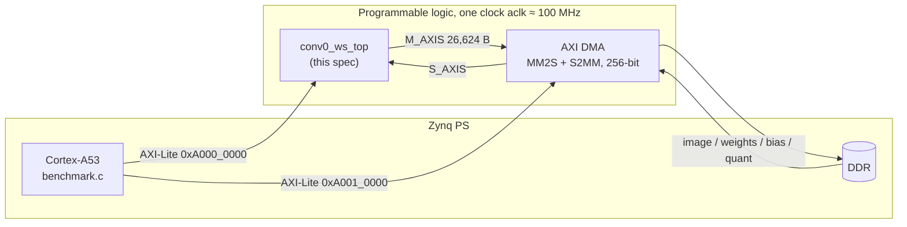
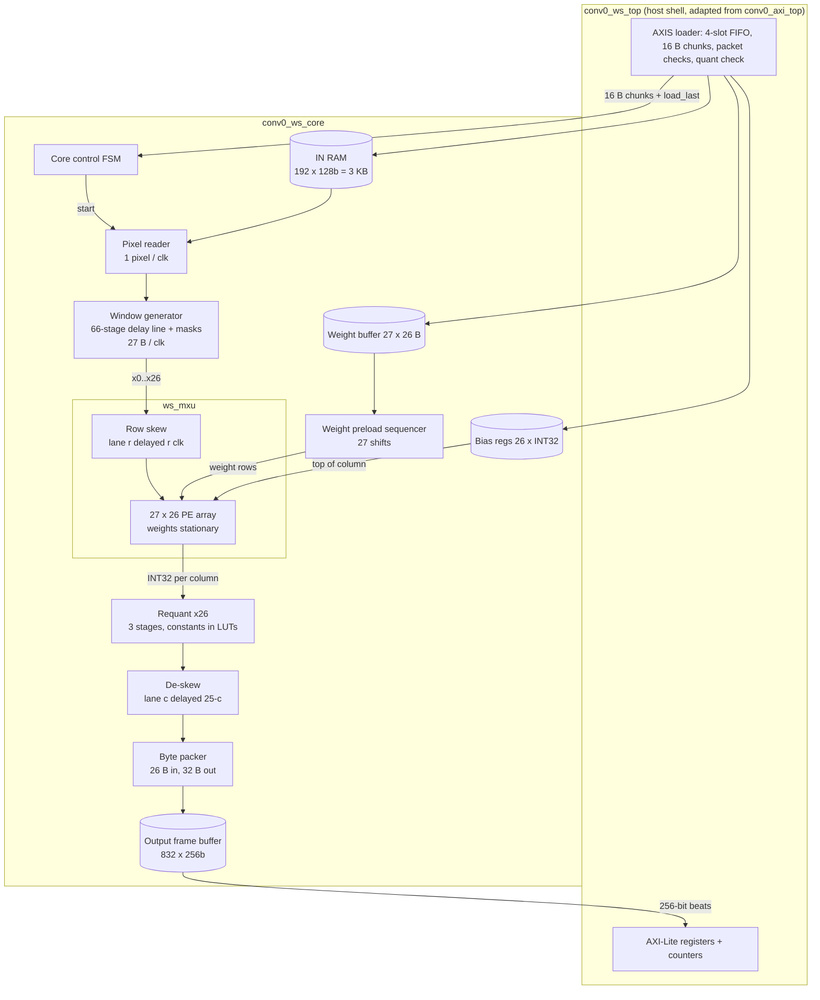
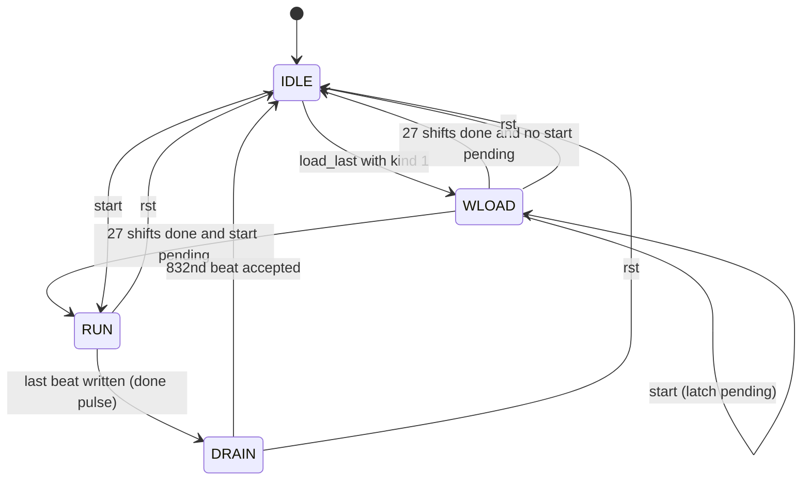
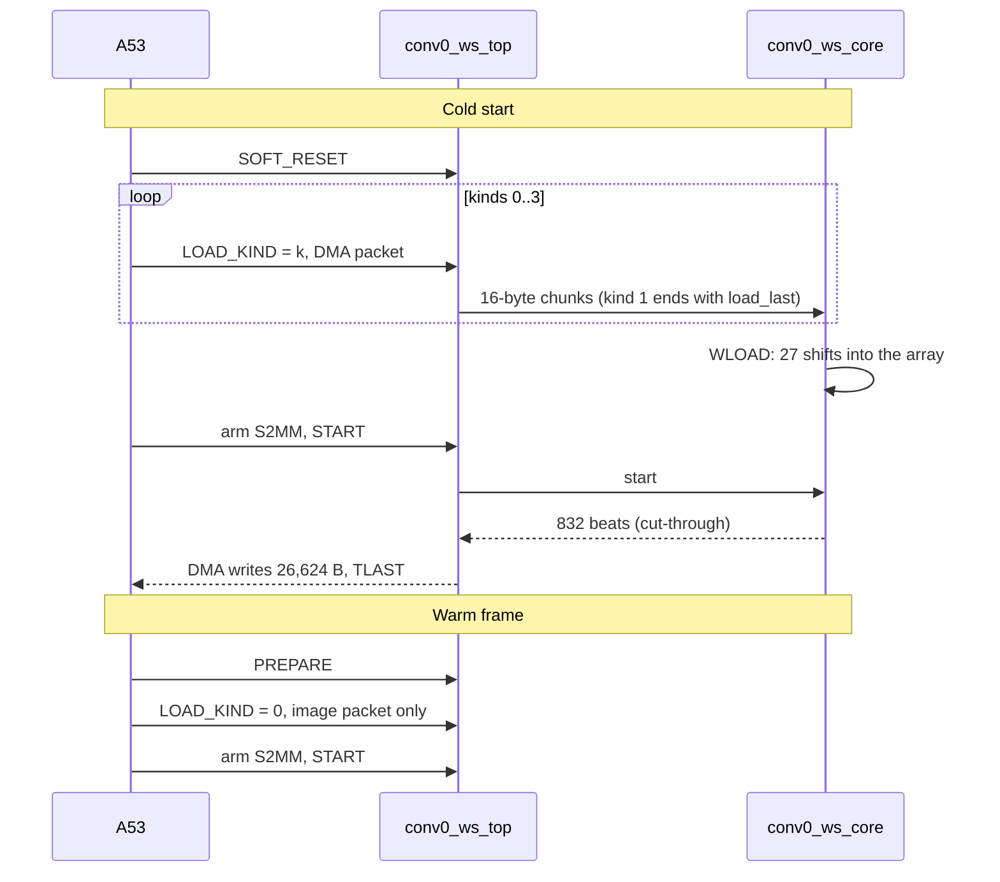

# Conv0 Architecture Specification — Weight-Stationary ("TPU-Style") 27×26 Systolic Engine on Kria KV260

| Field | Value |
|---|---|
| Document | `Conv0Spec_NaiveClaude.md`, revision 0.2 (draft), 2026-11-07. Rev 0.2 adds the project files `export`, `layer_vectors` and `resnet8` (see §0.1 and the change log at the end) |
| Purpose | Single source of truth for AI-assisted RTL generation **and** verification of the ResNet-8 Conv0 accelerator |
| Target | Kria KV260 (Zynq UltraScale+ `xck26-sfvc784-2LV-c`), Vivado/Vitis 2024.2 |
| Architecture | Weight-stationary systolic array, 27 rows × 26 columns = 702 PEs ("Arch 3" in the `conv0` archive) |
| Host/arithmetic contract | Identical to the implemented 832-MAC design ("Arch 1"), so its CPU harness and testbench patterns can be reused |
| Author / review | Generated by Claude from the `conv0.zip` archive and the project files `export.zip`, `layer_vectors.zip`, `resnet8.zip`. **Not human-reviewed. No RTL exists for this spec yet.** |

**What has and has not been checked.** The numerical contract (§3) and every cycle number (§6) were checked
with an executable Python model (Appendix B) that reproduces the archive's golden Conv0 fixture bit-exactly
(26,624 outputs), reproduces the per-column INT32 sums of the proposed array, and passes four stress vectors
including all-`-128` operands. Revision 0.2 additionally checked that the project's `.mem` files (Conv0 weights, bias, quantization, input, expected accumulators, expected output) equal the archive fixture and the golden model bit-exactly, derived the exact accumulator ranges and the channels that can saturate with real pixels (§3.2.1, §3.5), and added directed vectors V9 and V10. No part of this design has been simulated in HDL, synthesized or run on the board.
Resource numbers in §8 are estimates scaled from the Arch 1 Vivado reports.

---

## 0. How to use this document

1. **Normative language.** SHALL = mandatory, SHOULD = recommended, MAY = optional. Text marked *(informative)* explains or suggests and never overrides a SHALL.
2. **Precedence when two statements conflict:** §3 (functional contract) > §5 (module specs) > §6 (timing) > §4 (overview) > informative text. §3 restates the project's `HARDWARE_CONTRACT.md`, which is the upstream authority for arithmetic and file formats; rev 0.2 found no disagreement (§3.3, §3.7). If they ever disagree, record it in §13 and ask the project owner.
3. **Requirement IDs** (`FR-`, `IF-`, `AR-`, `TM-`, `IM-`, `RS-`) are stable. Tests (`T-…`, §9) cite them, so a failing test points at a requirement.
4. **Generate module by module** in the order of §11.2. Give the generator §3, the module's own §5 subsection, §6 and the relevant pitfalls from §12. Do not hand it the whole document and ask for the whole design.
5. **Never modify the golden model or weaken a test to make RTL pass.** If a SHALL appears wrong, record it in §13 and ask for a spec revision.
6. **Timing is specified relative to an observable event** (`t0`, the cycle pixel 0 leaves the pixel reader), so implementations with a slightly different front-end latency remain conformant (§6).

### 0.1 Input files the generator and testbench need

**(a) From `conv0.zip`.** Hashes are the first 16 hex digits of SHA-256.

| Role | Path in archive | SHA-256 (prefix) |
|---|---|---|
| Quantization constants (reuse verbatim) | `arch1_broadcast_832/src/conv0_quant_pkg.sv` | `68af88d3a07e6f0b` |
| Host shell to adapt (AXI-Lite + AXIS loader) | `arch1_broadcast_832/src/conv0_axi_top.sv` | `da64c1f57ccca9dc` |
| IP Integrator wrapper to adapt | `arch1_broadcast_832/src/conv0_axi_bd.v` | `70316800120bcf02` |
| Golden payloads (image, weights, bias, quant, expected) | `arch1_broadcast_832/cpu/fixture_data.h` | `c9a70f013aaf2cd1` |
| A53 benchmark harness to adapt | `arch1_broadcast_832/cpu/benchmark.c` | `45e48cec28884233` |
| Testbench patterns (AXI-Lite/AXIS BFM, stall/error cases) | `arch1_broadcast_832/sim/tb_conv0_axi.sv` | `aeeadf00dd4d914b` |
| Array skeleton (starting point, needs the changes in §5.6.4) | `arch3_ws_tpu_27x26/rtl/ws_{pkg,pe,column,array,mxu,skew}.sv` | see archive |
| Executable reference model | Appendix B of this document | — |

**(b) From the project files (added in rev 0.2).** Paths are those used by the project (`resnet8/artifacts/...` for generated files). Hashes are of the raw files as delivered, which use CRLF line endings.

| Role | Path | SHA-256 (prefix) |
|---|---|---|
| Authoritative arithmetic, layout and export contract | `resnet8/HARDWARE_CONTRACT.md` | `fd14566d4ef44436` |
| Integer reference implementation (Python); the software side of the bit-exact gate | `resnet8/integer.py` | `7b7d73ba006e1bb2` |
| Team flow, status (2026-10-01), acceptance gates | `resnet8/TEAM_OVERVIEW.md` | `397f7e2ae9b716d6` |
| Frozen network definition | `resnet8/ARCHITECTURE.md` | `7289ec1f5bc80a64` |
| Software results and baseline | `resnet8/RESULTS.md`, `resnet8/verification_baseline.json` | `2f99d88da4471417`, `1d08fecadad3f888` |
| Conv0 weights, 702 × INT8 (`$readmemh`) | `export/conv0_weights.mem` | `3842f9b2370204ed` |
| Conv0 bias, 26 × INT32 | `export/conv0_bias.mem` | `ef0a707f2034f830` |
| Conv0 quantization, 52 × INT32 (M, S interleaved) | `export/conv0_quant.mem` | `d88edc9b8c313ad2` |
| Conv0 input image, 3,072 × INT8 | `layer_vectors/conv0/input.mem` | `11d26259421b50dd` |
| Expected raw INT32 sums, 26,624 × INT32 | `layer_vectors/conv0/expected_acc.mem` | `1c11bc15382e00c5` |
| Expected INT8 output, 26,624 × INT8 | `layer_vectors/conv0/expected_output.mem` | `5a562685dda827bd` |

Rev 0.2 verified with Appendix B that every `.mem` file in table (b) holds exactly the same data as the corresponding payload of `fixture_data.h`, that `expected_acc.mem` equals `golden_acc` and `expected_output.mem` equals `golden_conv0`. The `.mem` files are therefore the preferred simulation oracle (§3.7); the C header remains the source for the board harness. `layer_vectors.zip` contains Conv0 only (not the other eight convolutions).

---

## 1. Scope, decisions and assumptions

### 1.1 Goal

Implement **only the first ResNet-8 layer (Conv0)** as a PL accelerator on the KV260, fed and drained by the Cortex-A53 over AXI DMA. Input: one 32×32×3 INT8 image. Output: one 32×32×26 INT8 feature map after bias, requantization, ReLU and saturation. The rest of the network stays in software.

Out of scope: later ResNet layers, residual adds, pooling, dense layer, training, a runtime-programmable quantization scale, clocks above 100 MHz, interrupts.

*(informative)* Project context (`TEAM_OVERVIEW.md`): Conv0 is the team's first hardware milestone. Its 32×32×26 INT8 output (HWC, 0..127) is the input of Block 1 Conv1 and the identity shortcut of the Block 1 residual add, so the 26,624-byte output frame is the hand-off point to whatever executes the rest of the network. The later stride-2 layers use different padding (§12, pitfall 18); nothing in this spec is meant to be reused for them unchanged.

### 1.2 Design decisions (all normative; change only through a spec revision)

| ID | Decision | Rationale |
|---|---|---|
| D-01 | Conv0 only, one frame at a time, no frame pipelining | Matches the benchmark flow; keeps control trivial |
| D-02 | **Weight-stationary 27×26 array.** Row = reduction index `k`, column = output channel. Conv0 fits exactly (K = 27, OC = 26): one pass, no partial-sum RAM | Exact fit means 100% PE utilization and no accumulation memory |
| D-03 | One clock domain `aclk`, nominal **100 MHz** (generated 99.999001 MHz). 200 MHz is a follow-up, not a requirement | Same clock as the Arch 1 platform that already closed timing; avoids CDC |
| D-04 | Host interface = Arch 1 contract (AXI-Lite registers, 256-bit AXIS in/out, packet kinds 0–3). Only the three identity registers differ | Lets the existing harness and testbench be reused |
| D-05 | Quantization multipliers/shifts are **compile-time constants** from `conv0_quant_pkg.sv`; the 208-byte quant packet is only verified, as in Arch 1 | Keeps requantizers in LUTs, so DSPs are used only by the array (702 of 1,248) |
| D-06 | **Bias is injected at the top of each column** (row 0 `psum_in = bias[c]`) | Zero extra latency, no bias adder after the array |
| D-07 | Window generation by a **raster pixel reader + delay-line (line-buffer) window generator**. No image replication | One 3 KB image copy instead of Arch 1's 32 copies |
| D-08 | **Full-frame output buffer** (832 × 256 bit). The array and everything upstream never stall; output backpressure only delays reads from this buffer | Removes all flow control inside the compute pipeline |
| D-09 | Weights are shifted into the array **once, at the end of the weight packet**, and are retained across warm frames. PE weight registers are never reset | Natural benefit of weight-stationary dataflow; warm frames skip weight loading |
| D-10 | Output de-skew is done on 8-bit post-requant values | 325 × 8 bits instead of 325 × 32 |
| D-11 | One register stage per PE hop (`ROW_LAT = COL_LAT = 1`) | Makes the timing equations in §6 exact |
| D-12 | Tap order `k = 9·ky + 3·kx + ic`; weights OHWI, input HWC, output HWC | Identical to the exported tensors and Arch 1 RTL; no reordering anywhere |

### 1.3 Assumptions

- The PS, DMA, SmartConnect and reset blocks of the Arch 1 block design are reused unchanged (DMA base `0xA0010000`, accelerator base `0xA0000000`).
- Software follows the Arch 1 protocol: one packet fully loaded before `LOAD_KIND` changes; `PREPARE`/`SOFT_RESET` between frames.
- The only weights/bias/quantization in use are the pretrained ones in the fixture (identical to `export/conv0_*.mem`); weights and bias are nevertheless runtime-loadable, quantization is not (D-05).

---

## 2. Platform (KV260)

| Item | Value |
|---|---|
| Device | `xck26-sfvc784-2LV-c` (K26 SOM) |
| Device capacity | 1,248 DSP48E2 · 117,120 LUT · 234,240 FF · 144 BRAM36 · 64 URAM |
| Clock | `aclk` ≈ 100 MHz from the PS (99.999001 MHz); no other PL clock is used by the accelerator |
| Reset | `aresetn`, active low, from Processor System Reset |
| Control | AXI4-Lite slave, 32-bit data, 7-bit address, no interrupts |
| Data in | AXI4-Stream slave `S_AXIS`, 256-bit, TKEEP + TLAST, from AXI DMA MM2S |
| Data out | AXI4-Stream master `M_AXIS`, 256-bit, TKEEP + TLAST, to AXI DMA S2MM |
| Platform overhead (measured in Arch 1 synthesis, excl. accelerator) | ≈ 7.8k LUT, 13.1k FF, 8 BRAM36 + 2 BRAM18, 0 DSP |



---

## 3. Functional contract (normative)

### 3.1 Tensors, layouts, byte order

| Tensor | Type | Count | Layout / index | Bytes |
|---|---|---:|---|---:|
| Image `X` | signed INT8 | 3,072 | HWC: `(y·32 + x)·3 + ic` | 3,072 |
| Weights `W` | signed INT8 | 702 | OHWI: `oc·27 + ky·9 + kx·3 + ic` (= `oc·27 + k`) | 702 |
| Bias | signed INT32, little-endian | 26 | `bias[oc]` at byte `4·oc` | 104 |
| Quant packet | 26 × {INT32 multiplier M, INT32 shift S}, little-endian | 52 words | `M[oc]` at byte `8·oc`, `S[oc]` at byte `8·oc + 4` | 208 |
| Output `Y` | INT8 in range 0..127 | 26,624 | HWC: `(y·32 + x)·26 + oc` | 26,624 |

All AXIS data is little-endian: byte 0 of a beat is `TDATA[7:0]`. Every tensor uses signed two's complement and zero-point 0.

**Input range.** In the project's integer contract the input scale is 255/127, so real RGB pixels (0..255) become INT8 values 0..127; the fixture image spans 16..117. This is a property of real data, **not** an interface precondition: the hardware SHALL treat the image bytes as full-range signed INT8 (FR-10). Weights span the full INT8 range in general.

### 3.2 Convolution

For output pixel `p = (y, x)`, `y, x ∈ 0..31`, and output channel `c ∈ 0..25`, with `k = 9·ky + 3·kx + ic`:

```
A[k][p] = X[y + ky - 1][x + kx - 1][ic]     if 0 <= y+ky-1 <= 31 and 0 <= x+kx-1 <= 31,  else 0   (SAME zero padding)
acc[c][p] = wrap32( bias[c] + Σ_{k=0..26} W[c][k] · A[k][p] )                                      (INT32, two's-complement wrap)
```

#### 3.2.1 Accumulator range *(informative; every number computed by Appendix B)*

| Case | Minimum | Maximum |
|---|---:|---:|
| Shipped weights/bias, real pixels (0..127) | −126,781 | 117,454 |
| Shipped weights/bias, any INT8 pixel (−128..127) | −225,329 | 249,637 |
| Project static bound `128·Σ abs(W[c]) + abs(bias[c])`, worst channel | | 250,326 |
| Any INT8 weights and pixels, zero bias (`27·128·128`) | −438,912 | 442,368 |

Consequences. (1) With the shipped parameters the INT32 sum can never wrap; 19 signed bits would be enough, and the project's bound (`≤ 2^31 − 1`) holds with a factor of about 8,500. The baseline still keeps 32 bits because weights and bias are runtime-loadable (FR-08) and the packet protocol accepts any INT32 bias. (2) The 27 products alone never exceed `2^19`, so a wrap can only occur when `abs(bias)` is within 442,368 of `2^31`; the overflow vectors (V9) therefore need huge biases. (3) The project's `integer.py` **raises** on INT32 overflow, while the contract says the hardware wraps modulo `2^32`, never saturates and has no overflow flag, and that directed overflow tests must use a wrapping oracle. This spec's `golden_acc` is such an oracle (FR-03); both agree whenever the project's static bound holds.

### 3.3 Requantization (bit-exact)

Per output channel `c`, with `M[c]` a positive INT32 constant and `S[c]` an integer shift in 38..42 (tables in Appendix A):

```
product   = signed_int64(acc) * M[c]                       // no overflow: |acc| <= 2^31, M < 2^31
magnitude = abs(product)
rounded   = (magnitude + 2^(S[c]-1)) >> S[c]               // logical shift of the MAGNITUDE
signed    = (product < 0) ? -rounded : rounded             // round-half-away-from-zero
Y         = clip(signed, 0, 127)                           // ReLU and INT8 saturation in one step
```

Rounding SHALL NOT be implemented as an arithmetic right shift of a negative number. Because negative results become 0 anyway, the sign only matters for the zero decision: `Y = 0` whenever `product < 0`.

*Notation against the project contract.* `M` is the contract's multiplier (Q31 significand, `M = round(f·2^31)`, positive, at most `2^31 − 1`), `S` is the contract's right shift `R = 31 − e`, and the contract's `round_away` is the magnitude rounding above. The contract allows `1 ≤ R ≤ 62` and uses R up to 57 elsewhere in the network; Conv0 uses 38..42 and the baseline hard-wires them (D-05), so a lane needs no general shifter. Output clip bounds are `0..127` because Conv0 is followed by ReLU. Width note: for the shipped parameters `abs(acc · M) < 2^50`, but because reloadable weights or bias can produce any INT32 `acc`, the lane SHALL keep the full signed 64-bit product (pitfall 5).

### 3.4 Golden reference code

The following functions are the definition of correct. They are the `GOLDEN` region of Appendix B and reproduce the archive fixture exactly.

```python
def wrap32(a):
    """INT32 two's-complement wrap (accumulator overflow behaviour)."""
    return ((np.asarray(a, dtype=np.int64) + 2**31) % 2**32) - 2**31

def golden_acc(image, weights, bias):
    """image: 3072 int (HWC, [y][x][ic]); weights: 702 int (OHWI, [oc][ky][kx][ic]);
    bias: 26 int.  Returns INT32 accumulators, shape (32, 32, 26), SAME zero padding."""
    X = np.asarray(image, dtype=np.int64).reshape(32, 32, 3)
    W = np.asarray(weights, dtype=np.int64).reshape(26, 3, 3, 3)
    Xp = np.zeros((34, 34, 3), dtype=np.int64)
    Xp[1:33, 1:33] = X
    acc = np.zeros((32, 32, 26), dtype=np.int64) + np.asarray(bias, dtype=np.int64)
    for ky in range(3):
        for kx in range(3):
            for ic in range(3):
                acc += Xp[ky:ky + 32, kx:kx + 32, ic][:, :, None] * W[:, ky, kx, ic][None, None, :]
    return wrap32(acc)

def requant(acc, M, S):
    """acc: INT32 array whose last axis is the 26 channels; M: 26 positive INT32 multipliers;
    S: 26 right shifts (>=1).  Returns int64 array of values 0..127 (ReLU + INT8 saturation).
    Rounding = round-half-away-from-zero on the magnitude (NOT an arithmetic shift)."""
    p = np.asarray(acc, dtype=np.int64) * np.asarray(M, dtype=np.int64)       # fits INT64
    mag = np.abs(p)
    r = (mag + (np.int64(1) << (np.asarray(S, dtype=np.int64) - 1))) >> np.asarray(S, dtype=np.int64)
    return np.clip(np.where(p < 0, -r, r), 0, 127)

def golden_conv0(image, weights, bias, M, S):
    """Complete Conv0: returns 26,624 values, HWC order ((y*32+x)*26 + c)."""
    return requant(golden_acc(image, weights, bias), M, S).reshape(-1)
```

### 3.5 Golden data

Source: CIFAR-10 test image index 3 (airplane), checkpoint SHA-256 `7e469415849ea0be2d5a6cb988a0840e2ffc4184ee1bdff3442a2f1ae4774fdf`. Payload hashes (from `cpu/fixture_manifest.json`):

| Payload | Bytes | SHA-256 |
|---|---:|---|
| `fixture_image` | 3,072 | `428af2afeb7eedd1bf5079ce640519620d6b5bc4ea2f446ce6a56f2e6072569b` |
| `fixture_weights` | 702 | `0bc19c18174d4cf2c7884ad00cdc4c45089c8ca1c6574916e802e245d053c94a` |
| `fixture_bias` | 104 | `27a07cf6e55acdb5ab3de4f0fca47c953f45872491ab04bba5287cde86e972dd` |
| `fixture_quant` | 208 | `db2027853087ae9567023b28c7674d43f39b8123df10136dcd92b3aa2ec0d493` |
| `fixture_expected` | 26,624 | `814f30f66bd61c9a8088cc5eeae85d73caaaf434c324a90de3cae3d87d0bcc0d` |

Properties of this fixture that matter for verification:

- Accumulators span −52,438 … 48,346; biases span −33,362 … 17,110.
- **The fixture's largest output is 62, so it never exercises the saturation-to-127 path.** Directed vectors (§9.2) are mandatory.
- The same data is delivered as `.mem` files (§0.1 b, §3.7): `input.mem`, `conv0_weights.mem`, `conv0_bias.mem`, `conv0_quant.mem` equal `fixture_image`, `fixture_weights`, `fixture_bias`, `fixture_quant`; `expected_output.mem` equals `fixture_expected`; `expected_acc.mem` is the raw INT32 sum per output (the fixture header has no equivalent).
- Source image: CIFAR-10 test index 3 is the first golden image of the project (class airplane; golden indices `[3, 6, 25, 0, 22, 12, 4, 13, 1, 11]`, one per class).
- **Real images can saturate even though this one does not.** With pixels restricted to the real range 0..127, nine channels can reach the clip: **0, 4, 5, 7, 10, 11, 13, 16, 19**. The largest reachable output of each channel c = 0..25 is 127, 51, 53, 31, 127, 127, 106, 127, 85, 37, 127, 127, 122, 127, 44, 97, 127, 118, 69, 127, 52, 90, 79, 76, 44, 47 (127 means the clip is reached). Vector V10 reaches these maxima with the shipped weights. With any INT8 pixels, 19 of 26 channels can saturate.
- 58% of outputs are non-zero, so the ReLU-to-zero path is exercised.

### 3.6 Functional requirements

| ID | Requirement | Verified by |
|---|---|---|
| FR-01 | For any image, weights and bias, the 26,624 output bytes SHALL equal `golden_conv0(...)` exactly | T-I01, T-I03, T-I08, T-S02, T-S07 |
| FR-02 | The INT32 sums leaving the array SHALL equal `golden_acc(...)` (before requantization) | T-U04, T-I01 |
| FR-03 | INT32 overflow SHALL wrap (two's complement); no saturation of accumulators and no overflow flag (project contract). Only huge biases can overflow (§3.2.1) | T-U04, T-I03 |
| FR-04 | Padding SHALL be numeric zero, including at all four borders and four corners | T-U07, T-I03 |
| FR-05 | Requantization SHALL match §3.3 for every INT32 input, including negative values, exact `.5` ties and values that round to 127/128 | T-U08 |
| FR-06 | Output order SHALL be HWC and exactly 832 beats of 32 bytes, TLAST on beat 831, TKEEP all ones | T-S02, T-U10, T-U11 |
| FR-07 | A warm frame (new image, retained weights/bias) SHALL give the same results as a cold frame | T-I02, T-S03 |
| FR-08 | The design SHALL accept new weights and bias at any time while idle (cold reload) and use them from the next frame | T-U05, T-I02 |
| FR-09 | Project acceptance gate: for the delivered Conv0 data, every one of the 26,624 INT32 sums at the array output SHALL equal `expected_acc.mem` and every output byte SHALL equal `expected_output.mem`, compared at the same index `(y·32 + x)·26 + oc` | T-I01, T-S02 |
| FR-10 | Image bytes SHALL be treated as full-range signed INT8 (−128..127); no logic may rely on the real-data range 0..127 | T-I03, T-I08 |

### 3.7 Memory-image (`.mem`) test files

| File | Words | Word size | Content and order | Maps to |
|---|---:|---:|---|---|
| `conv0_weights.mem` | 702 | 2 hex digits | OHWI: line `oc·27 + 9·ky + 3·kx + ic` | packet kind 1 byte for byte |
| `conv0_bias.mem` | 26 | 8 hex digits | line `oc` = `bias[oc]` | packet kind 2, bytes `4·oc .. 4·oc+3` little-endian |
| `conv0_quant.mem` | 52 | 8 hex digits | line `2·oc` = `M[oc]`, line `2·oc+1` = `S[oc]` | packet kind 3, `M` at byte `8·oc`, `S` at `8·oc+4` |
| `input.mem` | 3,072 | 2 hex digits | HWC: line `(y·32 + x)·3 + ic` | packet kind 0 byte for byte |
| `expected_acc.mem` | 26,624 | 8 hex digits | HWC: line `(y·32 + x)·26 + oc` = raw sum, bias included, before requantization | array output, `y[oc](p = y·32 + x)` |
| `expected_output.mem` | 26,624 | 2 hex digits | HWC: line `(y·32 + x)·26 + oc` | M_AXIS byte `(y·32 + x)·26 + oc` |

Format rules (project contract): one hex word per line, lower-case, two's complement, same logical order as the binary export; the project says signedness must be declared in the RTL or testbench. The delivered files use CRLF line endings. Testbench loading: declare `logic signed [7:0] img_mem [0:3071]` and so on, then `$readmemh`; the 32-bit files need `logic signed [31:0]`. Whether a given simulator's `$readmemh` accepts CR characters was not tested; if it does not, strip them (`tr -d '\r'`) in the vector-generation script, which is cheaper than debugging a loader. `gen_vectors.py` SHALL also write all vector sets in this same format so that testbenches have one loader (§11.1).

---

## 4. Architecture overview

### 4.1 Block diagram



### 4.2 Module hierarchy and files

| Module | File | Section |
|---|---|---|
| `conv0_ws_top` (+ `conv0_ws_bd` wrapper) | `conv0_ws_top.sv`, `conv0_ws_bd.v` | §5.1 |
| `conv0_ws_core` | `conv0_ws_core.sv` | §5.2 |
| `conv0_weight_loader` | `conv0_weight_loader.sv` | §5.4 |
| `conv0_pixel_reader` | `conv0_pixel_reader.sv` | §5.5 |
| `conv0_window_gen` | `conv0_window_gen.sv` | §5.6 |
| `ws_mxu` → `ws_skew`, `ws_array` → `ws_column` → `ws_pe` | `ws_*.sv` | §5.7 |
| `conv0_requant26` → `conv0_requant_lane` | `conv0_requant26.sv` | §5.8 |
| `conv0_deskew` | `conv0_deskew.sv` | §5.9 |
| `conv0_byte_packer`, `conv0_out_buffer` | `conv0_byte_packer.sv`, `conv0_out_buffer.sv` | §5.10 |
| `conv0_quant_pkg` | copied unchanged | §3.3 |

### 4.3 Global parameters (`ws_pkg`)

| Name | Value | Meaning |
|---|---:|---|
| `ROWS` | 27 | Array rows = reduction depth K |
| `COLS` | 26 | Array columns = output channels |
| `ACT_W`, `W_W` | 8 | Activation / weight width |
| `PSUM_W` | 32 | Partial-sum width |
| `NPIX` | 1,024 | Output pixels |
| `NBEAT_OUT` | 832 | Output AXIS beats |
| `L_WIN` | 34 | Reader pixel 0 → window 0 at array input (§5.6) |
| `L_RQ` | 3 | Requantizer latency |
| `ROW_LAT`, `COL_LAT` | 1, 1 | Register stages per vertical / horizontal PE hop |

### 4.4 How one output value is computed (the idea in one picture)

Weights sit still in the PEs. One pixel's whole 27-value window enters on the left edge, one value per row, each row one clock later than the one above (the skew). It moves one column to the right per clock. Inside each PE the product `W·A` is added to the partial sum arriving from the PE above, which then moves down. After 27 rows the bottom of column `c` holds the complete 27-term sum for output channel `c` of that pixel. A new pixel enters every clock.

```
 weights are fixed:   PE(r, c) holds W[c][r]  (drawn as "Wc,r");  r = tap index k (0..26), c = output channel (0..25)

                 col 0            col 1                     col 25
 x0  ───────►  [W0,0 ] ───────►  [W1,0 ] ───► … ───►  [W25,0 ]      activations move RIGHT, one PE per clock
                   │ psum            │                     │
 x1  (1 clk late)  [W0,1 ]         [W1,1 ]       …      [W25,1 ]      partial sums move DOWN, one PE per clock
                   │                 │                     │         bias[c] enters the top of column c
 ⋮                 ⋮                 ⋮                     ⋮
 x26 (26 clk late) [W0,26]         [W1,26]       …      [W25,26]
                   │                 │                     │
              Y0(p) INT32       Y1(p) INT32      …    Y25(p) INT32   column c lags column 0 by c clocks
```

### 4.5 Where every value lives

| Value | Storage | Size | Written by | Read by |
|---|---|---:|---|---|
| Raw image bytes | IN RAM (BRAM) | 192 × 128 b | AXIS loader (16 B chunks) | pixel reader |
| Pixel in flight | reader group register | 48 B | pixel reader | window generator |
| Previous pixels (3 rows of context) | delay line (SRL) | 66 × 24 b | window generator | window generator |
| Window (27 activations of one pixel) | window register | 27 B + 2 flags | window generator | row skew |
| Skewed activation | row-skew lanes, then 1 register per PE (moving right) | 351 × 8 b + 702 × 8 b | skew / PE | next PE |
| Weights, staging | weight buffer (flops/LUTRAM) | 702 B | AXIS loader | weight loader |
| Weights, next / active | PE `w_next` (B1) / `w_active` (B2) | 702 × 8 b each | weight shift chain / swap | PE multiplier |
| Bias | 26 INT32 registers | 104 B | AXIS loader | top of each column |
| **Running partial sum** | PE `psum_out` (DSP `P`), moving down | 702 × 32 b | each PE | PE below |
| Final INT32 sum | bottom-row `psum_out`, one per column | 26 × 32 b | PE row 26 | requantizer |
| Requant intermediates | 3 stage registers per lane (64 b product, 64 b rounded, 8 b result) | 26 lanes | lane | lane |
| Aligned output bytes | de-skew lanes | 325 × 8 b | requantizer | packer |
| Pending bytes | packer staging | ≤ 57 B | packer | packer |
| Output frame | frame buffer (BRAM) | 832 × 256 b = 26,624 B | packer | AXIS source |

No partial sum is ever stored in a RAM for Conv0.

### 4.6 Timeline of one frame (reference numbers from the model; cycle 0 = START)

```
cycle     0          6                  40                          95                 1118           1122
          |          |                  |                           |                  |              |
          START      pixel 0 leaves     window 0 enters the         first aligned      last aligned   last beat on AXIS;
                     the reader (t0)    array (a0 = t0 + 34)        vector at the      vector         the final handshake
                                                                    packer (a0 + 55)   (pixel 1,023)  is cycle 1,123 counted
```

---

## 5. Module specifications

Conventions for every module: synchronous design on `aclk`; `rst` is synchronous and active high inside the core; **datapath registers have no reset** (only valid/flag/control registers do, so SRL and DSP inference stay possible); all arithmetic is two's complement; "cycle n" is the period ending at rising edge n and a register written at edge n is visible in cycle n+1.

### 5.1 `conv0_ws_top` — host shell

Adapt `conv0_axi_top.sv`; **keep every behaviour of its AXI-Lite and AXIS logic** and change only what is listed here.

**Ports:** identical to `conv0_axi_top` (`aclk`, `aresetn`, `s_axi_*` with 7-bit address, `s_axis_*` 256-bit with `tkeep`/`tlast`, `m_axis_*` 256-bit with `tkeep`/`tlast`). `conv0_ws_bd.v` is the same plain-Verilog wrapper as `conv0_axi_bd.v` with the new module name.

**Changes relative to Arch 1:**

| ID | Change |
|---|---|
| IF-01 | Replace the instances of `conv0_832_core`, `conv0_requant`, `conv0_result_fifo` by one `conv0_ws_core` (ports in §5.2) |
| IF-02 | Drive core `rst` from `reset_datapath`, which is high when `aresetn` is low or `clear_pulse` is high (unchanged from Arch 1) |
| IF-03 | New core input `load_last = load_to_core && packet_end && (packet_bytes + chunk_bytes == expected_bytes)`, asserted in the same cycle as the final accepted chunk of a packet |
| IF-04 | `m_axis_tvalid = core.out_valid && running`; `core.out_ready = m_axis_tready && running`; `m_axis_tdata = core.out_data`; `m_axis_tlast = (out_bytes == 26592)`; `m_axis_tkeep = 32'hffffffff` |
| IF-05 | `core.done` replaces the Arch 1 `core_done` for `RAW_CYCLES` and `raw_sticky` |
| IF-06 | Identity registers: `VERSION = 0x00030000`, `MACS = 702`, `OUTPUT_LANES = 26`. `benchmark.c` line 95 must check these values |

**Register map** (accelerator base `0xA0000000`; aligned 32-bit accesses; unsupported address or command → SLVERR):

| Offset | Name | Behaviour |
|---|---|---|
| 0x00 | CONTROL (write) | exactly `1` = START, `2` = PREPARE, `4` = SOFT_RESET; read returns 0 |
| 0x04 | STATUS | bit0 running · bit1 output done · bit2 raw done · bit3 error · bit4 loader active · bits[11:8] loaded flags for kinds 3..0 |
| 0x08 | OUTPUT_BYTES | accepted output bytes |
| 0x0C | LOAD_KIND (R/W) | 0..3; writable only when idle and the loader is empty |
| 0x10 | ERRORS | bit0 invalid KEEP · bit1 quant mismatch · bit2 length mismatch/overflow |
| 0x14 | RUN_CYCLES | clocks while running, from the accepted START to the final output handshake |
| 0x18 | RAW_CYCLES | RUN_CYCLES sampled at the core `done` pulse |
| 0x1C | INPUT_STALLS | clocks with S_AXIS valid and not ready |
| 0x20 | OUTPUT_STALLS | clocks with M_AXIS valid and not ready |
| 0x24 | FIRST_OUTPUT_CYCLE | RUN_CYCLES at the first output handshake |
| 0x28 | LOAD_CYCLES | accepted 16-byte loader chunks |
| 0x2C | VERSION | `0x00030000` |
| 0x30 | MACS | 702 |
| 0x34 | OUTPUT_LANES | 26 |

**Packets** (select with `LOAD_KIND`, one packet per kind, TLAST on the final beat, TKEEP contiguous from the LSB, all non-final beats 32 bytes full):

| Kind | Payload | Bytes |
|---|---|---:|
| 0 | image | 3,072 |
| 1 | weights | 702 |
| 2 | bias | 104 |
| 3 | quantization check (compared against `conv0_quant_pkg`; mismatch sets ERRORS bit1) | 208 |

**Sequencing rules (unchanged from Arch 1):** START needs all four loaded flags, no error, and a PREPARE or SOFT_RESET since the previous frame. PREPARE (idle, loader empty) clears counters/done/error and invalidates only the image (loaded flag 0). SOFT_RESET aborts any frame and invalidates all four loaded flags. While `running`, `s_axis_tready` is low.

| ID | Requirement | Verified by |
|---|---|---|
| IF-07 | Register map, packet checks and error bits SHALL behave exactly as in Arch 1 except IF-06 | T-S01, T-S04 |
| IF-08 | `M_AXIS` data SHALL be stable while `tvalid && !tready` | A-05, T-S05 |
| IF-09 | Reading counters during a run SHALL NOT change any datapath behaviour | T-S02 |

### 5.2 `conv0_ws_core`

| Port | Dir | Width | Meaning |
|---|---|---:|---|
| `clk`, `rst` | in | 1 | clock; synchronous reset (hardware reset **or** PREPARE/SOFT_RESET) |
| `start` | in | 1 | one-cycle pulse; high during **cycle 0** |
| `load_valid` | in | 1 | a 16-byte chunk is presented (already validated by the shell) |
| `load_kind` | in | 2 | 0 image · 1 weights · 2 bias · 3 quant (core ignores 3) |
| `load_addr` | in | 12 | byte offset of the chunk within its packet (multiple of 16) |
| `load_data` | in | 128 | chunk bytes, byte 0 in `[7:0]` |
| `load_keep` | in | 16 | valid bytes of the chunk, contiguous from bit 0 |
| `load_last` | in | 1 | with the final chunk of a packet (IF-03) |
| `out_valid` | out | 1 | an output beat is available |
| `out_ready` | in | 1 | consumer accepts the beat |
| `out_data` | out | 256 | beat; byte 0 in `[7:0]` |
| `done` | out | 1 | one-cycle pulse when the last output beat has been written to the output buffer |
| `busy` | out | 1 | not idle |

**State machine:**



| ID | Requirement | Verified by |
|---|---|---|
| AR-01 | `rst` SHALL return the FSM to IDLE, clear all valid/flag registers and the output-buffer pointers, and SHALL NOT clear IN RAM, the weight buffer, bias registers or PE weight registers | T-I06, T-I02 |
| AR-02 | A `start` that arrives in WLOAD SHALL be held and applied when the preload finishes; a `start` in IDLE begins RUN in the next cycle | T-I04 |
| AR-03 | Weight preload SHALL begin the cycle after a `load_last` on kind 1 and takes exactly 27 cycles (§5.4) | T-U05 |
| AR-04 | During RUN the core SHALL NOT depend on `out_ready`; the compute pipeline never stalls (D-08) | T-I05 |
| AR-05 | `out_valid` MAY rise during RUN (cut-through) but SHALL never present a beat that has not been written | A-06, T-I05 |
| AR-06 | After the 832nd accepted beat the core SHALL return to IDLE ready for the next PREPARE/START | T-S08 |
| AR-07 | The core SHALL ignore `start` unless in IDLE or WLOAD (the shell already prevents this) | T-I06 |

### 5.3 Parameter and image storage

| Store | Organization | Write rule | Notes |
|---|---|---|---|
| IN RAM | 192 words × 128 b, byte-enable write | when `load_valid && load_kind == 0 && load_addr < 3072`: write word `load_addr[11:4]`, bytes where `load_keep[i]` | not reset; RAM style block; one read port to the pixel reader |
| Weight buffer `wbuf[c][k]` | 26 × 27 bytes | for each byte `i` with `load_keep[i]`, `j = load_addr + i`, if `j < 702`: `wbuf[j/27][j%27] ← load_data[8i +: 8]` | not reset; flops or LUTRAM |
| Bias `bias[c]` | 26 × INT32 | kind 2: for each word `w ∈ 0..3` of the chunk with all four keep bits set, `bias[load_addr/4 + w] ← load_data[32w +: 32]` if index < 26 | not reset; stable from START until `done` |

### 5.4 `conv0_weight_loader` (27-cycle preload)

Behaviour after `load_last` on kind 1, for `s = 0 … 26`:

```
cycle s:   w_load_en = 1
           w_load_data[c] = wbuf[c][26 - s]       for c = 0 .. 25
```

Each PE's `w_next` register shifts down the column (§5.7), so after cycle 26 PE(r, c).`w_next` = `W[c][r]` (the first row shifted ends at the bottom row 26). `w_load_en` is a single enable common to all 26 columns. **No column skew is applied to the weight load** because nothing is in flight while the array is idle. The preload leaves `w_active` untouched; it is replaced from `w_next` by the swap flag of the first pixel of the next frame (§5.7).

### 5.5 `conv0_pixel_reader`

| Port | Dir | Meaning |
|---|---|---|
| `start` | in | begin streaming the stored image |
| `pix_valid` | out | asserted for exactly 1,024 **consecutive** cycles |
| `pix_first` | out | with pixel 0 |
| `pix[23:0]` | out | `{ic2, ic1, ic0}` of raster pixel `i`: `pix[8·ic +: 8] = IN_bytes[3·i + ic]` |

| ID | Requirement | Verified by |
|---|---|---|
| AR-10 | Pixel `i` SHALL appear at cycle `t0 + i`, no bubbles, where `t0 = L_RD`, `2 ≤ L_RD ≤ 8` cycles after `start` (reference 6). All later timing is relative to the observed `t0` | T-U06, A-01 |
| AR-11 | The reader SHALL only read IN RAM; it SHALL NOT assume IN RAM is cleared between frames | T-I02 |

*(Informative)* Pixel `i` lives in 48-byte group `g = i >> 4` at lane `j = i & 15`; the three IN RAM words `3g … 3g+2` hold that group, so a group register of 384 bits filled from three consecutive words and shifted by 24 bits per clock, with the next group prefetched into a second register, gives one pixel per clock with a small 16:1 mux or shifter.

### 5.6 `conv0_window_gen`

Turns the raster pixel stream into one 27-byte window per output pixel.

**Output:** `win_valid`, `win_swap`, `win[k]` for `k = 0 … 26` (8-bit each, signed). `win_swap` is asserted together with pixel `p = 0` only.

**Definition.** Let `s` be the number of cycles since `t0` (so reader pixel `s` is presented at cycle `t0 + s` for `s ≤ 1023`; for `s ≥ 1024` the generator feeds zero pixels and keeps shifting until `s = 1056`). Keep a delay line so that `tap(d)` is the pixel presented `d` cycles earlier (`tap(0)` is the current reader pixel, `tap(1)` the previous, …, up to `tap(66)`). For output pixel `p = s − 33` with `(y, x) = (p >> 5, p & 31)` and `p ∈ 0 … 1023`:

```
win[9·ky + 3·kx + ic] = inside(ky,kx) ? tap(66 - 32·ky - kx)[ic] : 0
inside(ky,kx)         = (0 <= y+ky-1 <= 31) && (0 <= x+kx-1 <= 31)
```

| | kx = 0 | kx = 1 | kx = 2 |
|---|---:|---:|---:|
| **ky = 0** (row above) | tap 66 | tap 65 | tap 64 |
| **ky = 1** (same row) | tap 34 | tap 33 | tap 32 |
| **ky = 2** (row below) | tap 2 | tap 1 | tap 0 |

The window is registered; `win` for pixel `p` is visible during cycle `t0 + 34 + p` (33 cycles of line-buffer warm-up + 1 register). `y` and `x` come from counters, never from division. The mask `inside` guarantees that no tap ever reads stale data from a previous frame or from the wrapped row boundary.

| ID | Requirement | Verified by |
|---|---|---|
| AR-12 | `win_valid` SHALL be asserted for exactly 1,024 consecutive cycles starting at `t0 + 34`; `win_swap` only in the first | T-U07, A-02 |
| AR-13 | Window contents SHALL equal the definition above for all 1,024 pixels, including the 4 corners and 4 edges | T-U07 |
| AR-14 | Delay-line data stages SHOULD have no reset so they map to SRLs | RS-05 |

### 5.7 `ws_mxu` — skew + systolic array

**Parameters:** `ROWS = 27`, `COLS = 26`.

| Port | Dir | Meaning |
|---|---|---|
| `x[0..26]` | in | the window (signed 8-bit), presented for cycle `a0 + p` |
| `x_valid`, `x_swap` | in | flags accompanying the window |
| `bias[0..25]` | in | INT32, constant from START to `done` |
| `w_load_en`, `w_load_data[0..25]` | in | weight shift port (§5.4) |
| `y[0..25]`, `y_valid[0..25]` | out | INT32 sum per column and its valid flag |

**Structure.**

1. **Row skew.** Lane `r` (`r = 0 … 26`) delays `{x[r], x_valid, x_swap}` by `r` registers; lane 0 is a wire. Data stages SHOULD NOT be reset; only the flag bits are.
2. **Array.** `ws_array` = 26 `ws_column`s; `ws_column` = 27 `ws_pe`s stacked top to bottom. Activations, `valid` and `swap` move right through the PEs' output registers (one register per hop). Partial sums move down. `partial_sum_in` of row 0 in column `c` is `bias[c]`. The `w_next` registers form a shift chain down each column (`w_load_in` of row 0 is `w_load_data[c]`, row `r+1` takes `w_next` of row `r`).
3. **No column skew** on the weight-load path (§5.4). The skeleton's `u_col_skew` SHALL be removed.

**PE reference RTL (normative behaviour):**

```systemverilog
module ws_pe #(parameter int PSUM_W = 32) (
  input  logic clk, rst,                                  // rst clears only the flags
  input  logic signed [7:0]        pixel_in,  input  logic pixel_valid_in, swap_in,
  input  logic                     w_load_en, input  logic signed [7:0] w_load_in,
  input  logic signed [PSUM_W-1:0] psum_in,
  output logic signed [7:0]        pixel_out, output logic pixel_valid_out, swap_out,
  output logic signed [7:0]        w_load_out,
  output logic signed [PSUM_W-1:0] psum_out);

  logic signed [7:0] w_next, w_active;                    // DSP B1 / B2.  NO reset: they must survive PREPARE
  wire  signed [7:0] w_sel   = swap_in ? w_next : w_active;
  wire  signed [15:0] product = pixel_in * w_sel;         // signed 8x8
  assign w_load_out = w_next;
  always_ff @(posedge clk) begin
    pixel_out <= pixel_in;                                // data: no reset
    psum_out  <= psum_in + PSUM_W'(product);              // wraps modulo 2^32
    if (swap_in)   w_active <= w_next;                    // first pixel of a frame uses w_next in the same cycle
    if (w_load_en) w_next   <= w_load_in;
    if (rst) begin pixel_valid_out <= 1'b0; swap_out <= 1'b0; end
    else     begin pixel_valid_out <= pixel_valid_in; swap_out <= swap_in; end
  end
endmodule
```

**Column output.** `y[c] = psum_out` of row 26, `y_valid[c] = pixel_valid_out` of row 26 (both registered by the same edge).

**Timing (exact, relative to `a0 = t0 + 34`, the cycle pixel 0's window is presented):**

```
row r receives pixel p during cycle     a0 + p + r
PE(r, c) processes pixel p during cycle a0 + p + r + c     (result registered at the end of that cycle)
y[c] for pixel p is visible in cycle    a0 + p + 27 + c    (ROWS + c)
y[c](p) = wrap32( bias[c] + Σ_{r=0..26} W[c][r] · x_r(p) )
```

| ID | Requirement | Verified by |
|---|---|---|
| AR-20 | Column outputs SHALL follow the timing equations above exactly (`ROW_LAT = COL_LAT = 1`) | T-U04, T-I07, A-03 |
| AR-21 | `y_valid[c]` SHALL be high for exactly 1,024 consecutive cycles per frame and equal `y_valid[0]` delayed by `c` | A-03 |
| AR-22 | `w_next` and `w_active` SHALL NOT be reset by `rst` and SHALL NOT change during a frame except by the swap of the first pixel | A-07, T-I02 |
| AR-23 | After the 27-cycle preload, PE(r, c).`w_next` = `W[c][r]` for all r, c | T-U05 |
| AR-24 | The array SHALL produce correct sums for any `x_valid` pattern (the sum for a pixel does not depend on its neighbours) | T-U04 |
| AR-25 | `bias[c]` SHALL be added exactly once per output via the top of column `c` | T-U04 |

#### 5.7.1 DSP48E2 mapping *(informative, verify in the utilization report)*

One PE = one DSP48E2: activation on port A, weight on port B, `P = PCIN + A·B`, partial sums on the dedicated `PCOUT → PCIN` cascade, row 0 adding the bias through the `C` port. The `w_next`/`w_active` pair maps to B1/B2 with `BCOUT → BCIN` as the weight shift chain and `CEB2` driven by `swap`. The reference RTL above is deliberately simple; if the tool places `w_sel` and the adder in fabric the design is still functionally correct but misses RS-01 (see §12 for the recovery options). A 27-deep vertical cascade must fit a DSP column; check placement early.

#### 5.7.2 Required changes to the archive skeleton (`arch3_ws_tpu_27x26/rtl`)

| File | Required change |
|---|---|
| `ws_pe.sv` | Remove the reset of `w_next`, `w_active`, `pixel_out`, `partial_sum_out`; reset only `pixel_valid_out` and `new_pass_start_out` (AR-22, AR-14) |
| `ws_array.sv` | Replace `.partial_sum_in('0)` by the column's `bias[c]` (D-06); add a `bias[COLS]` input |
| `ws_mxu.sv` | Remove `u_col_skew` and feed `weight_load_enable`/`weight_load_in` straight to the array (§5.4); add the `bias` port |
| `ws_skew.sv` | Reset only the flag bits (data stages unreset) so lanes map to SRLs |
| `ws_column.sv`, `ws_pkg.sv` | No functional change (`PSUM_W` stays 32) |

### 5.8 `conv0_requant26`

26 independent lanes, one per column, each a 3-stage feed-forward pipeline with **no stall input**. Lane `c` uses the compile-time constants `quant_m(c)` and `quant_s(c)` from `conv0_quant_pkg`.

```systemverilog
module conv0_requant_lane #(parameter signed [31:0] M = 1, parameter int S = 1) (
  input  logic clk, rst,
  input  logic in_valid, input logic signed [31:0] acc,
  output logic out_valid, output logic [7:0] result);
  logic v1, v2;  logic signed [63:0] product;  logic [63:0] rounded;  logic negative;
  wire  [63:0] magnitude = product[63] ? (~product + 64'd1) : product;
  always_ff @(posedge clk) begin
    product  <= acc * M;                                         // stage 1: 64-bit signed product (both operands signed)
    rounded  <= (magnitude + (64'd1 << (S-1))) >> S;             // stage 2: round-half-away on the magnitude
    negative <= product[63];
    result   <= negative ? 8'd0 : ((rounded > 64'd127) ? 8'd127 : rounded[7:0]);   // stage 3: ReLU + saturate
    if (rst) begin v1 <= 0; v2 <= 0; out_valid <= 0; end
    else     begin v1 <= in_valid; v2 <= v1; out_valid <= v2; end
  end
endmodule
```

Lane arithmetic is the lane body of Arch 1's `conv0_requant.sv`, which already closed timing at 100 MHz. `M`/`S` are module parameters so unit tests can instantiate other values, but the top-level instance of lane `c` SHALL use `quant_m(c)`, `quant_s(c)`.

| ID | Requirement | Verified by |
|---|---|---|
| AR-30 | Latency from `in_valid`/`acc` visible to `out_valid`/`result` visible SHALL be exactly 3 cycles for every lane | T-U08, A-03 |
| AR-31 | The multiplier SHALL be implemented in LUT fabric (`use_dsp = "no"`); the requantizer SHALL consume 0 DSPs | RS-01, T-X01 |
| AR-32 | Bit-exact with §3.3 over the full INT32 input range | T-U08 |

### 5.9 `conv0_deskew`

Lane `c` (`c = 0 … 25`) delays `{valid, result}` by `25 − c` registers (lane 25 is a wire). Output: `vec_valid` and `vec[0..25]` (bytes). All 26 lanes SHALL become valid in the same cycle for each pixel (assertion A-04). For pixel `p`, `vec` is visible during cycle `a0 + p + 55`.

*(Why 55:* `27 + c` (array) `+ 3` (requant) `+ (25 − c)` (de-skew) `= 55`, independent of `c`.)

### 5.10 `conv0_byte_packer`, `conv0_out_buffer`

**Byte packer.** The output byte stream is `s[26·p + c] = Y[p][c]`. Each cycle `vec_valid` is high, append the 26 bytes of `vec` (channel 0 first) to a pending-byte queue. Whenever at least 32 bytes are pending, remove the oldest 32 and produce one beat (byte 0 → `[7:0]`). Because 1,024 × 26 = 832 × 32, the queue is empty after pixel 1,023. For this 26-in / 32-out ratio at most 56 bytes are ever pending (57 is the generic sizing bound), and at most one beat is produced per cycle. The beat appears in a beat register one cycle after the `vec` cycle that completed it.

Beat `n` (0-based) is completed by pixel `p_n = ceil(16·(n+1)/13) − 1`. The completion pattern repeats every 16 pixels (13 beats).

**Output buffer.** A simple dual-port RAM of 832 × 256 bits. The packer writes beat `n` at address `n` in the cycle its beat register is valid. The AXIS source reads address `rd_idx = 0 … 831` in order and presents `out_valid`/`out_data`; a beat is presented no earlier than the cycle after it was written and no later than `L_FB = 3` cycles after its beat register was valid (reference 3). `out_data` and `out_valid` SHALL stay stable until `out_ready`. `rd_idx` and the write pointer reset on `rst`.

| ID | Requirement | Verified by |
|---|---|---|
| AR-40 | Beats SHALL equal the concatenation of the per-pixel 26-byte vectors in raster order | T-U10 |
| AR-41 | The output buffer SHALL hold the whole frame so that no backpressure can reach the compute pipeline | T-I05 |
| AR-42 | After the 832nd accepted beat `out_valid` SHALL stay low until the next frame | T-S08 |

---

## 6. Timing and latency

### 6.1 Event timeline (symbolic, reference value with `t0 = 6`)

| Event | Cycle (symbolic) | Reference |
|---|---|---:|
| START (core `start` high) | 0 | 0 |
| Pixel 0 leaves the reader | `t0` | 6 |
| Window 0 presented to the array | `a0 = t0 + 34` | 40 |
| Window `p` presented | `a0 + p` | 40 + p |
| PE(r, c) processes pixel `p` | `a0 + p + r + c` | — |
| Column `c` sum for pixel `p` visible | `a0 + p + 27 + c` | 67 + p + c |
| Requant output of lane `c` visible | `a0 + p + 30 + c` | 70 + p + c |
| Aligned vector visible at the packer | `a0 + p + 55` | 95 + p |
| First beat (completed by pixel 1) visible on AXIS | `a0 + 1 + 59` | 100 |
| Last beat (pixel 1,023) visible on AXIS | `a0 + 1023 + 59` | 1,122 |
| **RUN_CYCLES** (START → final handshake, inclusive, no backpressure) | `a0 + 1023 + 59 + 1` | **1,123** |

### 6.2 Timing requirements

| ID | Requirement | Verified by |
|---|---|---|
| TM-01 | With `out_ready` always high, `RUN_CYCLES` SHALL be ≤ **1,140** (reference 1,123; Arch 1 simulates at 1,239) | T-S02, T-I01 |
| TM-02 | The reader, window generator and array inputs SHALL each carry a 1,024-cycle bubble-free valid window | A-01, A-02, A-03 |
| TM-03 | All relative offsets in §6.1 (`+34`, `+27+c`, `+3`, `+55`) SHALL hold exactly for the observed `t0` | T-I07 |
| TM-04 | Weight preload SHALL take 27 cycles and may overlap host activity; a warm frame SHALL NOT repeat it | T-U05, T-S03 |
| TM-05 | Image load keeps the Arch 1 rate (one 16-byte chunk per cycle → 192 chunk cycles); its latency is outside `RUN_CYCLES` | T-S02 |
| TM-06 | Total latency SHALL not depend on `out_ready` except by the consumer's own waiting time | T-I05 |

### 6.3 Throughput view *(informative)*

- Array: 702 MACs per cycle × 1,024 cycles = 718,848 MAC terms (including padded zeros) = the Conv0 workload, so utilization of the array is 100% for 1,024 cycles.
- Reference run: 1,123 cycles = 11.2 µs at 100 MHz (Arch 1 simulation: 1,239 cycles = 12.4 µs). The 99 cycles beyond the 1,024 streaming cycles are fixed latency: reader 6 + window warm-up and register 34 + (array 27 + requant 3 + column alignment 25 = 55) + output stage 4 (beat register 1, output buffer 3).
- Weight-stationary benefit: weights are written once per cold load; a warm frame moves only 3,072 bytes in and 26,624 bytes out.
- Possible latency trims *(not required)*: prefetching the first 33 pixels faster than 1/cycle to shorten the warm-up; skewed writes into the output buffer to remove the 25-cycle de-skew.

---

## 7. Control sequences



**Cold request:** `SOFT_RESET` → four packets → START. **Warm request:** `PREPARE` → image packet → START. The harness changes only in the identity check (IF-06).

**Error handling:** identical to Arch 1 (sticky ERRORS bits block START until `SOFT_RESET`). `SOFT_RESET` during any state returns the core to IDLE with pipelines flushed (AR-01); the next cold load overwrites all 702 PE weights, so no stale weight can be used.

**Reset classes:**

| Event | Control/flags/pointers | IN RAM, weight buffer, bias regs, PE weights | Host `loaded` flags |
|---|---|---|---|
| `aresetn` | reset | not reset (unknown at power-up) | cleared |
| `PREPARE` | reset | retained | image flag cleared, others kept |
| `SOFT_RESET` | reset | retained physically, treated as invalid | all cleared |

---

## 8. Implementation constraints and resource budget

### 8.1 Constraints

| ID | Constraint |
|---|---|
| IM-01 | RTL in SystemVerilog-2012 (wrapper in plain Verilog), synthesizable in Vivado 2024.2, no vendor primitives required in the baseline |
| IM-02 | Single clock `aclk`; synchronous resets; no latches; no combinational loops; no clock gating |
| IM-03 | Datapath registers carry no reset; flags and counters do. Simulation X on unreset datapath is acceptable only while the matching valid flag is low (A-09) |
| IM-04 | Arithmetic is explicitly signed; write `acc * M` with both operands declared signed and a 64-bit destination |
| IM-05 | IN RAM and the output buffer inferred as block RAM; delay line and skew lanes inferred as SRLs; weight buffer in flops/LUTRAM |
| IM-06 | PE multiply-add inferred as DSP48E2 (`(* use_dsp = "yes" *)`); requantizer multipliers `use_dsp = "no"` |
| IM-07 | Constraint: `create_clock -period 10.000 aclk` (Arch 1 block design resolves ≈ 10.000 ns); no multicycle or false paths in the accelerator |
| IM-08 | No `initial` blocks or `$display` in synthesizable files; testbench-only code lives under `tb/` |

### 8.2 Resource budget

Estimates derived from the Arch 1 reports (requantizer scaled from 45,918 LUT / 9,963 FF for 104 lanes → ≈ 11.5k LUT / 2.5k FF for 26 lanes; platform overhead from the integrated Arch 1 hierarchy). **They are not measurements of this design.**

| Resource | Accelerator estimate | + platform | % of device | Gate |
|---|---:|---:|---:|---|
| DSP48E2 | 702 | 702 | **56.3%** | RS-01: ≤ 710 and none outside `ws_pe` |
| LUT | 18k – 26k | 26k – 34k | 22% – 29% | RS-02: ≤ 60% |
| FF | 22k – 30k | 35k – 43k | 15% – 18% | RS-02: ≤ 60% |
| BRAM36-equivalent | ~12 (IN RAM 2–4, output buffer 8) | ~21 – 24 | 15% – 17% | RS-02: ≤ 60% |
| Occupied CLBs | — | — | far below Arch 1's 97.7% | RS-03: report only |

Contributors to the FF estimate: PE pixel registers 5.6k, per-PE flags 1.4k, row skew ≈ 3.5k (if not SRL), de-skew ≈ 2.6k, weight buffer 5.6k (if not LUTRAM), requant 2.5k, control/loader/counters the rest. If the PE sums do **not** map into DSP `P`/cascade, add ≈ 22k FF and ≈ 22k LUT for 702 fabric 32-bit adders.

### 8.3 Resource and timing requirements

| ID | Requirement | Verified by |
|---|---|---|
| RS-01 | Post-synthesis hierarchical DSP count = 702 for the 702 `ws_pe` instances (±8 allowed for housekeeping), 0 in requantizer/shell | T-X01 |
| RS-02 | Total post-route LUT, FF and BRAM36-equivalent each ≤ 60% of the device | T-X02 |
| RS-03 | Post-route setup WNS ≥ 0 and hold WHS ≥ 0 at 10 ns; no unconstrained internal endpoints | T-X02 |
| RS-04 | No critical warnings or DRC errors; DRC warnings reviewed, not blanket-waived | T-X02 |
| RS-05 | Skew and delay-line data paths map to SRL/LUTRAM, not thousands of flops (report SRL count) | T-X01 |

---

## 9. Verification plan

### 9.1 Strategy

| Layer | Reference | Compares | Owner |
|---|---|---|---|
| Functional | `golden_acc`, `golden_conv0` (§3.4) | INT32 sums and INT8 output, bit-exact | every test with data |
| Timing | cycle model (Appendix B) and the equations of §6.1 | relative offsets vs observed `t0`, totals vs TM-01 | T-U04, T-I07, T-S02 |
| Protocol | Arch 1 testbench patterns | register map, packet errors, stalls, resets | T-S* |
| File oracle | `expected_acc.mem`, `expected_output.mem` (§3.7) | element by element at index `(y·32 + x)·26 + oc`; sums at the array output and bytes at the stream | T-I01, T-S02 |

Testbench rules: self-checking; print exactly one `PASS: <test id>` or `FAIL: <test id>: <reason>` line per test; return a non-zero exit code on failure; data compared only where the matching valid is high; every test uses a seed printed at start.

### 9.2 Vector sets (all generated by a Python script using Appendix B)

| Set | Content | Why |
|---|---|---|
| V0 | The fixture frame (§3.5), loaded from the `.mem` files of §3.7 (script cross-checks them against `fixture_data.h`) | Real weights and quantization; FR-09 |
| V1 | Image all zero, real weights, real bias | Output depends on bias only; checks bias injection |
| V2 | Image all −128, weights all −128, random bias | Largest positive sums (≈ 475k); saturation to 127 |
| V3 | Image all 127, weights all −128 | Largest negative sums; everything ReLU'd to 0 |
| V4 | Alternating −128/127 image, weights −128 on every third tap | Mixed signs, carry chains |
| V5 | **Impulse:** image zero except one byte, weights `((c·27 + k)·37 mod 255) − 127`; impulse placed at each of the 4 corners, 4 edge centres, and 2 interior points, for each `ic` | Localizes tap-order and padding bugs: the response at neighbouring pixels equals one known weight |
| V6 | 100 random frames, uniform INT8 image and weights, bias uniform in ±40,000 | General coverage |
| V7 | Requant lane sweep: for each channel, 10⁶ random INT32 accumulators plus every value within ±3 of each rounding threshold `(k + 0.5)·2^S / M` for k = 125 … 130, ±2^31 limits, 0, ±1 | Rounding and saturation boundaries |
| V8 | Protocol-stress cases from the Arch 1 testbench (held responses, tvalid gaps, tready toggling, malformed packets, wrong quant, reset during each state) | Shell behaviour |
| V9 | **INT32 wrap:** (a) bias `+2^31 − 1`, image 127, weights 127; (b) bias `−2^31`, image −128, weights 127; (c) the same with bias `±2^31 ∓ j`, `j` random below 442,368, so some sums wrap and some do not. Oracle = `golden_acc` (wrapping) | Only way to exercise wrap (§3.2.1); FR-03 |
| V10 | **Real-range saturation:** shipped weights/bias/quantization; for each c in {0, 4, 5, 7, 10, 11, 13, 16, 19} the image from `targeted_image(weights, c)` (127 on positive-weight taps, 0 elsewhere, centred on pixel (16, 16)), plus the same for the other 17 channels as non-saturating controls (their maxima are 31..122); also centred on 4 other interior pixels | Saturation with realistic operands and the real constants; the fixture never saturates (§3.5) |

### 9.3 Test catalogue

**Unit tests**

| ID | DUT | Stimulus | Check | Requirements |
|---|---|---|---|---|
| T-U01 | `ws_pe` | random pixels/weights/psum; random `w_load_en`, `swap_in` | cycle-accurate match to a Python PE model; `w_next`/`w_active` unaffected by `rst` | AR-22 |
| T-U02 | `ws_skew` | random data | lane `i` = input delayed exactly `i` cycles | AR-20 |
| T-U03 | `ws_column` | pre-skewed random vectors | bottom output = Σ over 27 rows after 27 cycles | AR-20 |
| T-U04 | `ws_mxu` | random weights (V6), bias, 1,024 pixels, also with random gaps in `x_valid`; V9 | `y[c](p)` = `golden_acc`; offsets `a0 + p + 27 + c`; wrap on V9 | FR-02, FR-03, AR-20, AR-24, AR-25 |
| T-U05 | `ws_mxu` + preload | load W1, run frame, load W2 (without reset), run frame; also PREPARE-like `rst` between | PE(r,c).`w_next` = `W[c][r]`; frame 2 uses only W2 from its first pixel; `rst` keeps weights | AR-22, AR-23, FR-08, TM-04 |
| T-U06 | `conv0_pixel_reader` | random IN RAM content | pixel stream = `IN_bytes[3i..3i+2]`, 1,024 consecutive cycles, `2 ≤ L_RD ≤ 8` | AR-10 |
| T-U07 | `conv0_window_gen` | random pixel stream | all 1,024 windows equal the §5.6 definition; valid from `t0 + 34` for 1,024 cycles; swap only on pixel 0 | AR-12, AR-13, FR-04 |
| T-U08 | `conv0_requant_lane` / `26` | V7; also lane with synthetic `M`, `S` (e.g. `M = 1, S = 1`) to hit exact ties | equals `requant()` bit-exact; latency exactly 3 | FR-05, AR-30, AR-32 |
| T-U09 | `conv0_deskew` | skewed random vectors | all lanes valid together; data aligned | AR-20 |
| T-U10 | `conv0_byte_packer` | 1,024 random 26-byte vectors | 832 beats = concatenation; queue empty at end; ≤ 56 pending | AR-40, FR-06 |
| T-U11 | `conv0_out_buffer` | random `out_ready` patterns, including never-ready until all written | all beats in order, data stable under stall, never reads unwritten address | AR-41, AR-05, IF-08 |

**Core integration tests** (testbench drives the 16-byte chunk port directly)

| ID | Stimulus | Check | Requirements |
|---|---|---|---|
| T-I01 | Cold load V0 from the `.mem` files, start | output equals `expected_output.mem`; INT32 sums at the array bottom equal `expected_acc.mem` (hierarchical probe, index `p·26 + c`) and `golden_acc`; `RUN` cycles ≤ 1,140 | FR-01, FR-02, FR-09, TM-01 |
| T-I02 | Cold V0, then warm frames V6 (different images, no weight reload), then cold reload with different weights, then warm | all frames equal golden | FR-07, FR-08, AR-01, AR-22 |
| T-I03 | V1 – V6 and V9, each cold and warm | equal golden; V2 shows ≥ 90% outputs at 127; V3 all 0; V9 sums wrap exactly as `golden_acc` | FR-01, FR-03, FR-04, FR-10 |
| T-I04 | `start` issued during WLOAD (1, 13, 26 cycles after `load_last`) | frame starts after the preload and is correct | AR-02, AR-03 |
| T-I05 | `out_ready` low from cycle 0 until after the last beat was written; random patterns; always high | identical output; internal pipeline events (`t0`, `a0`, aligned vectors) at identical cycles in all cases | AR-04, AR-41, TM-06 |
| T-I06 | `rst` during WLOAD, early RUN, late RUN, DRAIN; then cold reload and run | no stale output; no output until next START; correct frame | AR-01, AR-07 |
| T-I07 | V0, V6 | timing equations of §6.1 for observed `t0`, for sampled p and all c, using hierarchical probes | TM-03, AR-20 |
| T-I08 | V10, cold and warm | output equals golden for every image; at the centre pixel the 9 listed channels give exactly 127 and the controls give their listed maxima; the INT32 sum of channel c at the centre pixel equals `acc_range(...)` maximum (`bias + 127 · Σ positive weights`) | FR-01, FR-10, FR-05 |

**System tests** (testbench = Arch 1 style AXI-Lite and AXIS bus functional models around `conv0_ws_top`)

| ID | Stimulus | Check | Requirements |
|---|---|---|---|
| T-S01 | Reset values, every register read, writes to bad address / bad command, identity registers | matches §5.1 | IF-06, IF-07 |
| T-S02 | Cold sequence with real packets (built from the `.mem` files), START, receive M_AXIS | 832 beats, TLAST only on beat 831, TKEEP all ones, bytes = fixture = `expected_output.mem`, `RUN_CYCLES` ≤ 1,140, `FIRST_OUTPUT_CYCLE` plausible (> 60, < 200), `LOAD_CYCLES` = 256 | FR-01, FR-06, FR-09, TM-01, TM-05, IF-09 |
| T-S03 | Warm sequence (PREPARE, image only) | correct; `LOAD_CYCLES` = 192; no weight preload activity | FR-07, TM-04 |
| T-S04 | Malformed packets (non-contiguous KEEP, empty KEEP, partial non-final beat, premature TLAST, too long, wrong quant bytes) | expected ERRORS bit, START refused, recovery by SOFT_RESET | IF-07 |
| T-S05 | Random `tvalid` gaps on S_AXIS and `tready` toggling on M_AXIS | no data change while `valid && !ready`; correct result | IF-08 |
| T-S06 | `aresetn` pulses during load, run and drain | clean recovery on cold reload | AR-01 |
| T-S07 | The 30-frame regression of Arch 1 (10 saved images + 4 synthetic stress cases, cold and warm) plus V2 – V6 | 100% bit-exact | FR-01 |
| T-S08 | 20 consecutive warm frames | every frame correct; no extra beats; `out_valid` low between frames | AR-06, AR-42 |

**Implementation checks**

| ID | Check | Requirements |
|---|---|---|
| T-X01 | Synthesis, hierarchical utilization: DSP = 702 in `ws_pe`, 0 elsewhere; SRL count reported; no RAM-to-flop explosion | RS-01, RS-05, AR-31 |
| T-X02 | Route: timing, utilization, DRC, CDC (single clock → none) | RS-02 – RS-04 |
| T-X03 | Re-run T-S02 and T-S07 on the post-synthesis netlist (functional) | FR-01 |
| T-B01 | Board: updated `benchmark.c` golden compare, guard check, 20 cold + 200 warm frames | FR-01, TM-01 |

### 9.4 Assertions (bind into the testbench or RTL)

| ID | Property |
|---|---|
| A-01 | After `start`, `pix_valid` rises within 8 cycles and stays high for exactly 1,024 cycles |
| A-02 | `win_valid` rises exactly 34 cycles after the first `pix_valid` and stays high for exactly 1,024 cycles; `win_swap` only in its first cycle |
| A-03 | For each column `c`: `y_valid[c]` rises `27 + c` cycles after the window's first cycle, lasts 1,024 cycles, and the lane's requant `out_valid` follows 3 cycles later |
| A-04 | `vec_valid` is all-ones or all-zeros across the 26 lanes |
| A-05 | If `out_valid` is high and `out_ready` is low in a cycle, then in the next cycle `out_valid` is still high and `out_data` is unchanged |
| A-06 | The read index never exceeds the write count; at most 832 writes and 832 reads per frame |
| A-07 | `w_next` and `w_active` of every PE are stable from the first `win_valid` to `done` except the swap of the first pixel |
| A-08 | `bias` registers are stable from `start` until `done` |
| A-09 | No X/Z on `out_data` while `out_valid` is high |
| A-10 | `load_last` for kind 1 is never accepted while the core is in RUN or DRAIN |

### 9.5 Functional coverage (minimum)

| ID | Coverage point |
|---|---|
| C-01 | Output pixel class (4 corners, 4 edges, interior) × all 9 `(ky, kx)` tap-mask outcomes |
| C-02 | Operand extremes: `-128×-128`, `-128×127`, `127×127` each seen in at least one PE row-sum |
| C-03 | Accumulator sign: negative, zero, positive; accumulator magnitude above 2^17 (needs V2 or any-INT8 vectors: the shipped weights with real pixels peak at 126,781 < 2^17); a sum that wraps (V9) |
| C-04 | Requant: result 0 from `product < 0`, result 0 from small positive, results 1…126, saturation at 127 (also with real pixels and shipped constants, V10), rounded value exactly 127 and 128 |
| C-05 | Packer phase: all 13 beat-completion phases of the 16-pixel pattern |
| C-06 | Output backpressure: ready always, never until full, random 50%, single-cycle toggles |
| C-07 | `start` relative to WLOAD: not pending, pending at 1, mid, last cycle |
| C-08 | Reset in each of IDLE, WLOAD, RUN, DRAIN |

### 9.6 Exit criteria by milestone

| Milestone | Gate |
|---|---|
| M1 array | T-U01 … T-U05 pass; AR-20/AR-22/AR-23 asserted |
| M2 datapath | T-U06 … T-U11 pass; C-01 … C-05 closed |
| M3 core | T-I01 … T-I08 pass; FR-09 met on both `.mem` oracles |
| M4 top | T-S01 … T-S08 pass; C-06 … C-08 closed; regression of Arch 1 protocol cases passes |
| M5 implementation | T-X01 … T-X03 pass; RS-01 … RS-04 met |
| M6 board | T-B01 pass; measured latency recorded (cold/warm median and p95) |

---

## 10. Interfaces summary *(informative)*

| Interface | From → To | Width | Rate |
|---|---|---:|---|
| Chunk load | shell → core | 128 b + keep | ≤ 1 / cycle |
| Weight shift | weight loader → array | 26 × 8 b | 27 consecutive cycles |
| Pixel | reader → window gen | 24 b | 1 / cycle × 1,024 |
| Window | window gen → row skew | 27 × 8 b | 1 / cycle × 1,024 |
| Column sums | array → requant | 26 × 32 b (column-skewed) | 1 / cycle / column |
| Requant → de-skew | lanes | 26 × 8 b (column-skewed) | 1 / cycle / lane |
| Aligned vector | de-skew → packer | 26 × 8 b | 1 / cycle × 1,024 |
| Beat | packer → buffer | 256 b | 832 beats |
| Output stream | buffer → shell | 256 b | ≤ 1 / cycle |

---

## 11. Deliverables and generation order

### 11.1 Deliverables

```
rtl/   ws_pkg.sv ws_pe.sv ws_skew.sv ws_column.sv ws_array.sv ws_mxu.sv
       conv0_weight_loader.sv conv0_pixel_reader.sv conv0_window_gen.sv
       conv0_requant26.sv conv0_deskew.sv conv0_byte_packer.sv conv0_out_buffer.sv
       conv0_ws_core.sv conv0_ws_top.sv conv0_ws_bd.v conv0_quant_pkg.sv (copied unchanged)
tb/    one self-checking testbench per T-U/T-I/T-S test, shared BFMs, assertion bind file
tools/ gen_vectors.py (V0..V10 from Appendix B; writes each set in the §3.7 .mem format), conv0_ref_model.py (Appendix B, unmodified)
vectors/ the six project .mem files of §0.1 (b) unchanged, plus the generated sets
cpu/   benchmark.c (identity check changed per IF-06)
scripts/ Vivado create/synth/impl/export Tcl adapted from Arch 1
reports/ simulation log, utilization (hierarchical), timing, DRC
```

### 11.2 Suggested generation order

1. `ws_pe`, `ws_skew`, `ws_column`, `ws_array`, `ws_mxu` from §5.7 + §5.7.2; run T-U01 … T-U05.
2. `conv0_requant26`; T-U08.
3. `conv0_pixel_reader`, `conv0_window_gen`; T-U06, T-U07.
4. `conv0_deskew`, `conv0_byte_packer`, `conv0_out_buffer`; T-U09 … T-U11.
5. `conv0_weight_loader`, `conv0_ws_core`; T-I01 … T-I07.
6. `conv0_ws_top` from the Arch 1 shell; T-S01 … T-S08.
7. Synthesis/implementation; T-X01 … T-X03; then board.

---

## 12. Known pitfalls for generated RTL

| # | Pitfall | Consequence | Guard |
|---|---|---|---|
| 1 | Tap order `(ky, ic, kx)` or `(ic, ky, kx)` instead of `9·ky + 3·kx + ic` | Wrong outputs only on non-symmetric weights | V5 impulse, T-U07 |
| 2 | Row skew applied in the wrong direction or to the wrong end | Sums mix different pixels | T-U04, A-03 |
| 3 | Resetting `w_next`/`w_active` on `rst` | First warm frame after PREPARE computes with zero weights | T-U05, T-I02, A-07 |
| 4 | Using `>>>` (arithmetic shift) on the signed product | Different rounding of negative values; hidden by ReLU only partly | V7 |
| 5 | `acc * M` evaluated in 32 bits | Silent truncation | T-U08 |
| 6 | Treating `rounded > 127` with a narrow compare | Wrong saturation | V2, V7 |
| 7 | Packer drops the straddling bytes at pixel/beat boundaries | Corrupt output every 16th pixel | T-U10, C-05 |
| 8 | Tool maps each PE to 2 DSPs, or the adder to fabric | DSP count 1,404 or ≈ 22k extra LUTs | T-X01 |
| 9 | Window mask uses `x`/`y` after the register stage | Off-by-one pixel at row ends | T-U07 |
| 10 | Not extending the delay line 33 cycles past pixel 1,023 | Last row missing | T-U07 |
| 11 | TLAST generated from the core instead of byte count | Early/late TLAST | T-S02 |
| 12 | Assuming the fixture exercises saturation | Saturation bugs go unnoticed | V2, C-04 |
| 13 | Comparing output bytes that are X while valid is low | False failures | A-09, §9.1 |
| 14 | Reading IN RAM before the last chunk is written | Stale pixels | T-I01, T-I02 |
| 15 | Declaring the `.mem` arrays unsigned or too narrow (for example `expected_acc.mem` in a 16-bit or unsigned array) | False failures on every negative value, or silent truncation | §3.7, T-I01 |
| 16 | Hand-written `.mem` parser that treats the CR of the CRLF line endings as part of the word | Parse errors or a shifted last word | §3.7 |
| 17 | Treating the real-data pixel range 0..127 as a guarantee (unsigned operand, dropped sign handling, narrowed accumulator) | Passes V0 but fails V2, V3 and any raw INT8 image | FR-10, V2, V3 |
| 18 | Reusing Conv0's symmetric padding (1 on every side) and this window generator for the network's stride-2 3×3 layers, which pad top/left 0 and bottom/right 1 | Wrong results in later layers (out of scope here) | project contract; do not generalize |
| 19 | Expecting the predecessor's output order: the single-MAC Conv0 described in `TEAM_OVERVIEW.md` emits channel by channel with an address per result | This design streams HWC: the 26 channels of pixel `p` are consecutive bytes. A scoreboard must index by `p·26 + c` | FR-06 |

---

## 13. Open questions and risks

| # | Item | Impact | Suggested resolution |
|---|---|---|---|
| Q-1 | Can the single-stage PE (multiply and add in one cycle) close 100 MHz in DSP48E2 with the fabric `w_sel` mux in front of port B? | If not, PE needs an internal pipeline (`ROW_LAT`, `COL_LAT` > 1) and §6 equations change | Check at M5; fall back to B1/B2 + `CEB2` mapping before adding pipeline stages |
| Q-2 | Does a 27-deep DSP cascade place cleanly in a K26 DSP column? | Placement or timing failure | Check early (M1 synthesis of `ws_mxu` alone); fallback is to split a column with one fabric register, which adds one cycle to rows below the split and requires revising §5.7/§6 |
| Q-3 | DSP use 56.3% leaves under 4 points of headroom below a 60% limit | None for Conv0; matters if extra DSP users appear | Keep requantizers in LUTs (D-05) |
| Q-4 | A runtime-programmable quantization scale would need ≈ 104 more DSPs (4 per lane) → ≈ 806 (64.6%) | Violates a 60% DSP limit | Not in baseline; revisit only if constants must change |
| Q-5 | Output buffer + cut-through relies on RAM timing | Latency, not correctness | A-06 and T-U11 protect correctness |
| Q-6 | The shell is adapted, not rewritten; regressions possible | Host protocol bugs | Re-run all Arch 1 protocol cases (V8) |
| Q-7 | Clock above 100 MHz | Not planned | Would require PE pipelining and a spec revision |
| Q-8 | All cycle numbers come from a Python model, not RTL | ±few cycles possible | TM-01 uses a budget of 1,140; TM-03 checks relative offsets only |
| Q-9 | The project's `integer.py` rejects INT32 overflow, the hardware wraps (§3.2.1) | A reader may think the RTL should also raise an error | Resolved by the contract: wrap, no flag, wrapping oracle for directed tests (V9). A sticky overflow flag would be a spec revision |
| Q-10 | `TEAM_OVERVIEW.md` (2026-10-01) lists a single-MAC and a 416-MAC Conv0 as the current designs and does not mention the 832-MAC AXI design or this array; those sources were not provided | Interface compatibility (D-04) with the team's other designs is unverified | Confirm with the project owner which interface the rest of the network will use; the numerical contract is identical either way |
| Q-11 | Conv0 needs only about 19 accumulator bits and about 50 product bits with the shipped data (§3.2.1, §3.3) | Possible area saving in the requant lanes | Not exploited: runtime-loadable weights/bias require the full widths |

---

## Appendix A — Quantization constants and bias (fixture)

Generated from `conv0_quant_pkg.sv` and `fixture_data.h`; the two sources agree for all 26 channels.

| Channel c | M[c] | S[c] | bias[c] |
|---:|---:|---:|---:|
| 0 | 1,145,439,378 | 39 | 2,422 |
| 1 | 1,146,875,512 | 40 | 6,098 |
| 2 | 1,499,025,764 | 41 | 4,985 |
| 3 | 1,688,704,632 | 42 | -33,362 |
| 4 | 1,689,973,370 | 39 | 2,730 |
| 5 | 1,282,199,442 | 38 | 2,312 |
| 6 | 1,171,885,099 | 40 | 5,601 |
| 7 | 1,433,735,231 | 39 | 2,727 |
| 8 | 1,924,085,427 | 41 | 4,974 |
| 9 | 2,051,744,702 | 42 | -14,384 |
| 10 | 1,439,771,906 | 39 | 3,281 |
| 11 | 1,744,529,516 | 39 | 3,080 |
| 12 | 1,558,615,247 | 40 | 3,293 |
| 13 | 1,273,347,095 | 38 | 3,117 |
| 14 | 1,256,690,059 | 41 | -17,406 |
| 15 | 1,242,953,877 | 40 | 4,705 |
| 16 | 1,273,923,047 | 39 | 1,279 |
| 17 | 1,705,339,820 | 40 | 1,261 |
| 18 | 2,115,618,556 | 41 | -27,595 |
| 19 | 1,093,049,293 | 38 | 100 |
| 20 | 1,094,634,201 | 41 | 17,110 |
| 21 | 1,423,626,006 | 40 | 5,186 |
| 22 | 1,905,005,356 | 41 | 10,497 |
| 23 | 1,165,126,611 | 40 | 9,420 |
| 24 | 1,783,416,464 | 42 | -4,689 |
| 25 | 1,545,673,184 | 41 | -176 |

---

## Appendix B — Executable reference model (`conv0_ref_model.py`)

Run: `python3 conv0_ref_model.py conv0/arch1_broadcast_832/cpu/fixture_data.h [DIR_WITH_MEM_FILES]` (needs `numpy`). The optional second argument is searched recursively for the six `.mem` files and enables the `MEM` check. Expected final line: `ALL SELF-CHECKS PASSED`. The part between `GOLDEN_BEGIN` and `GOLDEN_END` is the functional definition (§3.4); the rest is the cycle model that produced every number in §6.

```python
#!/usr/bin/env python3
"""conv0_ref_model.py -- executable reference for the Arch 3 (WS 27x26) Conv0 engine.

Part 1  (GOLDEN)      bit-exact functional model: layouts, conv, requantization.
Part 2  (CYCLE MODEL) cycle-level model of the proposed micro-architecture. It is the
                      source of every cycle number in the specification.

Usage:  python3 conv0_ref_model.py  [path/to/cpu/fixture_data.h  [dir_containing_the_.mem_files]]
Needs:  python3, numpy.   Exit code 0 = all self-checks passed.

Cycle convention: "cycle n" is the period that ends with rising clock edge n. A register
written by edge n is visible during cycle n+1.  START is high during cycle 0.
"""
import re, sys
import numpy as np

# ============================================================================ GOLDEN ====
# <<GOLDEN_BEGIN>>
def wrap32(a):
    """INT32 two's-complement wrap (accumulator overflow behaviour)."""
    return ((np.asarray(a, dtype=np.int64) + 2**31) % 2**32) - 2**31

def golden_acc(image, weights, bias):
    """image: 3072 int (HWC, [y][x][ic]); weights: 702 int (OHWI, [oc][ky][kx][ic]);
    bias: 26 int.  Returns INT32 accumulators, shape (32, 32, 26), SAME zero padding."""
    X = np.asarray(image, dtype=np.int64).reshape(32, 32, 3)
    W = np.asarray(weights, dtype=np.int64).reshape(26, 3, 3, 3)
    Xp = np.zeros((34, 34, 3), dtype=np.int64)
    Xp[1:33, 1:33] = X
    acc = np.zeros((32, 32, 26), dtype=np.int64) + np.asarray(bias, dtype=np.int64)
    for ky in range(3):
        for kx in range(3):
            for ic in range(3):
                acc += Xp[ky:ky + 32, kx:kx + 32, ic][:, :, None] * W[:, ky, kx, ic][None, None, :]
    return wrap32(acc)

def requant(acc, M, S):
    """acc: INT32 array whose last axis is the 26 channels; M: 26 positive INT32 multipliers;
    S: 26 right shifts (>=1).  Returns int64 array of values 0..127 (ReLU + INT8 saturation).
    Rounding = round-half-away-from-zero on the magnitude (NOT an arithmetic shift)."""
    p = np.asarray(acc, dtype=np.int64) * np.asarray(M, dtype=np.int64)       # fits INT64
    mag = np.abs(p)
    r = (mag + (np.int64(1) << (np.asarray(S, dtype=np.int64) - 1))) >> np.asarray(S, dtype=np.int64)
    return np.clip(np.where(p < 0, -r, r), 0, 127)

def golden_conv0(image, weights, bias, M, S):
    """Complete Conv0: returns 26,624 values, HWC order ((y*32+x)*26 + c)."""
    return requant(golden_acc(image, weights, bias), M, S).reshape(-1)
# <<GOLDEN_END>>

def load_fixture(header_path):
    """Parse the generated C header (cpu/fixture_data.h)."""
    t = open(header_path).read()
    def arr(name):
        body = re.search(r'\b' + name + r'\[\d+\].*?=\s*\{(.*?)\};', t, re.S).group(1)
        return np.array([int(x, 16) for x in re.findall(r'0x([0-9a-f]{2})', body)], dtype=np.uint8)
    image = arr('fixture_image').astype(np.int8).astype(np.int64)
    weights = arr('fixture_weights').astype(np.int8).astype(np.int64)
    bias = arr('fixture_bias').view('<i4').astype(np.int64)
    q = arr('fixture_quant').view('<i4').astype(np.int64).reshape(26, 2)
    expected = arr('fixture_expected').astype(np.int8).astype(np.int64)
    return dict(image=image, weights=weights, bias=bias, M=q[:, 0], S=q[:, 1], expected=expected)

# ================================================================================ VECTOR HELPERS ====
import os

def load_mem(path, bits):
    """Read a project .mem file ($readmemh format): one hex word per line, 2 digits for INT8 and
    8 digits for INT32, two's complement.  CRLF or LF line endings are both accepted."""
    out = []
    for line in open(path):
        line = line.strip()
        if line:
            v = int(line, 16)
            out.append(v - (1 << bits) if v >= (1 << (bits - 1)) else v)
    return np.array(out, dtype=np.int64)

def find_mem(root, name):
    for d, _, files in os.walk(root):
        if name in files:
            return os.path.join(d, name)
    raise FileNotFoundError(name)

def acc_range(weights, bias, x_lo, x_hi):
    """Exact per-channel minimum / maximum of the INT32 sum when every tap value lies in [x_lo, x_hi]
    (taps are independent for an interior pixel).  Returns two arrays of 26 values."""
    W = np.asarray(weights, dtype=np.int64).reshape(26, 27)
    b = np.asarray(bias, dtype=np.int64)
    hi = np.where(W > 0, W * x_hi, W * x_lo).sum(1) + b
    lo = np.where(W > 0, W * x_lo, W * x_hi).sum(1) + b
    return lo, hi

def targeted_image(weights, c, y=16, x=16, hi=127, lo=0):
    """Image that drives channel c to its largest possible sum at the interior output pixel (y, x):
    tap value hi where W[c][k] > 0, else lo, everything outside that 3x3x3 window = 0."""
    W = np.asarray(weights, dtype=np.int64).reshape(26, 3, 3, 3)
    img = np.zeros((32, 32, 3), dtype=np.int64)
    for ky in range(3):
        for kx in range(3):
            for ic in range(3):
                img[y + ky - 1, x + kx - 1, ic] = hi if W[c, ky, kx, ic] > 0 else lo
    return img.reshape(-1)

# ================================================================================ CYCLE MODEL ====
ROWS, COLS, NPIX = 27, 26, 1024
L_RD = 6     # START (cycle 0) -> pixel 0 at the reader output   (implementation may use 1..8)
L_WIN = 34   # reader pixel 0 -> window 0 visible at the array input  (33 warm-up + 1 register)
L_RQ = 3     # requant pipeline stages
L_FB = 3     # packer beat register visible -> beat visible on the AXIS source


def preload_weights(weights):
    """27 shift cycles, bottom row (k=26) first.  Returns w_next[r][c]."""
    W = np.asarray(weights, dtype=np.int64).reshape(26, 27)            # [c][k]
    w_next = np.zeros((ROWS, COLS), dtype=np.int64)
    for s in range(27):
        new = np.empty_like(w_next)
        new[0] = W[:, 26 - s]                                          # row 0 input = weight_load_in
        new[1:] = w_next[:-1]                                          # shift down the column chain
        w_next = new
    assert np.array_equal(w_next, W.T)                                 # PE(r,c) = W[c][r]
    return w_next


def run_frame(image, weights, bias, M, S, w_state=None):
    """Simulate one frame from START.  Returns (output_bytes, marks, w_state).
    w_state=(w_next, w_active) models a warm run (weights retained in the array)."""
    if w_state is None:
        w_next, w_active = preload_weights(weights), np.zeros((ROWS, COLS), dtype=np.int64)
    else:
        w_next, w_active = w_state
    px = np.asarray(image, dtype=np.int64).reshape(NPIX, 3)
    bias = np.asarray(bias, dtype=np.int64)

    dl = [np.zeros(3, dtype=np.int64) for _ in range(67)]            # delay line, dl[d] = pixel s-d
    xq, xq_valid, xq_swap = np.zeros(27, dtype=np.int64), 0, 0       # window register
    sk_pix = [[0] * i for i in range(ROWS)]                          # row-skew lanes (lane i: i stages)
    sk_val = [[0] * i for i in range(ROWS)]
    sk_swp = [[0] * i for i in range(ROWS)]
    pix_reg = np.zeros((ROWS, COLS), dtype=np.int64)
    val_reg = np.zeros((ROWS, COLS), dtype=np.int64)
    swp_reg = np.zeros((ROWS, COLS), dtype=np.int64)
    psum_reg = np.zeros((ROWS, COLS), dtype=np.int64)
    rq1 = [None] * COLS; rq2 = [None] * COLS; rq3 = [None] * COLS
    dsk = [[None] * (25 - c) for c in range(COLS)]                   # lane c delayed by 25-c
    pend = bytearray(); beats = []; beat_visible = []
    expect_pix = 0
    arrays_seen = {}
    bottom_vis = [None] * COLS
    marks = {}
    a0 = L_RD + L_WIN

    for cyc in range(L_RD + L_WIN + NPIX + 100):
        # ---- reader + window generator -------------------------------------------------
        s = cyc - L_RD
        tap0 = px[s] if 0 <= s < NPIX else np.zeros(3, dtype=np.int64)
        tap = lambda d: tap0 if d == 0 else dl[d]
        new_xq, new_val, new_swap = np.zeros(27, dtype=np.int64), 0, 0
        p = s - 33
        if 0 <= p < NPIX:
            y, x = divmod(p, 32)
            for ky in range(3):
                for kx in range(3):
                    d = 66 - 32 * ky - kx                              # delay-line tap for (ky,kx)
                    inside = 0 <= y + ky - 1 < 32 and 0 <= x + kx - 1 < 32
                    for ic in range(3):
                        new_xq[9 * ky + 3 * kx + ic] = tap(d)[ic] if inside else 0
            new_val, new_swap = 1, int(p == 0)
        for d in range(66, 1, -1):
            dl[d] = dl[d - 1]
        dl[1] = tap0.copy()

        # ---- row skew -------------------------------------------------------------------
        row_pix = np.zeros(ROWS, dtype=np.int64); row_val = [0] * ROWS; row_swp = [0] * ROWS
        row_pix[0], row_val[0], row_swp[0] = xq[0], xq_valid, xq_swap
        for i in range(1, ROWS):
            row_pix[i], row_val[i], row_swp[i] = sk_pix[i][-1], sk_val[i][-1], sk_swp[i][-1]
            sk_pix[i] = [xq[i]] + sk_pix[i][:-1]
            sk_val[i] = [xq_valid] + sk_val[i][:-1]
            sk_swp[i] = [xq_swap] + sk_swp[i][:-1]

        # ---- PE array: one register stage per PE -------------------------------------------
        pin = np.empty((ROWS, COLS), dtype=np.int64); vin = pin.copy(); sin = pin.copy()
        pin[:, 0], vin[:, 0], sin[:, 0] = row_pix, row_val, row_swp
        pin[:, 1:], vin[:, 1:], sin[:, 1:] = pix_reg[:, :-1], val_reg[:, :-1], swp_reg[:, :-1]
        psum_in = np.empty((ROWS, COLS), dtype=np.int64)
        psum_in[0] = bias                                              # bias enters at the top of the column
        psum_in[1:] = psum_reg[:-1]
        w_sel = np.where(sin == 1, w_next, w_active)
        new_psum = wrap32(psum_in + pin * w_sel)
        w_active = np.where(sin == 1, w_next, w_active)
        pix_reg, val_reg, swp_reg, psum_reg = pin, vin, sin, new_psum
        xq, xq_valid, xq_swap = new_xq, new_val, new_swap

        # ---- packer input: aligned vector visible this cycle ---------------------------------
        vec = [(dsk[c][-1] if 25 - c > 0 else rq3[c]) for c in range(COLS)]
        nvalid = sum(v is not None for v in vec)
        assert nvalid in (0, COLS), "deskew misaligned"
        if nvalid == COLS:
            assert len({v[0] for v in vec}) == 1 and vec[0][0] == expect_pix
            if expect_pix == 0: marks['first_aligned'] = cyc
            if expect_pix == NPIX - 1: marks['last_aligned'] = cyc
            expect_pix += 1
            pend.extend(int(v[1]) for v in vec)
            if len(pend) >= 32:
                beats.append(bytes(pend[:32])); del pend[:32]
                beat_visible.append(cyc + 1 + L_FB)
        # ---- deskew / requant stages (read old values, then advance) ----------------------------
        for c in range(COLS):
            if 25 - c > 0:
                dsk[c] = [rq3[c]] + dsk[c][:-1]
        for c in range(COLS):
            rq3[c] = None
            if rq2[c] is not None:
                pidx, neg, rnd = rq2[c]
                rq3[c] = (pidx, 0 if neg else min(rnd, 127))
            rq2[c] = None
            if rq1[c] is not None:
                pidx, prod = rq1[c]
                rq2[c] = (pidx, prod < 0, (abs(prod) + (1 << (int(S[c]) - 1))) >> int(S[c]))
            rq1[c] = None
            if bottom_vis[c] is not None:
                pidx, acc = bottom_vis[c]
                rq1[c] = (pidx, int(acc) * int(M[c]))
        # ---- bottom-of-array results that become visible next cycle -------------------------------
        bottom_vis = [None] * COLS
        for c in range(COLS):
            if val_reg[ROWS - 1, c]:
                pidx = (cyc + 1) - (a0 + ROWS + c)                     # timing equation under test
                assert 0 <= pidx < NPIX
                bottom_vis[c] = (pidx, psum_reg[ROWS - 1, c])
                arrays_seen.setdefault(pidx, {})[c] = int(psum_reg[ROWS - 1, c])

    marks.update(nbeat=len(beats), first_beat_visible=beat_visible[0], last_beat_visible=beat_visible[-1],
                 cycles_start_to_final_handshake=beat_visible[-1] + 1)
    return b''.join(beats), marks, (w_next, w_active), arrays_seen


def main(header, memdir=None):
    f = load_fixture(header)
    # --- part 1: golden vs fixture ---------------------------------------------------------
    gold = golden_conv0(f['image'], f['weights'], f['bias'], f['M'], f['S'])
    assert np.array_equal(gold, f['expected']), "golden != fixture"
    print("GOLDEN  : matches fixture (26,624 values); fixture max output =", int(f['expected'].max()),
          "(fixture never saturates at 127)")
    # --- part 2: cycle model ------------------------------------------------------------------
    out, marks, ws, seen = run_frame(f['image'], f['weights'], f['bias'], f['M'], f['S'])
    assert np.array_equal(np.frombuffer(out, dtype=np.uint8).astype(np.int64), f['expected'])
    acc = golden_acc(f['image'], f['weights'], f['bias']).reshape(NPIX, 26)
    assert all(seen[p][c] == acc[p, c] for p in range(NPIX) for c in range(COLS))
    print("CYCLE   : bit-exact output and per-column INT32 sums;", marks)
    out2, marks2, _, _ = run_frame(f['image'], f['weights'], f['bias'], f['M'], f['S'], w_state=ws)
    assert out2 == out
    print("WARM    : second frame with retained weights identical")
    rng = np.random.default_rng(7)
    cases = {
        'random':  (rng.integers(-128, 128, 3072), rng.integers(-128, 128, 702), rng.integers(-40000, 40000, 26)),
        'all-min': (np.full(3072, -128), np.full(702, -128), rng.integers(-40000, 40000, 26)),
        'all-max': (np.full(3072, 127), np.full(702, 127), rng.integers(-40000, 40000, 26)),
        'mixed':   (np.where(np.arange(3072) % 2 == 0, -128, 127), np.where(np.arange(702) % 3 == 0, -128, 127),
                    rng.integers(-40000, 40000, 26)),
    }
    for name, (im, wt, b) in cases.items():
        o, _, _, _ = run_frame(im, wt, b, f['M'], f['S'])
        ref = golden_conv0(im, wt, b, f['M'], f['S'])
        assert np.array_equal(np.frombuffer(o, dtype=np.uint8).astype(np.int64), ref), name
        print(f"STRESS  : {name:8s} bit-exact; fraction saturated at 127 = {(ref == 127).mean():.2f}")
    # --- part 3: files delivered with the ResNet-8 project (.mem) -----------------------------
    if memdir:
        img = load_mem(find_mem(memdir, 'input.mem'), 8)
        wt = load_mem(find_mem(memdir, 'conv0_weights.mem'), 8)
        bs = load_mem(find_mem(memdir, 'conv0_bias.mem'), 32)
        qq = load_mem(find_mem(memdir, 'conv0_quant.mem'), 32).reshape(26, 2)
        eacc = load_mem(find_mem(memdir, 'expected_acc.mem'), 32)
        eout = load_mem(find_mem(memdir, 'expected_output.mem'), 8)
        assert (len(img), len(wt), len(bs), len(qq), len(eacc), len(eout)) == (3072, 702, 26, 26, 26624, 26624)
        for a, b_, n in ((img, f['image'], 'image'), (wt, f['weights'], 'weights'), (bs, f['bias'], 'bias'),
                         (qq[:, 0], f['M'], 'M'), (qq[:, 1], f['S'], 'S'), (eout, f['expected'], 'expected')):
            assert np.array_equal(a, b_), ".mem " + n + " != fixture_data.h"
        assert np.array_equal(golden_acc(img, wt, bs).reshape(-1), eacc), "expected_acc.mem != golden_acc"
        assert np.array_equal(golden_conv0(img, wt, bs, qq[:, 0], qq[:, 1]), eout), "expected_output.mem != golden"
        print("MEM     : input/weights/bias/quant/expected_acc/expected_output .mem files equal the fixture and golden;",
              "image range", int(img.min()), "..", int(img.max()))
    # --- part 4: accumulator range and saturation reachability with the shipped weights ----------------
    lo_r, hi_r = acc_range(f['weights'], f['bias'], 0, 127)        # real images: pixels map to 0..127
    lo_f, hi_f = acc_range(f['weights'], f['bias'], -128, 127)     # any INT8 image
    assert max(-lo_f.min(), hi_f.max()) < 2**18                     # 19-bit signed is enough for the shipped weights
    bound = 128 * np.abs(f['weights'].reshape(26, 27)).sum(1) + np.abs(f['bias'])
    assert bound.max() <= 2**31 - 1                                 # the contract's static INT32 bound
    print("RANGE   : real-input acc", int(lo_r.min()), "..", int(hi_r.max()), "; any-INT8 acc", int(lo_f.min()), "..",
          int(hi_f.max()), "; static bound", int(bound.max()))
    sat = []
    for c in range(COLS):
        img = targeted_image(f['weights'], c)
        a = golden_acc(img, f['weights'], f['bias'])[16, 16, c]
        assert a == hi_r[c]                                         # the targeted image reaches the analytic maximum
        if golden_conv0(img, f['weights'], f['bias'], f['M'], f['S']).reshape(32, 32, 26)[16, 16, c] == 127:
            sat.append(c)
    print("SAT-REAL: channels that reach 127 with 0..127 pixels:", sat)
    # --- part 5: INT32 wrap needs a huge bias (the products alone are < 2^20) ------------------------------
    for bval in (2**31 - 1, -2**31):
        bb = np.full(26, bval)
        im = np.full(3072, 127 if bval > 0 else -128)
        wv = np.full(702, 127)
        o, _, _, seen = run_frame(im, wv, bb, f['M'], f['S'])
        ref = golden_conv0(im, wv, bb, f['M'], f['S'])
        assert np.array_equal(np.frombuffer(o, dtype=np.uint8).astype(np.int64), ref), "wrap case"
        wrapped = (golden_acc(im, wv, bb).reshape(NPIX, 26) < 0) if bval > 0 else (golden_acc(im, wv, bb).reshape(NPIX, 26) > 0)
        assert wrapped.any()
        print(f"WRAP    : bias={bval:+d}: cycle model equals golden; {int(wrapped.sum())} sums wrapped")
    print("ALL SELF-CHECKS PASSED")


if __name__ == '__main__':
    main(sys.argv[1] if len(sys.argv) > 1 else 'conv0/arch1_broadcast_832/cpu/fixture_data.h',
         sys.argv[2] if len(sys.argv) > 2 else None)
```

Reference-model output on the archive fixture and the project `.mem` files:

```text
GOLDEN  : matches fixture (26,624 values); fixture max output = 62 (fixture never saturates at 127)
CYCLE   : bit-exact output and per-column INT32 sums; {'first_aligned': 95, 'last_aligned': 1118, 'nbeat': 832, 'first_beat_visible': 100, 'last_beat_visible': 1122, 'cycles_start_to_final_handshake': 1123}
WARM    : second frame with retained weights identical
STRESS  : random   bit-exact; fraction saturated at 127 = 0.06
STRESS  : all-min  bit-exact; fraction saturated at 127 = 0.99
STRESS  : all-max  bit-exact; fraction saturated at 127 = 0.99
STRESS  : mixed    bit-exact; fraction saturated at 127 = 0.09
MEM     : input/weights/bias/quant/expected_acc/expected_output .mem files equal the fixture and golden; image range 16 .. 117
RANGE   : real-input acc -126781 .. 117454 ; any-INT8 acc -225329 .. 249637 ; static bound 250326
SAT-REAL: channels that reach 127 with 0..127 pixels: [0, 4, 5, 7, 10, 11, 13, 16, 19]
WRAP    : bias=+2147483647: cycle model equals golden; 26624 sums wrapped
WRAP    : bias=-2147483648: cycle model equals golden; 26624 sums wrapped
ALL SELF-CHECKS PASSED
```

---

## Change log

| Revision | Change |
|---|---|
| 0.2 | Added the project files `export`, `layer_vectors`, `resnet8` as inputs (§0.1 b). Confirmed that all six Conv0 `.mem` files equal the archive fixture and the golden model. New: §3.2.1 accumulator ranges and the wrap/raise policy; notation and width notes in §3.3; real-image input range and saturation reachability (§3.1, §3.5); FR-09 (project acceptance gate on `expected_acc.mem` and `expected_output.mem`) and FR-10 (full-range INT8 input); §3.7 `.mem` formats and index mapping; vectors V9 (INT32 wrap) and V10 (real-range saturation) with test T-I08; coverage and exit-criteria updates; pitfalls 15–19; questions Q-9 … Q-11; Appendix B model extended with `load_mem`, `acc_range`, `targeted_image` and checks 3–5. No change to the architecture, the cycle numbers or the resource estimates. |
| 0.1 | First draft from `conv0.zip`. |
