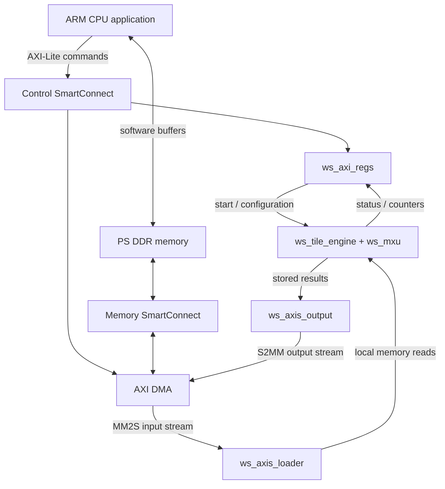

# TPU interfacing: from CPU commands to FPGA results

The current design accepts one 27 x 26 INT8 weight tile and 1..64 input vectors,
each containing 27 INT8 values. It returns 26 INT32 dot products per vector.
This guide explains the interfaces around that array and the remaining deployment
work. It describes a matrix test, not yet a complete Conv0 or ResNet accelerator.

The existing integrated build is now supplied in [hardware/](hardware/README.md):
bitstream, XSA and original routed reports. The steps below remain the rebuild
procedure; CPU application compilation and board validation are still required.

## 1. Three connections with different jobs

| Connection | What travels across it | Who uses it? |
|---|---|---|
| AXI-Lite, memory-mapped control | Register addresses, configuration values, commands and status | CPU and accelerator/DMA control registers |
| AXI memory-mapped data | DDR addresses and bursts of data | DMA and the PS DDR interface |
| AXI-Stream | Ordered payload bytes, valid/ready handshakes and packet boundaries; no addresses | DMA and our accelerator |



MM2S means memory to stream: DDR to accelerator. S2MM means stream to memory:
accelerator to DDR. Our RTL implements the custom boxes; PS, DMA and SmartConnect
still need to be assembled into the TPU system using Vivado IP Integrator.

## 2. What the assignments in `ws_axi_top.sv` mean

This line uses a SystemVerilog named struct assignment:

```systemverilog
assign cpu_req.w = '{data:s_axi_wdata, strb:s_axi_wstrb, valid:s_axi_wvalid};
```

It connects three external wires to three named fields. It is equivalent to:

```systemverilog
assign cpu_req.w.data  = s_axi_wdata;
assign cpu_req.w.strb  = s_axi_wstrb;
assign cpu_req.w.valid = s_axi_wvalid;
```

The apostrophe-brace syntax is an assignment pattern. These continuous assignments
describe wiring, not software instructions or clocked storage. `ws_axi_pkg.sv`
defines the structs; `ws_axi_regs.sv` receives `cpu_req` and drives `cpu_rsp`.

| Expression | Meaning |
|---|---|
| `cpu_req.aw.addr` | Address of the register the CPU wants to write |
| `cpu_req.w.data` / `.strb` | Write value / which of its four bytes are enabled |
| `cpu_req.bready` | CPU can accept the write response |
| `cpu_rsp.awready` | Register block can accept a write address |
| `cpu_rsp.b.valid` / `.resp` | Write response is available / success or error |
| `cpu_req.ar.addr` | Address the CPU wants to read |
| `cpu_rsp.r.data` | Value returned by that register read |

AW and W are independent channels, even though both are bundled into `cpu_req`.
Their values are held separately until both arrive. All fields within one struct
flow in the same direction; response signals use a different struct.

Streams similarly use `axis_fwd_t` for DATA/KEEP/LAST/VALID and `axis_back_t` for
READY. The receiver owns READY. Keeping the top-level ports flat lets Vivado
recognize standard AXI interfaces while the internal structs keep the code readable.

## 3. How a register write starts hardware

The CPU cannot directly assign a Verilog variable. Instead, it performs a write
to an address. The interconnect selects this peripheral; `ws_axi_regs` decodes
the low-byte offset and generates a hardware action.

For example, **if** the block design assigns base `0xA0000000`, writing 1 to
`0xA0000000 + 0x00` requests START. This base is a proposed integration choice,
not a value fixed by `ws_axi_top`.

| Offset | Register | Purpose |
|---|---|---|
| `0x00` | CONTROL | Write 1 to start; 2 to reset the datapath |
| `0x04` | STATUS | Busy, payload ready, computation/output complete and error flags |
| `0x08` | LOAD_KIND | 0 = weight packet; 1 = input-vector packet |
| `0x0C` | VECTOR_COUNT | Number of vectors, 1..64 |
| `0x10` | ERROR | Packet-format or computation errors |
| `0x14`, `0x18` | Cycle counters | Transaction-after-START and compute scheduling times |
| `0x1C` | OUTPUT_BYTES | Number of output bytes accepted by the stream sink |
| `0x20` | ID_VERSION | Read `0x57530001` to confirm register access |
| `0x24` | MAX_VECTORS | Read 64 |

START produces a pulse. The engine then advances independently through its state
machine; the CPU polls status rather than issuing a command for every MAC clock.
The full bit definitions and rejected-access behavior are in the
[register and packet contract](docs/04_axi_wrapper.md).

## 4. Stream handshakes and packet boundaries

A beat transfers only on a rising clock edge where VALID and READY are both 1.
If VALID=1 and READY=0, the producer holds DATA, KEEP, LAST and VALID unchanged.
There is no transfer when only one of the handshake signals is high.

Our stream is 256 bits, or 32 bytes, wide. KEEP has one bit for each byte. LAST
marks the final beat of one packet and is held with that beat during a stall.
For 702 weight bytes, the packet contains 21 full beats and a final 30-byte beat:
the final KEEP is `0x3FFFFFFF` and LAST is 1. Byte zero is `TDATA[7:0]`.

The loader currently stores one byte per clock and the output packer assembles
one INT32 word per clock. The stream width is not their sustained throughput.
This is a simple bring-up implementation, not the ideal transfer schedule from
the Python presentation demo.

## 5. Where data lives, and who owns it

| Location | Owner | Stored data |
|---|---|---|
| DDR transmit buffers | CPU before transfer; DMA reads during transfer | Packed weights and input vectors |
| `u_loader.weight_mem` | Input loader writes; engine reads | 702 weight bytes |
| `u_loader.input_mem` | Input loader writes; engine reads | Up to 1,728 input bytes |
| Registers inside `u_engine.u_mxu` | TPU | Held weights, delayed inputs and intermediate partial sums |
| `u_engine.result_mem` | Engine writes; output packer requests reads | 26 banks x 64 INT32 results = 6,656 bytes |
| Output beat register | Output packer | Up to eight results awaiting stream acceptance |
| DDR receive buffer | DMA writes; CPU reads after completion/cache maintenance | Returned results |

FPGA-local memories are not directly mapped into the CPU address space in this
design. DMA streams are the route into/out of them. Their sizes are logical
capacities; synthesis must establish how much BRAM, LUTRAM or register storage
is actually inferred.

The CPU must not change a transmit buffer while DMA reads it or consume a receive
buffer before DMA completes. On the planned noncoherent HP connection, software
must flush transmit cache lines and correctly prepare/invalidate receive buffers.
Use dedicated aligned buffers so cache operations do not corrupt unrelated data.

The TPU cannot pause for output backpressure. The full result tile is therefore
captured locally before sending it to DMA; memory is not reused until draining
completes. Each column writes independently because columns finish at different
clocks. Completed INT32 results are still raw dot products, before bias/scaling.

## 6. One complete CPU transaction

```mermaid
sequenceDiagram
    participant CPU
    participant DMA
    participant Loader
    participant Engine
    participant Output
    CPU->>CPU: Prepare buffers and cache state
    CPU->>Loader: Registers: N and LOAD_KIND=0
    CPU->>DMA: Send 702 weight bytes
    DMA->>Loader: Weight stream
    CPU->>Loader: Poll weights-ready after DMA completion
    CPU->>Loader: Register: LOAD_KIND=1
    CPU->>DMA: Send N x 27 input bytes
    DMA->>Loader: Input stream
    CPU->>Loader: Poll inputs-ready after DMA completion
    CPU->>DMA: Arm receive for N x 104 bytes
    CPU->>Engine: Register: START
    Loader->>Engine: Local weight/input reads
    Engine->>Engine: Compute and capture all results
    Engine->>Output: Enable result drain
    Output->>DMA: Result stream, final LAST
    CPU->>DMA: Wait for receive completion
    CPU->>CPU: Invalidate receive cache; check results
```

The register accesses shown against Loader/Engine are all physically handled by
`ws_axi_regs`. A DMA send can complete before the loader finishes unpacking its
last beat, hence the additional ready polling. Likewise, accelerator output-done
does not prove DMA has finished writing DDR.

For a warm run, retain the weight tile and upload fresh inputs. For error recovery,
reset affected DMA channels and the accelerator together; a soft reset can truncate
a packet. Every polling loop needs a timeout.

## 7. Current evidence and remaining work

| Item | Status |
|---|---|
| AXI wrapper/submodule RTL and self-checking testbench | Written |
| Vivado compilation and hierarchy elaboration | Passed; no simulation executed |
| Python packing and planned feed schedule | Checked for N=1, 2, 3, 64 |
| Behavioral simulation of this wrapper | User-run PASS on November 5, 2026: 1,820 INT32 comparisons plus AXI checks |
| TPU PS/DMA integrated build | Existing local build supplied; routed reports show positive setup/hold slack. Not rebuilt for publication. |
| TPU bitstream/XSA | Included in hardware/ with checksums |
| CPU application and board comparison | C source supplied; Vitis build and board validation remain pending |

The earlier core-only 702-DSP result is now supplemented by the integrated
[routed evidence](hardware/README.md), which also reports 702 DSPs. The old broadcast system's bitstream,
XSA, timing results and benchmark are references, not deployment artifacts for
this TPU wrapper.

Verified simulation evidence:
`build/tb_ws_axi_top_20261105_232158/tb_ws_axi_top.sim/sim_1/behav/xsim/simulate.log`.
This testbench pass does not establish integrated PS/DMA behavior or board timing.

## 8. Deployment sequence and exit criteria

### A. Register the RTL and verify its behavior

In the open TPU Vivado project's Tcl console:

```tcl
source <repo>/resnet8_project/brainstorming/conv0/arch3_ws_tpu_27x26/scripts/add_axi_sources.tcl
```

This adds dependencies, selects `ws_axi_top`, and updates compile order. Avoid
adding both the repository top and the existing project copy as duplicate modules.

Next, run [tb_ws_axi_top.sv](tb/tb_ws_axi_top.sv) when simulation is authorized.
The [simulation script](scripts/sim.tcl) creates a separate simulation project;
run it in a separate Vivado session from the architecture directory:

```tcl
set argv {tb_ws_axi_top}
set argc 1
source scripts/sim.tcl
```

Exit criterion: a real `PASS tb_ws_axi_top` log with **1,820 INT32 comparisons**
across its four runs, plus passing control/stall/error tests. This gate passed
in the user-run log above. Add tests for further integration cases discovered.

### B. Build the CPU/DMA system in IP Integrator

The new [create_soc_project.tcl](scripts/create_soc_project.tcl) automates the
connections described below. Save and close the current Vivado project first
(leave Vivado open), then run this in its Tcl console:

```tcl
source <repo>/resnet8_project/brainstorming/conv0/arch3_ws_tpu_27x26/scripts/create_soc_project.tcl
```

It creates a fresh `.vivado/tpu_soc_<timestamp>/tpu_soc.xpr`, validates the block
design, generates output products and selects `system_wrapper` as the top. Look
for `TPU_SOC_CREATED:` followed by the new project path. The script does not run
synthesis, implementation or simulation. Project creation itself has not yet
been run/validated as part of the prepared script delivery.

[ws_axi_bd.v](rtl/ws_axi_bd.v) is a thin, explicit AXI-interface adapter around
`ws_axi_top`, following the old integration's module-reference approach. It
adds no arithmetic or storage and passed a compile-only check. It is the module
instantiated by the block design; it was not part of the prior behavioral test.

Adapt [the old project creation Tcl](../arch1_broadcast_832/scripts/create_project.tcl)
into a separate TPU integration project. Do not overwrite the working broadcast
design. Add the KV260 Zynq UltraScale+ PS preset, AXI DMA in simple mode (both
directions, no scatter-gather), control/memory SmartConnect, processor-system reset
blocks and the new accelerator module reference.

| Connection | Required route |
|---|---|
| CPU control master | PS `M_AXI_HPM0_FPD` -> control SmartConnect -> accelerator AXI-Lite and DMA AXI-Lite |
| DDR transactions | DMA `M_AXI_MM2S` / `M_AXI_S2MM` -> memory SmartConnect -> PS `S_AXI_HP0_FPD` |
| Input packet | DMA `M_AXIS_MM2S` -> accelerator input stream |
| Result packet | Accelerator output stream -> DMA `S_AXIS_S2MM` |
| Clocks/resets | Connect every AXI interface and synchronize reset for each clock domain |

Start with a proposed 100 MHz wrapper/DMA/stream clock. The old design's HP0 port
uses 128 bits at 200 MHz; if retained, configure SmartConnect for the width/clock
conversion. Configure 256-bit DMA stream and memory ports as in the old system.
These are integration choices, not measured TPU performance. Verify them against
the installed [AXI DMA guide](https://www.amd.com/content/dam/xilinx/support/documents/ip_documentation/axi_dma/v7_1/pg021_axi_dma.pdf).

In Address Editor, assign non-overlapping control ranges (for example accelerator
`0xA0000000`, DMA `0xA0010000`) and make DDR reachable by both DMA masters. Record
the actual addresses for software. Confirm interface grouping/clock associations;
if automatic module-reference inference is incomplete, add interface metadata or
package the wrapper. Do not make the internal AXI data/control ports external pins.

Exit criterion: block-design validation passes, addresses and clocks are reviewed,
and the generated system HDL wrapper is the project top. `ws_axi_top` is now an
internal block, not the final board-level top.

### C. Synthesize, implement, and produce hardware artifacts

Generate block-design output products and run synthesis. Inspect hierarchical DSP,
LUT, FF and memory utilization for the full system, especially memory inference.
Then implement and review setup/hold timing, unconstrained paths, CDC and DRC.
The existing `ooc_200mhz.xdc` targets a port named `clk` on the old core-only flow;
do not apply it blindly to `ws_axi_top`, whose clock is `aclk`, or to the PS system.

Only after the integrated design fits and meets its clock requirements, generate
the bitstream and use **File -> Export -> Export Hardware**, including the bitstream,
to create the new TPU XSA. The XSA describes hardware for Vitis; it is not the CPU
application. [AMD's 2024.2 export instructions](https://docs.amd.com/r/2024.2-English/Vitis-Tutorials-Embedded-Software/Exporting-the-XSA).

### D. Build a matching CPU application

Create a Vitis standalone Cortex-A53 platform from that XSA. Adapt the old
[benchmark.c](../arch1_broadcast_832/cpu/benchmark.c) using the new registers and
INT32 packet sizes. Reuse its DMA/cache/timeout approach, not its Conv0 payload
assumptions. A 64-vector run sends 702 weight bytes and 1,728 input bytes and
receives 6,656 bytes, representing 1,664 results.

Generate matching CPU fixtures from the same scalar formulas or golden data as
the testbench. Weight order here is term-major then filter; existing OHWI Conv0
weights must be repacked. Inputs are prepared vectors, not raw image bytes.
Compile the application into an ELF with the platform's DMA driver/BSP.

The existing application is standalone, not an Ubuntu executable. Choosing to
remain under Ubuntu instead requires Linux DMA-buffer allocation/driver and
device-description integration; that path has not been implemented here.

### E. Program and validate on KV260

Follow the [Kria-specific JTAG boot/debug procedure](https://adaptivesupport.amd.com/s/article/000036959?language=en_US).
Use the matching platform initialization to initialize PS/DDR, program the new
bitstream, then download/run the new ELF on the A53 and capture UART output.
Do not run the standalone test alongside a live Ubuntu instance using the same
resources. Programming the PL alone neither initializes DDR nor runs the CPU.
This JTAG bring-up does not require implementing a persistent QSPI installation.

First read ID_VERSION, then test N=1 for 26 correct outputs and N=64 for all 1,664
outputs. Exercise warm weight reuse, repeated runs and recovery. Measure CPU total
latency including copies, caches, setup, loading, computation and return transfers;
report hardware counters separately. Compare against the model only with matching
scope and counting conventions.

The deployment milestone is **correct matrix results returned to the CPU with a
measured end-to-end latency**. Complete Conv0 comes afterward: patch generation,
padding, bias, requantization/ReLU and the full 26,624-byte golden comparison.

For source ownership and a reading order, see [the submodule walkthrough](docs/05_axi_submodules.md).
