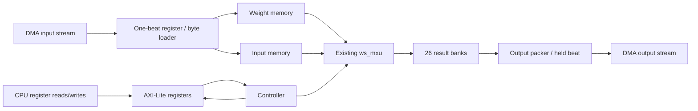

# Buffered AXI wrapper: first CPU/FPGA matrix test

`rtl/ws_axi_top.sv` wraps the existing 27 x 26 `ws_mxu`. It accepts one weight
tile and 1..64 synthetic/input vectors, computes raw INT32 dot products, then
returns one result packet. It does not generate image patches, add bias,
requantize, implement ReLU, or execute full Conv0/ResNet.

The implementation is now split into submodules with struct-based internal buses.
See [the module walkthrough](05_axi_submodules.md) for code ownership and the
Vivado command to add the new dependencies. This document remains the packet and
register contract; the refactor does not change that interface.

## What each section does

| RTL section | Purpose and reason |
|---|---|
| `ws_axi_regs` | CPU-visible commands and status. Captures write address and write data independently, respects byte strobes, holds responses until accepted. |
| `ws_axis_loader` | Owns weight/input memories. Accepts a 256-bit beat, validates KEEP/LAST, and stores one byte per clock. |
| `ws_tile_engine` | Loads weights, inserts two startup clocks, feeds vectors, and owns the MXU and per-column result banks. |
| `ws_axis_output` | Packs one INT32 per clock into a 256-bit beat; holds the beat unchanged while DMA is stalled. |
| `ws_axi_top` / `ws_axi_pkg` | External-port wiring / shared struct definitions for internal buses. |



## Why map registers to addresses?

The CPU cannot directly assign a Verilog signal. It issues a bus transaction to
an address, and this module decodes that address into a command/configuration
register. Software and RTL therefore share a small, stable control interface.
For example, if IP Integrator assigns base `0xA0000000`, a write of 1 to
`base + 0x00` requests START. The wrapper only decodes the low 8 address bits;
the interconnect selects this peripheral using the assigned base/range.
Choose a 256-byte segment where supported; a larger mapped segment can alias
these low-byte offsets. No absolute base is hard-coded in this RTL.

Payloads do not pass through these registers. CPU DDR buffers hold the bulk
data; DMA transfers them through AXI streams into FPGA-local storage. The DMA
has its own separate memory-mapped control registers and DDR addresses.

| Offset | Name | Access / meaning |
|---|---|---|
| `0x00` | CONTROL | Write 1 = START, 2 = SOFT_RESET, 0 = no-op. Other values return SLVERR. Reads return 0. |
| `0x04` | STATUS | Read: bit 0 busy (including packet loading/fault); 1 weights ready; 2 inputs ready for configured N; 3 compute done; 4 output done; 5 error; 6 loader active. |
| `0x08` | LOAD_KIND | Read/write: 0 weights, 1 input vectors. Reset default 0. |
| `0x0C` | VECTOR_COUNT | Read/write: N = 1..64. Reset default 64. Set before input packet. |
| `0x10` | ERROR | Sticky: bit 0 invalid KEEP; 1 incorrect LAST/length; 2 extra column result; 3 compute timeout. Cleared by reset. |
| `0x14` | ELAPSED_CYCLES | START acceptance through final output handshake; excludes input loading and CPU work. |
| `0x18` | COMPUTE_CYCLES | Weight load, settle, feed, pipeline capture and completion detection. Includes wrapper overhead; not the Python model's exact counting convention. |
| `0x1C` | OUTPUT_BYTES | Bytes accepted by DMA stream sink in this run. Final value N x 104. |
| `0x20` | ID_VERSION | `0x57530001` ('WS', interface revision 1). |
| `0x24` | MAX_VECTORS | 64. |

Unaligned/unknown accesses, writes to read-only addresses, invalid configuration
and illegal START return AXI SLVERR. These rejected register accesses do not set
the packet/core ERROR flags. Reads are snapshots, held until RREADY.
Configuration writes are allowed only while idle with no packet in progress.
AWPROT/ARPROT are accepted but ignored; this is not a security boundary.

START requires completed weights and inputs, matching N, and no error. A START
is a pulse, not a persistent enable. Starting consumes the inputs-ready flag;
the next run requires a new input packet. Weights remain in weight memory for
warm runs but are reloaded into the PE registers at every START.

Soft reset aborts the engine, invalidates both payloads, clears counters/errors,
and resets the TPU. It retains LOAD_KIND/VECTOR_COUNT and does not discard the
AXI-Lite write response. Stop/reset affected DMA channels as part of abort/error
recovery; abort can truncate a stream packet. Hardware reset clears everything
including configuration. Use an externally synchronized active-low reset for
this single-clock design. No internal clock-domain crossings are implemented.

## Packet and memory layout

All packets use 256-bit streams; byte 0 is `TDATA[7:0]`. Only full beats followed
by a contiguous low-byte final KEEP mask are accepted; sparse KEEP is rejected.
TLAST must coincide exactly with the expected final beat. A packet that simply
stops arriving requires a software timeout. Extra bytes cannot silently be
appended: final KEEP/LAST must match the configured length.

| Packet | Wire order | Bytes |
|---|---|---:|
| Weights, kind 0 | `W[0][0] .. W[0][25], W[1][0] .. W[26][25]` | 702 |
| Inputs, kind 1 | `X[0][0] .. X[0][26], X[1][0] .. X[N-1][26]` | N x 27 |
| Results | `Y[0][0] .. Y[0][25], Y[1][0] .. Y[N-1][25]`; each signed INT32 little-endian | N x 104 |

Weight wire order is **reduction-term first, filter second**. Existing Conv0
OHWI weight files are filter-first and must be transposed/repacked before this
interface. The input is already a matrix of patches/vectors, not a raw HWC image.
The feeder reverses stored weight rows when loading the TPU (26 down to 0),
matching `ws_mxu`'s shift-chain contract.

| Where data lives | Logical organization | Capacity |
|---|---|---:|
| CPU DDR | TX/RX buffers allocated by the application | Application-defined |
| `weight_mem` | 27 words, each holding 26 INT8 weights | 702 B |
| `input_mem` | 64 words, each holding 27 INT8 values | 1,728 B |
| TPU internal registers | Active/next weights, alignment delays, partial sums | Existing array storage |
| `result_mem` | 26 banks x 64 INT32 results | 6,656 B |
| Input/output beat registers | 256 bits each, plus metadata | 32 B each |

The three explicit tile memories total **9,086 payload bytes**. This is logical
capacity, not a BRAM utilization prediction. Wide reads, byte writes and variable
bank selection can infer LUTRAM/registers/muxes; inspect synthesis before claiming
BRAM mapping, resource fit or timing. Memory contents are not reset in bulk;
ready bits and counters ensure only initialized entries are used.

Intermediate dot-product sums live in the TPU's registered pipeline. Completed
raw sums live in `result_mem` until drained; they are not yet final INT8 feature
maps. This design performs one reduction tile and does not implement accumulation
across multiple tiles for later ResNet layers.

## Software sequence

1. Reset accelerator and initialize DMA. Set N. Prepare aligned DDR buffers.
2. Flush transmit buffers; set LOAD_KIND=0; send exactly 702 weight bytes.
3. Wait for DMA completion **and STATUS.weights_ready**: the loader may still
   be unpacking its last accepted beat after DMA reports completion.
4. Set LOAD_KIND=1; send N x 27 input bytes; wait for DMA and inputs_ready.
5. Prepare receive-buffer cache state and arm S2MM for N x 104 bytes.
6. Write CONTROL=1. Poll DMA/error/status with timeouts.
7. Wait for receive-DMA completion, then invalidate the receive cache and compare
   every INT32 result. Output-done alone does not prove DDR writes are complete.
8. For a warm run, send fresh inputs and repeat; no weight upload is required.

CPU total latency must include copies, cache operations, DMA/register setup,
loading, compute and output transfer. Hardware ELAPSED_CYCLES covers only part
of that transaction. This simple byte loader/word packer is deliberately slower
than the ideal transfer budget in the presentation model.

## Vivado and verification

The canonical source is `rtl/ws_axi_top.sv`; a matching copy is placed in the
currently open Vivado project's `sources_1/new/ws_axi_top.sv`. Compile only one
copy. Existing package/core files remain dependencies. The project's top was
`ws_mxu`; select `ws_axi_top` when checking this wrapper alone. In the eventual
CPU/DMA block design, the generated system wrapper becomes the project top.
Confirm interface grouping/clock association in IP Integrator before connection.
No PS, DMA, clock conversion or DDR controller is instantiated in this file.

`tb/tb_ws_axi_top.sv` is a self-checking testbench for 1, 64, 3 and 2 vectors,
warm weight reuse, both AW/W arrival orders, held responses, partial final beats,
random output stalls, invalid START/count, malformed KEEP/LAST and reset recovery.
From the architecture project directory, the existing simulation script can run
it when HDL simulation is authorized:

```tcl
set argv {tb_ws_axi_top}
set argc 1
source scripts/sim.tcl
```

Vivado 2024.2 `xvlog --sv` compiled the wrapper, existing dependencies and new
testbench successfully on November 5, 2026 (compile only; no HDL simulation).
The log is in `build/axi_wrapper_compile_20261105/compile.log`.
`model/check_axi_tile_contract.py` checks packet packing and the planned feeder
schedule against the existing Python MXU model; it does not execute this RTL.
The user's subsequent HDL run passed 1,820 INT32 comparisons plus AXI checks;
see `build/tb_ws_axi_top_20261105_232158/tb_ws_axi_top.sim/sim_1/behav/xsim/simulate.log`.
Integrated synthesis and board validation remain pending. The existing 702-DSP
synthesis report covers `ws_mxu`, not this top.
