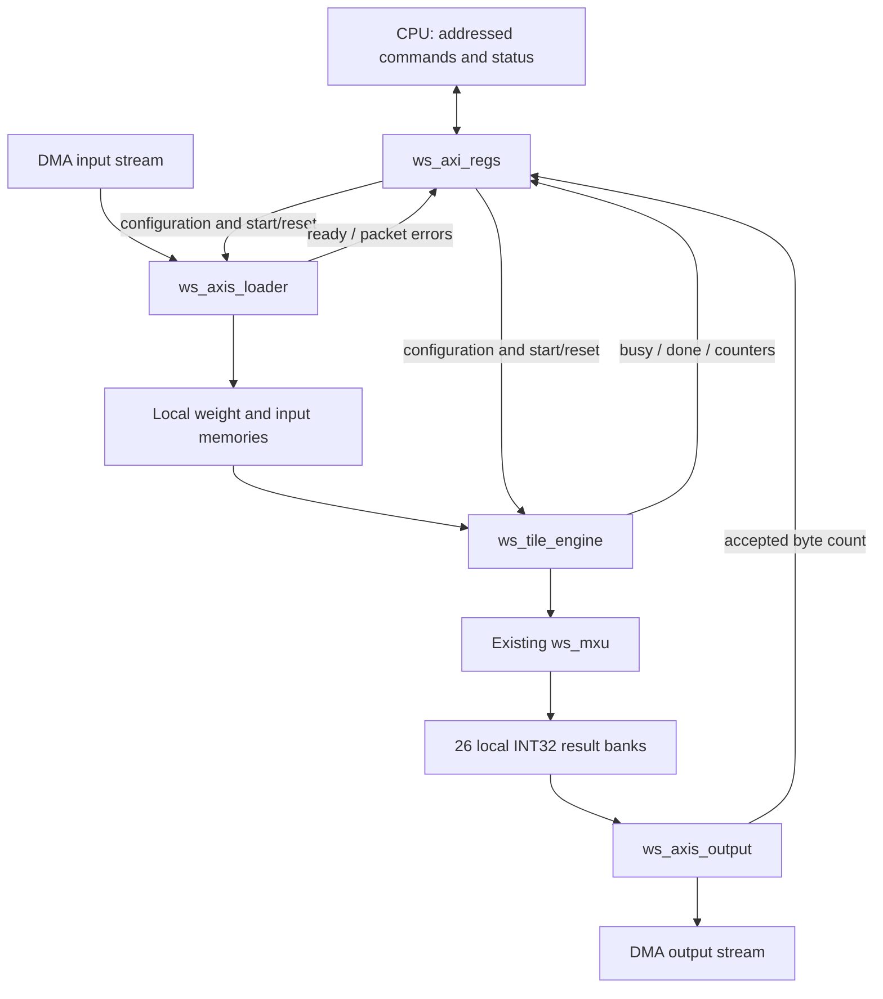

# AXI wrapper: module-by-module walkthrough

For the CPU/DMA transaction and the remaining board-deployment steps, start with
[INTERFACING.md](../INTERFACING.md).

Start at [ws_axi_top.sv](../rtl/ws_axi_top.sv). It now contains bus wiring and
four module instances. The register map, packet layout, 64-vector limit and
load-compute-drain schedule are unchanged by this refactor.



The memory boxes indicate ownership: weight/input memories are inside the loader;
the MXU and result banks are inside the tile engine. They are not extra modules.

## 1. `ws_axi_top`: the connection diagram in RTL

[Source](../rtl/ws_axi_top.sv)

This module maps flat external AXI wires into internal structs and connects the
submodules. It has no state machine or memory. It also combines external reset
and the software-reset pulse for the datapath. The register block receives only
external reset, so a software reset cannot erase its own pending AXI response.

Keep the external ports flat for IP Integrator's standard interface recognition.
The structs are used between our own SystemVerilog modules, where they reduce
long port lists and make direction/ownership explicit.

## 2. `ws_axi_pkg`: names for bundles of related wires

[Source](../rtl/ws_axi_pkg.sv)

This package defines types and fixed dimensions. It is compiled before the
modules that use its types. A `struct packed` is a named bundle of bits; declaring
one does not create a FIFO, memory, or extra pipeline clock.

| Type | Direction and contents |
|---|---|
| `axil_req_t` | CPU to registers: AW address/protection/valid, W data/strobes/valid, BREADY, AR address/protection/valid, RREADY |
| `axil_rsp_t` | Registers to CPU: AWREADY, WREADY, B response/valid, ARREADY, R data/response/valid |
| `axis_fwd_t` | Stream producer to consumer: DATA, KEEP, LAST, VALID |
| `axis_back_t` | Stream consumer to producer: READY |
| `control_t` | Register block's configuration, start/reset pulses and write-pending flag |
| `loader_status_t` | Payload-ready flags, loader busy, packet events/errors and loaded vector count |
| `engine_status_t` | Idle, computation/output completion, errors and cycle counters |
| `tile_read_t` / `tile_data_t` | Engine's local-memory read request / loader's wide weight and input words |
| `result_read_t` | Output packer's enable and linear index for an INT32 result |

For example:

```systemverilog
cpu_req.aw.addr       // CPU's write address
cpu_req.w.data        // CPU's write value
cpu_rsp.b.valid       // Register block has a write response
rx_stream.data       // Incoming 256-bit payload
rx_back.ready        // Loader can accept that payload
```

READY is kept in a separate reverse-direction struct because the consumer
drives it. Putting both directions into one ordinary input/output struct would
obscure who owns each wire. Struct grouping also does not couple the independent
AW/W channels: the register block still accepts them separately.

## 3. `ws_axi_regs`: translate CPU accesses into hardware actions

[Source](../rtl/ws_axi_regs.sv)

The CPU writes an address and value; this module decodes the offset, updates
configuration, or emits a one-clock START/RESET command. Reads return status and
counters. Independent holding registers capture AW and W; a write executes only
after both have arrived. Read/write responses stay valid until the CPU accepts
them. Byte strobes allow partial register writes.

It rejects invalid addresses, vector counts and commands with SLVERR. It checks
the loader/engine status before starting, so the array cannot consume incomplete
payloads. Its write-pending flag prevents a register update from racing packet
acceptance. It stores configuration and bus-transaction state, not image data.

**Trace first:** CPU writes N to `0x0C`, then writes START to `0x00`. Follow
`control.vector_count` and `control.start` into the engine.

## 4. `ws_axis_loader`: receive and store weights/input vectors

[Source](../rtl/ws_axis_loader.sv)

It accepts a beat only when VALID and READY are both high. It checks the expected
KEEP mask and LAST position, holds the beat in a register, and stores one byte
per clock. Packet metadata is latched so every byte of the packet has one meaning.
It raises a ready flag only after the final accepted beat has been fully stored.

It owns `weight_mem` (702 bytes) and `input_mem` (1,728 bytes). The engine can read
one full 26-weight row or 27-input vector through `tile_read` / `tile_data`.
These are local combinational read connections, not AXI transactions.

**Trace first:** the first 32 weight bytes cross a 26-byte weight-row boundary.
Follow `byte_offset / COLS` and `byte_offset % COLS` to see their destinations.

## 5. `ws_tile_engine`: compute scheduling and result storage

[Source](../rtl/ws_tile_engine.sv)

It owns the sequence `IDLE -> LOAD_WEIGHTS -> SETTLE -> FEED -> CAPTURE -> SEND`.
It requests weight rows 26 down to 0, inserts two empty clocks, then requests one
input vector per clock. It instantiates the existing `ws_mxu`; the arithmetic
inside the PE/column/array modules is unchanged.

Each output column has its own counter and result bank. Capture runs during
feeding as well as pipeline drain. Once all banks contain N results, the engine
enables output packing. It returns to IDLE on the final accepted output beat.
It also detects excess results/missing-result timeout and holds FAULT until reset.

`result_mem` contains 26 x 64 INT32 values (6,656 bytes). Intermediate sums inside
the MXU remain in the array pipeline registers. Neither storage is CPU-addressable
in this implementation; DMA returns the completed results.

**Trace first:** follow one column's valid bit, `result_count[c]`, and bank write.

## 6. `ws_axis_output`: turn stored results into a DMA packet

[Source](../rtl/ws_axis_output.sv)

It requests one INT32 word per clock in vector-major order, assembles eight words
into a 256-bit beat, and asserts VALID. The final beat has the corresponding KEEP
mask and LAST. While READY is low, the complete beat stays unchanged.

The `finished` signal denotes the final VALID/READY/LAST handshake on that edge.
The engine uses it to set output-done. This does not mean DMA has finished its
DDR writes; CPU software must also wait for receive-DMA completion.

**Trace first:** N=1 yields 26 words: three full beats and a final two-word beat
with KEEP=`0x000000FF`.

## Open the files in Vivado

The currently open project's `ws_axi_top.sv` is synchronized with the canonical
top. The five new supporting files are in the architecture's `rtl/` folder.
In the open TPU project's Tcl console, run:

```tcl
source <repo>/resnet8_project/brainstorming/conv0/arch3_ws_tpu_27x26/scripts/add_axi_sources.tcl
```

This registers missing source dependencies, retains the already-added top copy,
selects `ws_axi_top` as design top and updates compile order. It does not run
synthesis or simulation. There should be only one copy of each module in the
project. Direct compiler users must read `ws_pkg.sv` and `ws_axi_pkg.sv` first.

## Verification and limits

The refactored modules and the unchanged `tb_ws_axi_top.sv` passed Vivado 2024.2
`xvlog` compilation. Log: `build/axi_wrapper_compile_20261105/refactor_compile.log`.
`xelab` also successfully elaborated the hierarchy and built a snapshot, checking
the struct ports and module connections. Log:
`build/axi_wrapper_compile_20261105/refactor_elaborate.log`. The snapshot was not run.
The user subsequently ran the self-checking testbench on November 5, 2026:
**PASS tb_ws_axi_top: 1820 INT32 comparisons, AXI ordering/stalls/errors**.
The saved log was inspected at
`build/tb_ws_axi_top_20261105_232158/tb_ws_axi_top.sim/sim_1/behav/xsim/simulate.log`.
No integrated synthesis, routed timing, or board execution is claimed.

The byte loader, word packer, logical memory capacities and raw INT32 output
format remain the bring-up design described in [the interface contract](04_axi_wrapper.md).
The existing 702-DSP resource report covers the MXU, not the whole AXI wrapper.
