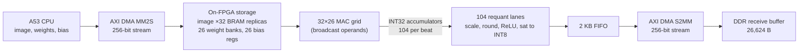
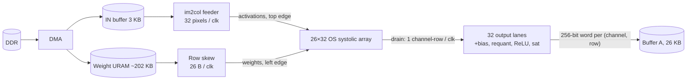
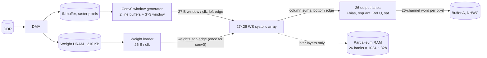

# Conv0 — the three proposed architectures

Summary of `conv0/arch1_broadcast_832`, `arch2_os_systolic_26x32`, `arch3_ws_tpu_27x26`.
Conv0 is the first ResNet-8 layer: a 32×32×3 INT8 image → 32×32×26 INT8 feature map
using 26 filters of 3×3×3, with folded BatchNorm, requantization, ReLU and saturation.

> **Status matters when comparing.** Arch 1 is implemented, simulated and routed (board run pending).
> Arch 2 and Arch 3 are **proposals only**: their numbers come from layer shapes and datasheet
> capacities, nothing is synthesized or measured. Arch 2 and 3 are also *whole-network* engines
> in which conv0 is just the first layer; Arch 1 is a conv0-only engine.

---

## 1. At a glance

| | **Arch 1 — Broadcast 832** | **Arch 2 — Output-stationary systolic 26×32** | **Arch 3 — Weight-stationary "TPU" 27×26** |
|---|---|---|---|
| Status | Built: RTL, XSim (30 frames), routed timing PASS, bitstream/XSA exported. Board run pending | Proposed | Proposed (RTL skeleton of the array only) |
| Scope | Conv0 only | Every ResNet-8 layer | Every ResNet-8 layer |
| Array | 32 pixel lanes × 26 channels = **832 MACs** | 26 channels × 32 pixels = **832 PEs** | 27 reduction rows × 26 channels = **702 PEs** |
| Neighbor-to-neighbor movement? | **No** — operands are broadcast | Yes — weights →, activations ↓ | Yes — activations →, partial sums ↓, weights loaded ↓ |
| Unrolled in space | pixels (32) × channels (26) | channels (26) × pixels (32) | reduction k (27) × channels (26) |
| Done in time | k = 27 taps, then next image row (×32) | k = 27 cycles per tile, 32 tiles | pixels: 1,024 streamed back-to-back |
| What stays put in a PE | the running sum (INT32) | the running sum (25-bit) | the weight |
| Where the sum over k happens | in time, inside each MAC's accumulator | in time, inside each PE's accumulator | **in space**, down the column |
| Accumulate where? | DSP multiplies only; INT32 add in **fabric** | inside the **DSP** (P register) | inside the **DSP cascade** (PCIN→PCOUT) |
| Output goes to | DDR (via FIFO + DMA) | on-chip buffer A | on-chip buffer A |
| Clock | 100 MHz accelerator/DMA (PS memory port at 200 MHz) | 200 MHz target | 200 MHz target |
| Conv0 cycles | **1,239** (RTL sim, START → last output) | ≈ **954** | ≈ **1,085–1,112** |
| Conv0 time | 12.39 µs @ 100 MHz | ≈ 4.8 µs @ 200 MHz | ≈ 5.4–5.6 µs @ 200 MHz |
| Resources | **Routed:** 832 DSP, 95,688 LUT (81.7%), 56,684 FF, 97.7% of CLBs | *Estimate, full net:* ~960–1,020 DSP (77–82%), 35–50k LUT, 32–40 BRAM36, 6 URAM | *Estimate, full net:* ~800–860 DSP (64–69%), 30–45k LUT, 57–61 BRAM36, 6 URAM |

---

## 2. The shared problem: conv0 is a (26×27)·(27×1024) matrix multiply

For output channel `c` and output pixel `p = (y, x)`:

```
Y[c][p] = bias[c] + Σ_{k=0..26} W[c][k] · A[k][p]

 k = (ky, kx, ic) flattened  →  27 terms = 3×3 window × 3 colour channels
 A[k][p] = the input value that filter tap k sees at output pixel p (0 outside the image)
```

```
      W  (OC=26 × K=27)            A  (K=27 × P=1024)             Y  (OC=26 × P=1024)
    ┌─────────────────┐         ┌───────────────────────┐        ┌───────────────────────┐
    │ filter 0        │         │ pixel 0 … pixel 1023  │        │ ch 0  over all pixels │
    │ filter 1        │    ×    │ one 27-long column    │   =    │ ch 1                  │
    │   ⋮             │         │ per output pixel      │        │   ⋮                   │
    │ filter 25       │         │ (the im2col window)   │        │ ch 25                 │
    └─────────────────┘         └───────────────────────┘        └───────────────────────┘
       702 weights                   3,072 image bytes                 26,624 INT8 outputs
                                     read ~9× each, padding = 0        (718,848 MAC terms)
```

The three loops are **OC=26**, **P=1024**, **K=27**. Each architecture chooses which two to
spread over hardware and which one to run in time:

```
                 OC (26)        P (1024)                 K (27)
 Arch 1          space          space (32 at a time)     time    (+ outer loop over 32 image rows)
 Arch 2          space          space (32 at a time)     time    (32 tiles back to back)
 Arch 3          space          time (stream 1/cycle)    space
```

---

## 3. Arch 1 — Broadcast array, 832 MACs (implemented)

*One image row (32 pixels × 26 channels) is computed at a time; the same grid is reused for all 32 rows.*

### 3.1 System flow



### 3.2 The array: what feeds it and how operands reach each MAC

```
                 26 output channels (c) — one weight register bank per column
                 weight[0]  weight[1]  weight[2]   …   weight[25]
                    │          │          │                │       each = wmem_c[tap], one read per issue clock,
                    ▼          ▼          ▼                ▼       broadcast DOWN the column to 32 MACs

 pixel lane 0   sample[0] ─►  ┌───┐      ┌───┐      ┌───┐          ┌───┐
 pixel lane 1   sample[1] ─►  │MAC│      │MAC│      │MAC│   …      │MAC│     sample[p] is broadcast ACROSS the
 pixel lane 2   sample[2] ─►  │   │      │   │      │   │          │   │     row to its 26 MACs
     ⋮                        └───┘      └───┘      └───┘          └───┘
 pixel lane 31  sample[31]─►   832 MACs in total.  There are NO wires between MACs (not systolic).
                               MAC(p,c) holds its own accumulator acc[p*26 + c].
```

Each lane has a private copy of the image in BRAM (32 replicas × four 192×32-bit banks), so all 32
lanes can read a *different* address in the same clock. At tap `t` (`ky = t/9`, `kx = (t/3)%3`, `ic = t%3`),
lane `p` reads `X[y+ky−1][p+kx−1][ic]` (0 if outside the image).

### 3.3 Inside one MAC — where the intermediate values live

```
 sample (INT8) ─┐
                ├─► DSP48 multiplier ─► product reg (INT16) ─► fabric adder ─► acc reg (INT32) ──┐
 weight (INT8) ─┘                                                  ▲                            │
                                                                   └────────────────────────────┘
          at INIT:   acc ← bias[c]            during 27 ISSUE clocks:  acc ← acc + product
```

| Value | Where it lives | Size |
|---|---|---|
| Image | 32 BRAM replicas (one per pixel lane) | 98,304 B logical |
| Weights | 26 register banks × 27 INT8; current tap in a `wq` register per channel | 702 B |
| Bias | 26 INT32 registers; loaded into every accumulator of that channel at INIT | 104 B |
| Product (intermediate) | INT16 register at the DSP output, one per MAC | 832 × 2 B |
| Running sum (intermediate) | INT32 fabric register **inside each MAC** | 832 × 4 B = 3,328 B |
| Final sum | the same accumulator, held until read out | — |
| Quantization constants | compiled into the requant logic (the packet only verifies them) | — |
| Output (after requant) | 2 KB FIFO → DMA → DDR | 26,624 B total |

### 3.4 One image row, cycle by cycle

```
 state   INIT ─► ISSUE × 27 ──────────► DRAIN (~2–3) ─► EMIT × 8 ─► next row INIT …
 what    acc ← bias   tap 0 … 26:        pipeline        beat b reads accum[b*104 .. b*104+103]
                      all 832 MACs        flush           = 4 pixels × 26 channels → 104 requant lanes
                      multiply-add
                      in lockstep
```

```
 EMIT: the 32×26 accumulator grid is read out 4 pixels (104 values) per beat

   beat 0 → pixels  0– 3     beat 4 → pixels 16–19
   beat 1 → pixels  4– 7     beat 5 → pixels 20–23
   beat 2 → pixels  8–11     beat 6 → pixels 24–27
   beat 3 → pixels 12–15     beat 7 → pixels 28–31

   104 INT32 ─► 3-stage requant (×M, round-shift, ReLU+saturate) ─► 104 INT8
             ─► FIFO (absorbs the rate mismatch; backpressure stalls the array if full)
             ─► 256-bit stream (≤ 32 B/beat) ─► DMA ─► DDR, laid out HWC (pixel-major, 26 channels each)
```

While the array is in DRAIN/EMIT it is not issuing new products: 864 of the 1,239 cycles are
issue cycles (my arithmetic: ≈ 70%; ≈ 375 cycles, ~12 per row, are overhead).

**Key design points:** broadcast avoids all inter-MAC wiring and skew; the cost is 32× image
replication and a **fabric** 32-bit adder per MAC (DSP only multiplies). My reading is that this,
plus the 104 requant lanes built in LUTs, is why LUT use is 81.7% and CLBs 97.7% even though
DSPs are only 832.

---

## 4. Arch 2 — Output-stationary systolic array, 26×32 (proposed)

*Rows = 26 output channels, columns = 32 consecutive output pixels. Each PE owns one output value `(c, p)` and accumulates it in place while operands stream past.*

### 4.1 System flow



### 4.2 The array

```
                 col 0        col 1        col 2    …    col 31          ▼ activations (top edge):
                 A[k][p0]     A[k-1][p1]   A[k-2][p2]    A[k-31][p31]      column p gets A[k][p], delayed p cycles
                    ↓            ↓            ↓              ↓
 row 0   W[0][k]    → [PE] ───────→ [PE] ───────→ [PE] ─ … ─→ [PE]    ◄ weights (left edge):
                    ↓            ↓            ↓              ↓            row c gets W[c][k], delayed c cycles
 row 1   W[1][k-1]  → [PE] ───────→ [PE] ───────→ [PE] ─ … ─→ [PE]
   ⋮
 row 25  W[25][k-25]→ [PE] ───────→ [PE] ───────→ [PE] ─ … ─→ [PE]
                    ↓ drain      ↓ drain      ↓ drain        ↓ drain
                  lane 0       lane 1       lane 2   …     lane 31  ─► output pipeline
```

Activation moves **down**, weight moves **right**, one PE per clock. Each PE multiplies the pair
that meets there and adds it to its own accumulator. Because of the skew, `W[c][k]` and `A[k][p]`
meet in `PE(c, p)` at cycle **`k + c + p`**. A snapshot of the top-left corner at t = 8 shows the
diagonal wavefront (number = which `k` that PE is multiplying right now, `·` = idle):

```
 t = 8        p0  p1  p2  p3  p4  p5  p6  p7
   c0          8   7   6   5   4   3   2   1
   c1          7   6   5   4   3   2   1   0
   c2          6   5   4   3   2   1   0   ·
   c3          5   4   3   2   1   0   ·   ·
   c4          4   3   2   1   0   ·   ·   ·
   c5          3   2   1   0   ·   ·   ·   ·          (PE(c,p) works on k = t − c − p, for 0 ≤ k ≤ 26)
```

### 4.3 The PE — where intermediate values live

```
          act_in (8b, from PE above) ──┬────────────────► act_out (registered, to PE below)
                                       ▼
 w_in (8b) ──► [reg] ──► w_out ┐   ┌──────────── DSP48E2 ─────────────┐
 (from left)      (to PE right)└──►│ P = first ? W·A : P + W·A         │  accumulator 1 = DSP P register
                                   └───────────────┬──────────────────┘  (25-bit signed, no bias yet)
                                                   │ on 'last' (k = 26)
                                                   ▼
                         drain_in ──► [ drain reg, 25b ] ──► drain_out (to PE below)
                         (from above)   accumulator 2: finished sum parked here
                                        so the DSP can start the next tile immediately
```

- `first` / `last` flags travel with the data, so each PE sees them at its own skewed time.
- Bias is **not** in the array; it is added in the output pipeline.
- 25 bits suffice: worst case |Σ| ≤ 936·128·128 ≈ 15.3 M < 2²⁴ (936 is the deepest layer; conv0 needs far less).

### 4.4 What feeds the array

| Edge | Source | Format | For conv0 |
|---|---|---|---|
| Left (weights) | 6 URAMs, one 26-byte word per `k`: `W[0..25][k]` | row `r` takes byte `r`, delayed `r` cycles (325-byte skew triangle) | the same 27 words are re-read for each of the 32 tiles |
| Top (activations) | im2col feeder from IN buffer (96 × 256-bit words: channel-planar, one 32-pixel image row of one channel per word) | for each `(ky, ic)` load one input-row word into a window register, then serve the 3 `kx` taps by selecting pixel `x = ox + kx − 1` per column (0 outside the image) | 1 word read every 3 cycles; one tile = one output row of 32 pixels |

### 4.5 Draining finished sums without stalling

```
 column c (26 PEs):  each PE has [acc | drain]
 1. PE(r,c) finishes k=26 → copies acc → its drain reg; DSP starts the next tile in the same cycle
 2. drain regs of the column shift DOWN, bottom first:  oc25, oc24, … oc0  → output lane c
 3. 26 shift cycles ≤ K (min K in the network = 26), so draining always hides under the next tile
 4. columns finish one cycle apart → small de-skew triangle → 32 lanes aligned
```

### 4.6 Output path and storage

```
 drain (1 channel-row per clock, 32 lanes) ─► + bias[c] ─► ×M ─► round-shift R ─► ReLU ─► sat INT8
      ─► 32 lanes × 8 bit = one 256-bit word  word(c, row) ─► Buffer A at address c·32 + row
```

The channel-planar 32-pixel word is exactly what the next layer's feeder reads, so conv0's output
never leaves the chip (the whole network moves only 3,072 B in and 10 B out).

### 4.7 Conv0 timeline

```
 tile (= image row)   0       1       2          …        31
 issue cycles       [0..26][27..53][54..80]  …  [837..863]       32 tiles × 27 = 864, back to back
 + 56  fill   (25 row-skew + 31 column-skew to reach PE(25,31))
 + 26  final drain       + ~8  RAM/requant latency
 ───────────────────────────────────────────────────────────────
 total ≈ 954 cycles ≈ 4.8 µs @ 200 MHz        all 832 PEs busy during the 864 issue cycles
```

---

## 5. Arch 3 — Weight-stationary "TPU-style" array, 27×26 (proposed)

*Rows = 27 reduction indices `k`, columns = 26 output channels. Each PE holds one weight for a whole pass; pixels stream through and the sum over k happens down each column.*

### 5.1 System flow



### 5.2 The array

```
 PE(r, c) holds the fixed weight  Wc,r = W[c][r]   (r = tap index k, c = output channel)

                    col 0           col 1               col 25  
 A[0]  (k=0)  ──► [  W0,0  ] ──► [  W1,0  ] ──► … ──► [ W25,0  ]
                      │               │                   │     
 A[1]  (k=1)  ──► [  W0,1  ] ──► [  W1,1  ] ──► … ──► [ W25,1  ]
                      │               │                   │     
                      ⋮               ⋮                   ⋮     
 A[26] (k=26) ──► [ W0,26  ] ──► [ W1,26  ] ──► … ──► [ W25,26 ]
                      │               │                   │     
                   Y[p][0]         Y[p][1]       …     Y[p][25] 

 → pixels flow right (registered, 1 PE per clock)       ↓ partial sums flow down (DSP cascade PCIN → PCOUT)
 Bottom edge: one complete 27-term sum per column for a NEW pixel every cycle; column c lags column 0 by c cycles.
```

Each cycle a whole 27-byte window `A[0..26][p]` of one output pixel enters on the left, row `r`
delayed by `r` cycles. `PE(r, c)` multiplies the value it sees by its fixed weight, adds the
partial sum from the PE above, and passes the result down. A snapshot at t = 8 (number = *pixel
index* `p` that PE is processing; compare with Arch 2, where the same diagonal means `k`):

```
 t = 8        c0  c1  c2  c3  c4  c5  c6  c7
   r0          8   7   6   5   4   3   2   1
   r1          7   6   5   4   3   2   1   0
   r2          6   5   4   3   2   1   0   ·
   r3          5   4   3   2   1   0   ·   ·
   r4          4   3   2   1   0   ·   ·   ·
   r5          3   2   1   0   ·   ·   ·   ·          (PE(r,c) works on pixel p = t − r − c, 0 ≤ p ≤ 1023)
```

### 5.3 The PE — where intermediate values live

```
              B1: next weight  ◄── shifts down the column during load (BCIN/BCOUT cascade)
                   │ swap when the first pixel of a new pass arrives
              B2: active weight (stays put for the whole pass)

 act_in (8b) ─► [reg] ──┬──────────────────────────► act_out (to PE on the right, 1 clk later)
                        ▼
                  A · B2  ─►  + psum_in (from PE above, PCIN)  ─►  psum_out (to PE below, PCOUT)
```

| Value | Where it lives |
|---|---|
| Weight (current / next) | DSP B2 / B1 registers inside each PE (702 weights; conv0 loads them once, 27 cycles, prefetchable) |
| Activation in flight | one 8-bit register per PE, moving right |
| Partial sum in flight | a partial-sum register at each row (32-bit in the RTL skeleton), moving down the cascade |
| Full 27-term sum (conv0) | emerges at the bottom of the column and goes **straight** into the output pipeline — never written to RAM |
| Partial sums for K > 27 (later layers) | 26-bank partial-sum RAM (1024 × 32 b each), read-modify-write per pass; pass 0 starts from bias |

### 5.4 What feeds the array (conv0)

```
 IN buffer (raster, 3 B/pixel)
      │  one pixel per cycle, raster order
      ▼
 ┌─────────────────────────────┐   3×3 register window of 3-byte pixels
 │ 2 line buffers (32 px each) │ ─► 27 B = the full 3×3×3 window of one output pixel, zero padding at the borders
 └─────────────────────────────┘
      │  27 B / clk
      ▼  row-skew triangle (row r delayed r clk) ─► left edge of the array
```

An alternative in the doc is to have the CPU pre-expand the image to 1,024 × 27 B (27.6 KB DMA instead of 3 KB).
Conv0 is the one layer that fits exactly: K = 27 rows, OC = 26 columns, one pass, 100% of PEs used.

### 5.5 Output path and storage

```
 column sums (c-skewed) ─► + bias[c] ─► ×M ─► round-shift R ─► ReLU ─► sat INT8
      ─► byte de-skew triangle ─► one 26-channel word per pixel (32 B padded)
      ─► Buffer A (1,024 × 256 b), address (y·32 + x), NHWC layout
```

Requant parameters `{M, R}` are constant per lane for a whole output-channel tile (Arch 2 needs a new set every drain cycle).

### 5.6 Conv0 timeline

```
 weight load      stream 1,024 pixels (1 per clk)                       skew + latency
 [27 clk]  ──►  [ p0 p1 p2 … p1023 ]───────────────────────────────►  +51 (27+26−2)  +~10
 (hidden if prefetched)

 total ≈ 1,024 + 51 + ~10 (+27 if weights not prefetched) ≈ 1,085–1,112 cycles ≈ 5.4–5.6 µs @ 200 MHz
 702 PEs busy once the pipeline is full; no partial-sum RAM traffic for conv0
```

---

## 6. The same output value traced through all three

Output `Y[c = 5]` at pixel `(y = 0, x = 7)` — 27 products plus bias:

| | Arch 1 | Arch 2 | Arch 3 |
|---|---|---|---|
| Who computes it | `MAC(lane 7, channel 5)` of the grid during image row 0 | `PE(row 5, column 7)` during tile 0 | column 5, pixel 7 of the stream (all 27 rows of column 5 contribute) |
| How the 27 terms arrive | one per clock, tap 0…26, by **broadcast**: `sample[7]` and `weight[5]` are sent to this MAC (and its neighbours) simultaneously | one per clock, `W[5][k]` from the left and `A[k][7]` from above, meeting at cycle `k + 12` | all 27 at once in space: pixel 7's window enters rows 0…26 at cycles `7 + r`, product `W[5][r]·A[r][7]` is added at row `r` as the partial sum falls |
| Where the running sum sits | INT32 accumulator in the MAC (init = bias[5]) | DSP P register in the PE (no bias) | psum registers down column 5 (no bias yet) |
| Finished at | after the 27 ISSUE clocks plus the DRAIN flush (~30 clocks after INIT) | cycle 38 of the tile (`26 + 5 + 7`) → drain register | bottom of column 5, cycle 38 of the stream (`7 + 26 + 5`) |
| Leaves the array via | EMIT beat 1 (pixels 4–7), lane 83 → requant lane → FIFO | drain shift into lane 7 (oc 5 is the 21st of 26 shifted, bottom first) | column 5 bottom edge → output lane 5 |
| Final home | DDR receive buffer, byte `7·26 + 5 = 187` of row 0 | Buffer A, byte 7 of the 256-bit word `(c=5, row 0)` | Buffer A, byte 5 of the word for pixel (0, 7) |

---

## 7. Trade-offs in one place

| | Arch 1 | Arch 2 | Arch 3 |
|---|---|---|---|
| Strength | Simplest control; no skew; **already routed and simulated**; fixed constants make requant cheap | 100% PE utilization on every conv layer; no partial-sum RAM; K is "free" (just cycles); fastest estimate | Natural fit for DSP B1/B2 + PCIN/PCOUT cascades; fewest PEs and DSPs; requant constants change rarely; conv0 is an exact fit |
| Weak point | Replicates the image 32×; 32-bit adder per MAC in fabric (LUT/CLB heavy); array idles during drain/emit; conv0 only | Needs im2col crossbar feeder, 325-byte skew + de-skew triangles, 832 drain registers; DSP use 77–82% | 96.4% utilization overall; weight loads hidden only when P ≥ 27; 26 BRAM36 psum RAM; weight URAM 98.5% full; needs a 27-deep physical DSP column |
| Conv0 cycles | 1,239 | ≈ 954 | ≈ 1,085–1,112 |
| Extends to later layers by | channel tiling + new memory plan (not designed) | same RTL, just more tiles/longer K (designed on paper) | more passes + partial-sum RAM (designed on paper) |

### Things to keep in mind when reading the numbers

- **Not apples-to-apples on time.** Arch 1's 12.39 µs is at 100 MHz and includes streaming results out of the array; Arch 2/3's conv0 times are at an unproven 200 MHz, with the image already on chip. In cycles: 1,239 vs ≈954 vs ≈1,085–1,112.
- **Resources are not comparable either.** Arch 1 is routed; Arch 2/3 are estimates for the *whole network*. Their lower LUT estimates assume accumulation inside the DSP, which Arch 1 deliberately did not do. None of the three is under ~60% on every resource (Arch 1: LUT 81.7%, CLB 97.7%; Arch 2: DSP 77–82%; Arch 3: DSP 64–69%).
- **Layout mismatch to resolve.** Arch 1's RTL walks taps as `(ky, kx, ic)` over OHWI weights; Arch 2's weight URAM and feeder use `(ky, ic, kx)`. Arch 3 uses NHWC 26-channel words, matching the exported layout. Sharing one weight export across architectures needs a reorder step for Arch 2.
- **Arch 3 RTL is a skeleton.** `ws_pe / ws_column / ws_array / ws_mxu / ws_skew` exist, with no testbench in the archive, and the PE's own comment warns that `use_dsp` attributes do not guarantee the B1/B2 and cascade mapping — verify the synthesized DSP count.

---

Sources (all inside `conv0.zip`): `arch1_broadcast_832/ARCHITECTURE.md`, `.../docs/TECHNICAL_REFERENCE.md`, `.../CURRENT_STATUS.md`, `.../src/{conv0_832_core,mac_int8_mixed,conv0_requant,conv0_result_fifo}.sv`; `arch2_os_systolic_26x32/ARCHITECTURE.md`; `arch3_ws_tpu_27x26/ARCHITECTURE.md`, `arch3_ws_tpu_27x26/rtl/*.sv`.
