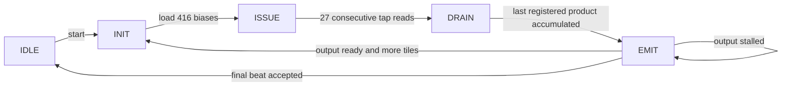

# Conv0 cycle-by-cycle Python RTL model

This is the experiment entry point for the **KV260 Conv0 accelerator**. It runs
in Python with NumPy; it does not launch Vivado or any HDL simulator.
See RESULTS.md (detailed file retained locally) for the initial checked architecture comparisons.
The expanded architecture study (detailed file retained locally) compares 396 clock/data
runs, DSP/LUT mapping scenarios, and recommends a provisional 208-MAC design.
For the current latency target, the newer [INT8 AXI/transfer model](AXI_INT8_STUDY.md)
supersedes that earlier raw-INT32 egress recommendation.

The default configuration follows the existing `conv0_416_dsp.v`: 16 spatial
positions x 26 output channels, 416 MAC lanes, and four INT32 outputs per beat.
Each call to `Conv0Core.step()` advances **one rising clock edge**, using old
register values to compute the next register values. The model multiplies and
accumulates the data as it advances; it does not run a whole software convolution
and attach a calculated latency afterward.

## Start here

From the repository root in PowerShell:

```powershell
cd resnet8_project

# Existing 416-MAC core, no bandwidth bottleneck, with a per-clock CSV trace
..\.venv-resnet\Scripts\python.exe simulate_conv0.py run --config cycle_sim/configs/416_ideal.json --trace resnet8/artifacts/cycle_sim/trace.csv

# Include illustrative CPU/FPGA transfer behavior; second frame reuses weights
..\.venv-resnet\Scripts\python.exe simulate_conv0.py run --config cycle_sim/configs/416_example_host.json --frames 2

# Compare MAC counts and output widths under those same transfer assumptions
..\.venv-resnet\Scripts\python.exe simulate_conv0.py sweep --config cycle_sim/configs/416_example_host.json

# Python tests, including arithmetic, pipeline timing, resets, and transfer stalls
..\.venv-resnet\Scripts\python.exe -m unittest discover -s tests -v

# INT8 Conv0 requantization/ReLU with AXI4-Stream and AXI4-Lite traces
..\.venv-resnet\Scripts\python.exe simulate_axi_conv0.py run --config cycle_sim/configs/conv0_int8_latency.json --trace resnet8/artifacts/axi_conv0/selected_trace.csv

# Lower-LUT fallback with DSP requantization
..\.venv-resnet\Scripts\python.exe simulate_axi_conv0.py run --config cycle_sim/configs/conv0_int8_latency_fallback_52.json

# Full AXI/INT8 architecture and transport sweep (several minutes)
..\.venv-resnet\Scripts\python.exe simulate_axi_conv0.py sweep
```

With a Python environment already activated, use `python` in place of the
explicit executable. Only NumPy is needed for this simulator; TensorFlow and
the CIFAR-10 download are unnecessary. The small committed `fixtures/` directory
provides all input, parameter, and expected-output data. `--fixture PATH` selects
another fixture with the same layout and hash manifest.

The default report paths are `resnet8/artifacts/cycle_sim/run.json` and
`sweep.json` / `sweep.csv`. Use `--output PATH` to keep named experiments.
Files under `artifacts/` are ignored by Git. `--trace-limit` defaults to 50,000
rows, and the report records any omitted trace rows. The simulation continues
after the trace reaches its limit.

## What one simulated clock means

The core follows this state sequence for each tile:



There are three overlapping pipeline stages during the issue phase:

1. Read one image byte per spatial lane and one weight per output channel.
2. Register the products of the **previous cycle's** memory outputs.
3. Accumulate the **previous cycle's** registered products.

The INIT edge loads biases, and two drain edges after the last read finish the
pipeline. The controller then emits the tile's results. It does not overlap
computation of a new tile with emission of the previous tile.

| Edge counted from accepted start | State before edge | Action |
|---:|---|---|
| 1 | IDLE | Accept start |
| 2 | INIT | Load biases, reset tap counters |
| 3 | ISSUE | Read tap 0 |
| 4 | ISSUE | Read tap 1; register tap 0 products |
| 5 | ISSUE | Read tap 2; register tap 1 products; accumulate tap 0 |
| 29 | ISSUE | Read final tap 26 |
| 30 | DRAIN | Register final products; accumulate tap 25 |
| 31 | DRAIN | Accumulate tap 26; transition to EMIT |
| 32 | EMIT | First output beat can be accepted |

The complete 416-MAC run issues 718,848 MAC operations and produces 26,624
INT32 values. Without stalls, it takes **8,577 counted edges** from start through
the final accepted output, inclusive. The six forced final-beat stalls in
`416_final_stall.json` produce **8,583**, matching the first two reported HDL
synthetic-test counts. This counting convention includes the start edge; elapsed
time between timestamps on the first and last edge is one period less.

The core's preloaded memory survives reset. Reset cancels the operation and
clears pipeline valid bits and accumulators. Start while idle blocks simultaneous
writes; start/writes while busy are ignored. INT8 products and INT32 accumulator
wraparound follow two's-complement register widths. Exported model parameters
are separately checked to avoid overflow during normal inference.

## Change an architecture

Copy one JSON config and edit its `architecture` section:

```json
{
  "architecture": {"spatial_lanes": 8, "output_lanes": 8},
  "host": {"clock_mhz": 100},
  "resources": {"dsp_per_mac": 2}
}
```

That experiment uses **8 x 26 = 208 MAC lanes**, emitting eight results per
beat. Supported spatial-lane counts are 1, 2, 4, 8, 16, and 32: MAC counts
26, 52, 104, 208, 416, and 832. All 26 output channels remain parallel.
Output lanes must divide `spatial_lanes * 26`, so every beat is full. Invalid
combinations are rejected, or listed under `skipped` in a sweep report.

The MAC count is fixed hardware parallelism; the number of operations per
image remains 718,848. Wider output interfaces affect drain time, not MAC count.
Spatial variants are **proposed architecture models**, not existing matching
RTL implementations. They adapt counters/addressing and replicated memory
counts in software. The existing Verilog has fixed spatial parallelism of 16.
This is not yet an arbitrary dataflow, systolic-array, or channel-tiling explorer.

For a targeted sweep:

```powershell
..\.venv-resnet\Scripts\python.exe simulate_conv0.py sweep --spatial-lanes 4 8 16 --output-lanes 4 8 --output resnet8/artifacts/cycle_sim/my_sweep.json
```

Each candidate actually executes its cycle model and checks every output;
the sweep does not merely compare formulas. Configurations over the resource
budget are still simulated, but clearly flagged, so the tradeoff remains visible.

## CPU–FPGA interaction model

The core is kept separate from a configurable transaction-level host/adapter:

```text
CPU-side input/parameters
       | H2D setup and shared byte-rate limit
       v
Three preload ports (one image byte, one weight byte, one bias word per clock)
       | launch delay
       v
Conv0 core -> finite output FIFO -> D2H setup / byte-rate limit -> CPU result
       ^             |
       +--- ready ---+                 completion handling delay
```

No specific AXI, DMA, cache-coherency policy, driver, DDR arbitration, or interrupt
controller is assumed. Those can be substituted behind the same core interface
later. The configuration numbers are inputs to an experiment, not measured
KV260 link specifications.

| Host setting | Meaning |
|---|---|
| `clock_mhz` | Assumed FPGA clock for converting cycles to time |
| `h2d_mbps`, `d2h_mbps` | Effective payload bandwidth in decimal MB/s; `null` means unlimited |
| `h2d_setup_us` | Delay before any preload transfer |
| `launch_us` | CPU/control delay after preload before start |
| `d2h_setup_us` | Output engine startup delay, measured from the start-edge phase |
| `completion_us` | CPU completion-handling delay after all output bytes arrive |
| `output_fifo_beats` | Full-beat capacity between core and host |
| `output_stall_probability`, `seed` | Reproducible additional deassertions of output ready |
| `final_stall_cycles` | Directed final-write stall, useful for matching the existing TB |
| `max_cycles` | Total-frame watchdog, including preload and transfer phases |

Delays round up to whole core clock cycles. H2D uses a bounded credit budget
shared by all three write ports. Each cycle checks bias, weight, then image
write eligibility; byte writes can use credit when a full bias word does not
yet fit. No port can exceed its RTL write rate even with unlimited host bandwidth.
This models a small transfer adapter, not instantaneous whole-image injection.

D2H consumes bytes from previously accepted output beats. A beat can drain
over multiple clocks; its result becomes visible to the host after the complete
beat arrives. Bytes drained this clock free FIFO space for the next accepted
core beat at this edge. Newly accepted data cannot drain until a later clock.
No unused empty-link bandwidth is saved for future bursts. Thus even unlimited
D2H bandwidth has one cycle of FIFO delivery latency after the last write.

When the FIFO cannot accept a whole beat, the model lowers `out_ready`, and the
core remains in EMIT. Random stalls only inhibit core acceptance; they do not
stop drainage of already buffered data. The FIFO contributes additional memory
requirements and is a proposed wrapper, not part of the current RTL module.

For `--frames 2`, the first frame loads 3,878 bytes (3,072 image + 702 weights +
104 biases). The second frame reuses resident weights/biases and loads 3,072
bytes. Both return **106,496 output bytes** because the current output is raw
INT32, not INT8. Frames execute sequentially; there is no double-buffer overlap.

## KV260 resource accounting and the discovered synthesis result

The device budget is 1,248 DSPs, 144 BRAM36 tiles, 64 URAMs, 117,120 LUTs, and
234,240 flip-flops. Capacities come from the
[AMD K26 data sheet](https://docs.amd.com/r/en-US/ds987-k26-som/Programmable-Logic).
The local synthesized-device report lists 189 available bonded I/O sites.

The October 1 report found in
`feature_map/feature_map.runs/synth_1/conv0_416_dsp_utilization_synth.rpt`
contains these measured baseline counts:

| Resource | Synthesized 416-MAC core | Device utilization |
|---|---:|---:|
| DSP | **832** | 66.67% |
| BRAM36 | 16 | 11.11% |
| LUT | 12,121 | 10.35% |
| Registers | 14,337 | 6.12% |
| Bonded I/O | 229 | 121.16% |

**The existing mapping uses two DSPs per MAC lane, not one.** The default model
uses that observed ratio. `dsp_per_mac: 1` is an explicit hypothetical improved
mapping; changing that JSON value does not change RTL or prove it synthesizes.
The source and Vivado-imported copy had matching SHA-256 identities when read
on October 15. [kv260.json](kv260.json) records the report identity and counts.

Spatial variants scale the known replicated image memory (one BRAM36 per copy)
and the configured DSP-per-MAC ratio. They report logical product/accumulator
storage too. LUT/FF counts are reported as measured only for the baseline
16-spatial / four-output-lane / two-DSP mapping. Other configurations have
unknown LUT/FF counts rather than invented linear fit claims.

`reserve_dsp` and `reserve_bram36` subtract resources you want to leave for
future operators or interfaces. The output FIFO reports its payload and a
BRAM capacity lower bound separately; width/depth packing and adapter logic
still need implementation. All resource checks are screening estimates, not
placement, routing, or timing validation.

The 229-pin standalone core does not fit the reported 189 I/O sites. Its wide
ports should connect internally to memories and a CPU interface; they should
not all become board pins. A suitable integrated wrapper is still required.
The model reports this separately from arithmetic/memory capacity.

## Results and cycle inspection

JSON reports include core cycles, total host-visible cycles, first output time,
phase/state counts, FIFO occupancy peak, stall reasons, transferred bytes,
parameter reuse, checked output count/hash, and resource assumptions. Time is
in microseconds at the configured clock, with timing closure explicitly unknown.

The CSV trace includes the state before and after each edge, tile/tap counters,
pipeline valid bits, input read addresses (`null` for padding), one product and
accumulator before/after, output addresses and values, handshakes, preload
writes, FIFO occupancy before acceptance, and bytes drained. Register values
outside a valid pipeline stage may be stale and must not be interpreted as
active work. `out_valid` in a row is the value sampled before the edge; `done`
and `busy_after` are after the edge.

For custom experiments, use the core directly:

```python
from cycle_sim import Architecture, Conv0Core, Inputs
from cycle_sim.fixtures import load_fixture

fixture = load_fixture()
core = Conv0Core(Architecture(spatial_lanes=16, output_lanes=4))
core.step(Inputs(rst=True))
for i in range(3072):
    core.step(Inputs(
        image_write=(i, int(fixture["image"][i])),
        weight_write=(i, int(fixture["weights"][i])) if i < 702 else None,
        bias_write=(i, int(fixture["bias"][i])) if i < 26 else None,
    ))

core.step(Inputs(start=True))
while core.busy:
    event = core.step(Inputs(out_ready=True))
    if event["transfer"]:
        print(event["cycle"], event["out_addr"], event["out_data"])
```

Inspect `core.acc`, `core.products_q`, `core.samples_q`, and `core.weights_q`
between steps to see all lanes. `peek()` reads combinational outputs without
advancing a clock. This makes it possible to add another controller/transport
model without modifying the compute core.

## Validation boundaries and extension path

The Python tests cover every saved Conv0 output, the 8,577/8,583 schedules,
pipeline edge alignment, zero padding, signed extreme products, INT32 wrap,
reset/start/write priorities, stalled-output stability, parameter retention,
bandwidth conservation, finite FIFO backpressure, warm frames, deterministic
random stalls, alternate spatial widths, and resource-limit rejection flags.

This is not Verilog elaboration or co-simulation. No new RTL run was performed
to validate this model. Data equality against the golden fixture and matching
schedule counts are evidence for the Python model; they do not replace the
pending pretrained-fixture run on actual RTL. Uninitialized memory use raises
an exception rather than reproducing four-state X propagation. Clock-domain
crossings, metastability, timing delays, place/route effects, and power are absent.

Conv0 geometry is deliberately fixed. To extend later, introduce a layer
descriptor for shape/kernel/stride/padding and channel tiling, update memory
banking and address widths, then validate each configuration against the
existing layer fixtures. Add requantization/ReLU as explicit pipeline stages,
then residual storage/adds, pooling, and dense. Keep the core step API, host
adapter, golden validation, and resource accounting separate while doing so.

No clock, bandwidth, or total latency target has been selected as a requirement;
the supplied 100 MHz and 500 MB/s scenarios are experiment assumptions.
