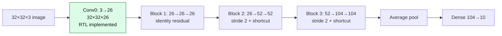
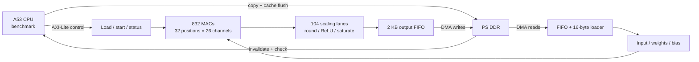
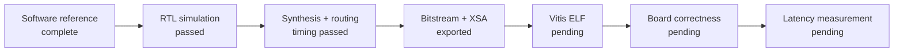

# ResNet-8: the first 15 minutes

Presenter guide for October 22, 2026. Allow eleven minutes for explanation and four for questions. Read the bold sentences as the main message; use the diagrams to explain the flow. Details and evidence links are in [the reference](TECHNICAL_REFERENCE.md).

## 0:00–2:00 — Our goal

**We are accelerating INT8 ResNet-8 on the AMD KV260. Success means a correct result with low CPU-request-to-result latency, including data movement.**

The frozen network takes a 32×32 RGB image and classifies it into ten CIFAR-10 classes. INT8 means weights and activations are stored as signed eight-bit numbers. A MAC multiplies an activation by a weight and adds it to a running sum; we accumulate in 32 bits before scaling back to eight bits.

Everything shown has a software reference. Only Conv0 has been implemented in the current accelerator. Conv0 returns a feature map, not a classification. It accounts for **2.21% of convolution/dense MAC terms** in the full network.

## 2:00–4:00 — What we have done and why

**We built a definition of correctness before optimizing hardware.**

| Completed work | Purpose |
|---|---|
| Pretrained Keras model and FP32 inference | Preserve network behavior |
| Integer reference, BatchNorm folding, quantization/export | Define exact FPGA arithmetic and memory formats |
| Golden intermediate tensors | Locate numerical errors, not just wrong final classes |
| Python scheduling and transfer studies | Explore parallelism, buffering, and transport costs |
| RTL and AXI/DMA system | Implement computation and CPU communication |
| Simulation, synthesis, placement/routing | Establish numerical behavior, actual resources, and timing |
| CPU benchmark and deployment guide | Prepare board correctness and end-to-end measurement |

We evolved from **27,648 MAC units** (too large), through a serial engine and **416 MACs**, to **832 MACs**. The older 416-MAC design used two DSPs per MAC. Separating DSP multiplication from fabric accumulation gives the new implementation one DSP per MAC.

The study explored 540 configurations plus 24 sensitivity cases on the same saved image. That is architecture exploration, not accuracy testing on 564 images. Smaller designs won under lower modeled transfer bandwidth.

## 4:00–6:30 — How one image moves through the system

**The CPU transfers data and starts computation; the FPGA returns the Conv0 feature map.**

One tile is one image row. Each MAC accumulates 27 products for a 3×3×3 window. After emitting the row, the same array processes the next row. ReLU clips negative results to zero; saturation caps Conv0 output at 127.

Streams are 256 bits wide. Accelerator/DMA run at nominal 100 MHz; the PS memory interface is 128 bits at nominal 200 MHz. SmartConnect converts widths and clocks.

**Cold:** transfer image, weights, bias, and quantization. **Warm:** retain parameters and transfer only a new image. Both return **26,624 bytes** from a **3,072-byte input**. CPU setup and output traffic can limit speed even with fast arithmetic.

Quantization constants are compiled into hardware for optimization. The received quantization packet verifies them; it does not replace them. Changing constants requires rebuilding hardware.

## 6:30–8:30 — What evidence do we have?

**Simulation and routed timing passed. Board execution and measured request latency remain pending.**

- Full simulation suite: **30 frames**, **798,720 INT32 comparisons and 798,720 INT8 comparisons**. Ten saved images and four synthetic cases, plus a repeated baseline, each cold/warm. A separate two-frame baseline also passed through the integration wrapper.
- Routed worst setup slack **+0.365 ns**, hold **+0.010 ns**, with nominal 100/200 MHz clocks. Positive slack means the checked timing requirements were met.
- CDC: **733 safe endpoints**, zero unsafe/unknown. DRC retains **2,548 warnings** for review; this is not a warning-free design.
- Bitstream and XSA export succeeded October 19.

No-stall simulation takes **1,239 cycles = 12.39 us at nominal 100 MHz**, from START to final accepted output. That excludes preload and CPU/DMA overhead. **19.47 us remains a Python-model estimate. Neither is measured board request latency.**

## 8:30–10:00 — Resources and expansion

**The design fits, but physical placement is tight.** These are actual integrated routed counts, including DMA/interconnect logic.

| Resource | Used | Capacity | Remaining |
|---|---:|---:|---:|
| DSPs | 832 | 1,248 | 416 |
| LUTs | 95,688 | 117,120 | 21,432 |
| Flip-flops | 56,684 | 234,240 | 177,556 |
| BRAM36 equivalents | 73.5 | 144 | 70.5 |
| Occupied CLBs | 14,306 | 14,640 | 334 |

BRAM use is 8 RAMB36 plus 131 RAMB18. CLBs are physical groups of logic resources: **97.72% are occupied**, although LUT use is 81.70%. Unused LUTs inside occupied blocks are subject to packing and routing constraints. Remaining counts are not a guaranteed expansion budget.

A 1,600-MAC implementation at one DSP per MAC exceeds the device's DSP count. Full ResNet needs **compute reuse**, later-layer scheduling, residual buffers/addition, pooling, and flexible quantization. We have not demonstrated that these additions fit beside the current design.

## 10:00–11:00 — The next shared milestone

**Run a correct Conv0 on the KV260, then measure cold/warm request latency.**

1. Build the existing standalone A53 benchmark in Vitis from the matching XSA.
2. Initialize PS/DDR, program PL, execute the ELF, and capture UART.
3. Check every output byte and receive-buffer guard.
4. Collect 20 cold and 200 warm frames and calibrate the model.
5. Expand board image coverage and plan the reusable full-network engine.

Programming PL alone does not initialize DDR or run the CPU application.

## 11:00–15:00 — Questions and handoff

Ask the room:

- What evidence would prove the accelerator works on the board?
- Which costs are absent from the simulation time?
- Which part of the dataflow will your group work on?

For seven attendees: **3 deployment, 2 agent experiment, 2 verification/onboarding**. Open [task cards](TASK_CARDS.md). Confirm the exact chip-agent tool and access before starting its experiment; no particular tool is assumed installed.

The meeting should produce progress toward a board result and more teammates able to explain, check, and operate the project.
