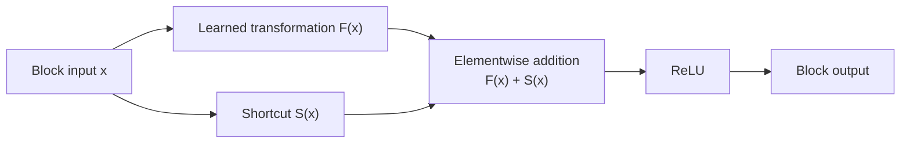
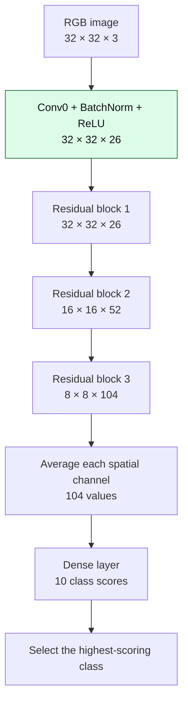
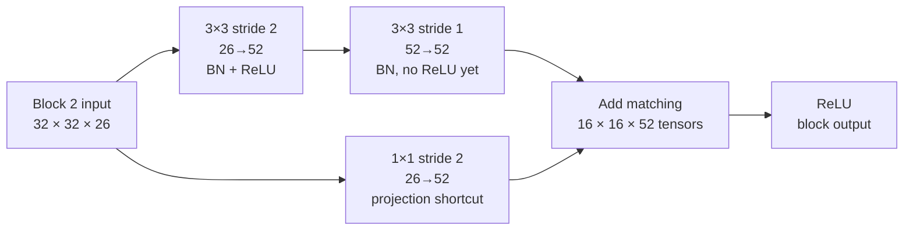
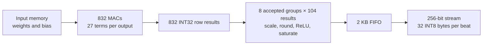
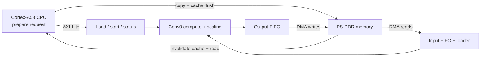
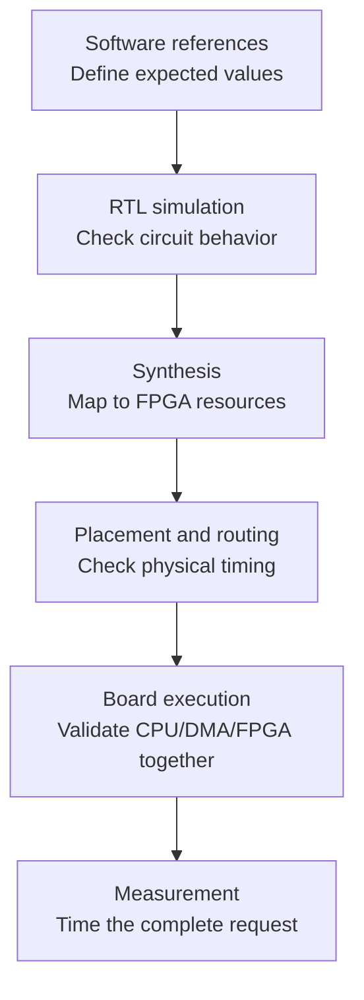

# Understanding our ResNet-8 accelerator

We are building hardware on the AMD KV260 to run a small image-classification neural network efficiently. Our performance objective is **end-to-end latency**: the time from a CPU request until its result is available, including preparation and CPU/FPGA transfers.

The entire network already runs in our software references. The current FPGA implementation computes **Conv0, the first convolution layer**. It has passed RTL simulation and physical implementation timing checks, and a bitstream has been generated. Running and measuring that design on the physical board is the next milestone. Conv0 produces a feature map, not yet a classification.

This guide explains the model, the engineering work, and the next steps. The [technical reference](TECHNICAL_REFERENCE.md) links code and evidence; [task cards](TASK_CARDS.md) organize the working session.

## What a neural network does with an image

An image is a grid of numbers. Our input has 32 rows, 32 columns, and three color channels: red, green and blue. We write that shape as **32 × 32 × 3**.

A neural network transforms these numbers through successive layers. Early layers can respond to local patterns such as changes in color or edges; later layers combine responses over larger regions. That is an intuition for feature learning, not a claim that we have inspected and assigned a meaning to each learned channel.

Two kinds of numbers matter:

- **Weights and biases** are learned parameters. Training adjusts them using examples and labels. We use an existing pretrained checkpoint.
- **Activations** are the intermediate results for the current image. They change with the image even when the weights remain fixed. A feature map is a spatial grid of such activations, with multiple channels.

**Inference** applies the trained model to a new input. Our FPGA targets inference; it does not implement training, backpropagation, or weight updates.

## What ResNet is

ResNet means **residual network**. Its distinguishing feature is a shortcut that carries a block's input around some layers and adds it to their output.

If the learned layers compute `F(x)`, an identity residual block combines `F(x) + x`. The learned path can refine the existing representation instead of having to produce the entire replacement representation. During training, the shortcut also provides a direct path for information and gradients.



When shapes match, the shortcut can be unchanged input: `S(x) = x`. When the main path changes resolution or channel count, the shortcut needs a learned projection so the arrays match before addition.

For hardware, a shortcut means **retaining data and scheduling two paths**. The block input must remain available until its contribution can be combined with the main path. It cannot be discarded when the first convolution starts.

## What ResNet-8 means in this project

Our frozen model is MLPerf Tiny's `resnet_v1_eembc(conv_filters=26)`. It classifies CIFAR-10 images into airplane, automobile, bird, cat, deer, dog, frog, horse, ship or truck.

The name **ResNet-8** counts the seven main-path convolutions and final dense layer. Two additional projection convolutions are on shortcuts. The actual graph therefore contains **nine convolution operations**, three residual additions, average pooling and a dense layer. There is no max pooling.



The highlighted stage is implemented in the current FPGA design. Its BatchNorm operation is folded into convolution parameters, as explained below. All stages exist in software.

| Stage | Main path | Shortcut | Output shape |
|---|---|---|---|
| Conv0 | 3×3 convolution, 3→26; BatchNorm; ReLU | None | 32×32×26 |
| Block 1 | 3×3, 26→26; BN; ReLU; 3×3, 26→26; BN | Identity | 32×32×26 after add/ReLU |
| Block 2 | 3×3 stride 2, 26→52; BN; ReLU; 3×3, 52→52; BN | 1×1 stride 2, 26→52 | 16×16×52 after add/ReLU |
| Block 3 | 3×3 stride 2, 52→104; BN; ReLU; 3×3, 104→104; BN | 1×1 stride 2, 52→104 | 8×8×104 after add/ReLU |
| Average pool | Average the 64 spatial values in each channel | None | 104 values |
| Dense | Ten weighted combinations of the 104 inputs | None | Ten scores |

We freeze the network, checkpoint and preprocessing so software, exports and hardware solve the same problem. Changing the channel count silently would invalidate our comparisons. The exact specification is in [ARCHITECTURE.md](../resnet8/ARCHITECTURE.md).

## The operations: what they mean and what hardware must do

### Convolution: local weighted combinations

A convolution slides a learned filter over an image or feature map. For each output position, it multiplies input values by weights, sums the products and adds a bias. Each output channel has its own filter.

One Conv0 filter covers **3 × 3 positions × 3 input channels = 27 terms**:

```text
one output value = bias + input[0] × weight[0] + ... + input[26] × weight[26]
```

There are 26 output channels at each of 32×32 positions: **26,624 output values** and **718,848 MAC terms**, including zero-padding terms. MAC means multiply-accumulate. A physical MAC can be reused for many terms and values, so mathematical operation count is different from hardware MAC count.

Channels matter: a later 3×3 convolution with 104 input channels needs **936 terms per output value**, rather than 27. Adapting Conv0 to later layers therefore requires longer reductions and channel tiling, not just replacing weights.

### Stride and padding: where the filter samples

Stride 1 moves one position at a time. Stride 2 moves two positions at a time and reduces spatial resolution. Blocks 2 and 3 halve height and width while doubling channels: fewer spatial positions, more features at each position.

SAME padding adds zeros at boundaries to produce the required output size. Our stride-1 Conv0 uses a one-pixel border on each side. For the even-sized inputs to the stride-2 layers, TensorFlow SAME uses top/left padding 0 and bottom/right padding 1. Hardware must generate those addresses correctly; the Conv0 address pattern cannot be reused unchanged.

### Batch normalization: a transform we can fold into convolution

At inference, BatchNorm uses learned scale/offset and saved statistics to transform each channel. With these values fixed, it is an affine transform: multiply by a constant and add an offset.

If convolution gives `z = W*x + b`, and BatchNorm gives `a*z + c`, they combine into `(a*W)*x + (a*b + c)`. Our software produces those folded weights and biases, avoiding a separate normalization hardware stage.

We checked folded floating-point results against the original model. The recorded largest absolute discrepancy was approximately **2.20 × 10^-5**, reflecting floating-point calculation order. This is an inference transformation, not a network topology change. The projection shortcuts in our model have no BatchNorm or activation of their own.

### ReLU: keep positive responses

ReLU computes `max(0, x)`. Its nonlinearity lets the network represent more than a chain of linear transforms. Its basic hardware behavior is a sign check and selection of zero for negative values.

Placement matters. The second main-path convolution in each residual block is followed by BatchNorm and **then addition**, without an intervening ReLU. Negative values can cancel shortcut contributions. Clipping them to zero before addition changes the model.

### Residual addition: combine corresponding features

This is elementwise addition, not channel concatenation. Block 1 adds two 32×32×26 tensors. Block 2 must transform its shortcut into 16×16×52 before adding it to the main path.



A 1×1 convolution still multiplies and sums across input channels; only its spatial footprint is one location. Our projections also use stride 2 to downsample.

Quantized branches may have different scales. We must align both into a common scale, add using a wide temporary, then apply activation and clipping. Saturating each aligned branch before addition can destroy cancellation. Our integer reference and tests cover this distinction.

### Average pooling and the dense layer

After Block 3, each of 104 channels has an 8×8 grid. Average pooling reduces each grid to one number. Integer hardware must implement the sum and division/rounding by 64 precisely.

The dense layer forms ten weighted sums from those 104 values, one score per class. The scores are called **logits**. The original floating-point network applies softmax to turn them into normalized class probabilities. Softmax preserves score ordering, so selecting the highest score does not require hardware softmax. Our integer reference can compute it on the host for presentation.

## Why INT8 needs its own reference

FP32 stores each value in four bytes; INT8 uses one byte. This reduces weight/activation storage and transfer payload and permits small integer arithmetic. It does not guarantee a particular speedup: memory access and implementation still matter.

Quantization represents a real value approximately as `scale × integer_value`, with zero point zero here. For example, scale 0.1 and integer 12 represent approximately 1.2. Rounding and clipping introduce error; quantization is not lossless compression.

Calibration observes activation ranges to select scales. Our recorded baseline calibrated on the first 512 CIFAR-10 training images and evaluated on the first 1,000 separate test images:

| Software result | Value |
|---|---:|
| FP32 classification accuracy | 89.2% |
| INT8 classification accuracy | 87.9% |
| Accuracy difference | 1.3 percentage points |
| FP32/INT8 highest-class agreement | 94.9% |

These are software results on that declared subset, not full-test-set or FPGA measurements. See [recorded software results](../resnet8/RESULTS.md).

Summing many products requires more range than INT8, so bias and accumulation are signed INT32. **Requantization** converts that sum to an output scale before storing INT8. We use per-channel multipliers/shifts, a signed INT64 product, nearest rounding with ties away from zero, and saturation. Conv0's ReLU limits its final output to 0..127.

Export checks establish safe accumulator bounds for trained parameters. Hardware also has defined INT32 wrap behavior on overflow, tested with synthetic cases. The export safety check and the overflow rule serve different purposes.

## What we have worked on, and why

### Software correctness, intermediate tensors and exports

We verified the pretrained architecture, built an instrumented floating-point reference, and implemented a separate integer reference. We exported weights, biases, scaling parameters and golden tensors in layouts suitable for hardware.

The floating-point reference answers **“Are we preserving the trained network?”** The integer reference answers **“Which exact bytes should the hardware produce?”** Intermediate golden tensors let us locate a bad convolution or scale conversion rather than debug only a wrong final class. Export/reload checks verify that file formats and layouts preserve those values.

### Python architecture exploration

We modeled computation schedules, buffering, host transfers, AXI handshakes and resource estimates before committing to expensive FPGA builds. The INT8 study ran 540 configurations plus 24 sensitivity cases using the same saved image. That is architecture exploration, not accuracy testing on 564 distinct images.

The chosen candidate combined 832 MACs, 104 output-scaling lanes, a 256-bit stream and a 2 KB output FIFO under nominal 100 MHz and assumed 2 GB/s transfers. At lower modeled bandwidth, smaller designs won. The rationale was to balance compute with data delivery and output drain bandwidth.

Python arithmetic checks do not prove RTL scheduling, synthesis fit or timing. The model tells us what to try; actual tool and board results decide whether the assumptions hold.

### Successive hardware implementations

| Design | Result | Lesson |
|---|---|---|
| 27,648 MAC units | Earlier synthesis used approximately 2.916M LUTs and no DSPs | Simulation correctness does not imply a design fits; inference mapping matters |
| One reused DSP MAC | Earlier user-run testbench passed three frames; full frames took millions of cycles | Reuse saves resources, but too little parallelism is slow |
| 416 MACs | Earlier simulation passed five frames; synthesis used 832 DSPs, 12,121 LUTs and 14,337 FFs | Two DSPs per MAC made expansion expensive |
| Current 832 MACs | One DSP per MAC confirmed; complete INT8 Conv0 output and DMA system; routed timing passed | Ready for board correctness and request-latency measurement |

The older 416-MAC run reported 8,583 cycles excluding preload, including six deliberately stalled final-write cycles; its intended stall-free schedule was 8,577. Interfaces and coverage differ across versions, so these are not directly comparable end-to-end benchmarks. Older testbenches do not validate the newest RTL.

## How the current accelerator works

The array has **32 spatial positions × 26 output channels = 832 MACs**. It computes one image row at a time. Each MAC accumulates 27 products, the row is emitted, and the same hardware is reused for the next row.



Input data is replicated into 32 local memory copies to supply parallel spatial lanes. This spends memory to reduce contention. The output FIFO absorbs temporary differences between compute and DMA rates. When full, it causes **backpressure**, pausing upstream work instead of losing results.

DSP blocks perform multiplication; LUT/carry fabric performs accumulation. The 104 scaling lanes use compiled Conv0 quantization constants to allow constant-arithmetic optimization. This saves generic arithmetic work but limits flexibility: incoming quantization packets verify the constants rather than replace them. Different constants require regeneration and a hardware rebuild.



**DMA** moves bulk data without the CPU issuing a store for every byte. **AXI-Lite** handles small control/register transactions; **AXI-Stream** carries tensor packets. Cache maintenance ensures the CPU and DMA see current memory contents.

Accelerator/DMA/streams run at nominal 100 MHz. The PS HP0 interface is 128 bits at nominal 200 MHz, joined through clock/width conversion. Bus capacity is not measured sustained DDR bandwidth.

A **cold request** loads image, weights, bias and quantization. A **warm request** retains parameters and loads only a new image. Both return 26,624 output bytes, compared with 3,072 image bytes sent in. Output traffic and CPU setup can therefore limit performance despite fast computation.

## What the results establish



We have evidence through routing and artifact export. Board execution and its latency remain pending.

- **Simulation:** the direct-top suite passed 30 frames with 798,720 raw INT32 and 798,720 INT8 comparisons. It used ten saved images, four synthetic cases and a repeated baseline, each cold/warm. A later two-frame baseline passed through the integration wrapper; the entire suite was not rerun through that wrapper.
- **Protocol testing:** stalls, malformed packets, independently arriving AXI-Lite addresses/data, held responses, reset recovery and incorrect quantization. This is bounded coverage, not proof of every input or interleaving.
- **Implementation:** integrated synthesis and routing completed. Worst setup slack was +0.365 ns and hold slack +0.010 ns at nominal 100/200 MHz. Positive slack means the checked timing requirements were met.
- **Clock crossings and design rules:** 733 crossing endpoints were classified safe, zero unsafe/unknown. DRC retained 2,548 warnings, with no errors/critical warnings in its summary. Warnings still require review.
- **Artifacts:** bitstream and XSA export succeeded. The bitstream configures FPGA logic; XSA describes the hardware platform for Vitis. A separately compiled ELF runs the CPU application.

No-stall simulation measured **1,239 cycles**, approximately **12.39 us** at nominal 100 MHz, from START to final accepted output. That excludes preload and CPU/DMA overhead. The study's **19.47 us** is a modeled cold-frame estimate under assumed transport/setup costs. Neither is measured board latency; their timing boundaries differ.

### Actual resources and expansion limits

| Resource | Routed use | Capacity | Role |
|---|---:|---:|---|
| DSPs | 832 | 1,248 | Dedicated arithmetic |
| LUTs | 95,688 | 117,120 | Programmable logic, including accumulation/scaling/control |
| Flip-flops | 56,684 | 234,240 | State and pipeline registers |
| BRAM36 equivalents | 73.5 | 144 | Block memory: 8 RAMB36 + 131 RAMB18 |
| Occupied CLBs | 14,306 | 14,640 | Physical groups of logic resources |

These include integrated programmable-logic infrastructure, not just the multiplier array. LUT use is 81.70%, but CLB occupancy is **97.72%**. Unused slots within occupied blocks are subject to packing and routing constraints. Remaining counts are not a guaranteed budget for new operations.

A 1,600-MAC design with one DSP per MAC exceeds the device's 1,248-DSP limit. Other mappings require a redesign. We should establish real bottlenecks and make room for full-network functions rather than assume more multipliers are the immediate answer.

## What comes next, and why

### Prove the full Conv0 deployment path

Build the standalone A53 application in Vitis using the matching XSA. Initialize PS/DDR, program the FPGA, execute the ELF and capture UART. Programming PL alone does not initialize DDR or run the benchmark.

The first acceptance gate is all **26,624 output bytes** matching the golden data with receive-buffer guards intact. This checks what accelerator-only simulation cannot establish: DDR/DMA integration, caches, clocks/resets and the deployed hardware/software pairing.

Then collect **20 cold and 200 warm frames**. The existing timer includes copies, cache maintenance, DMA/control setup, polling, compute and transfer completion; it excludes golden comparison and UART printing. Report median/p95 and hardware counters, then calibrate the model. Correct but slow results tell us what to optimize; a fast wrong answer is not an acceptable result.

### Extend toward complete ResNet-8

Conv0 accounts for only **2.21% of the network's 32,562,192 convolution/dense MAC terms**. It proves a useful integration path, but is not a whole-network accelerator.

| Required capability | Why it matters |
|---|---|
| Channel tiling and longer reductions | Later layers have far more input channels |
| Stride, shape and padding control | Blocks 2/3 change resolution and channel count |
| 1×1 projection support | Shortcut tensors must match main-path tensors |
| Residual buffers and scale-aware addition | Preserve inputs and combine branches correctly |
| Layer-dependent scaling and activation | Conv0's fixed constants/ReLU are insufficient for every layer |
| Pooling and dense output | Convert the last feature map to class scores |
| Layer sequencing and buffer reuse | Avoid unnecessary CPU round trips and DDR traffic |

A sensible next integration target after the measured baseline is **one complete residual block**, checked at each intermediate tensor. It exercises repeated convolution, retained input, scale alignment, addition and activation before multiplying the debugging scope across the whole network.

Memory organization is central. The largest activation is 26,624 INT8 bytes; a simple three-buffer sketch needs 79,872 bytes before banking, accumulators and replication. Current Conv0 input replication alone uses 98,304 logical bytes, so it should not simply be scaled to later layers. Storage capacity and sufficient simultaneous read/write access are different constraints.

We have not demonstrated a resource budget for all remaining functions. A reusable engine may need fewer parallel MACs or scaling lanes to create room. Board measurements and a network-level buffer/scheduling study should guide that tradeoff.

## How the team can work independently

- **Three on deployment:** build/run the application, review configuration and record reproducible steps. Rotate the laptop driver.
- **Two on a chip-agent experiment:** specify a bounded future block, such as residual addition; establish independent expected behavior; evaluate generated RTL and human repair effort. Confirm tool/access first. Generated code is not automatically verified or ready to integrate.
- **Two on verification/onboarding:** follow the instructions independently, check claims against evidence, and improve prerequisite checks and handoff documentation.

The [task cards](TASK_CARDS.md) define outputs and ownership. Our shared near-term goal is a correct, reproducible board result followed by measured request latency. The longer-term goal is full ResNet-8 inference with arithmetic, memory behavior and performance that the team can explain and defend.
