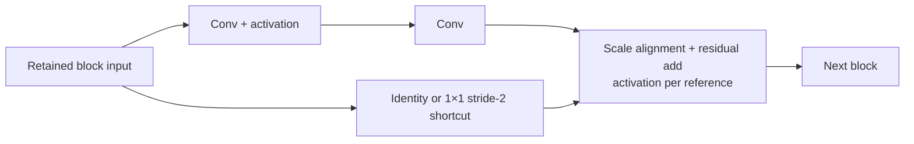

# Technical reference and evidence map

Snapshot: October 21, 2026. Use the [walkthrough](MEETING_WALKTHROUGH.md) for presentation. These documents describe existing results; no new simulation or FPGA build was run for this onboarding task.

## Software foundation

| Files | Purpose |
|---|---|
| [run_resnet.py](../run_resnet.py), [prepare_resnet.py](../prepare_resnet.py) | FP32 inference and golden-data preparation |
| [export_model.py](../export_model.py), [verify_resnet.py](../verify_resnet.py) | Quantized export and saved-data verification |
| [integer.py](../resnet8/integer.py), [hardware contract](../resnet8/HARDWARE_CONTRACT.md) | Exact arithmetic and layouts |
| [Architecture](../resnet8/ARCHITECTURE.md) | Frozen layer definitions |
| [Fixture manifest](../fixtures/manifest.json), [fixture validator](../cycle_sim/fixtures.py) | Portable data and hash checking |

FP32 establishes network fidelity. The integer reference defines hardware arithmetic. The cycle model estimates schedules and transport; it does not prove RTL behavior. Integer equality and classification accuracy are separate checks.

Operands are signed INT8, zero point zero. Folded bias and accumulation are INT32; hardware overflow wraps. Requantization uses positive per-channel multipliers/shifts, signed INT64 products, and nearest rounding with ties away from zero. Conv0 applies ReLU and saturates to 0..127. Activations use HWC order; weights use OHWI. BatchNorm folding incorporates trained normalization into convolution parameters.

Conv0 payloads are 3,072 input bytes, 702 weight bytes, 104 bias bytes, 208 quantization bytes, and 26,624 output bytes. Its 718,848 MAC terms include padding.

## Architecture history

| Design | Evidence and lesson |
|---|---|
| 27,648 MAC units | Earlier synthesis approximately 2.916M LUTs, 850k FFs, zero DSPs; infeasible despite synthetic simulation passing |
| Serial DSP design | Earlier user-run simulation passed 79,872 comparisons over three frames; millions of cycles per full frame |
| 416 MACs | Earlier simulation passed 133,120 comparisons over five frames; 8,583 no-stall cycles excluding preload; synthesis used 832 DSPs, 12,121 LUTs, 14,337 FFs, 16 BRAM36 |
| Current 832 MACs | Separate DSP multiplication/fabric accumulation achieved one DSP per MAC; concrete DMA system now routed |

Older testbench logs reported Python fixture checks skipped; they do not validate the new RTL. Interfaces and coverage differ, so historical cycle counts are not interchangeable application benchmarks.

The [AXI INT8 study](../cycle_sim/AXI_INT8_STUDY.md) explored 540 configurations and 24 sensitivity cases on one saved image. The selection assumed 100 MHz and 2 GB/s. Estimated resources including reserves were 896 DSPs, 107,531 LUTs, 94,467 FFs and 140 BRAM36, distinct from actual routed counts. Lower modeled bandwidth favored smaller engines. A 52-output-lane fallback is documented, not demonstrated as the board winner.

## Current source map

Files are under [rtl/kv260_conv0](../rtl/kv260_conv0/README.md).

| File | Responsibility |
|---|---|
| [mac_int8_mixed.sv](../rtl/kv260_conv0/src/mac_int8_mixed.sv) | DSP multiplication separated from fabric accumulation |
| [conv0_832_core.sv](../rtl/kv260_conv0/src/conv0_832_core.sv) | Row scheduling, operand delivery and MAC array |
| [conv0_requant.sv](../rtl/kv260_conv0/src/conv0_requant.sv) | 104 scaling/output lanes |
| [conv0_quant_pkg.sv](../rtl/kv260_conv0/src/conv0_quant_pkg.sv) | Fixed pretrained Conv0 constants |
| [conv0_result_fifo.sv](../rtl/kv260_conv0/src/conv0_result_fifo.sv) | 2 KB banked output FIFO |
| [conv0_axi_top.sv](../rtl/kv260_conv0/src/conv0_axi_top.sv) | Stream loading, AXI-Lite and control |
| [conv0_axi_bd.v](../rtl/kv260_conv0/src/conv0_axi_bd.v) | Plain-Verilog integration wrapper |
| [tb_conv0_axi.sv](../rtl/kv260_conv0/sim/tb_conv0_axi.sv) | Raw/output comparisons and protocol stress |
| [benchmark.c](../rtl/kv260_conv0/cpu/benchmark.c) | A53 DMA/cache/control, correctness and timing |

Input memory has 32 replicas, each with four 192×32-bit banks. Each row needs initialization, 27 issue cycles, two drain cycles and eight accepted groups of 104 results. Backpressure extends completion.

LOAD_KIND selects image/weights/bias/quantization; finish each packet before changing it. START requires all payloads ready. PREPARE retains parameters and invalidates the image. SOFT_RESET invalidates everything. Output is one packet ending in TLAST. Quantization packets verify compiled constants rather than replace them.

Tool repairs included Tcl property parsing, reading simulation logs after close, a Verilog integration wrapper, disabling unused PS masters, accepting actual PS frequency metadata, and short isolated build paths. The UART checker now expects 256 cold loader chunks and 192 warm; these count loader operations, not CPU transfer time.

## Actual evidence on the build machine

Selected reports and logs are archived in this repository; generated Vivado projects and board binaries remain local. See the archive README for provenance limitations.

| Evidence | File |
|---|---|
| Full suite/component synthesis | validation_synth.log (detailed file retained locally) |
| Additional two-frame wrapper run | sim_initial.log (detailed file retained locally) |
| Routed resources | [utilization_route.rpt](../reports/vivado_2026_10_19/integrated/utilization_route.rpt) |
| Routed timing | [timing_route.rpt](../reports/vivado_2026_10_19/integrated/timing_route.rpt) |
| Clock crossings | [cdc.rpt](../reports/vivado_2026_10_19/integrated/cdc.rpt) |
| Retained warnings | [drc.rpt](../reports/vivado_2026_10_19/integrated/drc.rpt) |
| Successful managed export | export.log (detailed file retained locally) |

The 30-frame suite used the direct top; a subsequent two-frame baseline used the wrapper. Do not call it a full wrapper regression. Coverage includes zero/signed inputs, positive/negative overflow, stalls, malformed packets, reset recovery and incorrect quantization. It does not establish DMA/DDR board integration or every possible input/interleaving.

DRC warnings include DSP pipeline recommendations, packing, vendor DMA FIFO collision advisories and no-load reset nets. No errors/critical warnings appeared in the rule summary. Review rather than blanket-waive them.

Artifacts are `.vivado/kv260_20261019_040420/conv0_kv260.bit` and `conv0_kv260.xsa` at repository root. XSA defines the Vitis hardware platform; bitstream configures PL; a separately built ELF executes on the A53. Generated clocks are approximately 99.999001/199.998001 MHz, nominally 100/200 MHz.

## Remaining full-network hardware

| Required work | Why Conv0 is insufficient |
|---|---|
| Channel tiling/layer scheduling | Later 3×3 layers reduce over 26/52/104 input channels |
| Stride/shape support | Stride-2 SAME here uses top/left padding 0 and bottom/right 1 |
| Shortcut convolution | Blocks 2/3 require 1×1 stride-2 projections |
| Residual storage/addition | Preserve source until both branches finish and align scales |
| Layer-dependent quantization | Choose selectable compiled constants or runtime scaling and reassess resources |
| Signed intermediates | Do not apply Conv0 ReLU unconditionally before every residual add |
| Pooling and dense 104→10 | Match integer rounding/scaling |
| Network control/loading | Sequence layers/buffers without unnecessary CPU transfers |
| End-to-end verification | Check tensors, logits, classification accuracy and latency separately |

Full-network convolution/dense work is 32,562,192 MAC terms; parameters occupy 203,190 weight bytes, 2,224 bias bytes and 4,504 quantization bytes. A three-buffer largest-feature-map sketch needs 79,872 logical bytes excluding banking, replication and accumulators. Current input replication represents 98,304 logical bytes; extending that directly to later layers is unsuitable.

[Network analysis](../reports/meeting_2026_10_20/ANALYSIS.md) estimates 442,586 activation-transfer bytes with DDR between every operation, versus a hypothetical 3,082 external activation bytes if intermediates stay on chip. Neither full-network implementation exists. Capacity alone does not establish memory-port bandwidth.

Recommended order: board correctness → measured latency → reusable convolution/buffers → one residual block → remaining blocks/pool/dense. A 1,600-MAC redesign is not a deployment prerequisite.

## Deployment and automation

Read [deployment guide](../rtl/kv260_conv0/KV260_BUILD_AND_BENCHMARK.md) sections 5–8 using the actual artifact path above instead of the default `build/` path. The whole-request timer includes copies, caches, DMA/control setup, polling and computation/transfers; comparison/UART printing are excluded.

Existing automation includes fixture checks, Vivado scripts, testbench comparisons and [UART summarization](../rtl/kv260_conv0/tools/summarize_uart.py). Reproducible Vitis build/launch, capture integration and unified preflight remain work. Record compiler settings, clocks, hashes and full captures; diagnostic timer reads may perturb short requests.

The older semester schedule (detailed file retained locally) contains MNIST examples and placeholder dates; reconcile it with actual scope and availability.
